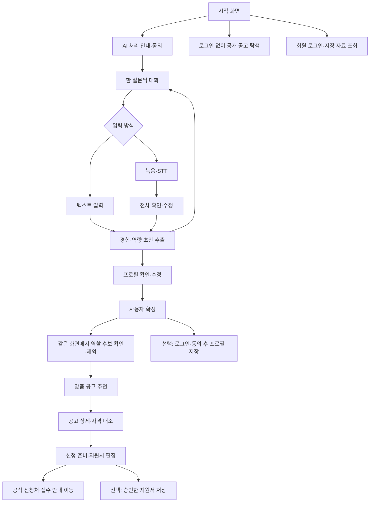

# 다시잇다 — 01. UX Flow

기준일: 2026-10-13 · 버전: v1.1 · 상태: 사용자 승인 설계 명세(EC2 로컬 추론 반영)

관련 문서: [Data Design](02_Data_Design.md) · [Architecture & Dependencies](03_Architecture_and_Dependencies.md) · [Functional Specification](04_Functional_Specification.md) · [Engineering Constraints](05_Engineering_Constraints.md)

이 문서는 개발 기준이다. 구현·외부 연동·사용자 검증의 완료를 의미하지 않는다.
> **한눈에 보기**
> - 비회원도 대화와 음성 입력으로 경험을 정리하고, 프로필을 직접 확정한 뒤 실제 공고를 비교해 신청을 준비하는 사용자 여정을 정의합니다.
> - AI가 만든 초안은 사용자가 확인·확정하기 전까지 추천이나 자격 판단에 쓰지 않으며, 회원 저장은 별도 로그인과 동의가 있을 때만 이뤄집니다.
> - 화면별 목적, 주요 분기, 실패·재진입 동작을 확인할 때 참고하세요. 이 문서는 UX 개발 기준이며 구현·연동 완료를 뜻하지 않습니다.

## 1. 서비스 범위

시니어가 경험을 설명하고, 역량을 확인하고, 실제 공고를 비교한 뒤 신청을 준비하도록 지원한다.

비회원도 전체 여정을 이용한다. 회원은 별도 저장 동의 후 **사용자가 승인한 프로필과 지원서 초안**을 저장한다. 기관 계정·기관 신청접수·자동 제출은 제공하지 않는다. 공고는 팀 운영자가 관리한다.

지원 환경은 Android Chrome, iPhone Safari, PC Chrome이다. 스마트폰을 우선 설계하고 PC에서도 같은 기능을 제공한다.

## 2. 전체 흐름

## 3. 화면 명세

| ID | 화면·목적 | 주요 행동과 시스템 반응 | 성공 조건 |
|---|---|---|---|
| UX01 | 시작 | 소개, 체험 시작, 카카오 로그인, 공개 공고 탐색 | 다음 행동을 선택할 수 있다 |
| UX02 | AI 처리 안내 | 처리 목적·EC2 자체 AI 처리·AWS 저장 위치·보관·삭제 안내, 동의 | 동의 후 대화가 시작된다 |
| UX03 | 대화 | AI가 한 질문씩 제시. 텍스트·녹음·초안 확인 제공 | 답변 처리 후 다음 질문 또는 확인 화면으로 이동한다 |
| UX04 | 전사 확인 | STT 결과 수정·보내기·취소 | 확인한 텍스트만 프로필 추출에 사용한다 |
| UX05 | 프로필·역할 확인 | 초안 수정·삭제·확정. 확정 후 역할 후보·근거·제외 제공 | 최소 프로필을 확정하고 추천으로 이동한다 |
| UX06 | 추천 목록 | 공고 카드, 필터, 추천 근거, 확인 필요 조건 | 관심 공고를 선택한다 |
| UX07 | 공고 상세 | 쉬운 설명·원문·조건·자격 대조·접수방법·오류 신고 | 신청 방법과 확인할 조건을 이해한다 |
| UX08 | 신청 준비 | 서류·절차 확인, 초안 생성·직접 작성·수정·승인·복사 | 준비 내용을 확인하고 공식 안내로 이동한다 |
| UX09 | 내 정보 | 저장 프로필·지원서 조회·수정·삭제, 동의 철회·탈퇴 | 자신의 저장 자료를 관리한다 |
| UX10 | 운영자 | 공고 등록·검수·정정·종료, 신고·수집 상태 확인 | 검수한 유효 공고만 공개한다 |

## 4. 주요 분기

### 대화와 확정

- 텍스트·음성 인식·읽어주기는 서비스의 AWS EC2 안에서 자체 모델로 처리한다. 사용자의 기기 내 처리로 설명하지 않는다. AWS 호스팅·RDS 저장·리전과 카카오 인증·공고 조회의 실제 처리 경계는 안내에 구분한다.
- 사용자는 언제든 초안 확인으로 이동한다.
- 추천 시작에는 경험 1개 이상, 희망 활동 지역, 활동 유형의 사용자 확정이 필요하다.
- 활동 유형은 취업·공공일자리와 봉사이며 둘 다 선택할 수 있다.
- 시간·거주 자격·연령·자격증 등은 필요한 때 점진적으로 질문한다.
- 모르는 정보는 입력을 강요하지 않고 `확인 필요`로 처리한다.
- 역할 후보는 초안으로 생성하지 않는다. 프로필 확정 후 같은 화면에 표시한다.
- 역할 제외는 현재 추천의 필터로 처리하며 프로필 사실을 변경하지 않는다.

### 프로필 수정

- 수정 내용은 새 초안이다. 이전 확정본은 재확정 전까지 유지한다.
- 수정 중 기존 추천에는 `이전 확정 프로필 기준`을 표시한다.
- 재확정하면 추천·자격 결과를 갱신한다.
- 기존 지원서 내용은 자동 변경하지 않고 `프로필 변경으로 재검토 필요`를 표시한다.

### 회원 저장

- 확정과 영구 저장을 별도 행동으로 제공한다.
- 비회원이 저장을 선택하면 카카오 로그인과 저장 동의를 진행한다.
- 로그인 왕복에 필요한 승인 자료만 일회성 저장 절차로 전달한다.
- 기존 회원 프로필이 있으면 교체 여부를 확인하고 새 버전으로 저장한다.
- 로그인 취소·실패 시 영구 저장하지 않는다.
- 회원도 수정 중인 프로필·지원서를 자동 저장하지 않는다.

### 종료와 재진입

- 비회원 재진입·새로고침은 새로 시작한다.
- 대화·초안·준비 체크 상태를 브라우저 영구 저장소에 남기지 않는다.
- 모든 체험 화면에 `종료하고 삭제`를 제공한다.
- 브라우저 종료 감지는 삭제 보장의 수단으로 사용하지 않는다. 서버 만료도 적용한다.
- 회원 재진입 시 저장 자료는 조회할 수 있지만 이전 대화와 준비 체크 상태는 복원하지 않는다.

### 추천과 신청

- 추천이 없으면 필수조건을 자동 완화하지 않는다.
- 사용자가 선택 필터를 변경하거나 프로필을 보완하도록 안내한다.
- 모집 종료·비공개·재검수 공고는 새 추천과 지원서 생성에서 제외한다.
- 온라인 신청은 공식 신청 페이지, 전화·방문·이메일은 공식 접수 안내 페이지로 연결한다.
- 외부 페이지 이동을 신청 완료로 표시하지 않는다.

## 5. 오류·접근성

- 마이크 권한 거부·녹음 실패: 텍스트 입력으로 전환.
- STT 실패: 재녹음 또는 직접 입력. 실패한 음성도 정리.
- AI 실패: 이전 입력을 유지하고 재시도·직접 수정 제공.
- 로컬 모델 준비 지연·자원 부족: 준비/혼잡 상태를 안내하고 직접 입력·수정·공개 공고 탐색 제공. 외부 AI API로 자동 전환하지 않는다.
- TTS 실패: 표시된 텍스트 유지, 재생 실패 안내.
- 세션 만료: 미저장 자료가 만료됐음을 안내하고 새로 시작.
- 저장 실패: 저장 완료로 표시하지 않고 현재 화면에서 복사·재시도 제공.

기본값은 본문 18px 이상, 주요 조작 영역 44px 이상, 명확한 포커스·레이블·상태 문구다. 색상만으로 상태를 구분하지 않는다. 읽어주기는 버튼으로 재생·중지하며 녹음과 동시에 재생하지 않는다.

## 6. 기능·검증 연결

| UX | 기능 명세 | 검증 시나리오 |
|---|---|---|
| UX01~02 | F01, F09 | AI 미동의, 비회원 시작, 로그인 취소, 공개 공고 탐색 |
| UX03~04 | F02, F11 | 텍스트·음성 전환, 전사 수정·취소, 권한 거부, 음성 정리 |
| UX05 | F03, F04, F09 | 최소 항목 누락, 미확정 차단, 재확정, 역할 제외, 선택적 저장 |
| UX06~07 | F05~F07, F10 | 빈 결과, 미충족 제외, 확인 필요, 공고 마감·변경·신고 |
| UX08 | F08, F09, F11 | 직접 작성, 사실 확인, 복사, 저장 실패, 외부 이동 |
| UX09 | F03, F09 | 자기 자료 접근, 재확정, 삭제·철회·탈퇴 |
| UX10 | F05, F10 | 일반 사용자 차단, MFA, 검수·정정·종료·감사 |

보관·삭제 기준은 [02 §5](02_Data_Design.md#5-상태와-보관), 보안·기기 검증은 [05 §5](05_Engineering_Constraints.md#5-테스트와-완료-기준)를 따른다.
