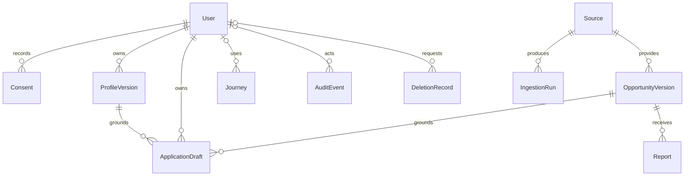

# 다시잇다 — 02. Data Design

기준일: 2026-10-15 · 버전: v1.2 · 상태: 사용자 승인 설계 명세(EC2 로컬 추론 반영)

> **v1.2 변경 (2026-10-15, W01-02):** API 계약 확정에 따라 공고 설명·변경 대기 필드, Requirement 연산 허용표, 중요 변경 필드 목록을 더하고, 선택 항목을 생략하지 않고 `null`로 보내도록 바꿨다. 세부 형식과 결정 이유는 [API 계약](../docs/api/README.md)을 따른다.

관련 문서: [UX Flow](01_UX_Flow.md) · [Architecture & Dependencies](03_Architecture_and_Dependencies.md) · [Functional Specification](04_Functional_Specification.md) · [Engineering Constraints](05_Engineering_Constraints.md)

이 문서는 데이터 계약과 보관 정책이다. 실제 데이터 확보·DB 구현·검증의 완료를 의미하지 않는다.

> **한눈에 보기**
> - 사용자·동의·체험·확정 프로필·공고·지원서 등 서비스 데이터의 구조와 서로의 관계를 정의합니다.
> - 프로필·공고 필드 계약, 상태·버전 구분, 임시 자료와 영구 자료의 보관·삭제 규칙을 확인할 수 있습니다.
> - API와 DB를 설계하거나 변경할 때 기준으로 삼으세요. 문서의 계약은 실제 DB 구현·데이터 확보·검증 완료를 의미하지 않습니다.

## 1. 핵심 엔터티

| 엔터티 | 책임·관계 |
|---|---|
| User | 카카오 식별 연결, 일반 사용자·운영자 권한, 계정 상태 |
| Consent | 사용자·처리 목적·안내문 버전·동의/철회 시각 |
| Journey | 현재 체험의 대화·초안·확정본·추천·준비 상태. Redis 임시 보관 |
| ProfileVersion | 회원이 저장한 불변 확정 프로필. 사용자별 버전 관리 |
| RoleDefinition | 역할명·설명·역량 태그·경험 연결 기준 |
| Source | 수집 출처·고정 통신 대상·이용 조건·수집 설정 |
| IngestionRun | 수집 시작·성공·실패·최종 성공 시각과 처리 건수 |
| OpportunityVersion | 공고 원문 근거·표준 필드·모집·검수 상태 |
| ApplicationDraft | 회원이 승인·저장한 지원서와 근거 버전 |
| Report | 공고 오류 유형·대상·처리 상태 |
| AuditEvent | 운영자·보안 관련 행위의 최소 메타데이터 |
| DeletionRecord | 삭제 처리·백업 복구 시 재적용에 필요한 최소 기록 |

개인 프로필·지원서 본문은 암호화한다. 운영 영구 데이터는 EC2 밖의 Amazon RDS PostgreSQL, 체험·세션·제한 집계는 EC2의 Redis에 보관한다. 공개 공고는 검색 가능한 구조로 저장한다. 기관명은 공고 속성이며 기관 계정 엔터티는 만들지 않는다.



위 관계는 논리 관계다. Journey는 Redis의 임시 데이터이며 PostgreSQL 외래키로 연결하지 않는다. 삭제 후 감사·삭제 기록은 원문을 포함하지 않는 최소 식별값만 남긴다.

## 2. 프로필 계약

| 필드 | 타입 | 필수 | 의미 |
|---|---|---:|---|
| `schema_version` | integer | O | 프로필 계약 버전 |
| `experiences` | Experience[] | O | 사용자가 확인할 경험 목록. 추천 시 1개 이상 |
| `skills` | string[] | O | 확인할 역량 태그. 비어 있을 수 있음 |
| `preferred_regions` | Region[] | O | 희망 활동 지역. 추천 시 1개 이상 |
| `activity_types` | enum[] | O | `employment`, `volunteering`. 추천 시 1개 이상 |
| `paid_preference` | enum / null | X | `paid`, `unpaid`, `any` 또는 미확인 `null` |
| `available_weekdays` | integer[] / null | X | 가능한 요일. 1~7 |
| `hours_per_week` | number / null | X | 희망·가능한 주당 활동 시간 |
| `mobility_note` | string / null | X | 이동 가능 범위에 대한 사용자 확인 설명 |
| `residence_region` | Region / null | X | 거주 자격 대조용 지역. 희망 활동 지역과 구분 |
| `birth_year` | integer / null | X | 공고 연령 대조에 필요한 경우 수집 |
| `certifications` | string[] / null | X | 사용자 확인 자격증 |
| `completed_courses` | string[] / null | X | 사용자 확인 교육 이수 |
| `activity_constraints` | string[] / null | X | 활동 수행 조건. 진단명·상세 병력 수집 금지 |
| `version` | integer | 확정본 | 확정 프로필 버전 |
| `confirmed_at` | datetime | 확정본 | 사용자 확정 시각 |

`Experience`:

| 필드 | 타입 | 의미 |
|---|---|---|
| `id` | UUID | 서버가 부여한 경험 식별자 |
| `description` | string | 실제 수행 경험에 대한 설명 |
| `skill_tags` | string[] | 해당 경험과 연결한 역량 |
| `duration_note` | string / null | 사용자가 설명한 기간. 불명확하면 추정하지 않음 |

`Region`:

| 필드 | 타입 | 필수 | 의미 |
|---|---|---:|---|
| `province` | enum | O | `seoul`, `gyeonggi`, `incheon` |
| `district` | string / null | X | 서버 지역 목록의 시·군·구 식별값. `null`이면 해당 시·도 전체 |

시·도는 서울·경기·인천을 지원하고 시·군·구는 서버의 지역 목록으로 검증한다. 외부 출처의 지역코드는 별도 매핑하고 미확인 매핑을 자동 확정하지 않는다.

`null`은 미확인, 빈 배열은 사용자가 없다고 확인한 상태로 구분한다. 예외로 추천에 1개 이상 필요하고 `null`을 허용하지 않는 `experiences`·`preferred_regions`·`activity_types`의 빈 배열은 "아직 입력하지 않음"이며, 추천 전에 `missing_for_recommendation`으로 다시 묻는다(v1.2). 초안에는 현재 대화의 근거 참조를 붙이며 영구 확정본에 대화 원문을 복제하지 않는다. 요청에서는 선택 항목도 키를 보내고 값을 `null`로 둔다. 키를 빠뜨리면 입력 오류로 거절한다(v1.2).

프로필 상태는 자료형과 별도로 서버가 관리한다. AI나 클라이언트가 보낸 `confirmed_at`, 확정 여부, 소유자를 신뢰하지 않는다. 시각은 시간대가 있는 UTC로 저장하고 사용자에게 한국시간으로 표시한다.

## 3. 공고 계약

| 필드 | 타입 | 공개 필수 | 의미 |
|---|---|---:|---|
| `id`, `version` | UUID, integer | O | 내부 공고와 버전 |
| `source_id` | UUID | O | 출처 |
| `external_id` | string / null | 출처별 | 출처 고유 ID |
| `title` | string | O | 공고 제목 |
| `organization_name` | string | O | 모집 기관 |
| `activity_type` | enum | O | `employment`, `volunteering` |
| `is_public_job` | boolean / null | X | 공공일자리 여부 |
| `role_tags`, `skill_tags` | string[] | O | 운영자가 확인한 역할·역량. 빈 값 가능. `role_tags`는 역할 사전(RoleDefinition)의 키 |
| `activity_region` | Region / null | 조건부 | 활동 지역. 원격 공고는 별도 표시 |
| `location_text` | string / null | X | 공식 장소 설명 |
| `remote_allowed` | boolean / null | X | 원격 활동 가능 여부 |
| `schedule_text` | string / null | X | 공식 활동 일정 |
| `hours_per_week` | number / null | X | 명시된 주당 시간 |
| `paid` | boolean / null | X | 보수 여부 |
| `compensation_text` | string / null | X | 원문 보수 설명 |
| `description_text` | string / null | X | 공식 원문 설명(일반 텍스트, 최대 5,000자). 검색 계산·상세 표시에 쓰고 검수 대상. 없으면 만들어 채우지 않음 |
| `description_truncated` | boolean | O | 원문이 5,000자를 넘어 앞부분만 저장했으면 `true` |
| `requirements` | Requirement[] | O | 정규화한 조건. 빈 값과 미해석 조건 구분 |
| `required_documents` | string[] / null | X | 공식 제출 서류 |
| `application_method` | enum | O | `online`, `phone`, `visit`, `email`, `mixed` |
| `application_instructions` | string | O | 접수 방법과 절차 |
| `source_url` | HTTPS URL | O | 확인한 공식 원문 |
| `application_url` | HTTPS URL | O | 공식 신청 또는 접수 안내 페이지 |
| `deadline_date` | date / null | X | 날짜만 제공된 모집 마감 |
| `deadline_at` | datetime / null | X | 정확한 시간이 제공된 마감 |
| `recruitment_status` | enum | O | `open`, `closed`, `unknown` |
| `review_status` | enum | O | `pending`, `approved`, `rejected`, `hidden` |
| `source_checked_at` | datetime | O | 출처 데이터 확인 시각 |
| `reviewed_at` | datetime / null | 승인 시 | 운영자 검수 시각 |
| `content_hash` | string | O | 변경 감지용 해시 |
| `change_pending` | boolean | 응답 | 중요 변경이 검수 대기 중인지. 저장 필드가 아니라 공개 응답에서 계산 |

날짜만 있는 마감은 시간까지 확정된 것처럼 표시하지 않는다. 해당 날짜가 지난 공고는 종료 처리하고 마감 당일의 정확한 시간은 확인 필요로 안내한다. `deadline_at`은 실제 시각이 제공된 경우에만 채우며 날짜와 충돌하면 검수 대기로 둔다.

공개·추천에는 검수 승인, 모집 중, 유효한 출처·공식 접수 경로가 필요하다. 원격이 아닌 공고의 지역을 알 수 없으면 지역 기준 추천에 사용하지 않는다. 같은 공고의 변경은 모두 새 버전으로 관리하고 미검수 변경본을 공개본에 덮어쓰지 않는다. 중요 변경이 검수 대기 중이면 이전 공개본은 조회에 남기되 추천·지원서 생성을 보류한다(§6).

## 4. 조건·추천·지원서 계약

### Requirement

| 필드 | 타입 | 의미 |
|---|---|---|
| `id` | UUID | 조건 식별자 |
| `field` | enum | `age`, `residence_region`, `certification`, `completed_course`, `weekday`, `hours_per_week`, `other` |
| `operator` | enum / null | 해당 필드에 허용한 비교 연산. 미해석 조건은 `null` |
| `value` | 필드별 타입 / null | 비교값. 미해석 값은 `null` |
| `group_id` | UUID / null | 명시된 논리 그룹. `null`이면 독립 필수조건 |
| `group_operator` | `and`, `or` / null | 원문에 명시된 그룹 관계 |
| `reference_date` | date / null | 연령 등 판정 기준일 |
| `source_evidence` | string | 원문 조건 문장 |
| `clarity` | `clear`, `needs_review` | 명확 또는 해석 필요 |

필드별 허용 연산과 값:

| `field` | `operator` | `value` |
|---|---|---|
| `age` | `gte`, `lte` | integer(만 나이) |
| `age` | `between` | `[min, max]` integer 2개 |
| `residence_region` | `in` | Region[] |
| `certification`, `completed_course` | `has_all`, `has_any` | string[] |
| `weekday` | `includes_all`, `includes_any` | integer[] (1=월 ~ 7=일) |
| `hours_per_week` | `gte`, `lte` | number |
| `other` | `null` | `null` (`clarity=needs_review`) |

표에 없는 조합은 입력 오류로 거절한다. 알 수 없는 연산·조건·기준일은 통과로 처리하지 않는다. 원문에 필수조건이 없다고 검수한 빈 배열과, 조건을 해석하지 못한 상태를 구분한다. 해석하지 못한 조건은 `field=other`, `clarity=needs_review`와 원문 근거로 보존한다.

독립 필수조건과 논리 그룹은 전체 AND로 평가한다. 그룹 안에서는 지정된 AND/OR를 적용한다. 중첩 구조를 현재 계약으로 표현할 수 없거나 그룹 정의가 충돌하면 임의로 평탄화하지 않고 확인 필요로 둔다.

### EligibilityResult

- 프로필·공고 버전 참조.
- 전체 결과와 조건별 `satisfied`, `not_satisfied`, `unknown`.
- 비교한 사용자 값, 원문 근거, 확인 필요 사유.
- 판정 시각.

### Recommendation

- 프로필·공고 버전 참조와 순위.
- 일치하는 경험 ID·역량·역할 근거.
- 조건별 자격 결과와 확인 필요 사항.
- 내부 정렬 점수. 사용자에게 신청 성공 확률로 표현하지 않음.

### ApplicationDraft

- 소유자, 문서 ID, 문서 버전.
- 근거 프로필·공고 버전.
- 자기소개·지원동기 본문.
- 사용자 승인 시각과 암호화 메타데이터.
- 근거 버전 변경에 따른 재검토 필요 상태.

회원이 편집한 저장 지원서는 임시 편집본으로 처리한다. 새 승인 없이 저장 본문을 덮어쓰지 않는다. 임시 프로필 참조와 회원 저장 프로필 참조를 구분하고 양쪽 모두 서버 소유권 검사를 거친다.

## 5. 상태와 보관

```text
프로필: 초안 → 사용자 확정 → 선택적 회원 저장
        수정 → 새 초안 → 재확정 → 새 버전

공고: 수집/작성 → 검수 대기 → 승인·공개
                    └ 반려
      공개본 중요 변경 → 재검수
      공개 → 모집 종료 / 비공개

지원서: 생성/직접 작성 → 편집 → 사용자 승인 → 선택적 저장
        근거 변경 → 재검토 필요
```

| 데이터 | 기본 보관 정책 |
|---|---|
| 원본 음성 | 영구 저장 없음. 처리 완료·실패·취소 시 정리 |
| 대화·전사·초안·준비 체크 | 유휴 30분·최대 2시간. 종료 시 삭제 |
| 로그인 왕복의 저장 대기 자료 | 승인 자료만 최대 10분, 일회 사용 |
| 저장 프로필·지원서 | 이용기간 동안, 개별 삭제·철회·탈퇴 가능 |
| 일반 운영 로그 | 14일 |
| 보안·운영자 감사 | 30일 |
| 암호화 백업 | 7일 순환 |
| 최소 삭제 이력 | 30일 |

TTL·보관기간은 프로젝트 기본값이다. 텍스트·STT·TTS는 EC2 자체 모델로 처리하고 입력을 외부 AI 추론 서비스에 보내지 않는다. 로컬 추론이라는 이유로 EC2 디스크·컨테이너 로그·RDS·스냅샷의 보관이 자동으로 없어지는 것은 아니므로 서비스와 AWS 저장·백업의 삭제 경계를 구분한다.

원본 음성은 늦어도 프로필 초안 추출 직후 삭제한다. 전사 후 후속 처리에 필요하지 않은 서버 음성 버퍼는 먼저 정리한다. 전사 취소·추출 실패·종료에서도 잔여 음성 버퍼·임시 파일·브라우저 객체 참조를 정리하며 Redis·DB·로그·백업으로 복제하지 않는다.

STT 입력·TTS 생성 음성의 서버 임시 처리는 메모리 또는 tmpfs에 제한한다. 모델 가중치용 영구 볼륨에 음성·대화·프로필을 쓰지 않는다. 학습·화자 복제·프롬프트 디버그 로그·평가 자료로 사용자 음성을 재사용하지 않는다. TTS 응답은 재생·요청 완료 후 임시 버퍼를 정리하고 개인정보가 포함될 수 있는 음성의 영구 캐시를 만들지 않는다.

체험 생성 시각 기준 최대 수명 2시간은 활동으로 연장하지 않는다. 유휴 30분은 실제 사용자 행동으로만 갱신하고 자동 조회·상태 갱신은 연장하지 않는다. 종료·만료·동의 철회 후 늦게 완료된 작업의 결과도 폐기한다.

프로필 삭제는 모든 저장 버전과 해당 프로필에서 파생한 지원서를 포함한다. 탈퇴는 세션·체험·계정 연결·동의·저장 자료에 적용한다. 보안상 필요한 최소 감사·삭제 기록은 위 보관기간을 따르고 원문을 남기지 않는다. 복구 시 최신 삭제 이력을 재적용한 뒤 서비스를 공개한다.

## 6. 수집·갱신·데이터 계약 관리

- 원본 공개 자료에서 출처·식별·조건·모집 상태의 근거를 보존한다. 원문에 없는 값을 LLM이나 기본값으로 사실처럼 채우지 않는다.
- `(source_id, external_id)`로 같은 출처 중복을 방지한다. 고유 ID가 없는 수동 자료는 공식 URL·기관·제목·모집기간을 대조하고 출처 간 유사 공고는 자동 병합하지 않는다.
- 정상 수집의 확인 시각과 운영자 검수 시각을 구분한다. 수집 실패·일시 누락을 모집 종료로 해석하지 않는다.
- 수집·운영자 수정으로 생긴 변경은 모두 새 `pending` 버전이다. 승인 전까지 이전 공개본을 보여 준다.
- 중요 변경 필드: `activity_type`, `requirements`, `activity_region`, `remote_allowed`, `schedule_text`, `hours_per_week`, `deadline_date`, `deadline_at`, `application_method`, `application_url`, `application_instructions`, `required_documents`, `paid`, `source_url`, `recruitment_status`(`closed`→`open`, `open`→`unknown`). 이 필드가 바뀌면 승인 전까지 이전 공개본의 추천·지원서 생성을 보류한다.
- 모집 종료·마감 경과처럼 추천에서 빼는 방향의 변경은 검수 없이 바로 반영한다. `source_checked_at` 갱신만으로는 새 버전을 만들지 않는다.
- API 제공 필드·승인·실제 응답과 로컬 모델 검증의 미확인은 [05 §4](05_Engineering_Constraints.md#4-연동로컬-추론-검증-조건)에 유지한다.
- API와 프론트엔드 타입은 이 계약을 함께 사용한다. 변경은 `schema_version`, 영향받는 API·기능·시험을 함께 검토한다.
