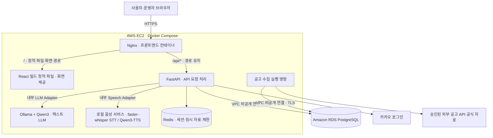

# 다시잇다 — 03. Architecture & Dependencies

기준일: 2026-10-13 · 버전: v1.1 · 상태: 사용자 승인 설계 명세(EC2 로컬 추론 반영)

관련 문서: [UX Flow](01_UX_Flow.md) · [Data Design](02_Data_Design.md) · [Functional Specification](04_Functional_Specification.md) · [Engineering Constraints](05_Engineering_Constraints.md)

이 문서는 구성·의존성·인터페이스의 개발 기준이다. 계정·배포 환경·실제 API 연동의 완료를 의미하지 않는다.

> **한눈에 보기**
> - EC2의 Nginx·React·FastAPI·Redis·로컬 LLM/STT/TTS와 별도 Amazon RDS PostgreSQL로 구성하는 시스템 경계를 설명합니다.
> - 컴포넌트 책임, API·저장소·외부 연동 경로, 모델 후보와 인터페이스 및 운영 네트워크 원칙을 확인할 수 있습니다.
> - 개발 환경과 배포·연동 작업의 구조 기준으로 활용하세요. 계정·인프라 준비, 모델 실행, 실제 API 연동은 아직 별도 검증 대상입니다.

## 1. 시스템 구성

모듈형 모놀리스는 하나의 백엔드 안에서 기능별 책임을 나누는 구조다. 이 프로젝트는 단일 FastAPI 서비스를 사용한다. 사용자 지정 구조에 따라 AWS EC2에서 Docker Compose로 웹·백엔드·로컬 모델을 실행하고, PostgreSQL은 EC2 밖의 Amazon RDS로 연결한다.

여기서 **로컬 처리**는 사용자의 PC가 아닌 서비스의 EC2 안에서 자체 모델로 추론한다는 뜻이다. 텍스트·STT·TTS의 입력을 외부 AI 추론 API로 전달하지 않는다. AWS 호스팅·RDS 저장·카카오 인증·공고 API 통신은 별도 경계이며 로컬 AI라는 이유로 모든 데이터가 사용자 기기 안에만 있다고 안내하지 않는다.



| 구성 | 선택·책임 |
|---|---|
| 프론트엔드 | React·TypeScript·Vite로 빌드한 정적 파일을 EC2의 Nginx 프론트엔드 컨테이너에서 제공 |
| 백엔드 | Python 3.12·FastAPI·Pydantic·SQLAlchemy |
| DB 변경 | Alembic 마이그레이션 |
| 영구 데이터 | 운영은 EC2 밖의 Amazon RDS PostgreSQL. 승인 자료는 암호화한 본문과 메타데이터 저장 |
| 임시 데이터 | Redis. 세션·체험·제한 집계·중복 요청 제어 |
| 텍스트 LLM | EC2의 Ollama + Qwen3. 로컬 LLM Adapter와 모델명·시간·자원 제한을 설정으로 분리 |
| STT | EC2의 faster-whisper 로컬 추론. 한국어 다국어 모델을 사용하고 전사를 사용자가 확인 |
| TTS | EC2의 Qwen3-TTS 로컬 추론. 한국어 기본 화자 음성으로 표시 내용을 읽어줌 |
| 배포 | Linux EC2·Docker Compose·Nginx·HTTPS, 별도 RDS. 인스턴스·GPU·메모리 사양은 실측 후 확정 |
| 초기 검색 | 조건 필터·역할/역량 태그·키워드 매칭 |

Redis에는 개인정보 임시 데이터의 RDB·AOF 영속화를 적용하지 않는다. 별도 문서 파일 저장소·상시 AI 작업 큐·pgvector·지역 Orchestrator는 초기 구성에 포함하지 않는다.

### 1.1 Nginx·네트워크·RDS 경계

- `/`와 화면·정적 파일 경로는 Nginx가 React 빌드 산출물을 제공한다. 운영에서는 별도 Vite 개발 서버를 공개하지 않는다.
- `/api/*`는 FastAPI로 전달한다. FastAPI의 `/api/v1` 계약이 유지되도록 `/api` 접두사를 제거하지 않는다.
- Ollama와 음성 서비스는 Compose 내부에서 FastAPI가 호출한다. 호스트 공개 포트·Nginx 프록시·공개 모델 관리 API를 만들지 않는다. Redis도 내부 연결만 허용한다.
- RDS는 운영 Compose의 PostgreSQL 컨테이너가 아니다. 동일 VPC의 비공개 접근을 기본으로 하고 인터넷 공개 접근을 비활성화한다. DB 보안 그룹은 필요한 EC2 연결만 허용한다.
- RDS 연결은 CA와 호스트명을 검증하는 TLS(`sslmode=verify-full` 또는 드라이버의 동등 설정)를 사용한다. 암호문 저장·사용자 소유권 검사는 RDS를 사용해도 응용 서버에서 수행한다.
- 로컬 개발·시험에서는 Compose PostgreSQL을 사용할 수 있지만 운영은 RDS 연결 설정을 사용한다. 데이터 계약·Alembic 마이그레이션은 동일하게 적용한다.

### 1.2 텍스트·음성 로컬 추론 계약

| 처리 | 런타임·모델 | 첫 검증 후보·확정 조건 |
|---|---|---|
| 대화·프로필 추출·지원서 | Ollama + Qwen3 | `qwen3:4b`를 첫 후보로 시험. 한국어·JSON 계약·지연을 평가한 뒤 태그·모델 digest 고정 |
| 음성 인식 | faster-whisper | 다국어 `small`을 첫 후보로 시험. 한국어 경험·지역·자격 표현과 90초 입력을 평가한 뒤 모델 revision·연산 정밀도 고정 |
| 읽어주기 | Qwen3-TTS | `Qwen/Qwen3-TTS-12Hz-0.6B-CustomVoice`, 한국어·Sohee 화자를 첫 후보로 시험. 발음·문장 일치·지연을 평가한 뒤 revision 고정 |

후보 선택은 실행 성공·품질·필요 메모리가 검증됐다는 의미가 아니다. GPU 기반 EC2를 권장 검증 대상으로 두되, CPU·GPU·RAM·VRAM 용량과 처리량을 추측하지 않는다. 모델 파일 크기만으로 런타임 메모리를 산정하지 않는다.

- FastAPI의 LLM Adapter는 고정된 내부 Ollama 주소의 `/api/chat`을 호출한다. `format`에 공통 Pydantic 모델의 JSON Schema를 전달하고 `stream=false`로 최종 결과를 받은 뒤 Pydantic과 근거 참조를 다시 검증한다.
- Qwen3의 thinking 설정을 `/api/show`로 확인한다. 해당 모델이 허용하면 구조화 추출의 초기값은 `think=false`, `temperature=0`으로 두고 검증한다. 추론 과정은 프로필·화면·로그에 저장하지 않고 `message.content`만 사용한다.
- Ollama Cloud는 `OLLAMA_NO_CLOUD=1`로 비활성화하고 로컬 모델만 사용한다. 외부 AI 추론 서비스로 자동 전환하지 않는다.
- STT·TTS는 텍스트 Qwen3나 Ollama만으로 제공되지 않는다. 별도 음성 서비스 컨테이너에서 faster-whisper와 Qwen3-TTS를 실행하고 FastAPI의 Speech Adapter가 호출한다.
- TTS는 고정된 기본 한국어 화자를 사용한다. 사용자 원본 음성을 화자 복제·학습·평가 자료로 보관하지 않는다.
- 모델 다운로드는 준비 단계에서 허용된 원본 저장소로 수행한다. 운영 추론은 로컬 가중치를 사용하고 원본 음성·대화·프로필을 모델 다운로드·원격 추론 요청에 포함하지 않는다.
- 기본 처리 흐름은 브라우저 녹음 → FastAPI → 로컬 STT → 전사 확인 → 로컬 Qwen3 추출이다. 읽어주기는 FastAPI → 로컬 TTS → 브라우저 재생이다. 서버·브라우저의 음성 정리는 [02 §5](02_Data_Design.md#5-상태와-보관)를 따른다.
- 준비 상태는 모델 적재·RDS·Redis의 상태로 확인한다. 모델 다운로드·적재는 사용자 요청 밖에서 수행한다. 모델 장애·메모리 부족은 503, 자원 슬롯 부족은 429로 응답하며 사용자에게 직접 입력·편집·공고 탐색을 제공한다.

공식 기술 근거와 하드웨어·품질 검증은 [05 §4](05_Engineering_Constraints.md#4-연동로컬-추론-검증-조건)를 따른다.

## 2. 모듈 책임과 의존성

| 모듈 | 책임 |
|---|---|
| Auth | 카카오 인증, 내부 세션, 운영자 MFA |
| Consent | AI 처리·저장 동의와 철회 |
| Journey/Profile | 임시 체험, 초안, 사용자 확정, 저장 버전 |
| AI/Speech | 내부 Ollama 텍스트 추론, 로컬 STT·TTS 호출과 응답 검증·공유 자원 제어 |
| Opportunity/Ingestion | 출처 Adapter, 정규화·중복·변경·모집 상태 |
| Recommendation | 공개 후보 필터, 역량 연결, 랭킹·추천 근거 |
| Eligibility | 원문 조건과 확정 정보의 규칙 대조 |
| Application | 준비 안내, 초안 편집·승인·저장·삭제 |
| Administration | 검수·정정·신고·수집 상태·감사 |
| Security/Operations | 암호화·제한·오류·삭제·백업·상태 확인 |

허용 의존성은 `API → 서비스 → 저장소/로컬 추론·외부 연동 Adapter`다.

- 브라우저는 RDS·Redis·Ollama·음성 서비스에 직접 접근하지 않는다. 모든 개인정보·추론 요청은 FastAPI의 동의·소유권·제한 검사를 거친다.
- AI Adapter는 계정·권한·검수 상태를 변경하지 않는다.
- 추천 모듈은 자격 결과를 변경하지 않는다.
- 수집 모듈은 사용자 개인정보를 읽지 않는다.
- 운영자 공고 관리 모듈은 개인 프로필·지원서 본문을 읽지 않는다.

## 3. API 계약

스키마는 데이터의 항목과 허용 형식을 정의하는 계약이다. 요청·응답 타입은 [02 Data Design](02_Data_Design.md)을 기준으로 Pydantic·OpenAPI와 프론트엔드 타입에 동일하게 반영한다.

기본 경로: `/api/v1`. 아래 경로는 기본 경로 뒤에 붙인다. GET 입력은 경로·쿼리 파라미터이며 GET 본문을 사용하지 않는다. 변경 요청은 JSON, 전사는 제한된 `multipart/form-data`, TTS 결과는 음성 바이너리다.

| 메서드·경로 | 입력 | 결과 |
|---|---|---|
| `POST /journeys` | AI 동의 버전, 선택적 자기 저장 프로필 참조 | 체험 ID·만료·초기 상태 |
| `DELETE /journeys/{id}` | 없음 | 임시 데이터·처리 결과 폐기 |
| `POST /journeys/{id}/transcriptions` | 제한된 음성 파일·요청 ID | 전사 텍스트·전사 ID |
| `POST /journeys/{id}/messages` | 확인한 텍스트·요청 ID·기준 리비전 | 다음 질문·프로필 초안·주의사항 |
| `GET /journeys/{id}/profile` | 없음 | 현재 초안·확정 상태 |
| `PATCH /journeys/{id}/profile` | 수정 항목·기준 리비전 | 수정한 초안 |
| `POST /journeys/{id}/profile/confirm` | 기준 리비전 | 확정 프로필 참조 |
| `GET /journeys/{id}/roles` | 확정 프로필 버전 쿼리. 생략 시 현재 확정본 | 역할 후보·경험 근거 |
| `PUT /journeys/{id}/role-exclusions` | 제외 역할 ID 목록 | 현재 추천 필터 |
| `POST /recommendations` | 소유한 확정 프로필 참조·필터 | Recommendation[] |
| `GET /opportunities` | 검색·지역·유형·페이지 | 공개 공고 목록 |
| `GET /opportunities/{id}` | 없음 | 최신 공개 공고 |
| `POST /opportunities/{id}/eligibility` | 확정 프로필 참조 | EligibilityResult |
| `GET /opportunities/{id}/preparation` | 없음 | 공식 서류·절차·접수 안내 |
| `POST /journeys/{id}/drafts` | 확정 프로필·공고 버전 참조·요청 ID·작성 방식 | 임시 지원서 초안 |
| `PATCH /journeys/{id}/drafts/{draft_id}` | 수정 본문·기준 리비전 | 수정한 임시 초안 |
| `POST /journeys/{id}/drafts/{draft_id}/approve` | 기준 리비전 | 사용자 승인 상태 |
| `POST /speech` | 서버가 발급한 읽기 대상 참조 | 음성 응답 |
| `GET /auth/kakao/start` | 허용된 로그인 목적·선택적 저장 대기 참조 | 인증 시작 |
| `GET /auth/kakao/callback` | 인가 코드·state | 내부 세션 |
| `POST /auth/logout` | 없음 | 세션 폐기 |
| `GET /me` | 없음 | 계정·권한·동의 상태 |
| `POST /consents` | 목적·안내문 버전 | 동의 기록 |
| `POST /consents/withdraw` | 목적 | 철회·관련 삭제 상태 |
| `GET /profiles/me` | 없음 | 현재 저장 확정본 |
| `POST /profiles/me/versions` | 승인 자료 참조·기준 저장 버전 | 새 저장 버전 |
| `DELETE /profiles/me` | 없음 | 전 버전·파생 지원서 삭제 |
| `GET /drafts` | 페이지 | 자기 저장 지원서 목록 |
| `GET /drafts/{id}` | 없음 | 자기 지원서·재검토 상태 |
| `POST /drafts` | 승인한 임시 지원서 참조·선택적 기존 문서 ID/기준 버전 | 암호화 저장·문서 버전 |
| `DELETE /drafts/{id}` | 없음 | 자기 지원서 삭제 |
| `DELETE /me` | 재인증 확인 | 탈퇴·삭제 상태 |
| `POST /reports` | 공고 ID·오류 유형 | 신고 접수 |
| `POST /admin/mfa/verify` | OTP | MFA 확인 상태 |
| `GET/POST /admin/opportunities` | 목록 조건 / 공고 초안 | 운영자 공고 |
| `PATCH /admin/opportunities/{id}` | 변경 항목·기준 버전 | 검수 대기 변경본 |
| `POST /admin/opportunities/{id}/approve` | 검수 사유·기준 버전 | 승인·공개 |
| `POST /admin/opportunities/{id}/hide` | 사유 | 비공개 |
| `POST /admin/opportunities/{id}/close` | 근거·사유 | 모집 종료 |
| `GET /admin/operations` | 없음 | 수집·장애·제한 상태 |
| `GET /admin/reports` | 상태·페이지 | 신고 목록 |
| `PATCH /admin/reports/{id}` | 처리 상태·사유 | 신고 처리 |
| `GET /admin/audit` | 기간·페이지 | 최소 감사 기록 |

### 3.1 참조·편집·저장 계약

- 체험 ID는 사적 자원 참조이며 인증 수단이 아니다. 서버 세션과 소유권을 함께 확인한다.
- 확정 프로필 참조는 `kind`(`journey`, `saved`), `id`, `version`으로 구분한다. 클라이언트가 프로필 본문을 추천·자격 API에 전달해 확정 검사를 우회할 수 없다.
- 체험 리비전은 현재 편집 상태의 변경 번호, 프로필 버전은 사용자 확정본의 번호다. 요청은 `base_revision` 또는 `base_version`을 사용한다.
- 임시 지원서 작성 방식은 `generate`, `manual`, `from_saved`다. 직접 작성은 AI를 호출하지 않으며 저장 문서 가져오기는 자기 문서만 허용한다.
- 저장 문서 편집은 임시 초안 생성 → 수정 → 재승인 → `POST /drafts` 순서다. 기존 문서 갱신에는 문서 ID와 기준 버전을 검사한다.
- 목록은 `page`(1부터), `page_size`(기본 20, 최대 20)를 사용하고 `items`, `page`, `page_size`, `total`을 반환한다.

### 3.2 로그인 왕복의 일회성 저장

비회원 재진입 복원과 저장을 위한 인증 왕복은 구분한다.

1. 저장 버튼을 누르면 서버가 해당 세션 소유의 승인 자료만 저장 대기 참조로 만든다. 대화 원문·음성·미승인 초안은 전달하지 않는다.
2. 저장 대기 자료는 Redis에 최대 10분 유지하고 OAuth state 및 시작 세션에 연결한다. 자료 본문·세션 자격증명을 URL에 넣지 않는다.
3. 카카오 인증을 검증하고 세션을 교체한 뒤 저장 대상과 동의를 다시 확인한다. 인증 성공만으로 자료를 영구 저장하지 않는다.
4. 저장 완료·취소·만료 후 대기 참조를 폐기한다. 저장 요청은 멱등하게 처리해 네트워크 재전송이 새 버전을 반복 생성하지 않게 한다.

운영자 MFA 등록·복구·최초 권한 부여는 제한된 관리 절차로 구성하고 공개 가입에서 권한을 선택할 수 없게 한다.

## 4. 공통 요청·오류·처리

- 체험·프로필·지원서 참조는 서버에서 소유권을 검사한다.
- 클라이언트가 보낸 `owner_id`, 역할, 검수 상태를 신뢰하지 않는다.
- 변경에는 기준 버전·리비전을 사용한다. 오래된 변경 요청은 409로 거절한다.
- AI 호출은 제한시간 내 요청·응답 방식이다. Ollama·음성 서비스와의 통신은 비동기 I/O로 처리하고 모델의 무거운 연산을 FastAPI 이벤트 루프에서 직접 수행하지 않는다.
- 동일 요청 ID의 재전송은 새 추론을 만들지 않는다. 키는 소유 주체·체험·API별로 구분하며 같은 키에 다른 입력은 409로 거절한다.
- 삭제·만료 후 도착한 응답은 저장하지 않는다.
- TTS는 서버의 접근 가능한 표시 내용을 참조한다. 임의 텍스트를 받아주는 공개 음성 변환 프록시로 만들지 않는다.

오류 응답:

```json
{
  "code": "PROFILE_VERSION_CONFLICT",
  "message": "정보가 변경되었습니다. 최신 내용을 확인해 주세요.",
  "request_id": "서버가 부여한 추적 ID"
}
```

| 상태 코드 | 의미 |
|---|---|
| 401 | 미인증·세션 만료 |
| 403 | 권한·CSRF·MFA 실패 |
| 404 | 없는 자원 또는 접근할 수 없는 사적 자원 |
| 409 | 버전·상태 충돌 |
| 413 | 요청 크기 초과 |
| 422 | 입력 형식·범위 오류 |
| 429 | 호출·동시성 제한 |
| 503 | 외부·내부 서비스 일시 장애 |

원본 입력·SQL·토큰·파일 경로·예외 추적을 사용자 오류 응답에 넣지 않는다. 한도와 시간 제한은 [05 §3](05_Engineering_Constraints.md#3-운영-기본값)를 단일 기준으로 사용한다.

## 5. 개발·배포·소유권

| 담당 | 코드 소유 영역 | 병렬 개발 계약 |
|---|---|---|
| 기획·프론트엔드 | 화면·UX·접근성·사용자 과업 | OpenAPI와 정상·오류 예제 사용 |
| AI·데이터 | AI/Speech Adapter·수집·역할 사전·추천 평가 | 공통 Profile·Opportunity·Eligibility 계약 사용 |
| 백엔드·보안 | API·DB·인증·암호화·삭제·배포 | 공통 모델·마이그레이션·보안 경계 관리 |

개발환경은 같은 Compose 구성과 버전 고정 의존성으로 재현한다. 운영 EC2에는 Nginx·FastAPI·Redis·Ollama·음성 서비스 컨테이너를 두고 PostgreSQL은 외부 RDS로 연결한다. 인터넷에는 Nginx의 HTTPS만 제공하고 Ollama·음성 서비스·Redis와 RDS는 비공개로 관리한다. 수집은 별도 실행 명령을 6시간 주기로 실행하며 출처 제한이 더 엄격하면 이를 우선한다.

프론트엔드는 계약 예제로 개발할 수 있지만 모의 응답과 실제 연동 완료를 구분한다. 공통 API·DB 변경은 백엔드·보안 담당자가 조정하고 화면·AI·수집·시험의 영향을 함께 검토한다. 모델 라이선스·revision·컨테이너·CUDA/드라이버·GPU 공유·RDS 연결의 검증과 버전 고정은 [05 §4](05_Engineering_Constraints.md#4-연동로컬-추론-검증-조건)의 선행 검증을 따른다.
