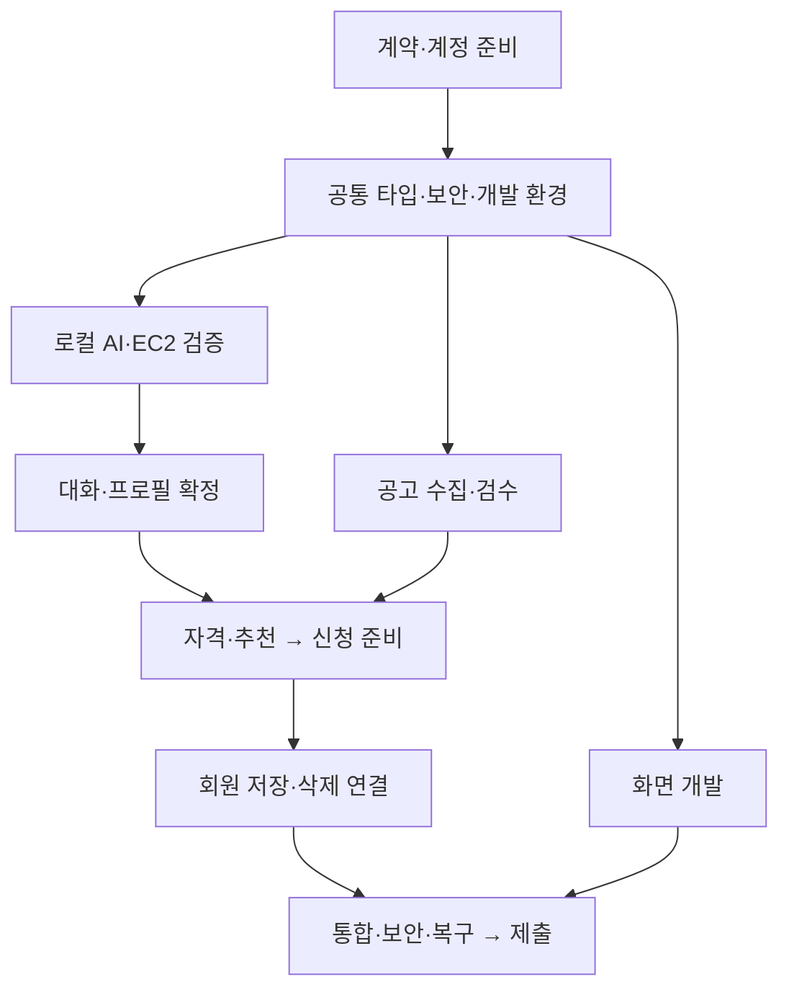
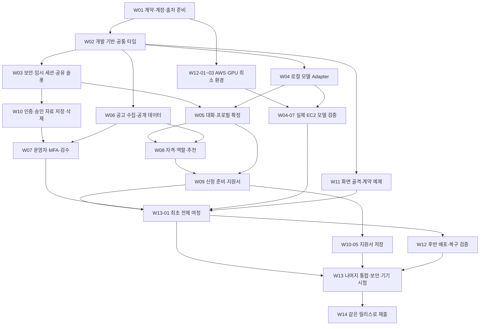

# 다시잇다 — 개발 실행 계획

기준일: 2026-10-13 · 버전: v1.1 · 상태: 개발 착수용 계획 / 가독성 개선본

## 한눈에 보는 계획

**목표:** 경험을 이야기하고 → 프로필을 확정하고 → 실제 공고를 비교하고 → 지원서를 준비해 공식 신청 안내로 이동하는 서비스를 만든다.

| 확인할 것 | 핵심 내용 |
|---|---|
| 전체 범위 | **14개 영역 · 106개 작업** |
| 현재 상태 | **전 작업 미착수** — 이 문서는 개발 계획이다 |
| 제출 마감 | **2026년 10월 30일 18:00 · 한국시간** |
| AI 처리 | **EC2 내부에서 텍스트·STT·TTS 처리**, 영구 DB는 별도 RDS |
| 가장 먼저 | **범위·담당·시간 확인 → 계약·AWS·실제 공고 준비** |

> **먼저 확인할 세 가지**
>
> - **실제 EC2에서 세 모델 실행:** 한국어 품질·처리 속도·메모리를 초기에 검증한다.
> - **추천의 선행조건:** 사용자 확정 프로필 + 검수한 유효 공고 + 자격 판정이 필요하다.
> - **일정의 기준:** 아래 날짜는 목표다. 첫 실행·전체 여정 결과로 남은 시간을 다시 계산한다.

### 지금 시작할 일

첫 공동 작업은 [W01-01 · 범위·담당·가용시간 확인](#w01-01--범위담당가용시간-확인)이다. 완료 후 아래 준비 작업을 담당별로 나눠 진행한다.

| 담당 | 첫 준비 작업 | 다음 연결 |
|---|---|---|
| **A · 기획·프론트엔드** | 팀 범위·참여시간 정리 | [화면 골격](#w02-02--프론트엔드-기본-화면-구성), [동의문](#w01-06--처리저장-동의문-작성) — 각 선행 완료 후 |
| **B · AI·데이터** | [실제 취업·봉사 자료 확보](#w01-05--실제-취업봉사-자료-확보) | [모델 준비](#w04-01--모델가중치런타임-준비), [출처 매핑](#w06-01--출처-설정과-실제-필드-매핑) |
| **C · 백엔드·보안** | [API 계약](#w01-02--api-계약과-오류-예제-확정), [AWS 준비](#w01-03--awsgpu비용도메인-준비) | [백엔드 골격](#w02-03--백엔드-기본-구조-구성), [EC2·RDS](#w12-01--ec2rds비공개-네트워크) |

### 목표 일정

| 목표일 | 확인할 결과 |
|---|---|
| **10/15** | 계정·출처·EC2 텍스트/음성 최소 실행 |
| **10/18** | 첫 비회원 전체 여정 연결·작업량 재산정 |
| **10/23** | 회원 저장·삭제·운영자 기능 연결 |
| **10/26** | 보안·접근성·복구 검증·기능 동결 목표 |
| **10/29** | 같은 릴리스로 파일 확정·내부 제출 목표 |
| **10/30 18시 전** | 수신·파일·영상 최종 확인 |

### 필요한 부분으로 바로 이동

[전체 구현 지도](#1-전체-구현-지도) · [진행 순서·담당](#2-의존성과-진행-방식) · [일정·시간 배분](#3-실제-진행-순서와-달력) · [106개 상세 작업](#4-세부-개발-작업)

[보완할 계약](#5-개발-전에-보완할-계약) · [API·데이터 추적](#6-api화면데이터-추적표) · [검증·보안 근거](#7-검증과-보안-근거) · [작업 인계 양식](#8-작업-인계-형식) · [상세 의존성 지도](#9-상세-의존성-지도)

기준 명세: [01 UX](../design/01_UX_Flow.md) · [02 데이터](../design/02_Data_Design.md) · [03 아키텍처·API](../design/03_Architecture_and_Dependencies.md) · [04 기능](../design/04_Functional_Specification.md) · [05 제약·검증](../design/05_Engineering_Constraints.md). EC2 로컬 추론을 반영한 v1.1 기준이다.

기존 루트의 `다시잇다_상세개발계획.md`는 과거 초안으로 보존한다. 기관 계정·외부 AI 등 충돌하는 내용은 최신 5종 명세를 따른다.

---

## 1. 전체 구현 지도

묶음 이름을 누르면 해당 작업 목록으로 이동한다. 자세한 범위·기능 ID는 각 묶음의 첫 부분에 적었다.

| 묶음 | 만들거나 확인할 결과 | 작업 수 |
|---|---|---:|
| [W01 · 착수와 계약](#w01--착수와-계약) | 담당·계약·계정·실제 자료 준비 | 8 |
| [W02 · 개발 기반과 데이터](#w02--개발-기반과-데이터) | 모두 같은 타입과 개발 환경 사용 | 8 |
| [W03 · 공통 보안과 실행 제어](#w03--공통-보안과-실행-제어) | 세션·동의·암호화·요청 제한 | 8 |
| [W04 · 로컬 모델과 음성](#w04--로컬-모델과-음성) | EC2에서 텍스트·음성 처리 검증 | 8 |
| [W05 · 체험과 프로필](#w05--체험과-프로필) | 대화에서 확정 프로필까지 연결 | 8 |
| [W06 · 공고와 수집](#w06--공고와-수집) | 실제 공고를 안전하게 수집·갱신 | 8 |
| [W07 · 운영자와 신고](#w07--운영자와-신고) | 운영자가 검수·신고를 처리 | 6 |
| [W08 · 자격·역할·추천](#w08--자격역할추천) | 자격·경험에 근거한 공고 추천 | 8 |
| [W09 · 신청 준비와 지원서](#w09--신청-준비와-지원서) | 서류 안내·지원서 편집·복사 | 6 |
| [W10 · 회원 인증·저장·삭제](#w10--회원-인증저장삭제) | 승인 자료 저장·조회·삭제 | 8 |
| [W11 · 전체 화면과 접근성](#w11--전체-화면과-접근성) | 모바일·PC에서 전체 화면 사용 | 10 |
| [W12 · AWS 배포와 운영](#w12--aws-배포와-운영) | 배포·백업·복구·운영 준비 | 8 |
| [W13 · 통합 시험과 수정](#w13--통합-시험과-수정) | 전체 여정·보안·기기 검증 | 8 |
| [W14 · 릴리스와 제출](#w14--릴리스와-제출) | 같은 릴리스로 제출 확인 | 4 |

기관 계정·기관 접수·자동 제출·문서 다운로드·복원 코드·벡터 검색·상시 작업 큐는 현재 구현 대상에 포함하지 않는다. API 승인 지연에 대한 공식 자료 수동 검수는 포함한다.

**우선순위:** P0는 공개·완료 판정에 필수다. P1은 명세에 포함된 후속 구현이며, 구현 목록에 그대로 포함한다.

---

## 2. 의존성과 진행 방식

### 2.1 핵심 의존성



위 그림은 큰 흐름이다. [작업 묶음의 상세 연결](#9-상세-의존성-지도)은 뒤에 모았다. **실제 착수 조건은 각 작업 카드의 개별 선행 ID**를 따른다. 배포 전체를 마지막에 시작하지 않는다. W12-01~03은 초기 모델 검증에 필요하므로 가장 먼저 진행하고, 나머지 배포 작업은 통합·검증과 함께 진행한다.

- 로그인 없이 동의 → 대화 → 확정 → 추천 → 준비까지 가능해야 한다. 비회원 여정 전체를 카카오 가입 완료에 종속시키지 않는다.
- 공개 목록·상세·수동 작성·자격 규칙은 LLM 장애 중에도 동작할 수 있게 나눈다.
- 추천은 확정 프로필, 검수한 유효 공고, 자격 판정이 있어야 통합 완료다. 모의 공고로 만든 화면은 별도 상태다.
- 운영자 검수는 공고를 공개하기 전에 필요하다. 운영자 역할·MFA는 카카오 내부 세션과 연결된다.
- 음성·읽어주기는 STT/TTS 각각의 실행 성공뿐 아니라 LLM과 공유 자원을 사용하는 시험까지 통과해야 한다.
- 회원 저장은 명시적 승인·저장 동의·암호화가 선행한다. 로그인 성공을 저장 완료로 취급하지 않는다.
- 삭제 완료는 현재 DB 삭제뿐 아니라 늦은 결과 폐기·파생 자료 삭제·복구 후 삭제 재적용까지 검증한다.

### 2.2 담당과 작업 단위

| 표기 | 주담당 | 기본 소유 영역 |
|---|---|---|
| A | 기획·프론트엔드 | 화면·접근성·사용자 과업·제출 자료 |
| B | AI·데이터 | 모델 Adapter·음성 서비스·출처/수집·역할·추천 |
| C | 백엔드·보안 | API·공통 계약·DB·인증·암호화·삭제·인프라 |

`A+C` 같은 표기는 앞 사람이 주담당이고 뒤 사람은 계약·검토 협력자다. 한 사람이 여러 작업을 동시에 수행하는 것으로 계산하지 않는다. 보안·DB/API 변경은 C가 조정하지만 모든 보안 구현을 C에게만 몰아주지 않는다. B는 수집·모델 경계를, A는 브라우저 입력·출력·접근성을 함께 검증한다.

각 작업의 1·2·3단계는 순서대로 구현하는 내부 단계다. 한 번의 작업 세션은 약 1~2시간을 계획 단위로 삼되 전체 구현시간 보장은 아니다. 작업이 한 세션을 넘으면 `Wxx-yy.a`, `.b`, `.c`로 나누고 각 결과가 검토 가능하도록 한다. 아래 상세 작업의 모든 항목은 현재 **미착수**다.

상태는 `미착수 → 진행 → 검토 → 통과`, 또는 `차단`으로 기록한다. 코드 작성, 계약 예제 연결, 실제 연동, 배포 검증을 구분한다. 실제 API·EC2·기기 증거가 없는 항목은 통과로 옮기지 않는다.

공통 완료 조건은 필요한 코드·계약·오류 처리가 있고, 해당 작업의 동작을 재현했으며, 증거가 남고, 다른 작업을 깨뜨리지 않는 것이다. 단순 문구·스타일 변경에 구현을 그대로 복제한 테스트를 만들지 않는다. 상태·보안·자격·동시성처럼 오류 영향이 큰 동작에는 적절한 시험을 붙인다.

**표기 도움말:** 선행 = 먼저 통과해야 할 작업 · 게이트 = 다음 단계 전 확인할 기준 · Adapter = 모델/외부 시스템과 통신하는 연결 모듈 · 멱등성 = 같은 요청을 다시 보내도 중복 처리되지 않는 성질.


---

## 3. 실제 진행 순서와 달력

### 3.1 처음 착수할 작업

한 팀원이 수행 가능한 동시 작업은 하나다. 세 담당의 독립 작업을 병행하되 공통 파일 변경은 C가 조정한다.

#### 첫 작업

- **A · 기획·프론트엔드:** [W01-01](#w01-01--범위담당가용시간-확인) 담당/실제 시간, [W01-06](#w01-06--처리저장-동의문-작성) 안내 재료
- **B · AI·데이터:** [W01-05](#w01-05--실제-취업봉사-자료-확보) 실제 취업/봉사 출처
- **C · 백엔드·보안:** [W01-02](#w01-02--api-계약과-오류-예제-확정) API 빈 부분, [W01-03](#w01-03--awsgpu비용도메인-준비) AWS 준비

> **함께 확인할 결과:** 명세·담당·준비/차단 현황

#### 다음 작업

- **A · 기획·프론트엔드:** [W02-02](#w02-02--프론트엔드-기본-화면-구성), [W02-08](#w02-08--프론트엔드-타입api-클라이언트-연결) 화면 골격·계약 예제
- **B · AI·데이터:** [W04-01](#w04-01--모델가중치런타임-준비) 모델 준비, [W06-01](#w06-01--출처-설정과-실제-필드-매핑) 매핑
- **C · 백엔드·보안:** [W02-03](#w02-03--백엔드-기본-구조-구성) ~ [W02-07](#w02-07--db-변경과-개발-compose-구성) 타입/DB/Compose, [W01-04](#w01-04--카카오-로그인-앱-준비) 카카오

> **함께 확인할 결과:** 같은 타입·샘플·실행환경

#### 초기 병행

- **A · 기획·프론트엔드:** [W11-01](#w11-01--공통-ui메모리-상태접근성) ~ [W11-02](#w11-02--시작동의-화면) 시작/공통 UI
- **B · AI·데이터:** [W04-02](#w04-02--ollama-텍스트-통신-모듈) ~ [W04-06](#w04-06--내부-음성-서비스-연결) 모델/음성, [W06-02](#w06-02--안전한-외부-수집파싱) ~ [W06-05](#w06-05--마감신선도수집-실패-처리) 수집
- **C · 백엔드·보안:** [W03-01](#w03-01--익명-세션과-자료-소유권-검사) ~ [W03-08](#w03-08--삭제만료-후-결과-저장-차단) 보안/슬롯, [W12-01](#w12-01--ec2rds비공개-네트워크) ~ [W12-03](#w12-03--ec2-gpu모델-실행-환경) 실제 AWS

> **함께 확인할 결과:** EC2 품질·접속·음성 정리 검증

#### 첫 연결

- **A · 기획·프론트엔드:** [W11-03](#w11-03--한-질문씩-대화-화면) ~ [W11-07](#w11-07--신청-준비지원서-화면) 대화/확정/추천/준비
- **B · AI·데이터:** W08 역할/추천, [W09-02](#w09-02--지원서-생성직접-작성) 생성
- **C · 백엔드·보안:** W05 체험, W08 자격, [W10-01](#w10-01--카카오-인증-왕복-검증) ~ [W10-02](#w10-02--내부-계정로그인-세션)와 W07 검수

> **함께 확인할 결과:** [W13-01](#w13-01--첫-비회원-전체-여정-통합) 비회원 실제 전체 여정

#### 후속 연결

- **A · 기획·프론트엔드:** [W11-08](#w11-08--로그인저장내-정보-화면) ~ [W11-10](#w11-10--읽어주기종료재진입-연결) 회원/운영/음성·종료
- **B · AI·데이터:** 실제 공고/추천 평가·모델 실패 보강
- **C · 백엔드·보안:** W10 저장/삭제, W12 백업/복구

> **함께 확인할 결과:** 전체 기능·복구·실패 시나리오

타입/예제 기반 화면 개발과 서비스 구현을 병행하고, 실제 경로가 준비되는 즉시 연결한다. 계약 예제 사용은 전체 여정 통과와 별도다.

### 3.2 통과 게이트

#### G0 착수 기준

**목표일:** 10/13~14

**통과 기준:** [W01-01](#w01-01--범위담당가용시간-확인), [W01-02](#w01-02--api-계약과-오류-예제-확정), [W01-08](#w01-08--진행-상태와-검증-기록-준비), 담당·시간·범위·API 보완 목록

**미통과 시:** 공통 계약에 의존하는 변경을 조정하고 독립 UI/자료 준비 지속

#### G1 외부 준비·실제 EC2 최소 실행

**목표일:** 10/15 목표

**통과 기준:** [W01-03](#w01-03--awsgpu비용도메인-준비) ~ [W01-06](#w01-06--처리저장-동의문-작성), [W12-01](#w12-01--ec2rds비공개-네트워크) ~ [W12-03](#w12-03--ec2-gpu모델-실행-환경), [W04-07](#w04-07--실제-ec2-성능품질-검증)의 실측, 실제 공고 샘플·카카오 첫 로그인

**미통과 시:** 지연 항목·영향·담당·재검증일 기록. GPU/음성/인증 완료를 추정하지 않음

#### G2 비회원 최초 전체 여정

**목표일:** 10/18 목표

**통과 기준:** [W13-01](#w13-01--첫-비회원-전체-여정-통합): 로컬 텍스트/STT/TTS·확정·검수 공고·자격·추천·지원서·공식 안내

**미통과 시:** 실제 잔여 작업량 재산정. 미검증 모델/공고를 완료로 계산하지 않음

#### G3 회원·운영·삭제 기능 연결

**목표일:** 10/23 목표

**통과 기준:** [W10-08](#w10-08--다른-사용자-접근저장-경합-검증), [W11-08](#w11-08--로그인저장내-정보-화면), [W11-09](#w11-09--운영자-관리-화면), 운영자·MFA·승인 저장·연쇄 삭제·주요 실패

**미통과 시:** C의 병목·계정 지연을 기준으로 담당/일정 조정. 승인 경계·삭제 시험 유지

#### G4 통합·보안·기기·복구/기능 동결

**목표일:** 10/26 목표

**통과 기준:** [W13-02](#w13-02--승인버전추천-경계-시험) ~ [W13-07](#w13-07--장애배포롤백-시험), [W12-06](#w12-06--복원-후-삭제-재적용) ~ [W12-08](#w12-08--롤백운영-절차인계), 필수 실패/자격/권한/복구 확인

**미통과 시:** 기능 추가 대신 실패 항목 수정·재시험. 범위/일정 변경은 별도 결정 기록

#### G5 릴리스·제출 파일 확정

**목표일:** 10/29 내부 목표

**통과 기준:** [W13-08](#w13-08--결함-수정재시험릴리스-판정), [W14-03](#w14-03--같은-릴리스로-제출물-확정)·업로드 확인

**미통과 시:** 같은 릴리스로 정정·재확인. 미해결 필수 기능을 완성으로 발표하지 않음

#### G6 최종 제출

**목표일:** 10/30 18:00 이전

**통과 기준:** [W14-04](#w14-04--업로드수신최종-제출-확인) 수신·재생·파일 확인

**미통과 시:** 마감 전 확인·긴급 수정. 추가 개발을 마감 이후 시간에 전제하지 않음

이 날짜는 기존 마감에 맞춘 **목표 게이트**이며 106개 작업의 실행 가능한 확정 일정이 아니다. GPU 쿼터·모델 적재·출처·숙련도는 미확인이고 이미 완료한 개발시간도 없다. G1과 G2에서 실제 남은 시간을 계산해 날짜를 다시 판단한다.

### 3.3 가용시간과 배분

10/13~23은 11일이다. 주당 14시간을 일할한 계획 가정으로 `14 × 11 / 7 = 22시간/인`, 10/24~30의 최대는 `6 × 7 = 42시간/인`이다. 합계 **인당 약 64시간, 팀 약 192시간을 일할 기준의 계획 예산**으로 둔다. 이는 확정 상한이 아니다. 두 달력주의 14시간이 모두 남아 있다면 첫 구간은 인당 최대 28시간일 수 있으므로 실제 주별 시간을 확인한다. 첫 구간의 주간 참여일, 현재일까지 이미 쓴 시간, 10/30 18시 이전 실제 참여 가능 시간과 결석을 반영하면 줄어든다. 팀 합산 시간이 있어도 한 담당의 순차 의존성은 사라지지 않는다.

| 목적 | 팀 시간 배분 목표 | 적용 작업 |
|---|---|---|
| 준비·계약·기능·인프라 구현 | 192시간 기준 약 2/3, 약 128시간 | W01~12. 여기에도 구현 중 필요한 단위·계약 검증은 포함 |
| 통합·보안·기기/복구 시험·수정·시연·제출 | 192시간 기준 약 1/3, 약 64시간 | W13~14와 통합 수정·배포 복구 반복 |

128/64시간은 **시간 배분 목표**이지 작업 견적이 아니다. 106개 작업에 동일 시간을 배당하지 않는다. 현재 전체 범위를 이 예산에 맞출 수 있다는 근거는 없다. 특히 C의 인증·DB·삭제·GPU/네트워크·복구 작업이 병목이 될 수 있다. 숙련도 미확인 상태에서 단정적인 작업별 시간/완료일을 붙이지 않는다.

W01-08에서 각 작업에 `실제 착수일`, `사용한 인시간`, `남은 인시간의 하한/상한`, `외부 대기`, `차단`, `증거`를 기록한다. 모델 단독 실행이 아닌 첫 실제 전체 여정까지의 시간이 기준이다. 에이전트가 있다면 생성 대기시간과 팀원의 검토/수정시간도 나눠 기록하며 현재 계획에 무제한 병렬 개발을 가정하지 않는다.

**재산정 식:** `남은 필수 작업의 담당별 상한 + 해당 담당의 검증·수정·제출 여유 ≤ 해당 담당의 남은 가용시간`을 먼저 검사하고, 그다음 선행 관계를 만족하는 날짜에 놓는다. 팀 합계만 비교하지 않는다. 부족하면 원인/미완료/대안을 제시하고 범위·기한·도움을 결정한다. 음성 제외·외부 AI 대체·권한/삭제 시험 생략으로 기존 요구가 완료된 것처럼 처리하지 않는다.

---

## 4. 세부 개발 작업

각 묶음은 **작업 목록 → 작업별 실행 카드** 순서다. 제목을 누르면 필요한 카드로 바로 이동한다. 선행 작업은 링크로 확인한다. 모든 작업의 상태는 **미착수**다.

### W01 · 착수와 계약

**목표:** 담당·계약·계정·실제 자료 준비 · **작업 8개**

**포함 범위:** 범위·담당·API·상태·실제 안내문, AWS/카카오/출처 준비, 평가 표본·작업량 기록

**기능·화면 연결:** 전 기능·전 화면

| 작업 | 주담당 |
|---|---|
| [W01-01 · 범위·담당·가용시간 확인](#w01-01--범위담당가용시간-확인) | A |
| [W01-02 · API 계약과 오류 예제 확정](#w01-02--api-계약과-오류-예제-확정) | C |
| [W01-03 · AWS·GPU·비용·도메인 준비](#w01-03--awsgpu비용도메인-준비) | C |
| [W01-04 · 카카오 로그인 앱 준비](#w01-04--카카오-로그인-앱-준비) | C |
| [W01-05 · 실제 취업·봉사 자료 확보](#w01-05--실제-취업봉사-자료-확보) | B |
| [W01-06 · 처리·저장 동의문 작성](#w01-06--처리저장-동의문-작성) | A |
| [W01-07 · 프로필·한국어 음성 평가 표본 준비](#w01-07--프로필한국어-음성-평가-표본-준비) | B |
| [W01-08 · 진행 상태와 검증 기록 준비](#w01-08--진행-상태와-검증-기록-준비) | A |

#### W01-01 · 범위·담당·가용시간 확인

**주담당:** A · 기획·프론트엔드　**협력:** C　**우선:** P0

**먼저 완료:** 없음 — 첫 공동 작업

**진행 단계**

1. v1.1 범위·제외 범위 확인
2. A/B/C 담당 지정
3. 실제 가용시간·준비 상태 기록

> **완료 확인:** 범위표·담당·달력 존재. 기관/외부 AI 과거 초안과 충돌 없음

#### W01-02 · API 계약과 오류 예제 확정

**주담당:** C · 백엔드·보안　**협력:** A　**우선:** P0

**먼저 완료:** [W01-01](#w01-01--범위담당가용시간-확인)

**진행 단계**

1. 모든 API 입출력·공통 오류 확정
2. 아래 §5 추가 계약 정의
3. 정상/누락/409/429 예제 준비

> **완료 확인:** FE·BE·모델이 같은 계약 사용. 없는 API를 화면에서 임의 호출하지 않음

#### W01-03 · AWS·GPU·비용·도메인 준비

**주담당:** C · 백엔드·보안　**우선:** P0

**먼저 완료:** [W01-01](#w01-01--범위담당가용시간-확인)

**진행 단계**

1. AWS 계정·접근·GPU 사용 가능 여부 확인
2. 리전·EC2/RDS 후보·가동시간·비용 상한 기록
3. 도메인/HTTPS 준비

> **완료 확인:** 실제 준비 상태와 지출 조건 확인. 미확보 항목에 담당·다음 확인일 있음

#### W01-04 · 카카오 로그인 앱 준비

**주담당:** C · 백엔드·보안　**협력:** A　**우선:** P0

**먼저 완료:** [W01-01](#w01-01--범위담당가용시간-확인)

**진행 단계**

1. 카카오 앱·웹 설정 준비
2. 개발/운영 콜백 목록 등록
3. 외부 시험 계정·취소 경로 확보

> **완료 확인:** 정상 로그인에 사용할 앱 설정 존재. 비밀은 저장소 제외

#### W01-05 · 실제 취업·봉사 자료 확보

**주담당:** B · AI·데이터　**우선:** P0

**먼저 완료:** [W01-01](#w01-01--범위담당가용시간-확인)

**진행 단계**

1. 취업/공공일자리·봉사 출처 확인
2. 승인 요청·실제 자료 확보
3. 이용 조건·공식 접수 URL 검증

> **완료 확인:** 출처별 실제 샘플·접근 상태 존재. API 미승인은 수동 자료 경로로 구분

#### W01-06 · 처리·저장 동의문 작성

**주담당:** A · 기획·프론트엔드　**협력:** C　**우선:** P0

**먼저 완료:** [W01-03](#w01-03--awsgpu비용도메인-준비)

**진행 단계**

1. 실제 운영 주체·연락 경로·리전 확인
2. AI/저장 동의문 목적·버전 작성
3. 삭제·보관·외부 인증 안내 작성

> **완료 확인:** 안내문이 실제 EC2/RDS 처리와 일치. 미정 값을 완료로 표시하지 않음

#### W01-07 · 프로필·한국어 음성 평가 표본 준비

**주담당:** B · AI·데이터　**협력:** A　**우선:** P0

**먼저 완료:** [W01-01](#w01-01--범위담당가용시간-확인)

**진행 단계**

1. 가상 프로필 5~10개·조건 사례 준비
2. 한국어 공개/동의한 시험 음성 확보
3. 기대 추출·판정·추천 작성

> **완료 확인:** 평가 입력과 기대값 존재. 사용자 운영 음성을 평가용으로 축적하지 않음

#### W01-08 · 진행 상태와 검증 기록 준비

**주담당:** A · 기획·프론트엔드　**협력:** C, B　**우선:** P0

**먼저 완료:** [W01-02](#w01-02--api-계약과-오류-예제-확정)

**진행 단계**

1. 작업별 상태·실제 시간 기록 양식 작성
2. 첫 통합/공개 게이트 지정
3. 차단 사유·재검증일 관리

> **완료 확인:** 진행 현황에서 완료 증거·미검증·일정 변경을 구분 가능

[전체 구현 지도로 돌아가기](#1-전체-구현-지도)

---

### W02 · 개발 기반과 데이터

**목표:** 모두 같은 타입과 개발 환경 사용 · **작업 8개**

**포함 범위:** 저장소 구조, FE/BE 골격, Compose, 설정, 공통 타입·지역, 12개 논리 엔터티, 마이그레이션, API 클라이언트·CI 기초

**기능·화면 연결:** 전 기능

| 작업 | 주담당 |
|---|---|
| [W02-01 · 저장소 구조와 실행 안내 구성](#w02-01--저장소-구조와-실행-안내-구성) | C |
| [W02-02 · 프론트엔드 기본 화면 구성](#w02-02--프론트엔드-기본-화면-구성) | A |
| [W02-03 · 백엔드 기본 구조 구성](#w02-03--백엔드-기본-구조-구성) | C |
| [W02-04 · 공통 데이터 타입과 지역 목록 정의](#w02-04--공통-데이터-타입과-지역-목록-정의) | C |
| [W02-05 · 회원·프로필·지원서 DB 모델 정의](#w02-05--회원프로필지원서-db-모델-정의) | C |
| [W02-06 · 공고·수집·운영 DB 모델 정의](#w02-06--공고수집운영-db-모델-정의) | C |
| [W02-07 · DB 변경과 개발 Compose 구성](#w02-07--db-변경과-개발-compose-구성) | C |
| [W02-08 · 프론트엔드 타입·API 클라이언트 연결](#w02-08--프론트엔드-타입api-클라이언트-연결) | A |

#### W02-01 · 저장소 구조와 실행 안내 구성

**주담당:** C · 백엔드·보안　**협력:** A　**우선:** P0

**먼저 완료:** [W01-01](#w01-01--범위담당가용시간-확인)

**진행 단계**

1. frontend/backend/speech/infra/tests 경계 구성
2. 실행 안내·비밀 제외
3. 버전 고정 파일·설정 예제 준비

> **완료 확인:** 새 작업 환경에서 같은 구조와 개발 명령 사용

#### W02-02 · 프론트엔드 기본 화면 구성

**주담당:** A · 기획·프론트엔드　**우선:** P0

**먼저 완료:** [W02-01](#w02-01--저장소-구조와-실행-안내-구성)

**진행 단계**

1. React/TS/Vite 골격
2. 화면 라우트·오류 경계
3. 최소 타입·빌드 검사

> **완료 확인:** 빈 화면이라도 모든 UX 경로를 열고 빌드 가능

#### W02-03 · 백엔드 기본 구조 구성

**주담당:** C · 백엔드·보안　**우선:** P0

**먼저 완료:** [W02-01](#w02-01--저장소-구조와-실행-안내-구성)

**진행 단계**

1. FastAPI 설정·모듈 골격
2. 서비스/저장소/Adapter 인터페이스
3. request_id·기본 상태 경로

> **완료 확인:** FastAPI가 DB·AI 구체 구현에 화면 코드를 결합하지 않음

#### W02-04 · 공통 데이터 타입과 지역 목록 정의

**주담당:** C · 백엔드·보안　**협력:** B　**우선:** P0

**먼저 완료:** [W01-02](#w01-02--api-계약과-오류-예제-확정), [W02-03](#w02-03--백엔드-기본-구조-구성)

**진행 단계**

1. Profile/Experience/Region/Requirement 등 Pydantic 타입
2. 필드/연산 허용표·null/빈 배열
3. UTC/KST·지역 목록 공통화

> **완료 확인:** 불법 enum·시군구·조건 타입 거절. FE용 같은 지역 목록 제공

#### W02-05 · 회원·프로필·지원서 DB 모델 정의

**주담당:** C · 백엔드·보안　**우선:** P0

**먼저 완료:** [W02-03](#w02-03--백엔드-기본-구조-구성), [W02-04](#w02-04--공통-데이터-타입과-지역-목록-정의)

**진행 단계**

1. User/Consent/ProfileVersion/ApplicationDraft 영구 모델
2. 키·문서/프로필 버전·소유권 관계
3. 삭제 관계·인덱스 정의

> **완료 확인:** 저장 모델이 초안/대화 원문을 포함하지 않고 버전 제약 존재

#### W02-06 · 공고·수집·운영 DB 모델 정의

**주담당:** C · 백엔드·보안　**협력:** B　**우선:** P0

**먼저 완료:** [W02-04](#w02-04--공통-데이터-타입과-지역-목록-정의)

**진행 단계**

1. Source/IngestionRun/RoleDefinition/OpportunityVersion
2. Report/AuditEvent/DeletionRecord
3. 출처 ID 중복·공개 버전 제약

> **완료 확인:** 12개 논리 엔터티의 저장 경계 정의. Journey는 RDS FK 대상 아님

#### W02-07 · DB 변경과 개발 Compose 구성

**주담당:** C · 백엔드·보안　**우선:** P0

**먼저 완료:** [W02-05](#w02-05--회원프로필지원서-db-모델-정의), [W02-06](#w02-06--공고수집운영-db-모델-정의)

**진행 단계**

1. Alembic 초기/추가 변경
2. 개발 Compose PG·Redis·내부 네트워크
3. upgrade·정상 조회 검사

> **완료 확인:** 빈 DB에서 재현. Redis RDB/AOF와 개인정보 영구 볼륨 없음

#### W02-08 · 프론트엔드 타입·API 클라이언트 연결

**주담당:** A · 기획·프론트엔드　**협력:** C　**우선:** P0

**먼저 완료:** [W01-02](#w01-02--api-계약과-오류-예제-확정), [W02-02](#w02-02--프론트엔드-기본-화면-구성), [W02-04](#w02-04--공통-데이터-타입과-지역-목록-정의)

**진행 단계**

1. OpenAPI/TS 타입 생성 또는 일치 검사
2. 공통 API 클라이언트·오류 변환
3. 계약 예제·최소 CI

> **완료 확인:** 계약 변경이 타입/빌드 검사에서 드러남. 모의 연동 명시

[전체 구현 지도로 돌아가기](#1-전체-구현-지도)

---

### W03 · 공통 보안과 실행 제어

**목표:** 세션·동의·암호화·요청 제한 · **작업 8개**

**포함 범위:** 익명 세션·소유권, 동의, CSRF·Origin, 크기·한도·공유 슬롯, 멱등성, 암호화·키, 로그·오류, 삭제/만료와 완료의 경합

**기능·화면 연결:** F01~F11

| 작업 | 주담당 |
|---|---|
| [W03-01 · 익명 세션과 자료 소유권 검사](#w03-01--익명-세션과-자료-소유권-검사) | C |
| [W03-02 · AI·저장 동의 검사](#w03-02--ai저장-동의-검사) | C |
| [W03-03 · 위조 요청·과대 입력 차단](#w03-03--위조-요청과대-입력-차단) | C |
| [W03-04 · 호출 한도와 공유 추론 슬롯](#w03-04--호출-한도와-공유-추론-슬롯) | C |
| [W03-05 · 중복 요청·동시 수정 제어](#w03-05--중복-요청동시-수정-제어) | C |
| [W03-06 · 개인 본문 암호화와 키 관리](#w03-06--개인-본문-암호화와-키-관리) | C |
| [W03-07 · 안전한 오류 응답과 로그](#w03-07--안전한-오류-응답과-로그) | C |
| [W03-08 · 삭제·만료 후 결과 저장 차단](#w03-08--삭제만료-후-결과-저장-차단) | C |

#### W03-01 · 익명 세션과 자료 소유권 검사

**주담당:** C · 백엔드·보안　**우선:** P0

**먼저 완료:** [W02-03](#w02-03--백엔드-기본-구조-구성), [W02-07](#w02-07--db-변경과-개발-compose-구성)

**진행 단계**

1. 익명 안전 쿠키 세션
2. 자원 소유권·사적 404 처리
3. 세션 교체·유휴/절대 만료

> **완료 확인:** UUID만 아는 다른 주체의 접근 불가. 자격증명 URL/영구 저장소 노출 없음

#### W03-02 · AI·저장 동의 검사

**주담당:** C · 백엔드·보안　**협력:** A　**우선:** P0

**먼저 완료:** [W01-06](#w01-06--처리저장-동의문-작성), [W02-05](#w02-05--회원프로필지원서-db-모델-정의), [W03-01](#w03-01--익명-세션과-자료-소유권-검사)

**진행 단계**

1. AI/저장 동의 목적·버전 검증
2. Consent 기록/체험 동의 연결
3. 목적별 철회·삭제 대상 표 작성

> **완료 확인:** 미동의·폐기 버전에서 AI 호출/회원 저장 불가

#### W03-03 · 위조 요청·과대 입력 차단

**주담당:** C · 백엔드·보안　**협력:** A　**우선:** P0

**먼저 완료:** [W03-01](#w03-01--익명-세션과-자료-소유권-검사)

**진행 단계**

1. 변경 요청 CSRF·Origin 검사
2. 인증/복사 응답 캐시 정책
3. 신뢰 프록시·CORS·입력 크기 제한

> **완료 확인:** 위조 Origin/토큰·직접 헤더 위조·초과 JSON 거절. 공개 조회 유지

#### W03-04 · 호출 한도와 공유 추론 슬롯

**주담당:** C · 백엔드·보안　**협력:** B　**우선:** P0

**먼저 완료:** [W03-01](#w03-01--익명-세션과-자료-소유권-검사), [W02-07](#w02-07--db-변경과-개발-compose-구성)

**진행 단계**

1. IP/주체/계정·KST 일별 한도 원자 집계
2. 전체 LLM/STT/TTS 공유 슬롯 1개
3. Redis 실패·실제 런타임 종료/재시도 처리

> **완료 확인:** 거절은 미실행. 타임아웃만으로 슬롯 조기 반환 없음. Redis 장애에서 우회 없음

#### W03-05 · 중복 요청·동시 수정 제어

**주담당:** C · 백엔드·보안　**협력:** B　**우선:** P0

**먼저 완료:** [W03-01](#w03-01--익명-세션과-자료-소유권-검사), [W02-07](#w02-07--db-변경과-개발-compose-구성)

**진행 단계**

1. 주체/체험/API별 요청 ID·입력 해시
2. 진행/완료 재전송 처리
3. 리비전 CAS·저장 멱등성 인터페이스

> **완료 확인:** 동일 입력 재사용은 새 실행 없음. 같은 키 다른 입력·오래된 리비전은 409

#### W03-06 · 개인 본문 암호화와 키 관리

**주담당:** C · 백엔드·보안　**우선:** P0

**먼저 완료:** [W02-05](#w02-05--회원프로필지원서-db-모델-정의)

**진행 단계**

1. AES-256-GCM·새 nonce·대상 AAD
2. 키 버전/암호화 메타데이터·키 분리
3. 복구용 키·변조/키 없음 처리

> **완료 확인:** 정상 복호화·암호문/소유 대상 변조 거절. 키가 DB/소스/DB 백업에 없음

#### W03-07 · 안전한 오류 응답과 로그

**주담당:** C · 백엔드·보안　**협력:** B, A　**우선:** P0

**먼저 완료:** [W02-03](#w02-03--백엔드-기본-구조-구성)

**진행 단계**

1. 공통 오류 코드·최소 로그
2. 콜백 query/음성/본문/토큰/OTP 제거
3. 감사·운영 로그 보관 설정

> **완료 확인:** 의도한 오류에도 본문·비밀·trace 미노출. request_id로 결과 추적 가능

#### W03-08 · 삭제·만료 후 결과 저장 차단

**주담당:** C · 백엔드·보안　**협력:** B　**우선:** P0

**먼저 완료:** [W03-04](#w03-04--호출-한도와-공유-추론-슬롯), [W03-05](#w03-05--중복-요청동시-수정-제어)

**진행 단계**

1. 활성·취소·삭제/계정 세대 검사
2. 결과 저장 직전 원자 재검사
3. 프로세스 중단 후 슬롯 복구 절차

> **완료 확인:** 삭제/만료와 완료 경합에서 자료 재생성 없음. 종료 미확인 슬롯은 새 실행 금지

[전체 구현 지도로 돌아가기](#1-전체-구현-지도)

---

### W04 · 로컬 모델과 음성

**목표:** EC2에서 텍스트·음성 처리 검증 · **작업 8개**

**포함 범위:** 고정 모델 준비, Ollama Adapter, 근거 검증, faster-whisper, Qwen3-TTS, 내부 음성 서비스, 실제 EC2 품질·자원 시험, 장애 처리

**기능·화면 연결:** F02/F08/F11

| 작업 | 주담당 |
|---|---|
| [W04-01 · 모델·가중치·런타임 준비](#w04-01--모델가중치런타임-준비) | B |
| [W04-02 · Ollama 텍스트 통신 모듈](#w04-02--ollama-텍스트-통신-모듈) | B |
| [W04-03 · 추출·질문·지원서 근거 검증](#w04-03--추출질문지원서-근거-검증) | B |
| [W04-04 · 로컬 음성 인식 구현](#w04-04--로컬-음성-인식-구현) | B |
| [W04-05 · 로컬 한국어 읽어주기 구현](#w04-05--로컬-한국어-읽어주기-구현) | B |
| [W04-06 · 내부 음성 서비스 연결](#w04-06--내부-음성-서비스-연결) | B |
| [W04-07 · 실제 EC2 성능·품질 검증](#w04-07--실제-ec2-성능품질-검증) | B |
| [W04-08 · 모델 장애·혼잡·재시도 처리](#w04-08--모델-장애혼잡재시도-처리) | B |

#### W04-01 · 모델·가중치·런타임 준비

**주담당:** B · AI·데이터　**협력:** C　**우선:** P0

**먼저 완료:** [W01-03](#w01-03--awsgpu비용도메인-준비), [W02-01](#w02-01--저장소-구조와-실행-안내-구성)

**진행 단계**

1. Qwen3/STT/TTS 후보·라이선스 확인
2. 공식 가중치·revision/digest 준비
3. 런타임/드라이버·컨테이너 조합 기록

> **완료 확인:** 준비 다운로드와 추론 분리. 임의 모델·원격 코드·Cloud 추론 없음

#### W04-02 · Ollama 텍스트 통신 모듈

**주담당:** B · AI·데이터　**우선:** P0

**먼저 완료:** [W04-01](#w04-01--모델가중치런타임-준비), [W02-04](#w02-04--공통-데이터-타입과-지역-목록-정의)

**진행 단계**

1. 내부 Ollama /api/chat Adapter
2. JSON format·stream=false·thinking 설정 확인
3. content만 파싱·스키마 재검증

> **완료 확인:** 정상·불량 JSON 구분. 모델 결과로 서버 승인/권한 변경 불가

#### W04-03 · 추출·질문·지원서 근거 검증

**주담당:** B · AI·데이터　**협력:** C　**우선:** P0

**먼저 완료:** [W04-02](#w04-02--ollama-텍스트-통신-모듈), [W01-07](#w01-07--프로필한국어-음성-평가-표본-준비)

**진행 단계**

1. 경험 추출·한 질문·지원서 프롬프트 분리
2. 기존 경험 ID/근거 참조 검사
3. 불필요 개인정보 탐지·환각/인젝션 표본 평가

> **완료 확인:** 없는 경험·기간·자격을 사실로 승인하지 않음. 필터 한계를 기록

#### W04-04 · 로컬 음성 인식 구현

**주담당:** B · AI·데이터　**우선:** P0

**먼저 완료:** [W04-01](#w04-01--모델가중치런타임-준비), [W01-07](#w01-07--프로필한국어-음성-평가-표본-준비)

**진행 단계**

1. faster-whisper 다국어 모델 적재
2. 제한 형식 decode·길이/무음 검사
3. 전사·실패·취소와 버퍼 정리

> **완료 확인:** 90초/6MiB 경계, 무음·잘못된 파일·한국어 사례 결과와 정리 증거

#### W04-05 · 로컬 한국어 읽어주기 구현

**주담당:** B · AI·데이터　**우선:** P0

**먼저 완료:** [W04-01](#w04-01--모델가중치런타임-준비), [W01-07](#w01-07--프로필한국어-음성-평가-표본-준비)

**진행 단계**

1. Qwen3-TTS 한국어 고정 화자
2. 표시 문장·길이 제한
3. 음성 응답·실패/재생 종료 정리

> **완료 확인:** 실제 텍스트와 발화 일치 평가. 사용자 화자 복제·영구 음성 캐시 없음

#### W04-06 · 내부 음성 서비스 연결

**주담당:** B · AI·데이터　**협력:** C　**우선:** P0

**먼저 완료:** [W04-04](#w04-04--로컬-음성-인식-구현), [W04-05](#w04-05--로컬-한국어-읽어주기-구현), [W03-04](#w03-04--호출-한도와-공유-추론-슬롯), [W03-07](#w03-07--안전한-오류-응답과-로그)

**진행 단계**

1. 별도 내부 Speech 서비스·Adapter
2. STT/TTS readiness·tmpfs·자원 제한
3. FastAPI event loop와 추론 분리

> **완료 확인:** 내부 연결만 가능. LLM/STT/TTS가 동일 실행 슬롯 정책 사용

#### W04-07 · 실제 EC2 성능·품질 검증

**주담당:** B · AI·데이터　**협력:** C　**우선:** P0

**먼저 완료:** [W04-02](#w04-02--ollama-텍스트-통신-모듈), [W04-03](#w04-03--추출질문지원서-근거-검증), [W04-06](#w04-06--내부-음성-서비스-연결), [W12-03](#w12-03--ec2-gpu모델-실행-환경)

**진행 단계**

1. 실제 EC2 단일/교대 모델 실행
2. RAM/VRAM·90초 STT·최대 TTS·60초 기준 측정
3. OOM/취소·다운로드 없는 요청 확인

> **완료 확인:** 측정 장비·버전·품질·지연·최대 메모리 기록. 미달은 조정 후 재검증

#### W04-08 · 모델 장애·혼잡·재시도 처리

**주담당:** B · AI·데이터　**협력:** C, A　**우선:** P0

**먼저 완료:** [W04-06](#w04-06--내부-음성-서비스-연결), [W03-08](#w03-08--삭제만료-후-결과-저장-차단)

**진행 단계**

1. timeout·503·429 변환
2. 일시 오류 1회/전체 60초 재시도
3. 수동 입력·편집·공개 탐색 연결

> **완료 확인:** 재시도 중복 집계 없음. 실제 종료 전 슬롯 미해제. 외부 AI 자동 전환 없음

[전체 구현 지도로 돌아가기](#1-전체-구현-지도)

---

### W05 · 체험과 프로필

**목표:** 대화에서 확정 프로필까지 연결 · **작업 8개**

**포함 범위:** 체험 생성, 한 질문 대화, 전사 확인, 직접 편집, 확정·재확정, 결과 버전 관리, 저장 자료 가져오기, 종료·만료

**기능·화면 연결:** F01~F03

| 작업 | 주담당 |
|---|---|
| [W05-01 · 임시 체험 생성과 만료](#w05-01--임시-체험-생성과-만료) | C |
| [W05-02 · 한 질문씩 대화·초안 추출](#w05-02--한-질문씩-대화초안-추출) | C |
| [W05-03 · 음성 전사 확인·수정 연결](#w05-03--음성-전사-확인수정-연결) | C |
| [W05-04 · 프로필 직접 작성·편집](#w05-04--프로필-직접-작성편집) | C |
| [W05-05 · 프로필 확정과 버전 부여](#w05-05--프로필-확정과-버전-부여) | C |
| [W05-06 · 재확정 후 결과 갱신](#w05-06--재확정-후-결과-갱신) | C |
| [W05-07 · 저장 자료로 새 체험 시작](#w05-07--저장-자료로-새-체험-시작) | C |
| [W05-08 · 체험 종료·삭제·재진입 처리](#w05-08--체험-종료삭제재진입-처리) | C |

#### W05-01 · 임시 체험 생성과 만료

**주담당:** C · 백엔드·보안　**우선:** P0

**먼저 완료:** [W02-04](#w02-04--공통-데이터-타입과-지역-목록-정의), [W03-01](#w03-01--익명-세션과-자료-소유권-검사), [W03-02](#w03-02--ai저장-동의-검사), [W03-05](#w03-05--중복-요청동시-수정-제어)

**진행 단계**

1. Redis Journey 구조·리비전
2. 동의 후 생성·초기 질문
3. 유휴 30분/최대 2시간

> **완료 확인:** 미동의 생성에서 AI 실행 없음. 자동 조회가 TTL을 연장하지 않음

#### W05-02 · 한 질문씩 대화·초안 추출

**주담당:** C · 백엔드·보안　**협력:** B　**우선:** P0

**먼저 완료:** [W05-01](#w05-01--임시-체험-생성과-만료), [W04-03](#w04-03--추출질문지원서-근거-검증), [W03-04](#w03-04--호출-한도와-공유-추론-슬롯), [W03-08](#w03-08--삭제만료-후-결과-저장-차단)

**진행 단계**

1. 확인 텍스트 message API
2. 추출 결과·근거 검증/리비전 반영
3. 하나의 다음 질문·입력 유지

> **완료 확인:** 실패 때 기존 입력/확정본 유지. 동시에 수정된 초안 덮어쓰지 않음

#### W05-03 · 음성 전사 확인·수정 연결

**주담당:** C · 백엔드·보안　**협력:** B　**우선:** P0

**먼저 완료:** [W05-01](#w05-01--임시-체험-생성과-만료), [W04-06](#w04-06--내부-음성-서비스-연결), [W03-08](#w03-08--삭제만료-후-결과-저장-차단)

**진행 단계**

1. 제한 음성 transcription API
2. 전사 ID·수정 텍스트 전달 계약
3. 취소·음성 참조 폐기

> **완료 확인:** STT 원문이 자동 추출되지 않음. 사용자가 보낸 수정 텍스트만 사용

#### W05-04 · 프로필 직접 작성·편집

**주담당:** C · 백엔드·보안　**우선:** P0

**먼저 완료:** [W05-01](#w05-01--임시-체험-생성과-만료)

**진행 단계**

1. profile GET/PATCH
2. 경험 ID 서버 부여·수동 수정/삭제
3. 기준 리비전 검사

> **완료 확인:** AI가 없어도 초안 직접 작성·수정 가능. 소유권·지역·필드 범위 검증

#### W05-05 · 프로필 확정과 버전 부여

**주담당:** C · 백엔드·보안　**우선:** P0

**먼저 완료:** [W05-04](#w05-04--프로필-직접-작성편집)

**진행 단계**

1. 최소 경험/희망 지역/유형 검사
2. 명시적 확정·불변 버전
3. 확정 참조 resolver

> **완료 확인:** 미확정·위조 본문 참조 거절. confirmed_at/version은 서버 부여

#### W05-06 · 재확정 후 결과 갱신

**주담당:** C · 백엔드·보안　**협력:** A　**우선:** P0

**먼저 완료:** [W05-05](#w05-05--프로필-확정과-버전-부여)

**진행 단계**

1. 편집 중 기존 확정본 유지
2. 재확정 후 추천/자격 무효화
3. 기존 지원서 근거 변경 표시 인터페이스

> **완료 확인:** 이전 결과 버전 구분. 지원서 본문 자동 변경 없음

#### W05-07 · 저장 자료로 새 체험 시작

**주담당:** C · 백엔드·보안　**우선:** P0

**먼저 완료:** [W05-05](#w05-05--프로필-확정과-버전-부여), [W10-04](#w10-04--확정-프로필-암호화-저장)

**진행 단계**

1. 자기 저장 프로필로 새 Journey 생성
2. 저장 지원서 편집용 자료 참조 준비
3. 대화·준비 체크 미복원

> **완료 확인:** 타 사용자 참조 불가. 회원도 항상 새 대화·새 편집본에서 시작

#### W05-08 · 체험 종료·삭제·재진입 처리

**주담당:** C · 백엔드·보안　**협력:** B　**우선:** P0

**먼저 완료:** [W05-01](#w05-01--임시-체험-생성과-만료), [W03-08](#w03-08--삭제만료-후-결과-저장-차단)

**진행 단계**

1. 종료 DELETE·진행 결과 폐기
2. 만료 자료 참조 정리
3. 새로고침/새 시작의 이전 자료 접근 차단

> **완료 확인:** 이전 대화 복원 API 경로 없음. 종료·만료 후 늦은 결과 저장 안 됨

[전체 구현 지도로 돌아가기](#1-전체-구현-지도)

---

### W06 · 공고와 수집

**목표:** 실제 공고를 안전하게 수집·갱신 · **작업 8개**

**포함 범위:** 출처 설정, 안전한 수집, 정규화·원문 조건, 중복·변경·재검수, 마감·48시간 보류, 공개 조회, 공식 자료 수동 입력

**기능·화면 연결:** F05/F06/F08

| 작업 | 주담당 |
|---|---|
| [W06-01 · 출처 설정과 실제 필드 매핑](#w06-01--출처-설정과-실제-필드-매핑) | B |
| [W06-02 · 안전한 외부 수집·파싱](#w06-02--안전한-외부-수집파싱) | B |
| [W06-03 · 공고와 원문 조건 정규화](#w06-03--공고와-원문-조건-정규화) | B |
| [W06-04 · 중복 방지·변경 버전 관리](#w06-04--중복-방지변경-버전-관리) | B |
| [W06-05 · 마감·신선도·수집 실패 처리](#w06-05--마감신선도수집-실패-처리) | B |
| [W06-06 · 수집 실행·집계·스케줄 연결](#w06-06--수집-실행집계스케줄-연결) | B |
| [W06-07 · 공개 목록·상세·검색 API](#w06-07--공개-목록상세검색-api) | C |
| [W06-08 · 공식 자료 수동 입력·공고 확보](#w06-08--공식-자료-수동-입력공고-확보) | B |

#### W06-01 · 출처 설정과 실제 필드 매핑

**주담당:** B · AI·데이터　**협력:** C　**우선:** P0

**먼저 완료:** [W01-05](#w01-05--실제-취업봉사-자료-확보), [W02-06](#w02-06--공고수집운영-db-모델-정의)

**진행 단계**

1. 출처별 설정·고정 목적지·이용 조건
2. 실제 필드→표준 계약 매핑
3. 실패/미확인 필드 규칙

> **완료 확인:** 실제 취업/봉사 샘플로 매핑 확인. 모의 응답은 실제 API 증거와 분리

#### W06-02 · 안전한 외부 수집·파싱

**주담당:** B · AI·데이터　**우선:** P0

**먼저 완료:** [W06-01](#w06-01--출처-설정과-실제-필드-매핑), [W03-07](#w03-07--안전한-오류-응답과-로그)

**진행 단계**

1. 고정 HTTP 대상·redirect 검사
2. timeout/크기·DTD/외부 엔티티 차단
3. 안전한 파서·실패 결과

> **완료 확인:** SSRF/XXE/과대 응답 거절. 사용자 URL로 임의 수집하지 않음

#### W06-03 · 공고와 원문 조건 정규화

**주담당:** B · AI·데이터　**협력:** C　**우선:** P0

**먼저 완료:** [W06-02](#w06-02--안전한-외부-수집파싱), [W02-04](#w02-04--공통-데이터-타입과-지역-목록-정의)

**진행 단계**

1. 제목·기관·지역/원격·시간·보수·공식 URL
2. 원문 조건·AND/OR 정규화
3. 미해석 조건/미확인 매핑 보존

> **완료 확인:** 없는 사실을 생성하지 않음. 조건 없음과 조건 미해석 구분

#### W06-04 · 중복 방지·변경 버전 관리

**주담당:** B · AI·데이터　**협력:** C　**우선:** P0

**먼저 완료:** [W06-03](#w06-03--공고와-원문-조건-정규화), [W02-07](#w02-07--db-변경과-개발-compose-구성)

**진행 단계**

1. source/external_id 중복 제약
2. content_hash·불변 새 버전
3. 중요 변경→재검수/추천 보류

> **완료 확인:** 반복 수집에 중복 없음. 변경본이 공개본을 무검수 덮어쓰지 않음

#### W06-05 · 마감·신선도·수집 실패 처리

**주담당:** B · AI·데이터　**협력:** C　**우선:** P0

**먼저 완료:** [W06-04](#w06-04--중복-방지변경-버전-관리)

**진행 단계**

1. 모집/마감·날짜/시각 규칙
2. 48시간 지연→추천 보류
3. 실패/일시 누락·최종 성공 시각 처리

> **완료 확인:** 수집 장애를 종료로 해석하지 않음. 마감 당일 시각을 추정하지 않음

#### W06-06 · 수집 실행·집계·스케줄 연결

**주담당:** B · AI·데이터　**협력:** C　**우선:** P0

**먼저 완료:** [W06-05](#w06-05--마감신선도수집-실패-처리)

**진행 단계**

1. 수집 실행 명령·중복 실행 제어
2. IngestionRun 집계
3. 출처 제한 우선·6시간 스케줄 인터페이스

> **완료 확인:** 같은 출처 동시 수집으로 버전 꼬임 없음. 실패 이후 재실행 가능

#### W06-07 · 공개 목록·상세·검색 API

**주담당:** C · 백엔드·보안　**협력:** B　**우선:** P0

**먼저 완료:** [W06-05](#w06-05--마감신선도수집-실패-처리), [W03-03](#w03-03--위조-요청과대-입력-차단)

**진행 단계**

1. 공개 목록/상세·검색·페이지
2. 승인/모집/지역·필터·바인딩
3. 공식 URL·원문·확인 시각 제공

> **완료 확인:** 미검수·비공개·종료 자료 노출 정책 검사. AI/Redis 장애 중 DB 조회 유지

#### W06-08 · 공식 자료 수동 입력·공고 확보

**주담당:** B · AI·데이터　**협력:** C　**우선:** P0

**먼저 완료:** [W06-01](#w06-01--출처-설정과-실제-필드-매핑), [W06-04](#w06-04--중복-방지변경-버전-관리)

**진행 단계**

1. 공식 자료 수동 입력·근거 기록
2. 필수 필드 검사·초안 생성
3. 현재 유효 공고 20건 확보 목표 추적

> **완료 확인:** 실제 자료만 검수 대상으로 생성. 목표 미달을 허위 공고로 채우지 않음

[전체 구현 지도로 돌아가기](#1-전체-구현-지도)

---

### W07 · 운영자와 신고

**목표:** 운영자가 검수·신고를 처리 · **작업 6개**

**포함 범위:** 제한된 운영자 부여·MFA, 공고 검수 API, 승인·반려·정정·비공개·종료, 수집/장애 상태, 신고 처리·감사

**기능·화면 연결:** F05/F10

| 작업 | 주담당 |
|---|---|
| [W07-01 · 운영자 권한과 MFA](#w07-01--운영자-권한과-mfa) | C |
| [W07-02 · 운영자 공고 등록·수정 API](#w07-02--운영자-공고-등록수정-api) | C |
| [W07-03 · 공고 승인·반려·숨김·종료](#w07-03--공고-승인반려숨김종료) | C |
| [W07-04 · 수집·모델·장애 상태 조회](#w07-04--수집모델장애-상태-조회) | C |
| [W07-05 · 공고 오류 신고·처리](#w07-05--공고-오류-신고처리) | C |
| [W07-06 · 감사 기록 조회·정리](#w07-06--감사-기록-조회정리) | C |

#### W07-01 · 운영자 권한과 MFA

**주담당:** C · 백엔드·보안　**우선:** P0

**먼저 완료:** [W10-01](#w10-01--카카오-인증-왕복-검증), [W10-02](#w10-02--내부-계정로그인-세션), [W03-06](#w03-06--개인-본문-암호화와-키-관리)

**진행 단계**

1. 제한 절차로 운영자 부여/회수
2. MFA 등록·검증·복구
3. 세션 결합·OTP 재사용/시도 제한

> **완료 확인:** 일반 가입에서 역할 선택 불가. MFA 만료/역할 회수 즉시 관리 API 차단

#### W07-02 · 운영자 공고 등록·수정 API

**주담당:** C · 백엔드·보안　**협력:** B　**우선:** P0

**먼저 완료:** [W07-01](#w07-01--운영자-권한과-mfa), [W06-04](#w06-04--중복-방지변경-버전-관리), [W06-08](#w06-08--공식-자료-수동-입력공고-확보)

**진행 단계**

1. 운영자 목록/등록/PATCH
2. 기준 버전·중요 변경 분류
3. 원문/정규화 비교용 검수 데이터

> **완료 확인:** 오래된 변경 409. 미검수 중요 변경은 추천 보류

#### W07-03 · 공고 승인·반려·숨김·종료

**주담당:** C · 백엔드·보안　**우선:** P0

**먼저 완료:** [W07-02](#w07-02--운영자-공고-등록수정-api), [W03-07](#w03-07--안전한-오류-응답과-로그)

**진행 단계**

1. 승인·반려 상태 전이
2. 비공개·모집 종료 근거
3. 검수 사유·감사 기록

> **완료 확인:** 승인 필수 필드/공식 경로 검사. 관리 역할/MFA 우회 불가

#### W07-04 · 수집·모델·장애 상태 조회

**주담당:** C · 백엔드·보안　**협력:** B　**우선:** P0

**먼저 완료:** [W07-01](#w07-01--운영자-권한과-mfa), [W06-06](#w06-06--수집-실행집계스케줄-연결), [W03-04](#w03-04--호출-한도와-공유-추론-슬롯)

**진행 단계**

1. 수집·마지막 성공·신선도 표시 API
2. 모델 준비/실행 제한·장애 집계
3. 본문 없는 운영 상태

> **완료 확인:** 운영자가 실패·혼잡을 파악. 개인 프로필/지원서 본문 응답 없음

#### W07-05 · 공고 오류 신고·처리

**주담당:** C · 백엔드·보안　**협력:** A　**우선:** P0

**먼저 완료:** [W06-07](#w06-07--공개-목록상세검색-api), [W07-01](#w07-01--운영자-권한과-mfa), [W03-03](#w03-03--위조-요청과대-입력-차단)

**진행 단계**

1. 공고 오류 유형 중심 신고 접수
2. 주체/IP 제한·목록
3. 상태·사유 처리

> **완료 확인:** 일반 사용자 관리 API 불가. 불필요 개인정보 자유 입력 수집 없음

#### W07-06 · 감사 기록 조회·정리

**주담당:** C · 백엔드·보안　**우선:** P0

**먼저 완료:** [W07-03](#w07-03--공고-승인반려숨김종료), [W07-05](#w07-05--공고-오류-신고처리), [W03-07](#w03-07--안전한-오류-응답과-로그)

**진행 단계**

1. 감사 기간·페이지 조회
2. 최소 메타데이터·30일 정리
3. 개인 본문 조회 경로 검토

> **완료 확인:** 승인·정정·회수 행위 추적. 운영자 경로에 개인 본문 기능 없음

[전체 구현 지도로 돌아가기](#1-전체-구현-지도)

---

### W08 · 자격·역할·추천

**목표:** 자격·경험에 근거한 공고 추천 · **작업 8개**

**포함 범위:** 필드별 규칙, AND/OR 3상태, 기준일·연령 경계, 역할 사전·제외, 후보 필터, 0.7/0.3 점수·동점 정렬, 근거·평가

**기능·화면 연결:** F04/F06/F07

| 작업 | 주담당 |
|---|---|
| [W08-01 · 자격조건별 비교 규칙](#w08-01--자격조건별-비교-규칙) | C |
| [W08-02 · AND/OR·연령 경계 판정](#w08-02--andor연령-경계-판정) | C |
| [W08-03 · 확정 정보로 자격 대조 API](#w08-03--확정-정보로-자격-대조-api) | C |
| [W08-04 · 경험 근거가 있는 역할 후보](#w08-04--경험-근거가-있는-역할-후보) | B |
| [W08-05 · 역할 제외·복원](#w08-05--역할-제외복원) | C |
| [W08-06 · 추천 후보와 필수조건 필터](#w08-06--추천-후보와-필수조건-필터) | B |
| [W08-07 · 추천 점수·정렬·근거](#w08-07--추천-점수정렬근거) | B |
| [W08-08 · 실제 공고로 추천 평가](#w08-08--실제-공고로-추천-평가) | B |

#### W08-01 · 자격조건별 비교 규칙

**주담당:** C · 백엔드·보안　**협력:** B　**우선:** P0

**먼저 완료:** [W02-04](#w02-04--공통-데이터-타입과-지역-목록-정의), [W01-07](#w01-07--프로필한국어-음성-평가-표본-준비)

**진행 단계**

1. 필드별 연산·값 허용표
2. 순수 규칙 비교 함수
3. 누락/null/빈 배열·미해석 처리

> **완료 확인:** 연령·거주·자격·교육·요일·시간·기타가 지원/미지원으로 구분. LLM 판정 없음

#### W08-02 · AND/OR·연령 경계 판정

**주담당:** C · 백엔드·보안　**우선:** P0

**먼저 완료:** [W08-01](#w08-01--자격조건별-비교-규칙)

**진행 단계**

1. AND/OR 3상태 결합
2. 기준일·출생연도 연령 범위
3. 모순/중첩/빈 조건 처리

> **완료 확인:** OR 단일 미충족이 전체 미충족으로 오판되지 않음. 경계 연령은 unknown

#### W08-03 · 확정 정보로 자격 대조 API

**주담당:** C · 백엔드·보안　**우선:** P0

**먼저 완료:** [W08-02](#w08-02--andor연령-경계-판정), [W05-05](#w05-05--프로필-확정과-버전-부여), [W06-07](#w06-07--공개-목록상세검색-api)

**진행 단계**

1. 확정 참조·공고 버전 resolve
2. 조건별 사용자 값/원문·전체 결과
3. 재확정/변경 재평가 API

> **완료 확인:** 초안·타 사용자 차단. 희망 활동지역을 거주 자격으로 사용하지 않음

#### W08-04 · 경험 근거가 있는 역할 후보

**주담당:** B · AI·데이터　**협력:** C　**우선:** P1

**먼저 완료:** [W05-05](#w05-05--프로필-확정과-버전-부여), [W02-06](#w02-06--공고수집운영-db-모델-정의)

**진행 단계**

1. 역할 사전·확인된 태그/별칭
2. 경험 ID 근거 연결
3. 확정 후 역할 후보 API

> **완료 확인:** 후보마다 실제 확정 경험 ID 존재. 근거 없음은 일반 탐색 안내

#### W08-05 · 역할 제외·복원

**주담당:** C · 백엔드·보안　**협력:** B　**우선:** P1

**먼저 완료:** [W08-04](#w08-04--경험-근거가-있는-역할-후보)

**진행 단계**

1. 역할 제외/복원 API
2. 존재하는 역할·소유 체험 검사
3. 현재 추천 필터에만 반영

> **완료 확인:** 제외로 프로필 사실 변경 안 됨. 다른 체험 필터 접근 불가

#### W08-06 · 추천 후보와 필수조건 필터

**주담당:** B · AI·데이터　**협력:** C　**우선:** P0

**먼저 완료:** [W08-03](#w08-03--확정-정보로-자격-대조-api), [W06-05](#w06-05--마감신선도수집-실패-처리), [W08-05](#w08-05--역할-제외복원)

**진행 단계**

1. 최신 승인/모집/신선도·지역/유형 후보
2. 전체 자격 미충족 제외
3. 선택 필터·역할 제외

> **완료 확인:** OR 전체 충족은 유지. 필수조건 자동 완화·미검수 추천 없음

#### W08-07 · 추천 점수·정렬·근거

**주담당:** B · AI·데이터　**우선:** P0

**먼저 완료:** [W08-06](#w08-06--추천-후보와-필수조건-필터)

**진행 단계**

1. 태그 Jaccard·공백 토큰
2. 0.7/0.3 점수·0점/무근거 제외
3. 마감·공고 ID 동점·상위 5건

> **완료 확인:** 명세 계산과 일치. 모든 추천에 경험·공고 버전 근거, unknown 안내

#### W08-08 · 실제 공고로 추천 평가

**주담당:** B · AI·데이터　**협력:** A, C　**우선:** P0

**먼저 완료:** [W08-07](#w08-07--추천-점수정렬근거), [W01-07](#w01-07--프로필한국어-음성-평가-표본-준비), [W07-03](#w07-03--공고-승인반려숨김종료)

**진행 단계**

1. 실제 검수 공고×페르소나 평가
2. 명백한 미충족/무근거 연결 검토
3. 수정·재시험·추천 API 연결

> **완료 확인:** 평가 표본/기대/실제/결함 기록. 성공 확률로 점수 표시 안 함

[전체 구현 지도로 돌아가기](#1-전체-구현-지도)

---

### W09 · 신청 준비와 지원서

**목표:** 서류 안내·지원서 편집·복사 · **작업 6개**

**포함 범위:** 공식 서류·절차, 생성/직접 작성/저장 문서 편집, 수정·승인, 변경 검토, 복사·공식 안내 이동

**기능·화면 연결:** F08

| 작업 | 주담당 |
|---|---|
| [W09-01 · 공식 서류·접수 절차 안내](#w09-01--공식-서류접수-절차-안내) | C |
| [W09-02 · 지원서 생성·직접 작성](#w09-02--지원서-생성직접-작성) | B |
| [W09-03 · 지원서 편집·승인 API](#w09-03--지원서-편집승인-api) | C |
| [W09-04 · 근거 변경 시 재검토 표시](#w09-04--근거-변경-시-재검토-표시) | C |
| [W09-05 · 생성 실패·수동 작성 연결](#w09-05--생성-실패수동-작성-연결) | C |
| [W09-06 · 편집 문장 복사·공식 안내 이동](#w09-06--편집-문장-복사공식-안내-이동) | A |

#### W09-01 · 공식 서류·접수 절차 안내

**주담당:** C · 백엔드·보안　**협력:** B　**우선:** P0

**먼저 완료:** [W06-07](#w06-07--공개-목록상세검색-api)

**진행 단계**

1. preparation API·공식 서류/절차
2. 온라인/전화/방문/이메일/복합 안내
3. 공식 URL·확인 필요 상태

> **완료 확인:** 원문에 없는 서류를 필수 추가하지 않음. 공식 접수 안내 경로 존재

#### W09-02 · 지원서 생성·직접 작성

**주담당:** B · AI·데이터　**협력:** C　**우선:** P0

**먼저 완료:** [W05-05](#w05-05--프로필-확정과-버전-부여), [W08-03](#w08-03--확정-정보로-자격-대조-api), [W04-03](#w04-03--추출질문지원서-근거-검증), [W03-08](#w03-08--삭제만료-후-결과-저장-차단)

**진행 단계**

1. 승인 프로필·공고 버전 생성 입력
2. 사실/근거 검증·임시 초안
3. generate/manual/from_saved 생성 서비스

> **완료 확인:** 초안·종료/보류 공고 거절. 직접 작성은 AI 미실행. 자기 자료 가져오기만 허용

#### W09-03 · 지원서 편집·승인 API

**주담당:** C · 백엔드·보안　**우선:** P0

**먼저 완료:** [W09-02](#w09-02--지원서-생성직접-작성), [W03-05](#w03-05--중복-요청동시-수정-제어)

**진행 단계**

1. drafts 생성/PATCH API
2. 편집 리비전·수정 시 승인 해제
3. 명시적 approve API

> **완료 확인:** 수정 본문 승인 전 영구 저장 불가. 오래된 편집/승인 409

#### W09-04 · 근거 변경 시 재검토 표시

**주담당:** C · 백엔드·보안　**협력:** B　**우선:** P0

**먼저 완료:** [W09-03](#w09-03--지원서-편집승인-api), [W05-06](#w05-06--재확정-후-결과-갱신), [W06-04](#w06-04--중복-방지변경-버전-관리)

**진행 단계**

1. 프로필/공고 근거 버전 변경 감지
2. 재검토 플래그·재생성 조건
3. 종료/중요 변경 시 최신 안내

> **완료 확인:** 기존 문장 자동 갱신 없음. 새 생성/승인/저장 직전에 유효성 재검사

#### W09-05 · 생성 실패·수동 작성 연결

**주담당:** C · 백엔드·보안　**협력:** B　**우선:** P0

**먼저 완료:** [W09-03](#w09-03--지원서-편집승인-api), [W04-08](#w04-08--모델-장애혼잡재시도-처리)

**진행 단계**

1. 허위 사실·불량 출력 거절
2. AI 실패 입력 유지/직접 작성
3. 중복·취소·삭제 경합 연결

> **완료 확인:** 생성 실패가 편집 내용을 지우지 않음. 늦은 초안이 삭제 자료 복원 안 함

#### W09-06 · 편집 문장 복사·공식 안내 이동

**주담당:** A · 기획·프론트엔드　**협력:** C　**우선:** P0

**먼저 완료:** [W09-01](#w09-01--공식-서류접수-절차-안내), [W09-03](#w09-03--지원서-편집승인-api)

**진행 단계**

1. 현재 편집 문장 복사
2. 실패 시 선택 복사 안내
3. 공식 안내 이동·준비 체크 임시 상태

> **완료 확인:** 복사 내용이 화면과 일치. 외부 이동을 신청 완료로 표시하지 않음

[전체 구현 지도로 돌아가기](#1-전체-구현-지도)

---

### W10 · 회원 인증·저장·삭제

**목표:** 승인 자료 저장·조회·삭제 · **작업 8개**

**포함 범위:** 카카오, 계정·세션, 로그인 일회 전달, 승인 프로필·지원서 저장, 내 자료 편집, 개별/연쇄 삭제·철회·탈퇴, 타 사용자 차단

**기능·화면 연결:** F09

| 작업 | 주담당 |
|---|---|
| [W10-01 · 카카오 인증 왕복 검증](#w10-01--카카오-인증-왕복-검증) | C |
| [W10-02 · 내부 계정·로그인 세션](#w10-02--내부-계정로그인-세션) | C |
| [W10-03 · 승인 자료의 일회 저장 전달](#w10-03--승인-자료의-일회-저장-전달) | C |
| [W10-04 · 확정 프로필 암호화 저장](#w10-04--확정-프로필-암호화-저장) | C |
| [W10-05 · 승인 지원서 암호화 저장](#w10-05--승인-지원서-암호화-저장) | C |
| [W10-06 · 저장 자료 조회·재편집](#w10-06--저장-자료-조회재편집) | C |
| [W10-07 · 삭제·철회·탈퇴](#w10-07--삭제철회탈퇴) | C |
| [W10-08 · 다른 사용자 접근·저장 경합 검증](#w10-08--다른-사용자-접근저장-경합-검증) | C |

#### W10-01 · 카카오 인증 왕복 검증

**주담당:** C · 백엔드·보안　**우선:** P0

**먼저 완료:** [W01-04](#w01-04--카카오-로그인-앱-준비), [W03-01](#w03-01--익명-세션과-자료-소유권-검사), [W03-03](#w03-03--위조-요청과대-입력-차단), [W02-05](#w02-05--회원프로필지원서-db-모델-정의)

**진행 단계**

1. 허용 로그인 목적·일회 state
2. 코드 교환·신원 확인
3. 허용 callback/return 경로·취소 처리

> **완료 확인:** state 위조/재사용·다른 시작 세션 거절. 인가 코드·토큰 로그 없음

#### W10-02 · 내부 계정·로그인 세션

**주담당:** C · 백엔드·보안　**우선:** P0

**먼저 완료:** [W10-01](#w10-01--카카오-인증-왕복-검증)

**진행 단계**

1. 카카오↔내부 User 연결
2. 로그인 시 세션 교체·GET me/logout
3. 재인증·탈퇴/MFA 세션 연계

> **완료 확인:** 클라이언트 역할 불신. logout·만료·회수 후 중요 요청 차단

#### W10-03 · 승인 자료의 일회 저장 전달

**주담당:** C · 백엔드·보안　**협력:** A　**우선:** P0

**먼저 완료:** [W10-02](#w10-02--내부-계정로그인-세션), [W05-05](#w05-05--프로필-확정과-버전-부여), [W03-02](#w03-02--ai저장-동의-검사), [W03-05](#w03-05--중복-요청동시-수정-제어)

**진행 단계**

1. 승인 자료만 save-intent 발급
2. state/시작 세션 연결·10분 TTL
3. 인증 후 동의·교체 확인·일회 소비

> **완료 확인:** 취소/만료/재사용 저장 불가. 인증 성공만으로 자동 저장하지 않음

#### W10-04 · 확정 프로필 암호화 저장

**주담당:** C · 백엔드·보안　**우선:** P0

**먼저 완료:** [W10-03](#w10-03--승인-자료의-일회-저장-전달), [W03-06](#w03-06--개인-본문-암호화와-키-관리)

**진행 단계**

1. GET/POST profile versions
2. 기준 저장 버전·새 불변 본문
3. 교체 확인·저장 응답 멱등성

> **완료 확인:** 본문 암호화·소유권 검사. 승인/저장 동의 누락과 충돌 거절

#### W10-05 · 승인 지원서 암호화 저장

**주담당:** C · 백엔드·보안　**우선:** P0

**먼저 완료:** [W10-03](#w10-03--승인-자료의-일회-저장-전달), [W09-03](#w09-03--지원서-편집승인-api), [W03-06](#w03-06--개인-본문-암호화와-키-관리)

**진행 단계**

1. 승인 임시 지원서 암호화 저장
2. 문서/버전·근거 프로필 매핑
3. 목록/상세/기존 문서 갱신

> **완료 확인:** 저장 프로필 연결이 없으면 승인 프로필도 명시적 동의로 함께 저장. 미승인 차단

#### W10-06 · 저장 자료 조회·재편집

**주담당:** C · 백엔드·보안　**협력:** A　**우선:** P0

**먼저 완료:** [W10-04](#w10-04--확정-프로필-암호화-저장), [W10-05](#w10-05--승인-지원서-암호화-저장), [W05-07](#w05-07--저장-자료로-새-체험-시작)

**진행 단계**

1. 내 저장 자료 조회·새 임시 편집
2. 재확정/재승인 후 저장
3. 저장 실패 복사/재시도

> **완료 확인:** 수정 중 자동 저장 없음. 기존 저장본은 새 승인 전 유지

#### W10-07 · 삭제·철회·탈퇴

**주담당:** C · 백엔드·보안　**우선:** P0

**먼저 완료:** [W10-04](#w10-04--확정-프로필-암호화-저장), [W10-05](#w10-05--승인-지원서-암호화-저장), [W03-08](#w03-08--삭제만료-후-결과-저장-차단)

**진행 단계**

1. 개별 지원서/프로필 전 버전·파생 문서 삭제
2. 동의 철회·탈퇴·세션/체험 무효화
3. 최소 삭제 이력·재시도 상태

> **완료 확인:** 삭제 직후 타 조회/늦은 저장 차단. 복구용 최신 이력 전달 계약 존재

#### W10-08 · 다른 사용자 접근·저장 경합 검증

**주담당:** C · 백엔드·보안　**협력:** A　**우선:** P0

**먼저 완료:** [W10-06](#w10-06--저장-자료-조회재편집), [W10-07](#w10-07--삭제철회탈퇴)

**진행 단계**

1. 두 사용자·익명·운영자 접근 비교
2. 로그인 저장 왕복·동시 저장/삭제
3. 실패/탈퇴/철회 재시험

> **완료 확인:** 다른 소유자의 조회·수정·삭제 전부 차단. 실패를 완료로 표시하지 않음

[전체 구현 지도로 돌아가기](#1-전체-구현-지도)

---

### W11 · 전체 화면과 접근성

**목표:** 모바일·PC에서 전체 화면 사용 · **작업 10개**

**포함 범위:** UX01~10 전체 화면, 상태·오류·로딩, 녹음·읽어주기, 모바일/PC, 확대·키보드·포커스, 재진입 새 시작

**기능·화면 연결:** 전 기능·UX01~10

| 작업 | 주담당 |
|---|---|
| [W11-01 · 공통 UI·메모리 상태·접근성](#w11-01--공통-ui메모리-상태접근성) | A |
| [W11-02 · 시작·동의 화면](#w11-02--시작동의-화면) | A |
| [W11-03 · 한 질문씩 대화 화면](#w11-03--한-질문씩-대화-화면) | A |
| [W11-04 · 녹음·전사 확인 화면](#w11-04--녹음전사-확인-화면) | A |
| [W11-05 · 프로필·역할 확인 화면](#w11-05--프로필역할-확인-화면) | A |
| [W11-06 · 추천·공고 상세·신고 화면](#w11-06--추천공고-상세신고-화면) | A |
| [W11-07 · 신청 준비·지원서 화면](#w11-07--신청-준비지원서-화면) | A |
| [W11-08 · 로그인·저장·내 정보 화면](#w11-08--로그인저장내-정보-화면) | A |
| [W11-09 · 운영자 관리 화면](#w11-09--운영자-관리-화면) | A |
| [W11-10 · 읽어주기·종료·재진입 연결](#w11-10--읽어주기종료재진입-연결) | A |

#### W11-01 · 공통 UI·메모리 상태·접근성

**주담당:** A · 기획·프론트엔드　**우선:** P0

**먼저 완료:** [W02-02](#w02-02--프론트엔드-기본-화면-구성), [W02-08](#w02-08--프론트엔드-타입api-클라이언트-연결)

**진행 단계**

1. 18px/44px 공통 UI·폼
2. 포커스/레이블/상태·로딩/오류
3. 메모리 상태·금지 저장소·민감 캐시 경계

> **완료 확인:** 공통 조작이 키보드 가능. local/sessionStorage·IndexedDB에 여정 본문 없음

#### W11-02 · 시작·동의 화면

**주담당:** A · 기획·프론트엔드　**우선:** P0

**먼저 완료:** [W11-01](#w11-01--공통-ui메모리-상태접근성), [W05-01](#w05-01--임시-체험-생성과-만료), [W01-06](#w01-06--처리저장-동의문-작성), [W06-07](#w06-07--공개-목록상세검색-api)

**진행 단계**

1. UX01 시작/공개 탐색
2. UX02 AI 안내·동의
3. 새 체험·미동의 공개 경로

> **완료 확인:** 로그인 없이 시작. 동의 전에 모델 호출 없음

#### W11-03 · 한 질문씩 대화 화면

**주담당:** A · 기획·프론트엔드　**협력:** B　**우선:** P0

**먼저 완료:** [W11-02](#w11-02--시작동의-화면), [W05-02](#w05-02--한-질문씩-대화초안-추출), [W04-08](#w04-08--모델-장애혼잡재시도-처리)

**진행 단계**

1. UX03 한 질문 대화·텍스트
2. 초안 이동·중복 클릭 제어
3. 오류 시 입력 유지

> **완료 확인:** 다음 질문/확인 이동. 초안 확인 강제 완료 없이 언제든 가능

#### W11-04 · 녹음·전사 확인 화면

**주담당:** A · 기획·프론트엔드　**협력:** B　**우선:** P0

**먼저 완료:** [W11-03](#w11-03--한-질문씩-대화-화면), [W05-03](#w05-03--음성-전사-확인수정-연결)

**진행 단계**

1. 녹음 권한/형식·90초/6MiB
2. UX04 전사 수정·보내기/취소
3. blob/track/object URL 정리

> **완료 확인:** 세 기기 녹음 검증 대상으로 구현. 수정 전사만 메시지에 전달

#### W11-05 · 프로필·역할 확인 화면

**주담당:** A · 기획·프론트엔드　**우선:** P0

**먼저 완료:** [W11-01](#w11-01--공통-ui메모리-상태접근성), [W05-05](#w05-05--프로필-확정과-버전-부여), [W05-06](#w05-06--재확정-후-결과-갱신), [W08-04](#w08-04--경험-근거가-있는-역할-후보), [W08-05](#w08-05--역할-제외복원)

**진행 단계**

1. UX05 초안 편집·최소 항목 오류
2. 확정/재확정·이전 결과 표시
3. 확정 뒤 역할 후보·근거·제외

> **완료 확인:** 역할 영역은 확정 후 같은 화면. 저장 버튼과 확정 버튼 구분

#### W11-06 · 추천·공고 상세·신고 화면

**주담당:** A · 기획·프론트엔드　**협력:** C　**우선:** P0

**먼저 완료:** [W11-01](#w11-01--공통-ui메모리-상태접근성), [W06-07](#w06-07--공개-목록상세검색-api), [W08-08](#w08-08--실제-공고로-추천-평가), [W07-05](#w07-05--공고-오류-신고처리)

**진행 단계**

1. UX06 추천/검색·빈 결과·필터
2. UX07 상세·원문·자격·신고
3. 변경/마감/확인 필요 안내

> **완료 확인:** 미충족·unknown 구분. 자동 조건 완화와 성공 확률 표시 없음

#### W11-07 · 신청 준비·지원서 화면

**주담당:** A · 기획·프론트엔드　**우선:** P0

**먼저 완료:** [W11-01](#w11-01--공통-ui메모리-상태접근성), [W09-04](#w09-04--근거-변경-시-재검토-표시), [W09-05](#w09-05--생성-실패수동-작성-연결), [W09-06](#w09-06--편집-문장-복사공식-안내-이동)

**진행 단계**

1. UX08 서류/준비 체크
2. 생성/직접 작성·수정/승인
3. 복사·공식 안내·실패

> **완료 확인:** 체크와 미승인 본문 영구 저장 없음. 외부 이동 후 신청 완료 오표시 없음

#### W11-08 · 로그인·저장·내 정보 화면

**주담당:** A · 기획·프론트엔드　**협력:** C　**우선:** P0

**먼저 완료:** [W11-01](#w11-01--공통-ui메모리-상태접근성), [W10-08](#w10-08--다른-사용자-접근저장-경합-검증)

**진행 단계**

1. 로그인/저장 동의 왕복 UI
2. UX09 조회·수정·삭제/철회/탈퇴
3. 기존본 교체·취소·저장 실패

> **완료 확인:** 자기 저장 자료만 표시. 재진입에 저장본만 조회하고 대화는 새로 시작

#### W11-09 · 운영자 관리 화면

**주담당:** A · 기획·프론트엔드　**협력:** C　**우선:** P0

**먼저 완료:** [W11-01](#w11-01--공통-ui메모리-상태접근성), [W07-06](#w07-06--감사-기록-조회정리), [W07-04](#w07-04--수집모델장애-상태-조회)

**진행 단계**

1. UX10 MFA·공고 편집/검수
2. 상태/신고/감사
3. 실패·버전 충돌

> **완료 확인:** 운영자 화면이 API 역할/MFA를 우회하지 않음. 개인 본문 표시 없음

#### W11-10 · 읽어주기·종료·재진입 연결

**주담당:** A · 기획·프론트엔드　**협력:** B, C　**우선:** P0

**먼저 완료:** [W11-03](#w11-03--한-질문씩-대화-화면), [W11-04](#w11-04--녹음전사-확인-화면), [W11-07](#w11-07--신청-준비지원서-화면), [W04-05](#w04-05--로컬-한국어-읽어주기-구현), [W05-08](#w05-08--체험-종료삭제재진입-처리)

**진행 단계**

1. 읽기 대상 참조·POST speech/재생·중지
2. 녹음과 상호 중지·음성 정리
3. 전 체험 종료/만료·새로고침 새 시작

> **완료 확인:** 임의 텍스트 TTS 불가. 음성 재생 실패에서도 텍스트 유지. 이전 여정 미복원

[전체 구현 지도로 돌아가기](#1-전체-구현-지도)

---

### W12 · AWS 배포와 운영

**목표:** 배포·백업·복구·운영 준비 · **작업 8개**

**포함 범위:** VPC/EC2/RDS, 도메인·HTTPS·Nginx, GPU/모델 준비, 배포·설정, 백업·삭제 이력, 복원, 주기 수집·보관 정리, 롤백·운영 인계

**기능·화면 연결:** 전 기능

| 작업 | 주담당 |
|---|---|
| [W12-01 · EC2·RDS·비공개 네트워크](#w12-01--ec2rds비공개-네트워크) | C |
| [W12-02 · HTTPS·Nginx 경로·도메인](#w12-02--httpsnginx-경로도메인) | C |
| [W12-03 · EC2 GPU·모델 실행 환경](#w12-03--ec2-gpu모델-실행-환경) | C |
| [W12-04 · CI·릴리스 이미지·배포](#w12-04--ci릴리스-이미지배포) | C |
| [W12-05 · 백업·최신 삭제 이력 관리](#w12-05--백업최신-삭제-이력-관리) | C |
| [W12-06 · 복원 후 삭제 재적용](#w12-06--복원-후-삭제-재적용) | C |
| [W12-07 · 주기 수집·보관 정리·장애 상태](#w12-07--주기-수집보관-정리장애-상태) | C |
| [W12-08 · 롤백·운영 절차·인계](#w12-08--롤백운영-절차인계) | C |

#### W12-01 · EC2·RDS·비공개 네트워크

**주담당:** C · 백엔드·보안　**우선:** P0

**먼저 완료:** [W01-03](#w01-03--awsgpu비용도메인-준비), [W02-07](#w02-07--db-변경과-개발-compose-구성)

**진행 단계**

1. VPC·EC2·RDS/보안 그룹
2. 비공개 DB·최소권한 계정·암호화
3. 검증 TLS 연결·마이그레이션

> **완료 확인:** RDS 인터넷 접근 불가. EC2만 필요한 연결. CA/호스트 검증 켠 정상 접속

#### W12-02 · HTTPS·Nginx 경로·도메인

**주담당:** C · 백엔드·보안　**협력:** A　**우선:** P0

**먼저 완료:** [W12-01](#w12-01--ec2rds비공개-네트워크), [W02-02](#w02-02--프론트엔드-기본-화면-구성), [W03-03](#w03-03--위조-요청과대-입력-차단)

**진행 단계**

1. 도메인/HTTPS·프론트 빌드 Nginx
2. /와 /api/* 경로·/api/v1 유지
3. callback 로그·cache·본문 제한

> **완료 확인:** UI 새로고침 라우트/JSON/음성 정상. 운영 Vite/모델/Redis 포트 비공개

#### W12-03 · EC2 GPU·모델 실행 환경

**주담당:** C · 백엔드·보안　**협력:** B　**우선:** P0

**먼저 완료:** [W12-01](#w12-01--ec2rds비공개-네트워크), [W04-01](#w04-01--모델가중치런타임-준비), [W02-07](#w02-07--db-변경과-개발-compose-구성)

**진행 단계**

1. EC2 GPU/런타임·Compose 내부 모델 서비스
2. 가중치 전용 볼륨·tmpfs·Cloud 비활성
3. readiness·권한·swap/core dump 검사

> **완료 확인:** 사용자 요청 전에 모델 적재. 음성/본문이 모델 볼륨/호스트 로그에 없음

#### W12-04 · CI·릴리스 이미지·배포

**주담당:** C · 백엔드·보안　**협력:** A, B　**우선:** P0

**먼저 완료:** [W12-02](#w12-02--httpsnginx-경로도메인), [W12-03](#w12-03--ec2-gpu모델-실행-환경), [W03-07](#w03-07--안전한-오류-응답과-로그), [W02-08](#w02-08--프론트엔드-타입api-클라이언트-연결)

**진행 단계**

1. FE 타입/빌드·Pytest/Bandit/pip-audit/gitleaks CI
2. 릴리스 이미지·환경/비밀 주입
3. 테스트 환경 배포·모듈 추가 통합

> **완료 확인:** 검사를 통과한 버전 배포. 라이브러리/모델/프롬프트/마이그레이션 버전 기록

#### W12-05 · 백업·최신 삭제 이력 관리

**주담당:** C · 백엔드·보안　**우선:** P0

**먼저 완료:** [W12-01](#w12-01--ec2rds비공개-네트워크), [W03-06](#w03-06--개인-본문-암호화와-키-관리), [W10-07](#w10-07--삭제철회탈퇴)

**진행 단계**

1. RDS 7일 자동 백업·수동 스냅샷 목록
2. DB 밖 최신 최소 삭제 이력·키 복구 분리
3. 복원 체크리스트

> **완료 확인:** 백업과 최신 삭제 이력이 같은 과거 시점으로 되돌아가지 않음. 30일 이력 관리

#### W12-06 · 복원 후 삭제 재적용

**주담당:** C · 백엔드·보안　**우선:** P0

**먼저 완료:** [W12-05](#w12-05--백업최신-삭제-이력-관리), [W12-04](#w12-04--ci릴리스-이미지배포)

**진행 단계**

1. 격리 복원·키/DB 연결 확인
2. 최신 삭제 이력 재적용·전 버전/파생 자료 점검
3. 확인 후 재공개

> **완료 확인:** 삭제했던 자료가 복원 서비스에 조회되지 않음. 원문 없는 복구 증거

#### W12-07 · 주기 수집·보관 정리·장애 상태

**주담당:** C · 백엔드·보안　**협력:** B　**우선:** P0

**먼저 완료:** [W12-04](#w12-04--ci릴리스-이미지배포), [W06-06](#w06-06--수집-실행집계스케줄-연결), [W07-04](#w07-04--수집모델장애-상태-조회)

**진행 단계**

1. 6시간 수집/출처 우선·마감 갱신
2. 로그14일/감사30일/삭제 이력30일 정리
3. 제한·모델·DB·Redis 장애 상태

> **완료 확인:** 실패 시 마지막 성공 유지. 보관 작업과 재시작을 실제 실행 확인

#### W12-08 · 롤백·운영 절차·인계

**주담당:** C · 백엔드·보안　**협력:** A, B　**우선:** P0

**먼저 완료:** [W12-04](#w12-04--ci릴리스-이미지배포), [W12-06](#w12-06--복원-후-삭제-재적용), [W12-07](#w12-07--주기-수집보관-정리장애-상태)

**진행 단계**

1. 코드/DB 호환 롤백·모델 재준비
2. 장애·키/권한/비용 운영 절차
3. 공개 정책·담당 인계

> **완료 확인:** 새 환경 실행/복원/롤백 절차 재현. 실제 값이 있는 정책·문의 경로

[전체 구현 지도로 돌아가기](#1-전체-구현-지도)

---

### W13 · 통합 시험과 수정

**목표:** 전체 여정·보안·기기 검증 · **작업 8개**

**포함 범위:** 최초 전체 여정, 승인·버전 경계, 회원·삭제, 웹/AI 공격, 로컬 음성 수명·부하, 접근성·사용성, 결함 재시험

**기능·화면 연결:** 전 기능·전 화면

| 작업 | 주담당 |
|---|---|
| [W13-01 · 첫 비회원 전체 여정 통합](#w13-01--첫-비회원-전체-여정-통합) | A |
| [W13-02 · 승인·버전·추천 경계 시험](#w13-02--승인버전추천-경계-시험) | C |
| [W13-03 · 회원 저장·삭제·복구 시험](#w13-03--회원-저장삭제복구-시험) | C |
| [W13-04 · 웹·AI 공격 시험](#w13-04--웹ai-공격-시험) | C |
| [W13-05 · 음성 수명·한도·공유 자원 시험](#w13-05--음성-수명한도공유-자원-시험) | B |
| [W13-06 · 실제 기기·접근성·사용성 시험](#w13-06--실제-기기접근성사용성-시험) | A |
| [W13-07 · 장애·배포·롤백 시험](#w13-07--장애배포롤백-시험) | C |
| [W13-08 · 결함 수정·재시험·릴리스 판정](#w13-08--결함-수정재시험릴리스-판정) | A |

#### W13-01 · 첫 비회원 전체 여정 통합

**주담당:** A · 기획·프론트엔드　**협력:** B, C　**우선:** P0

**먼저 완료:** [W04-07](#w04-07--실제-ec2-성능품질-검증), [W12-04](#w12-04--ci릴리스-이미지배포), [W11-02](#w11-02--시작동의-화면), [W11-04](#w11-04--녹음전사-확인-화면), [W11-05](#w11-05--프로필역할-확인-화면), [W11-06](#w11-06--추천공고-상세신고-화면), [W11-07](#w11-07--신청-준비지원서-화면), [W11-09](#w11-09--운영자-관리-화면), [W11-10](#w11-10--읽어주기종료재진입-연결)

**진행 단계**

1. 실제 검수 공고와 비회원 텍스트 전체 여정
2. STT 수정·확정·추천·준비·읽어주기
3. 첫 실제 소요시간·병목 재산정

> **완료 확인:** 운영과 같은 EC2/RDS 구조에서 끝까지 이동. 미완료를 모의 연동으로 대체하지 않음

#### W13-02 · 승인·버전·추천 경계 시험

**주담당:** C · 백엔드·보안　**협력:** B, A　**우선:** P0

**먼저 완료:** [W13-01](#w13-01--첫-비회원-전체-여정-통합)

**진행 단계**

1. 초안/소유권/버전 거절
2. 재확정·OR·unknown·마감/재검수
3. 역할 제외·근거·신청 안내

> **완료 확인:** 명세 핵심 경계 재현. 공고 변경·프로필 수정으로 잘못된 사실 판단 없음

#### W13-03 · 회원 저장·삭제·복구 시험

**주담당:** C · 백엔드·보안　**협력:** A　**우선:** P0

**먼저 완료:** [W11-08](#w11-08--로그인저장내-정보-화면), [W12-06](#w12-06--복원-후-삭제-재적용)

**진행 단계**

1. 로그인 취소/재사용·저장 대기 만료
2. 타 사용자/동시 저장·철회·탈퇴
3. 늦은 결과/백업 복원 삭제

> **완료 확인:** 모든 저장본·파생본 삭제와 복구 경계 확인. 재시도·멱등성 검증

#### W13-04 · 웹·AI 공격 시험

**주담당:** C · 백엔드·보안　**협력:** B, A　**우선:** P0

**먼저 완료:** [W13-01](#w13-01--첫-비회원-전체-여정-통합), [W11-08](#w11-08--로그인저장내-정보-화면)

**진행 단계**

1. SQLi/XSS/CSRF·권한/ID 우회
2. SSRF/XXE/과대 파일·응답
3. 인젝션/허위 사실/악성 모델 출력

> **완료 확인:** 결과·권한·검수 상태 조작 차단. 자동 도구 통과만으로 완료하지 않음

#### W13-05 · 음성 수명·한도·공유 자원 시험

**주담당:** B · AI·데이터　**협력:** C, A　**우선:** P0

**먼저 완료:** [W13-01](#w13-01--첫-비회원-전체-여정-통합), [W04-08](#w04-08--모델-장애혼잡재시도-처리)

**진행 단계**

1. 음성 성공/취소/실패/종료/연결 중단
2. tmpfs/로그/볼륨/백업·외부 추론 통신 검사
3. 제한·중복·OOM·슬롯/프로세스 복구

> **완료 확인:** 음성 영구 저장·외부 AI 추론 전송 없음. 런타임 종료 전 새 실행 없음

#### W13-06 · 실제 기기·접근성·사용성 시험

**주담당:** A · 기획·프론트엔드　**협력:** B　**우선:** P0

**먼저 완료:** [W13-01](#w13-01--첫-비회원-전체-여정-통합), [W11-08](#w11-08--로그인저장내-정보-화면)

**진행 단계**

1. Android Chrome/iPhone Safari/PC Chrome
2. 확대/키보드·포커스·레이블·녹음/읽기
3. 시니어 과업 관찰·문구 수정

> **완료 확인:** 실제 기기/브라우저·과업 결과 기록. 사용자 성과를 표본 없이 주장하지 않음

#### W13-07 · 장애·배포·롤백 시험

**주담당:** C · 백엔드·보안　**협력:** B　**우선:** P0

**먼저 완료:** [W13-01](#w13-01--첫-비회원-전체-여정-통합), [W12-08](#w12-08--롤백운영-절차인계)

**진행 단계**

1. Redis/DB/모델 장애·재시작
2. 공개 조회/직접 작성과 429/503 분기
3. HTTPS·새 환경·롤백·최신 공고 확인

> **완료 확인:** 장애 중 개인정보 처리 한도 우회 없음. 준비상태별 사용 경로 설명 가능

#### W13-08 · 결함 수정·재시험·릴리스 판정

**주담당:** A · 기획·프론트엔드　**협력:** C, B　**우선:** P0

**먼저 완료:** [W13-02](#w13-02--승인버전추천-경계-시험), [W13-03](#w13-03--회원-저장삭제복구-시험), [W13-04](#w13-04--웹ai-공격-시험), [W13-05](#w13-05--음성-수명한도공유-자원-시험), [W13-06](#w13-06--실제-기기접근성사용성-시험), [W13-07](#w13-07--장애배포롤백-시험)

**진행 단계**

1. 결함 우선순위·실제 시간 기록
2. 수정 후 관련 범위 재시험
3. 미해결·릴리스 게이트 판정

> **완료 확인:** 필수 완료 기준에 실패한 항목을 완료로 처리하지 않음. 릴리스별 증거 확정

[전체 구현 지도로 돌아가기](#1-전체-구현-지도)

---

### W14 · 릴리스와 제출

**목표:** 같은 릴리스로 제출 확인 · **작업 4개**

**포함 범위:** 최신 양식·버전, 영상·기획서·발표자료·개요서·코드·포스터, 최신 공고·실행 점검, 제출 확인

**기능·화면 연결:** 제출물 6종

| 작업 | 주담당 |
|---|---|
| [W14-01 · 대회 양식·채널·제출 목록 확인](#w14-01--대회-양식채널제출-목록-확인) | A |
| [W14-02 · 제출 문서·발표·영상 준비](#w14-02--제출-문서발표영상-준비) | A |
| [W14-03 · 같은 릴리스로 제출물 확정](#w14-03--같은-릴리스로-제출물-확정) | A |
| [W14-04 · 업로드·수신·최종 제출 확인](#w14-04--업로드수신최종-제출-확인) | A |

#### W14-01 · 대회 양식·채널·제출 목록 확인

**주담당:** A · 기획·프론트엔드　**우선:** P0

**먼저 완료:** [W01-01](#w01-01--범위담당가용시간-확인)

**진행 단계**

1. 최신 대회 미션·A 트랙·양식·채널 확인
2. 제출물6종 체크리스트
3. 릴리스/증거 표기 양식

> **완료 확인:** 확정된 형식·마감·제출 채널 기록. 예전 공지 추정으로 제출하지 않음

#### W14-02 · 제출 문서·발표·영상 준비

**주담당:** A · 기획·프론트엔드　**협력:** B, C　**우선:** P0

**먼저 완료:** [W13-01](#w13-01--첫-비회원-전체-여정-통합), [W14-01](#w14-01--대회-양식채널제출-목록-확인)

**진행 단계**

1. 개발기획서·개요서·PPT/PDF/스크립트·포스터 초안
2. 출처/AI/보안 평가 증거
3. 영상 시나리오·실제 촬영

> **완료 확인:** 구현/미검증 상태와 실제 자료 구분. 개인정보·비밀이 자료에 없음

#### W14-03 · 같은 릴리스로 제출물 확정

**주담당:** A · 기획·프론트엔드　**협력:** C, B　**우선:** P0

**먼저 완료:** [W13-08](#w13-08--결함-수정재시험릴리스-판정), [W14-02](#w14-02--제출-문서발표영상-준비), [W12-08](#w12-08--롤백운영-절차인계)

**진행 단계**

1. 같은 릴리스 코드/배포/영상/문서 확정
2. 최신 공고·URL·파일/영상·새 환경 실행
3. 소스 패키지 비밀 제외

> **완료 확인:** 여섯 제출물이 열리고 코드·영상·배포 버전 일치

#### W14-04 · 업로드·수신·최종 제출 확인

**주담당:** A · 기획·프론트엔드　**우선:** P0

**먼저 완료:** [W14-03](#w14-03--같은-릴리스로-제출물-확정)

**진행 단계**

1. 10/29 제출 목표로 업로드
2. 수신·재생·파일 검증
3. 10/30 18시 이전 최종 확인

> **완료 확인:** 실제 제출 완료/수신 증거. 업로드 시작만으로 완료 처리하지 않음

[전체 구현 지도로 돌아가기](#1-전체-구현-지도)

---

## 5. 개발 전에 보완할 계약

전체 구현을 나누는 과정에서 확인한 계약의 빈 부분이다. **현재 5종 명세를 이미 수정한 것으로 취급하지 않는다.** W01-02에서 아래 구현 계약을 명세/OpenAPI에 반영하고 그 기준으로 개발한다. 제품 범위의 확대가 아닌 기존 기능의 요청·응답 보완이다.

> **2026-10-15 반영:** 아래 계약 중 저장 대기·공고 반려·공고 설명·TTS 읽기 참조·준비/상태 확인·역할 제외·중요 변경은 W01-02에서 확정해 [API 계약](../docs/api/README.md)과 02·03 명세 v1.2에 반영했다. 비회원 지원서 단독 저장은 저장 대기 흐름(프로필과 함께 담기)으로 정했다. 삭제 경합·복구는 W03-08·W10-07·W12-05에서 정한다.

### 로그인 저장 대기 발급

`POST /auth/save-intents`: 현재 세션 소유의 승인 프로필/지원서 참조만 받는다. 서버가 본문을 조회해 opaque 대기 참조·10분 만료를 반환한다. CSRF·소유권·멱등성 적용. URL에 본문/자격증명 없음

**관련 작업:** [W01-02](#w01-02--api-계약과-오류-예제-확정), [W10-03](#w10-03--승인-자료의-일회-저장-전달)

### 공고 반려

`POST /admin/opportunities/{id}/reject`: 기준 버전·사유. pending → rejected만 허용하고 역할·MFA·감사 적용

**관련 작업:** [W01-02](#w01-02--api-계약과-오류-예제-확정), [W07-03](#w07-03--공고-승인반려숨김종료)

### 공고 설명

검색 계산에 사용하는 `description_text`(공식 원문 설명, 선택적·최대 5,000자)의 저장/공개·검수 계약을 명시한다. 값이 없으면 제목/역할/역량만 계산하고 설명을 만들어 채우지 않는다

**관련 작업:** [W01-02](#w01-02--api-계약과-오류-예제-확정), [W02-04](#w02-04--공통-데이터-타입과-지역-목록-정의), [W06-03](#w06-03--공고와-원문-조건-정규화), [W08-07](#w08-07--추천-점수정렬근거)

### TTS 읽기 참조

화면 응답에 서버 발급 `speech_target`을 넣거나 같은 응답의 버전 참조로 resolve한다. 주체·자료 버전·보이는 텍스트·만료를 연결한다. 일반 공고 읽기도 AI 동의를 검사한다

**관련 작업:** [W01-02](#w01-02--api-계약과-오류-예제-확정), [W04-05](#w04-05--로컬-한국어-읽어주기-구현), [W11-10](#w11-10--읽어주기종료재진입-연결)

### 준비/상태 확인

`/health/live`, `/health/ready`는 최소 상태만 반환한다. DB/Redis/모델별 readiness를 구분해 AI 장애만으로 공개 공고 조회 전체를 중지하지 않는다. 상세는 운영자 API

**관련 작업:** [W02-03](#w02-03--백엔드-기본-구조-구성), [W07-04](#w07-04--수집모델장애-상태-조회), [W12-03](#w12-03--ec2-gpu모델-실행-환경)

### 비회원 지원서 단독 저장

문서의 근거 프로필은 삭제/재검토 연결에 필요하다. 승인 프로필이 미저장인 경우 프로필+지원서 저장을 화면에서 명시하고 동의를 받는다. 자기 저장본과 일치하면 그 버전을 연결한다. 몰래 프로필 저장하지 않는다

**관련 작업:** [W10-03](#w10-03--승인-자료의-일회-저장-전달) ~ [W10-05](#w10-05--승인-지원서-암호화-저장), [W11-08](#w11-08--로그인저장내-정보-화면)

### 역할 제외·중요 변경

복합 역할 공고의 제외 기준, 검수 중요 변경 필드, 이전 공개본 추천 보류를 공통 규칙으로 고정한다. 서로 다른 FE/추천/운영자 판단을 만들지 않는다

**관련 작업:** [W01-02](#w01-02--api-계약과-오류-예제-확정), [W06-04](#w06-04--중복-방지변경-버전-관리), [W08-06](#w08-06--추천-후보와-필수조건-필터)

### 삭제 경합·복구

삭제/철회 상태와 결과 저장 검사를 원자적으로 묶는다. Redis와 RDS에 걸친 저장/삭제는 계정 상태·삭제 세대·DB 트랜잭션을 재검사한다. DB 밖 최신 최소 삭제 이력의 위치·권한·보관기간을 지정한다

**관련 작업:** [W03-08](#w03-08--삭제만료-후-결과-저장-차단), [W10-07](#w10-07--삭제철회탈퇴), [W12-05](#w12-05--백업최신-삭제-이력-관리) ~ [W12-06](#w12-06--복원-후-삭제-재적용)

추가 API 2개와 health 경로는 이 계획의 구현 계약 제안이다. 인증 제공자·모델 라이브러리의 실제 요청 형식과 호환성은 구현 시 공식 문서와 실호출로 확인한다.

---

## 6. API·화면·데이터 추적표

### 6.1 API 구현 책임

기본 경로 `/api/v1`. v1.1의 경로를 빠짐없이 매핑한다. `GET/POST`는 두 작업 메서드를 의미하며 보완 계약은 별도로 표시한다.

#### 체험·대화·프로필

| API 경로·메서드 | 주 구현 작업 | 화면 연결 |
|---|---|---|
| POST /journeys | [W05-01](#w05-01--임시-체험-생성과-만료), [W05-07](#w05-07--저장-자료로-새-체험-시작) | UX02/UX09 |
| DELETE /journeys/{id} | [W05-08](#w05-08--체험-종료삭제재진입-처리) | 모든 체험 화면 |
| POST /journeys/{id}/transcriptions | [W05-03](#w05-03--음성-전사-확인수정-연결), [W04-04](#w04-04--로컬-음성-인식-구현) | UX03/UX04 |
| POST /journeys/{id}/messages | [W05-02](#w05-02--한-질문씩-대화초안-추출), [W04-03](#w04-03--추출질문지원서-근거-검증) | UX03/UX04 |
| GET/PATCH /journeys/{id}/profile | [W05-04](#w05-04--프로필-직접-작성편집) | UX05 |
| POST /journeys/{id}/profile/confirm | [W05-05](#w05-05--프로필-확정과-버전-부여), [W05-06](#w05-06--재확정-후-결과-갱신) | UX05 |
| GET /journeys/{id}/roles | [W08-04](#w08-04--경험-근거가-있는-역할-후보) | UX05 |
| PUT /journeys/{id}/role-exclusions | [W08-05](#w08-05--역할-제외복원) | UX05/UX06 |

#### 추천·공고

| API 경로·메서드 | 주 구현 작업 | 화면 연결 |
|---|---|---|
| POST /recommendations | [W08-06](#w08-06--추천-후보와-필수조건-필터) ~ [W08-08](#w08-08--실제-공고로-추천-평가) | UX06 |
| GET /opportunities | [W06-07](#w06-07--공개-목록상세검색-api) | UX01/UX06 |
| GET /opportunities/{id} | [W06-07](#w06-07--공개-목록상세검색-api) | UX07 |
| POST /opportunities/{id}/eligibility | [W08-03](#w08-03--확정-정보로-자격-대조-api) | UX07 |

#### 신청 준비·지원서·음성

| API 경로·메서드 | 주 구현 작업 | 화면 연결 |
|---|---|---|
| GET /opportunities/{id}/preparation | [W09-01](#w09-01--공식-서류접수-절차-안내) | UX08 |
| POST /journeys/{id}/drafts | [W09-02](#w09-02--지원서-생성직접-작성), [W09-03](#w09-03--지원서-편집승인-api) | UX08/UX09 |
| PATCH /journeys/{id}/drafts/{draft_id} | [W09-03](#w09-03--지원서-편집승인-api) | UX08 |
| POST /journeys/{id}/drafts/{draft_id}/approve | [W09-03](#w09-03--지원서-편집승인-api) | UX08 |
| POST /speech | [W04-05](#w04-05--로컬-한국어-읽어주기-구현), [W04-06](#w04-06--내부-음성-서비스-연결), [W11-10](#w11-10--읽어주기종료재진입-연결) | 읽어주기 제공 화면 |

#### 인증·동의

| API 경로·메서드 | 주 구현 작업 | 화면 연결 |
|---|---|---|
| GET /auth/kakao/start | [W10-01](#w10-01--카카오-인증-왕복-검증), [W10-03](#w10-03--승인-자료의-일회-저장-전달) | UX01/UX05/UX08 |
| GET /auth/kakao/callback | [W10-01](#w10-01--카카오-인증-왕복-검증), [W10-02](#w10-02--내부-계정로그인-세션), [W10-03](#w10-03--승인-자료의-일회-저장-전달) | 로그인 왕복 |
| POST /auth/logout | [W10-02](#w10-02--내부-계정로그인-세션) | UX09 |
| GET /me | [W10-02](#w10-02--내부-계정로그인-세션) | UX01/UX09/UX10 |
| POST /consents | [W03-02](#w03-02--ai저장-동의-검사) | UX02/저장 동의 |
| POST /consents/withdraw | [W10-07](#w10-07--삭제철회탈퇴) | UX09 |

#### 회원 저장 자료

| API 경로·메서드 | 주 구현 작업 | 화면 연결 |
|---|---|---|
| GET /profiles/me | [W10-04](#w10-04--확정-프로필-암호화-저장) | UX09 |
| POST /profiles/me/versions | [W10-04](#w10-04--확정-프로필-암호화-저장) | UX05/UX09 |
| DELETE /profiles/me | [W10-07](#w10-07--삭제철회탈퇴) | UX09 |
| GET /drafts | [W10-05](#w10-05--승인-지원서-암호화-저장) | UX09 |
| GET /drafts/{id} | [W10-05](#w10-05--승인-지원서-암호화-저장) | UX09 |
| POST /drafts | [W10-05](#w10-05--승인-지원서-암호화-저장) | UX08/UX09 |
| DELETE /drafts/{id} | [W10-07](#w10-07--삭제철회탈퇴) | UX09 |
| DELETE /me | [W10-07](#w10-07--삭제철회탈퇴) | UX09 |

#### 운영자·신고

| API 경로·메서드 | 주 구현 작업 | 화면 연결 |
|---|---|---|
| POST /reports | [W07-05](#w07-05--공고-오류-신고처리) | UX07 |
| POST /admin/mfa/verify | [W07-01](#w07-01--운영자-권한과-mfa) | UX10 |
| GET/POST /admin/opportunities | [W07-02](#w07-02--운영자-공고-등록수정-api) | UX10 |
| PATCH /admin/opportunities/{id} | [W07-02](#w07-02--운영자-공고-등록수정-api) | UX10 |
| POST /admin/opportunities/{id}/approve | [W07-03](#w07-03--공고-승인반려숨김종료) | UX10 |
| POST /admin/opportunities/{id}/hide | [W07-03](#w07-03--공고-승인반려숨김종료) | UX10 |
| POST /admin/opportunities/{id}/close | [W07-03](#w07-03--공고-승인반려숨김종료) | UX10 |
| GET /admin/operations | [W07-04](#w07-04--수집모델장애-상태-조회) | UX10 |
| GET /admin/reports | [W07-05](#w07-05--공고-오류-신고처리) | UX10 |
| PATCH /admin/reports/{id} | [W07-05](#w07-05--공고-오류-신고처리) | UX10 |
| GET /admin/audit | [W07-06](#w07-06--감사-기록-조회정리) | UX10 |

#### 추가 계약 제안

| API 경로·메서드 | 주 구현 작업 | 화면 연결 |
|---|---|---|
| 추가 POST /auth/save-intents | [W10-03](#w10-03--승인-자료의-일회-저장-전달) | 저장 버튼·로그인 왕복 |
| 추가 POST /admin/opportunities/{id}/reject | [W07-03](#w07-03--공고-승인반려숨김종료) | UX10 |

### 6.2 영구·임시 데이터 책임

| 데이터 | 주 작업 | 구현 시 반드시 연결할 사항 |
|---|---|---|
| User / Consent | [W02-05](#w02-05--회원프로필지원서-db-모델-정의), [W03-02](#w03-02--ai저장-동의-검사), [W10-01](#w10-01--카카오-인증-왕복-검증) ~ [W10-02](#w10-02--내부-계정로그인-세션) | 계정 상태·서버 역할·목적별 동의/철회 |
| Journey | [W05-01](#w05-01--임시-체험-생성과-만료) ~ [W05-08](#w05-08--체험-종료삭제재진입-처리) | Redis 전용·TTL·소유권·초안/확정본·추천/지원서 임시 참조 |
| ProfileVersion / ApplicationDraft | [W02-05](#w02-05--회원프로필지원서-db-모델-정의), [W10-04](#w10-04--확정-프로필-암호화-저장) ~ [W10-07](#w10-07--삭제철회탈퇴) | 승인·버전·암호화·근거·연쇄 삭제·재검토 |
| RoleDefinition | [W02-06](#w02-06--공고수집운영-db-모델-정의), [W08-04](#w08-04--경험-근거가-있는-역할-후보) | 사전·별칭·근거 연결·유효 역할 ID |
| Source / IngestionRun | [W02-06](#w02-06--공고수집운영-db-모델-정의), [W06-01](#w06-01--출처-설정과-실제-필드-매핑) ~ [W06-06](#w06-06--수집-실행집계스케줄-연결) | 고정 목적지·이용 조건·실행 실패/최종 성공 |
| OpportunityVersion | [W02-06](#w02-06--공고수집운영-db-모델-정의), [W06-03](#w06-03--공고와-원문-조건-정규화) ~ [W06-08](#w06-08--공식-자료-수동-입력공고-확보), [W07-02](#w07-02--운영자-공고-등록수정-api) ~ [W07-03](#w07-03--공고-승인반려숨김종료) | 원문·정규화·중복·검수/모집·변경 이력 |
| Report / AuditEvent | [W02-06](#w02-06--공고수집운영-db-모델-정의), [W07-05](#w07-05--공고-오류-신고처리) ~ [W07-06](#w07-06--감사-기록-조회정리) | 신고 상태·최소 감사·개인 본문 미포함 |
| DeletionRecord | [W02-06](#w02-06--공고수집운영-db-모델-정의), [W10-07](#w10-07--삭제철회탈퇴), [W12-05](#w12-05--백업최신-삭제-이력-관리) ~ [W12-06](#w12-06--복원-후-삭제-재적용) | 최소 식별·30일·최신 이력·복원 재적용 |
| 원본/STT/TTS 음성 | [W04-04](#w04-04--로컬-음성-인식-구현) ~ [W04-06](#w04-06--내부-음성-서비스-연결), [W11-04](#w11-04--녹음전사-확인-화면), [W11-10](#w11-10--읽어주기종료재진입-연결), [W13-05](#w13-05--음성-수명한도공유-자원-시험) | 메모리/tmpfs·참조 해제·취소/실패 정리·영구 복제 없음 |
| 세션/state/저장 대기/멱등키/한도 | [W03-01](#w03-01--익명-세션과-자료-소유권-검사), [W03-04](#w03-04--호출-한도와-공유-추론-슬롯), [W03-05](#w03-05--중복-요청동시-수정-제어), [W10-01](#w10-01--카카오-인증-왕복-검증) ~ [W10-03](#w10-03--승인-자료의-일회-저장-전달) | 임시 수명·주체 결합·원자 처리·종료/삭제 영향 |

---

## 7. 검증과 보안 근거

### 7.1 검증 책임

- A: 화면 상태·텍스트/음성/복사·재진입·확대/키보드·시니어 과업·파일/영상 확인.
- B: 실제 출처·원문→표준 값·중복/변경·추천/근거·한국어 모델/음성 품질·악성 모델 출력.
- C: 승인/소유권/버전·인증/세션/CSRF·암호화/키·삭제 경합·제한/슬롯·네트워크/배포/복구.
- 공동: 비회원/회원 전체 여정·장애·실제 기기·같은 릴리스 제출. 결함 수정은 해당 코드 담당이 하고 영향받는 시험을 다시 수행한다.

증거에는 릴리스·환경·모델/프롬프트/공고 버전·입력 사례 ID·기대/실제·결함·재시험 결과를 남긴다. 운영 사용자의 음성/본문·토큰/인가 코드/OTP/키는 증거에 넣지 않는다. CI는 정적/단위 검사를 담당하고 실제 인증·AWS·기기·동적 공격·복구 시험을 대체하지 않는다.

### 7.2 공식 자료와 프로젝트 판단 구분

참조 흐름은 [AGENTS.md](../../AGENTS.md) → [Security/INDEX.md](../../SW개발보안_obsidian/Security/INDEX.md) → 관련 원문 → 작업/시험이다. 상세 경로·장절·PDF 쪽은 [05 §7 공식 보안 근거](../design/05_Engineering_Constraints.md#7-공식-보안-근거)에 유지하며 아래는 작업 연결이다.

#### 설계단계 보안설계 기준

**원문·프로젝트 상대경로:** [SW개발보안_obsidian/Security/SW-Diagnosis-2021/제5장-부록/제1절-설계단계-보안설계-기준/100-제1절-설계단계-보안설계-기준.md](../../SW개발보안_obsidian/Security/SW-Diagnosis-2021/제5장-부록/제1절-설계단계-보안설계-기준/100-제1절-설계단계-보안설계-기준.md)

**장·절·PDF:** 제5장 제1절, 506~511쪽

**적용 작업:** W03·W06·W07·W10·W12·W13 입력·접근·키·저장/전송·예외·세션 설계

#### 검사·사용 시점의 경쟁조건

**원문·프로젝트 상대경로:** [SW개발보안_obsidian/Security/Python-2023/제2장-시큐어코딩-가이드/제3절-시간-및-상태/040-1.-경쟁조건--검사시점과-사용시점(TOCTOU).md](../../SW개발보안_obsidian/Security/Python-2023/제2장-시큐어코딩-가이드/제3절-시간-및-상태/040-1.-경쟁조건--검사시점과-사용시점%28TOCTOU%29.md)

**장·절·PDF:** 제2장 제3절 1항, 125~127쪽

**적용 작업:** W03-04/05/08, W10-07, W13-03/05 원자 상태 검사·완료/삭제 경합

#### 부적절한 자원 해제

**원문·프로젝트 상대경로:** [SW개발보안_obsidian/Security/Python-2023/제2장-시큐어코딩-가이드/제5절-코드오류/048-2.-부적절한-자원-해제.md](../../SW개발보안_obsidian/Security/Python-2023/제2장-시큐어코딩-가이드/제5절-코드오류/048-2.-부적절한-자원-해제.md)

**장·절·PDF:** 제2장 제5절 2항, 143~145쪽

**적용 작업:** W04-04~06, W05-08, W11-04/10 실패/취소에서도 파일·버퍼·스트림 자원 정리

#### 그 밖의 관련 보안 항목

**원문·프로젝트 상대경로:** SQL 삽입·부적절한 인가·중요정보 보호·SSRF·XXE·자원 권한

**장·절·PDF:** 05 §7의 프로젝트 상대경로·장절·PDF 쪽 참조

**적용 작업:** W02·W03·W06·W07·W10·W12·W13의 관련 시험

Python 가이드는 구현 원칙이고 진단가이드는 설계·진단 기준이다. Python 원문의 스레드 Lock 예제를 Redis/RDS 분산 경계에 그대로 복사하지 않는다. 실제 선택한 원자 연산·트랜잭션·실패 처리를 검증한다. 자원 참조 정리만으로 모든 물리 메모리의 완전 소거를 입증했다고 표현하지 않는다.

로컬 모델·EC2/GPU·구체적인 TTL/한도·추천 점수·동의 정책·삭제 이력 외부 보관 방식은 프로젝트 판단이다. 공식 보안 가이드의 고정 수치로 설명하지 않는다. 관련 기술 공식 문서는 [05 §4](../design/05_Engineering_Constraints.md#4-연동로컬-추론-검증-조건)를 출발점으로 구현 시 현재 호환성과 실제 실행을 확인한다.

---

## 8. 작업 인계 형식

```text
작업 ID: Wxx-yy (필요하면 .a/.b/.c)
현재 상태: 미착수 / 진행 / 검토 / 통과 / 차단
선행 통과: 작업 ID + 증거 위치
담당·실제 가용시간:
변경 대상: 모듈/화면/API/마이그레이션/설정
단계: ① ... ② ... ③ ...
완료 조건: 해당 작업의 동작 + 실패/보안 경계
검증: 사례 ID, 기대 결과, 실제 결과, 릴리스/환경
실제 사용 인시간 / 남은 인시간 하한~상한:
외부 대기·차단 사유·다음 검증일:
영향받는 작업/계약과 인계 내용:
```

작업 ID로 구현과 검증을 연결하고 선행 작업의 ‘코드 있음’과 ‘통과’를 구분한다. 첫 개발 착수 묶음은 W01의 계약·실제 준비, W02의 공통 타입/골격, W04/W12의 EC2 모델 최소 검증이다.

---

## 9. 상세 의존성 지도

작업 묶음 사이의 상세 연결이다. 실제 착수 조건은 각 작업 카드의 **먼저 완료** 항목을 따른다.



[한눈에 보는 계획으로 돌아가기](#한눈에-보는-계획)
