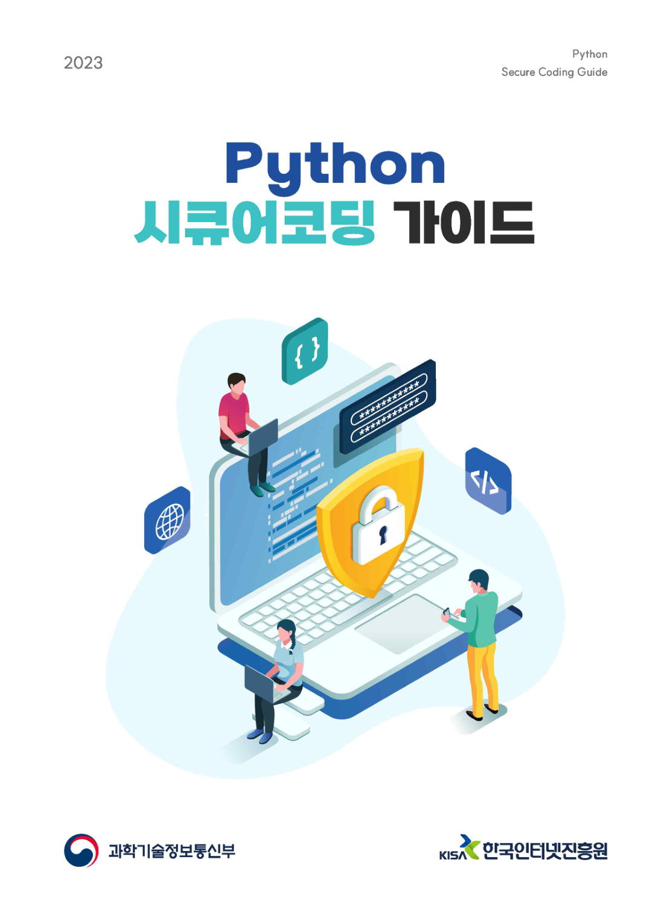
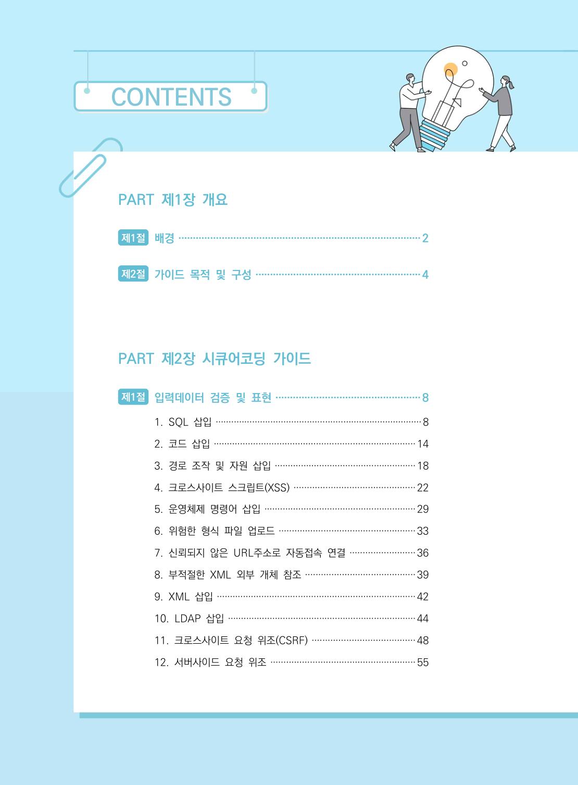
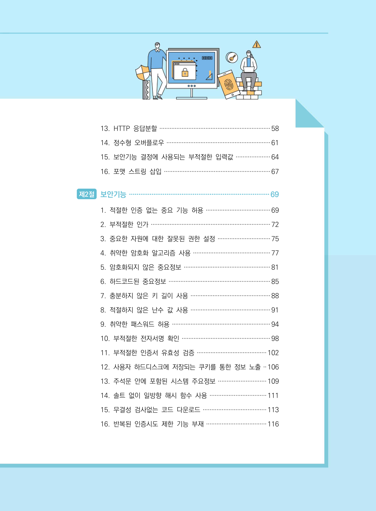
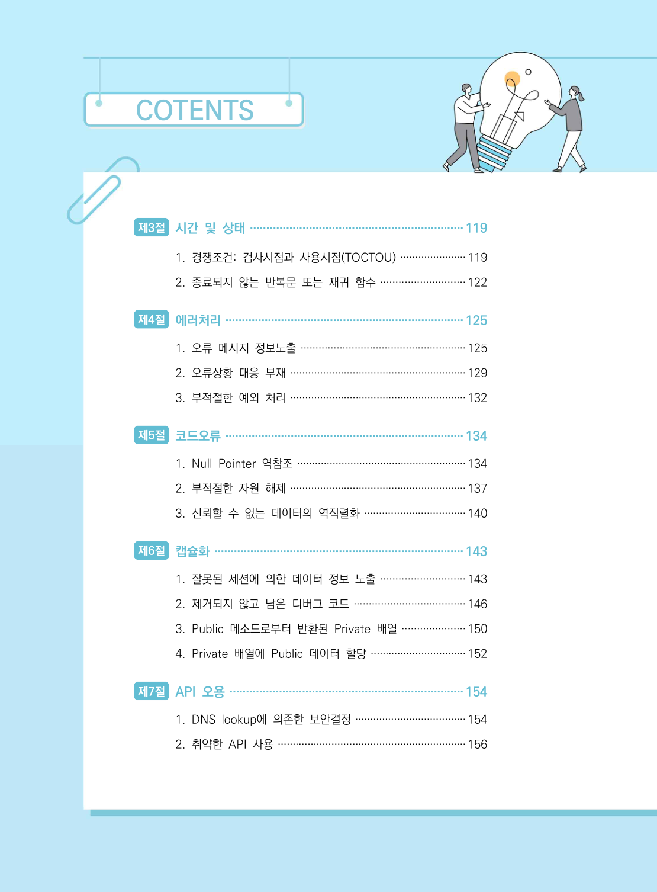
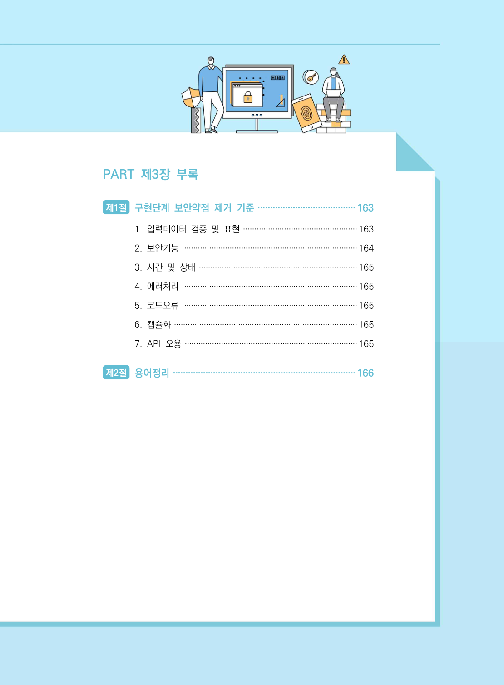

# 표지·목차·앞부분

> 변환 안내(원문 외): 아래 본문은 PDF 텍스트를 추출한 전사입니다. 코드 줄번호·특수 공백·원문 오류를 유지했습니다. 실행용 코드가 아닙니다. 표·그림·들여쓰기는 연결된 페이지 이미지와 대조하세요. 페이지 경계의 줄바꿈을 보존하며, 동일 페이지가 여러 항목에 나뉘면 각 항목의 본문은 해당 구간만 포함합니다.

### PDF 1페이지

<!-- source-page:Python-2023:1; source-lines: -->

원본 페이지 이미지 (변환 외 보존 자료)

### PDF 2페이지

<!-- source-page:Python-2023:2; source-lines:0,1,2,3,4,5,6,7,8,9,10,11,12,13,14,15,16,17 -->

CONTENTS

PART 제1장 개요

#### 제1절 배경····················································································2

#### 제2절 가이드 목적 및 구성·························································4

PART 제2장 시큐어코딩 가이드

#### 제1절 입력데이터 검증 및 표현··················································8

#### 1. SQL 삽입···············································································8

#### 2. 코드 삽입·············································································14

#### 3. 경로 조작 및 자원 삽입······················································18

#### 4. 크로스사이트 스크립트(XSS) ··············································22

#### 5. 운영체제 명령어 삽입··························································29

#### 6. 위험한 형식 파일 업로드····················································33

#### 7. 신뢰되지 않은 URL주소로 자동접속 연결·························36

#### 8. 부적절한 XML 외부 개체 참조··········································39

#### 9. XML 삽입············································································42

#### 10. LDAP 삽입········································································44

#### 11. 크로스사이트 요청 위조(CSRF) ·······································48

#### 12. 서버사이드 요청 위조·······················································55

원본 페이지 이미지 (변환 외 보존 자료)

### PDF 3페이지

<!-- source-page:Python-2023:3; source-lines:0,1,2,3,4,5,6,7,8,9,10,11,12,13,14,15,16,17,18,19,20 -->

#### 13. HTTP 응답분할·································································58

#### 14. 정수형 오버플로우·····························································61

#### 15. 보안기능 결정에 사용되는 부적절한 입력값····················64

#### 16. 포맷 스트링 삽입······························································67

#### 제2절 보안기능···········································································69

#### 1. 적절한 인증 없는 중요 기능 허용······································69

#### 2. 부적절한 인가······································································72

#### 3. 중요한 자원에 대한 잘못된 권한 설정·······························75

#### 4. 취약한 암호화 알고리즘 사용·············································77

#### 5. 암호화되지 않은 중요정보···················································81

#### 6. 하드코드된 중요정보····························································85

#### 7. 충분하지 않은 키 길이 사용···············································88

#### 8. 적절하지 않은 난수 값 사용···············································91

#### 9. 취약한 패스워드 허용··························································94

#### 10. 부적절한 전자서명 확인····················································98

#### 11. 부적절한 인증서 유효성 검증·········································102

#### 12. 사용자 하드디스크에 저장되는 쿠키를 통한 정보 노출··106

#### 13. 주석문 안에 포함된 시스템 주요정보····························109

#### 14. 솔트 없이 일방향 해시 함수 사용·································111

#### 15. 무결성 검사없는 코드 다운로드·····································113

#### 16. 반복된 인증시도 제한 기능 부재···································116

원본 페이지 이미지 (변환 외 보존 자료)

### PDF 4페이지

<!-- source-page:Python-2023:4; source-lines:0,1,2,3,4,5,6,7,8,9,10,11,12,13,14,15,16,17,18,19 -->

COTENTS

#### 제3절 시간 및 상태·································································119

#### 1. 경쟁조건: 검사시점과 사용시점(TOCTOU) ······················119

#### 2. 종료되지 않는 반복문 또는 재귀 함수····························122

#### 제4절 에러처리·········································································125

#### 1. 오류 메시지 정보노출·······················································125

#### 2. 오류상황 대응 부재···························································129

#### 3. 부적절한 예외 처리···························································132

#### 제5절 코드오류·········································································134

#### 1. Null Pointer 역참조·························································134

#### 2. 부적절한 자원 해제···························································137

#### 3. 신뢰할 수 없는 데이터의 역직렬화··································140

#### 제6절 캡슐화············································································143

#### 1. 잘못된 세션에 의한 데이터 정보 노출····························143

#### 2. 제거되지 않고 남은 디버그 코드·····································146

#### 3. Public 메소드로부터 반환된 Private 배열·····················150

#### 4. Private 배열에 Public 데이터 할당································152

#### 제7절 API 오용·······································································154

#### 1. DNS lookup에 의존한 보안결정·····································154

#### 2. 취약한 API 사용·······························································156

원본 페이지 이미지 (변환 외 보존 자료)

### PDF 5페이지

<!-- source-page:Python-2023:5; source-lines:0,1,2,3,4,5,6,7,8,9 -->

PART 제3장 부록

#### 제1절 구현단계 보안약점 제거 기준·······································163

#### 1. 입력데이터 검증 및 표현··················································163

#### 2. 보안기능·············································································164

#### 3. 시간 및 상태·····································································165

#### 4. 에러처리·············································································165

#### 5. 코드오류·············································································165

#### 6. 캡슐화················································································165

#### 7. API 오용············································································165

#### 제2절 용어정리·········································································166

원본 페이지 이미지 (변환 외 보존 자료)

### PDF 6페이지

<!-- source-page:Python-2023:6; source-lines: -->

원본 페이지 이미지 (변환 외 보존 자료)

---

## 탐색 링크 (원문 외)

[통합 인덱스](../INDEX.md)

