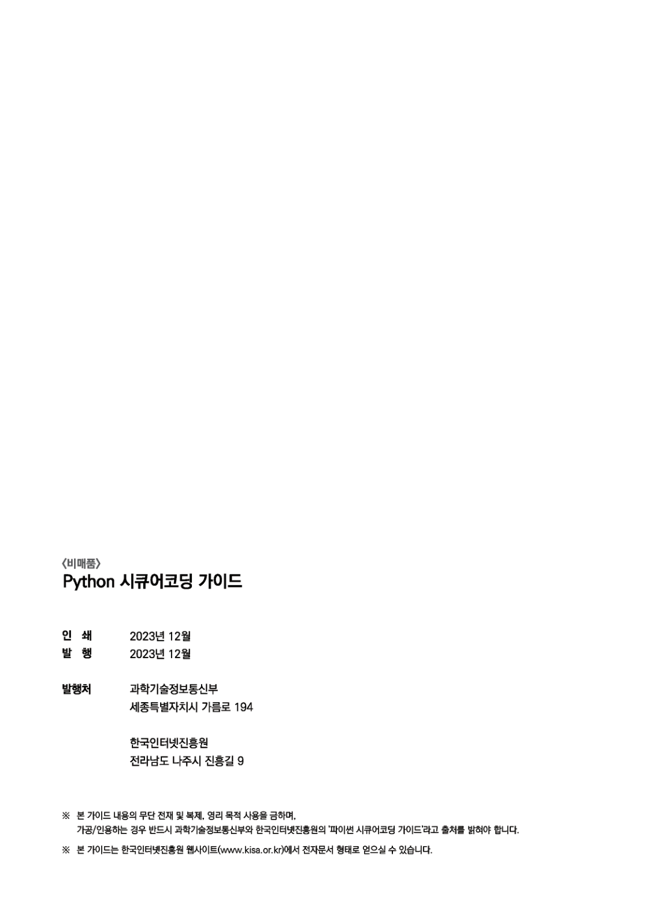
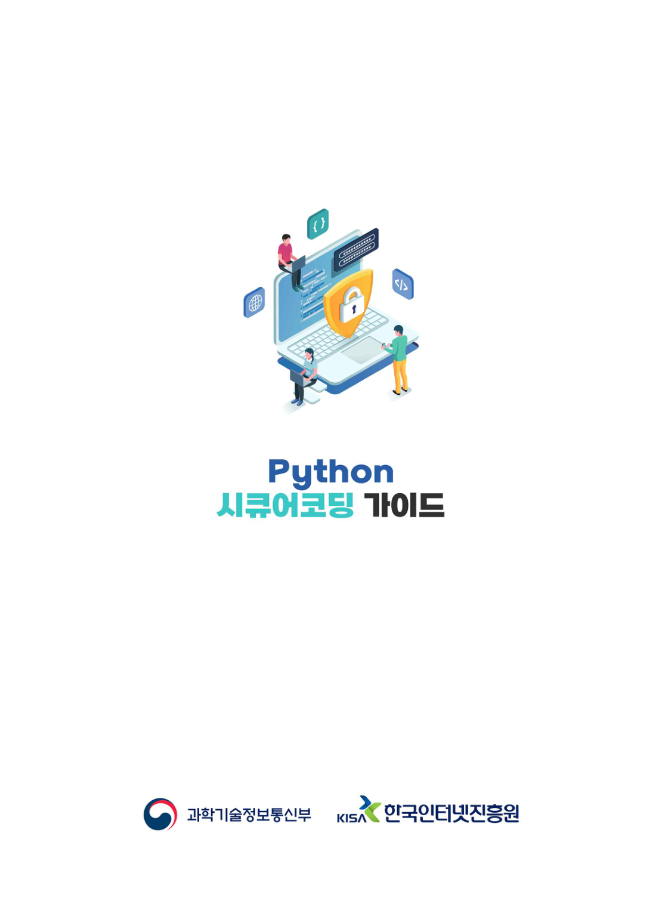

# 발행정보·뒷표지

> 변환 안내(원문 외): 아래 본문은 PDF 텍스트를 추출한 전사입니다. 코드 줄번호·특수 공백·원문 오류를 유지했습니다. 실행용 코드가 아닙니다. 표·그림·들여쓰기는 연결된 페이지 이미지와 대조하세요. 페이지 경계의 줄바꿈을 보존하며, 동일 페이지가 여러 항목에 나뉘면 각 항목의 본문은 해당 구간만 포함합니다.

### PDF 175페이지

<!-- source-page:Python-2023:175; source-lines: -->


<details><summary>원본 페이지 이미지 (변환 외 보존 자료)</summary>



</details>

#### 이미지 내 원문 전사 (수동 대조)

> 변환 안내(원문 외): 이 페이지는 텍스트 레이어가 없어 원본 렌더를 직접 읽어 전사했습니다. 자동 추출 본문과 별도로 표시합니다.

```text
〈비매품〉
Python 시큐어코딩 가이드

인 쇄 2023년 12월
발 행 2023년 12월

발행처 과학기술정보통신부
세종특별자치시 가름로 194

한국인터넷진흥원
전라남도 나주시 진흥길 9

※ 본 가이드 내용의 무단 전재 및 복제, 영리 목적 사용을 금하며,
가공/인용하는 경우 반드시 과학기술정보통신부와 한국인터넷진흥원의 "파이썬 시큐어코딩 가이드"라고 출처를 밝혀야 합니다.

※ 본 가이드는 한국인터넷진흥원 웹사이트(www.kisa.or.kr)에서 전자문서 형태로 얻으실 수 있습니다.
```

### PDF 176페이지

<!-- source-page:Python-2023:176; source-lines: -->


<details><summary>원본 페이지 이미지 (변환 외 보존 자료)</summary>



</details>

---

## 탐색 링크 (원문 외)

[통합 인덱스](../INDEX.md)

