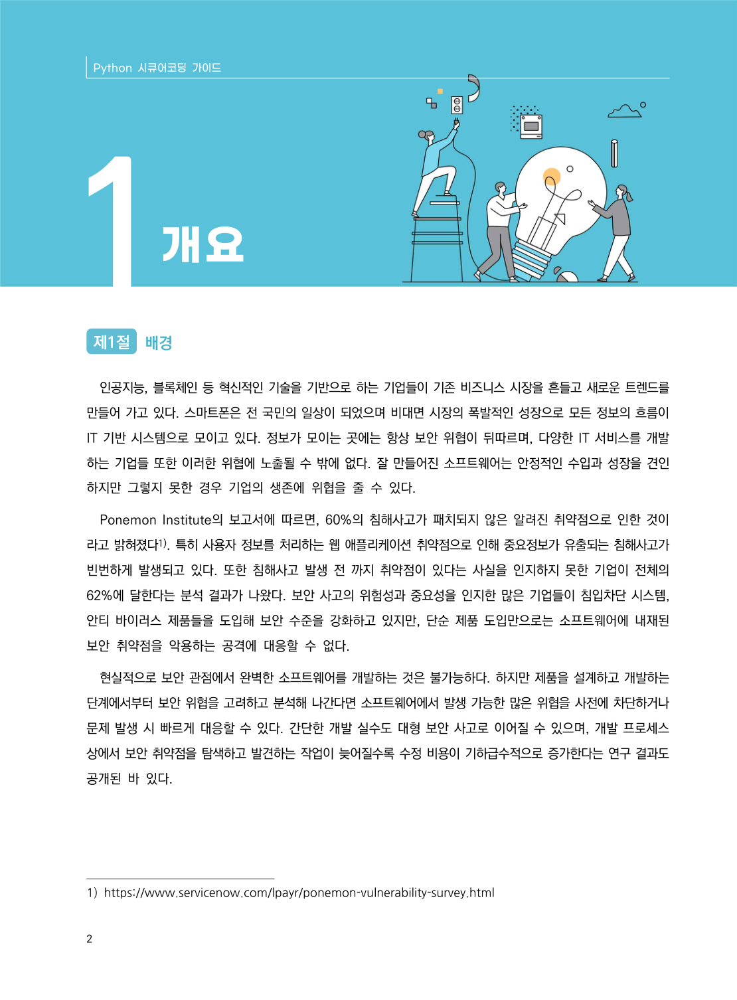
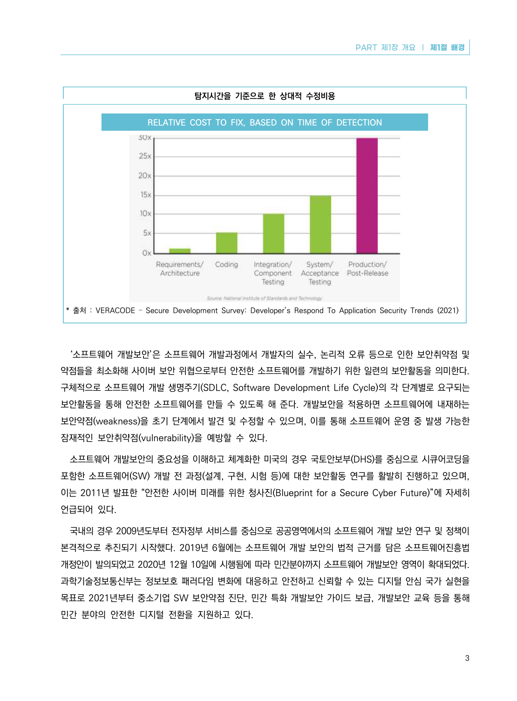

# 제1절 배경

> 변환 안내(원문 외): 아래 본문은 PDF 텍스트를 추출한 전사입니다. 코드 줄번호·특수 공백·원문 오류를 유지했습니다. 실행용 코드가 아닙니다. 표·그림·들여쓰기는 연결된 페이지 이미지와 대조하세요. 페이지 경계의 줄바꿈을 보존하며, 동일 페이지가 여러 항목에 나뉘면 각 항목의 본문은 해당 구간만 포함합니다.

### PDF 8페이지 / 인쇄 2페이지

<!-- source-page:Python-2023:8; source-lines:0,1,3,4,5,6,7,8,9,10,11,12,13,14,15,16,17,18,19,20 -->

Python 시큐어코딩 가이드

2

#### 제1절 배경

인공지능, 블록체인 등 혁신적인 기술을 기반으로 하는 기업들이 기존 비즈니스 시장을 흔들고 새로운 트렌드를 
만들어 가고 있다. 스마트폰은 전 국민의 일상이 되었으며 비대면 시장의 폭발적인 성장으로 모든 정보의 흐름이 
IT 기반 시스템으로 모이고 있다. 정보가 모이는 곳에는 항상 보안 위협이 뒤따르며, 다양한 IT 서비스를 개발
하는 기업들 또한 이러한 위협에 노출될 수 밖에 없다. 잘 만들어진 소프트웨어는 안정적인 수입과 성장을 견인
하지만 그렇지 못한 경우 기업의 생존에 위협을 줄 수 있다.

Ponemon Institute의 보고서에 따르면, 60%의 침해사고가 패치되지 않은 알려진 취약점으로 인한 것이
라고 밝혀졌다1). 특히 사용자 정보를 처리하는 웹 애플리케이션 취약점으로 인해 중요정보가 유출되는 침해사고가 
빈번하게 발생되고 있다. 또한 침해사고 발생 전 까지 취약점이 있다는 사실을 인지하지 못한 기업이 전체의 
62%에 달한다는 분석 결과가 나왔다. 보안 사고의 위험성과 중요성을 인지한 많은 기업들이 침입차단 시스템, 
안티 바이러스 제품들을 도입해 보안 수준을 강화하고 있지만, 단순 제품 도입만으로는 소프트웨어에 내재된 
보안 취약점을 악용하는 공격에 대응할 수 없다. 

현실적으로 보안 관점에서 완벽한 소프트웨어를 개발하는 것은 불가능하다. 하지만 제품을 설계하고 개발하는 
단계에서부터 보안 위협을 고려하고 분석해 나간다면 소프트웨어에서 발생 가능한 많은 위협을 사전에 차단하거나 
문제 발생 시 빠르게 대응할 수 있다. 간단한 개발 실수도 대형 보안 사고로 이어질 수 있으며, 개발 프로세스 
상에서 보안 취약점을 탐색하고 발견하는 작업이 늦어질수록 수정 비용이 기하급수적으로 증가한다는 연구 결과도 
공개된 바 있다. 

1) https://www.servicenow.com/lpayr/ponemon-vulnerability-survey.html

원본 페이지 이미지 (변환 외 보존 자료)

### PDF 9페이지 / 인쇄 3페이지

<!-- source-page:Python-2023:9; source-lines:0,1,2,3,4,5,6,7,8,9,10,11,12,13,14,15,16,17,18,19,20 -->

PART 제1장 개요 ❘ 제1절 배경

3

탐지시간을 기준으로 한 상대적 수정비용

RELATIVE COST TO FIX, BASED ON TIME OF DETECTION

* 출처 : VERACODE – Secure Development Survey: Developer’s Respond To Application Security Trends (2021)

‘소프트웨어 개발보안’은 소프트웨어 개발과정에서 개발자의 실수, 논리적 오류 등으로 인한 보안취약점 및 
약점들을 최소화해 사이버 보안 위협으로부터 안전한 소프트웨어를 개발하기 위한 일련의 보안활동을 의미한다. 
구체적으로 소프트웨어 개발 생명주기(SDLC, Software Development Life Cycle)의 각 단계별로 요구되는 
보안활동을 통해 안전한 소프트웨어를 만들 수 있도록 해 준다. 개발보안을 적용하면 소프트웨어에 내재하는 
보안약점(weakness)을 초기 단계에서 발견 및 수정할 수 있으며, 이를 통해 소프트웨어 운영 중 발생 가능한 
잠재적인 보안취약점(vulnerability)을 예방할 수 있다. 

소프트웨어 개발보안의 중요성을 이해하고 체계화한 미국의 경우 국토안보부(DHS)를 중심으로 시큐어코딩을 
포함한 소프트웨어(SW) 개발 전 과정(설계, 구현, 시험 등)에 대한 보안활동 연구를 활발히 진행하고 있으며, 
이는 2011년 발표한 “안전한 사이버 미래를 위한 청사진(Blueprint for a Secure Cyber Future)”에 자세히 
언급되어 있다.

국내의 경우 2009년도부터 전자정부 서비스를 중심으로 공공영역에서의 소프트웨어 개발 보안 연구 및 정책이 
본격적으로 추진되기 시작했다. 2019년 6월에는 소프트웨어 개발 보안의 법적 근거를 담은 소프트웨어진흥법 
개정안이 발의되었고 2020년 12월 10일에 시행됨에 따라 민간분야까지 소프트웨어 개발보안 영역이 확대되었다. 
과학기술정보통신부는 정보보호 패러다임 변화에 대응하고 안전하고 신뢰할 수 있는 디지털 안심 국가 실현을 
목표로 2021년부터 중소기업 SW 보안약점 진단, 민간 특화 개발보안 가이드 보급, 개발보안 교육 등을 통해 
민간 분야의 안전한 디지털 전환을 지원하고 있다.

원본 페이지 이미지 (변환 외 보존 자료)

---

## 탐색 링크 (원문 외)

[통합 인덱스](../../../INDEX.md)

