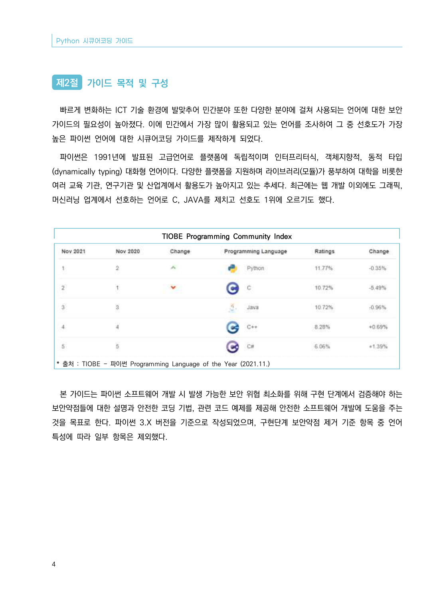
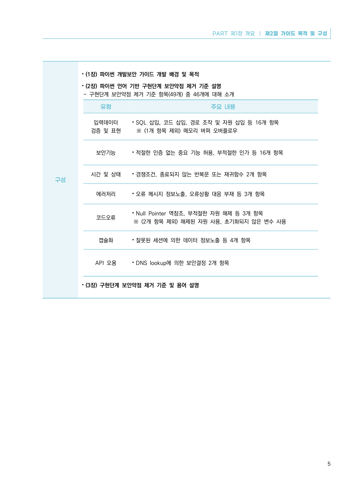

# 제2절 가이드 목적 및 구성

> 변환 안내(원문 외): 아래 본문은 PDF 텍스트를 추출한 전사입니다. 코드 줄번호·특수 공백·원문 오류를 유지했습니다. 실행용 코드가 아닙니다. 표·그림·들여쓰기는 연결된 페이지 이미지와 대조하세요. 페이지 경계의 줄바꿈을 보존하며, 동일 페이지가 여러 항목에 나뉘면 각 항목의 본문은 해당 구간만 포함합니다.

### PDF 10페이지 / 인쇄 4페이지

<!-- source-page:Python-2023:10; source-lines:0,1,2,3,4,5,6,7,8,9,10,11,12,13,14,15 -->

Python 시큐어코딩 가이드

4

#### 제2절 가이드 목적 및 구성

빠르게 변화하는 ICT 기술 환경에 발맞추어 민간분야 또한 다양한 분야에 걸쳐 사용되는 언어에 대한 보안 
가이드의 필요성이 높아졌다. 이에 민간에서 가장 많이 활용되고 있는 언어를 조사하여 그 중 선호도가 가장 
높은 파이썬 언어에 대한 시큐어코딩 가이드를 제작하게 되었다.

파이썬은 1991년에 발표된 고급언어로 플랫폼에 독립적이며 인터프리터식, 객체지향적, 동적 타입
(dynamically typing) 대화형 언어이다. 다양한 플랫폼을 지원하며 라이브러리(모듈)가 풍부하여 대학을 비롯한 
여러 교육 기관, 연구기관 및 산업계에서 활용도가 높아지고 있는 추세다. 최근에는 웹 개발 이외에도 그래픽, 
머신러닝 업계에서 선호하는 언어로 C, JAVA를 제치고 선호도 1위에 오르기도 했다.

TIOBE Programming Community Index

* 출처 : TIOBE - 파이썬 Programming Language of the Year (2021.11.)

본 가이드는 파이썬 소프트웨어 개발 시 발생 가능한 보안 위협 최소화를 위해 구현 단계에서 검증해야 하는 
보안약점들에 대한 설명과 안전한 코딩 기법, 관련 코드 예제를 제공해 안전한 소프트웨어 개발에 도움을 주는 
것을 목표로 한다. 파이썬 3.X 버전을 기준으로 작성되었으며, 구현단계 보안약점 제거 기준 항목 중 언어 
특성에 따라 일부 항목은 제외했다.

원본 페이지 이미지 (변환 외 보존 자료)

### PDF 11페이지 / 인쇄 5페이지

<!-- source-page:Python-2023:11; source-lines:0,1,2,3,4,5,6,7,8,9,10,11,12,13,14,15,16,17,18,19,20,21,22,23,24,25 -->

PART 제1장 개요 ❘ 제2절 가이드 목적 및 구성

5

구성

⦁(1장) 파이썬 개발보안 가이드 개발 배경 및 목적
⦁(2장) 파이썬 언어 기반 구현단계 보안약점 제거 기준 설명
- 구현단계 보안약점 제거 기준 항목(49개) 중 46개에 대해 소개

유형

주요 내용

입력데이터
검증 및 표현

⦁SQL 삽입, 코드 삽입, 경로 조작 및 자원 삽입 등 16개 항목
 ※ (1개 항목 제외) 메모리 버퍼 오버플로우

보안기능

⦁적절한 인증 없는 중요 기능 허용, 부적절한 인가 등 16개 항목

시간 및 상태

⦁경쟁조건, 종료되지 않는 반복문 또는 재귀함수 2개 항목

에러처리

⦁오류 메시지 정보노출, 오류상황 대응 부재 등 3개 항목

코드오류

⦁Null Pointer 역참조, 부적절한 자원 해제 등 3개 항목
※ (2개 항목 제외) 해제된 자원 사용, 초기화되지 않은 변수 사용

캡슐화

⦁잘못된 세션에 의한 데이터 정보노출 등 4개 항목

API 오용

⦁DNS lookup에 의한 보안결정 2개 항목

⦁(3장) 구현단계 보안약점 제거 기준 및 용어 설명

원본 페이지 이미지 (변환 외 보존 자료)

### PDF 12페이지 / 인쇄 6페이지

<!-- source-page:Python-2023:12; source-lines: -->

원본 페이지 이미지 (변환 외 보존 자료)

---

## 탐색 링크 (원문 외)

[통합 인덱스](../../../INDEX.md)

