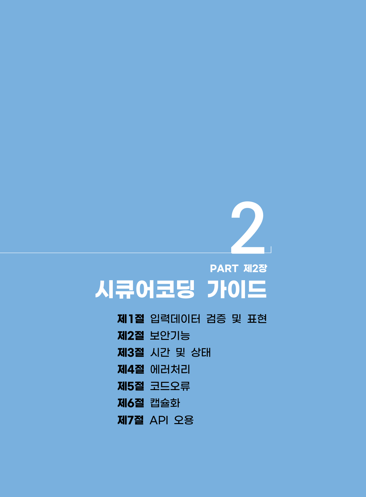

# 제2장 시큐어코딩 가이드

> 변환 안내(원문 외): 아래 본문은 PDF 텍스트를 추출한 전사입니다. 코드 줄번호·특수 공백·원문 오류를 유지했습니다. 실행용 코드가 아닙니다. 표·그림·들여쓰기는 연결된 페이지 이미지와 대조하세요. 페이지 경계의 줄바꿈을 보존하며, 동일 페이지가 여러 항목에 나뉘면 각 항목의 본문은 해당 구간만 포함합니다.

### PDF 13페이지 / 인쇄 7페이지

<!-- source-page:Python-2023:13; source-lines:0,1,2,3,4,5,6,7,8,9 -->

2

PART 제2장

시큐어코딩 가이드

#### 제1절 입력데이터 검증 및 표현

#### 제2절 보안기능

#### 제3절 시간 및 상태

#### 제4절 에러처리

#### 제5절 코드오류

#### 제6절 캡슐화

#### 제7절 API 오용

원본 페이지 이미지 (변환 외 보존 자료)

### PDF 14페이지 / 인쇄 8페이지

<!-- source-page:Python-2023:14; source-lines:2,3,4 -->

2

시큐어코딩
가이드

원본 페이지 이미지 (변환 외 보존 자료)

---

## 탐색 링크 (원문 외)

[통합 인덱스](../../INDEX.md)

