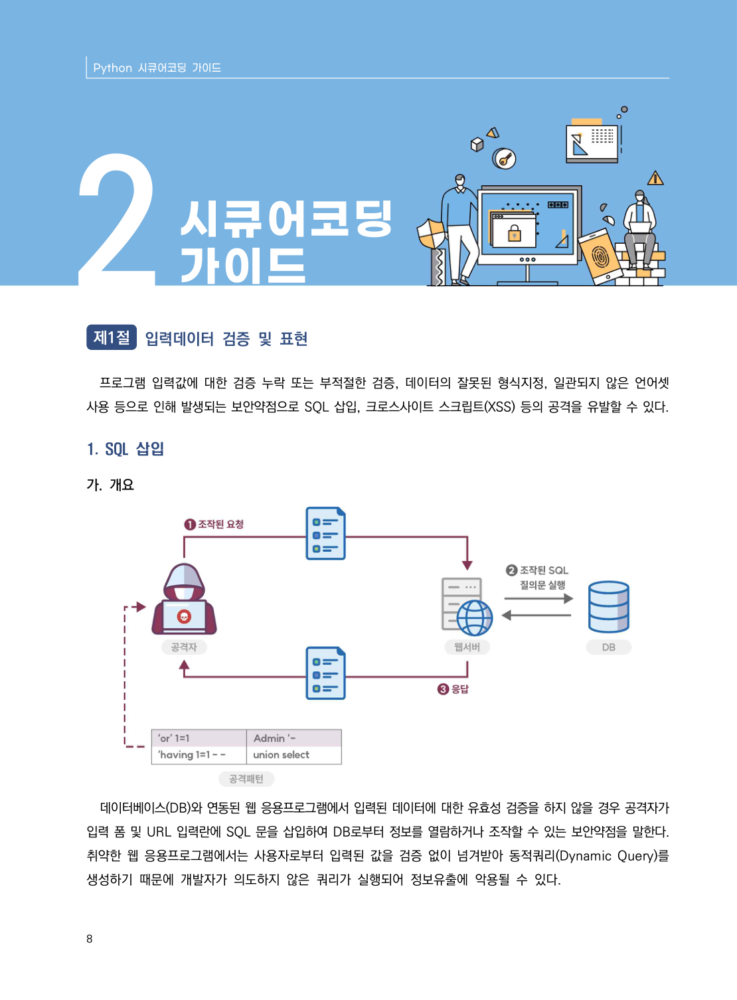

# 제1절 입력데이터 검증 및 표현

> 변환 안내(원문 외): 아래 본문은 PDF 텍스트를 추출한 전사입니다. 코드 줄번호·특수 공백·원문 오류를 유지했습니다. 실행용 코드가 아닙니다. 표·그림·들여쓰기는 연결된 페이지 이미지와 대조하세요. 페이지 경계의 줄바꿈을 보존하며, 동일 페이지가 여러 항목에 나뉘면 각 항목의 본문은 해당 구간만 포함합니다.

### PDF 14페이지 / 인쇄 8페이지

<!-- source-page:Python-2023:14; source-lines:0,5,6,7 -->

Python 시큐어코딩 가이드

#### 제1절 입력데이터 검증 및 표현

프로그램 입력값에 대한 검증 누락 또는 부적절한 검증, 데이터의 잘못된 형식지정, 일관되지 않은 언어셋 
사용 등으로 인해 발생되는 보안약점으로 SQL 삽입, 크로스사이트 스크립트(XSS) 등의 공격을 유발할 수 있다.

원본 페이지 이미지 (변환 외 보존 자료)

---

## 탐색 링크 (원문 외)

[통합 인덱스](../../../INDEX.md)

