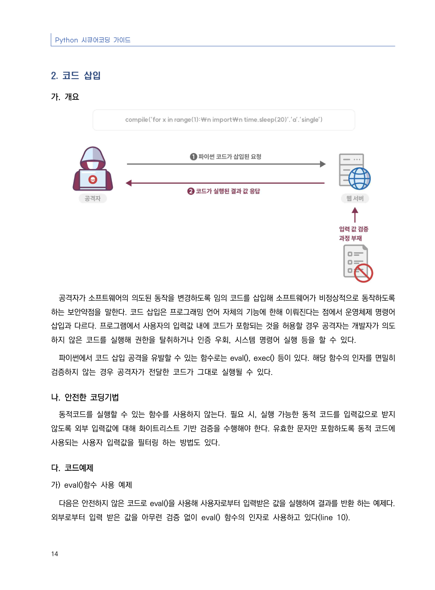
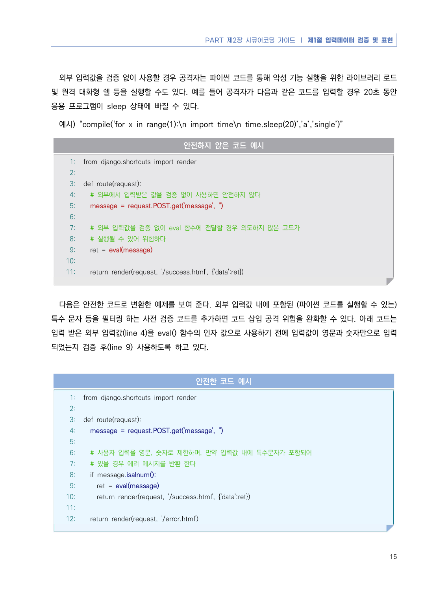
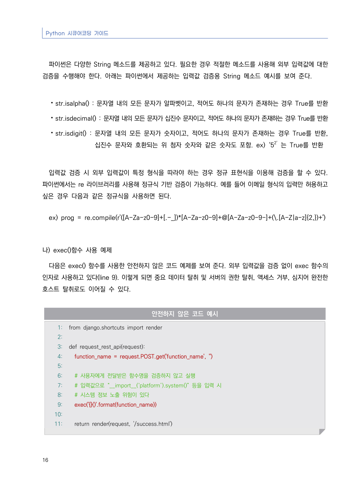
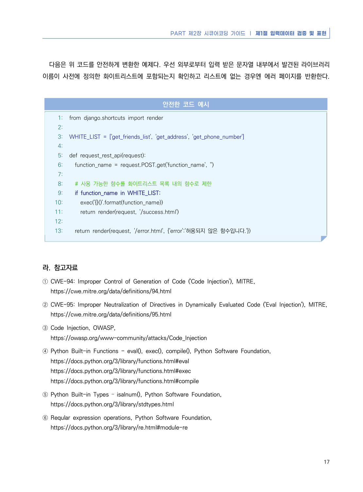

# 2. 코드 삽입

> 변환 안내(원문 외): 아래 본문은 PDF 텍스트를 추출한 전사입니다. 코드 줄번호·특수 공백·원문 오류를 유지했습니다. 실행용 코드가 아닙니다. 표·그림·들여쓰기는 연결된 페이지 이미지와 대조하세요. 페이지 경계의 줄바꿈을 보존하며, 동일 페이지가 여러 항목에 나뉘면 각 항목의 본문은 해당 구간만 포함합니다.

### PDF 20페이지 / 인쇄 14페이지

<!-- source-page:Python-2023:20; source-lines:0,1,2,3,4,5,6,7,8,9,10,11,12,13,14,15,16,17 -->

Python 시큐어코딩 가이드

14

#### 2. 코드 삽입

#### 가. 개요

공격자가 소프트웨어의 의도된 동작을 변경하도록 임의 코드를 삽입해 소프트웨어가 비정상적으로 동작하도록 
하는 보안약점을 말한다. 코드 삽입은 프로그래밍 언어 자체의 기능에 한해 이뤄진다는 점에서 운영체제 명령어 
삽입과 다르다. 프로그램에서 사용자의 입력값 내에 코드가 포함되는 것을 허용할 경우 공격자는 개발자가 의도
하지 않은 코드를 실행해 권한을 탈취하거나 인증 우회, 시스템 명령어 실행 등을 할 수 있다.

파이썬에서 코드 삽입 공격을 유발할 수 있는 함수로는 eval(), exec() 등이 있다. 해당 함수의 인자를 면밀히 
검증하지 않는 경우 공격자가 전달한 코드가 그대로 실행될 수 있다.

#### 나. 안전한 코딩기법

동적코드를 실행할 수 있는 함수를 사용하지 않는다. 필요 시, 실행 가능한 동적 코드를 입력값으로 받지 
않도록 외부 입력값에 대해 화이트리스트 기반 검증을 수행해야 한다. 유효한 문자만 포함하도록 동적 코드에 
사용되는 사용자 입력값을 필터링 하는 방법도 있다.

#### 다. 코드예제

#### 가) eval()함수 사용 예제

다음은 안전하지 않은 코드로 eval()을 사용해 사용자로부터 입력받은 값을 실행하여 결과를 반환 하는 예제다. 
외부로부터 입력 받은 값을 아무런 검증 없이 eval() 함수의 인자로 사용하고 있다(line 10).

<details><summary>원본 페이지 이미지 (변환 외 보존 자료)</summary>



</details>

### PDF 21페이지 / 인쇄 15페이지

<!-- source-page:Python-2023:21; source-lines:0,1,2,3,4,5,6,7,8,9,10,11,12,13,14,15,16,17,18,19,20,21,22,23,24,25,26,27,28,29,30,31,32,33,34,35,36,37,38,39,40,41,42,43,44,45,46,47,48,49,50,51,52,53 -->

PART 제2장 시큐어코딩 가이드 ❘ 제1절 입력데이터 검증 및 표현

15

외부 입력값을 검증 없이 사용할 경우 공격자는 파이썬 코드를 통해 악성 기능 실행을 위한 라이브러리 로드 
및 원격 대화형 쉘 등을 실행할 수도 있다. 예를 들어 공격자가 다음과 같은 코드를 입력할 경우 20초 동안 
응용 프로그램이 sleep 상태에 빠질 수 있다. 

예시) “compile(‘for x in range(1):\n import time\n time.sleep(20)’,’a’,’single’)”

#### 안전하지 않은 코드 예시

```python
1: from django.shortcuts import render
2:
3: def route(request):
4:   # 외부에서 입력받은 값을 검증 없이 사용하면 안전하지 않다
5:   message = request.POST.get('message', '')
6:     
7:   # 외부 입력값을 검증 없이 eval 함수에 전달할 경우 의도하지 않은 코드가 
8:   # 실행될 수 있어 위험하다
9:   ret = eval(message)
10:
11:   return render(request, '/success.html', {'data':ret})
```

다음은 안전한 코드로 변환한 예제를 보여 준다. 외부 입력값 내에 포함된 (파이썬 코드를 실행할 수 있는) 
특수 문자 등을 필터링 하는 사전 검증 코드를 추가하면 코드 삽입 공격 위험을 완화할 수 있다. 아래 코드는 
입력 받은 외부 입력값(line 4)을 eval() 함수의 인자 값으로 사용하기 전에 입력값이 영문과 숫자만으로 입력
되었는지 검증 후(line 9) 사용하도록 하고 있다. 

#### 안전한 코드 예시

```python
1: from django.shortcuts import render
2:
3: def route(request):
4:   message = request.POST.get('message', '')
5:
6:   # 사용자 입력을 영문, 숫자로 제한하며, 만약 입력값 내에 특수문자가 포함되어 
7:   # 있을 경우 에러 메시지를 반환 한다
8:   if message.isalnum():
9:     ret = eval(message)
10:     return render(request, '/success.html', {'data':ret})
11:     
12:   return render(request, '/error.html')
```

<details><summary>원본 페이지 이미지 (변환 외 보존 자료)</summary>



</details>

### PDF 22페이지 / 인쇄 16페이지

<!-- source-page:Python-2023:22; source-lines:0,1,2,3,4,5,6,7,8,9,10,11,12,13,14,15,16,17,18,19,20,21,22,23,24,25,26,27,28,29,30,31,32,33,34,35,36 -->

Python 시큐어코딩 가이드

16

파이썬은 다양한 String 메소드를 제공하고 있다. 필요한 경우 적절한 메소드를 사용해 외부 입력값에 대한 
검증을 수행해야 한다. 아래는 파이썬에서 제공하는 입력값 검증용 String 메소드 예시를 보여 준다.

⦁str.isalpha() : 문자열 내의 모든 문자가 알파벳이고, 적어도 하나의 문자가 존재하는 경우 True를 반환
⦁str.isdecimal() : 문자열 내의 모든 문자가 십진수 문자이고, 적어도 하나의 문자가 존재하는 경우 True를 반환
⦁str.isdigit() : 문자열 내의 모든 문자가 숫자이고, 적어도 하나의 문자가 존재하는 경우 True를 반환, 

십진수 문자와 호환되는 위 첨자 숫자와 같은 숫자도 포함. ex) ‘52’ 는 True를 반환

입력값 검증 시 외부 입력값이 특정 형식을 따라야 하는 경우 정규 표현식을 이용해 검증을 할 수 있다. 
파이썬에서는 re 라이브러리를 사용해 정규식 기반 검증이 가능하다. 예를 들어 이메일 형식의 입력만 허용하고 
싶은 경우 다음과 같은 정규식을 사용하면 된다.

ex) prog = re.compile(r'([A-Za-z0-9]+[.-_])*[A-Za-z0-9]+@[A-Za-z0-9-]+(\.[A-Z|a-z]{2,})+')

#### 나) exec()함수 사용 예제

다음은 exec() 함수를 사용한 안전하지 않은 코드 예제를 보여 준다. 외부 입력값을 검증 없이 exec 함수의 
인자로 사용하고 있다(line 9). 이렇게 되면 중요 데이터 탈취 및 서버의 권한 탈취, 액세스 거부, 심지어 완전한 
호스트 탈취로도 이어질 수 있다.

#### 안전하지 않은 코드 예시

```python
1: from django.shortcuts import render
2:
3: def request_rest_api(request):
4:   function_name = request.POST.get('function_name', '')
5:
6:   # 사용자에게 전달받은 함수명을 검증하지 않고 실행
7:   # 입력값으로 “__import__(‘platform’).system()” 등을 입력 시
8:   # 시스템 정보 노출 위험이 있다
9:   exec('{}()'.format(function_name))
10:     
11:   return render(request, '/success.html')
```

<details><summary>원본 페이지 이미지 (변환 외 보존 자료)</summary>



</details>

### PDF 23페이지 / 인쇄 17페이지

<!-- source-page:Python-2023:23; source-lines:0,1,2,3,4,5,6,7,8,9,10,11,12,13,14,15,16,17,18,19,20,21,22,23,24,25,26,27,28,29,30,31,32,33,34,35,36,37,38,39,40,41,42 -->

PART 제2장 시큐어코딩 가이드 ❘ 제1절 입력데이터 검증 및 표현

17

다음은 위 코드를 안전하게 변환한 예제다. 우선 외부로부터 입력 받은 문자열 내부에서 발견된 라이브러리 
이름이 사전에 정의한 화이트리스트에 포함되는지 확인하고 리스트에 없는 경우엔 에러 페이지를 반환한다.

#### 안전한 코드 예시

```python
1: from django.shortcuts import render
2:
3: WHITE_LIST = ['get_friends_list', 'get_address', 'get_phone_number']
4:
5: def request_rest_api(request):
6:   function_name = request.POST.get('function_name', '')
7:
8:   # 사용 가능한 함수를 화이트리스트 목록 내의 함수로 제한
9:   if function_name in WHITE_LIST:
10:     exec('{}()'.format(function_name))
11:     return render(request, '/success.html')
12:         
13:   return render(request, '/error.html', {'error':'허용되지 않은 함수입니다.'})
```

#### 라. 참고자료

① CWE-94: Improper Control of Generation of Code ('Code Injection'), MITRE,

https://cwe.mitre.org/data/definitions/94.html
② CWE-95: Improper Neutralization of Directives in Dynamically Evaluated Code ('Eval Injection'), MITRE,

https://cwe.mitre.org/data/definitions/95.html
③ Code Injection, OWASP,

https://owasp.org/www-community/attacks/Code_Injection
④ Python Built-in Functions - eval(), exec(), compile(), Python Software Foundation,

https://docs.python.org/3/library/functions.html#eval
https://docs.python.org/3/library/functions.html#exec
https://docs.python.org/3/library/functions.html#compile
⑤ Python Built-in Types – isalnum(), Python Software Foundation,

https://docs.python.org/3/library/stdtypes.html
⑥ Reqular expression operations, Python Software Foundation,

https://docs.python.org/3/library/re.html#module-re

<details><summary>원본 페이지 이미지 (변환 외 보존 자료)</summary>



</details>

---

## 탐색 링크 (원문 외)

[통합 인덱스](../../../INDEX.md)

