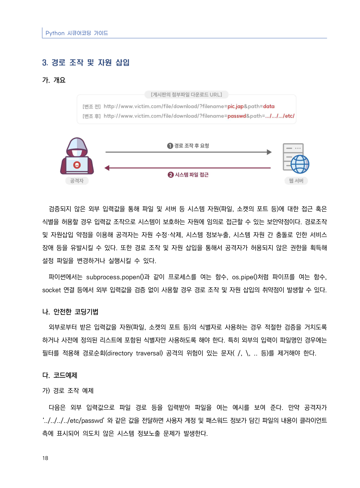
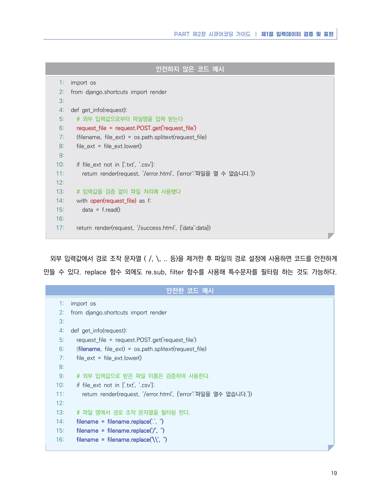
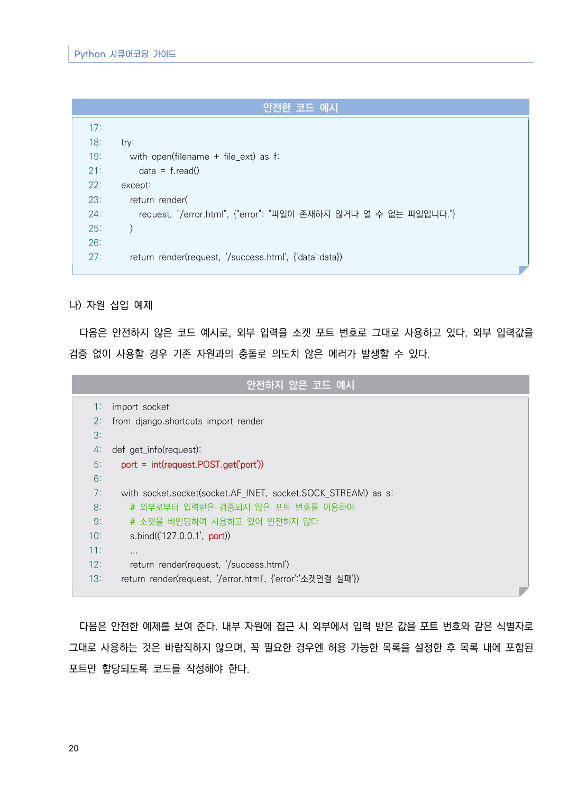
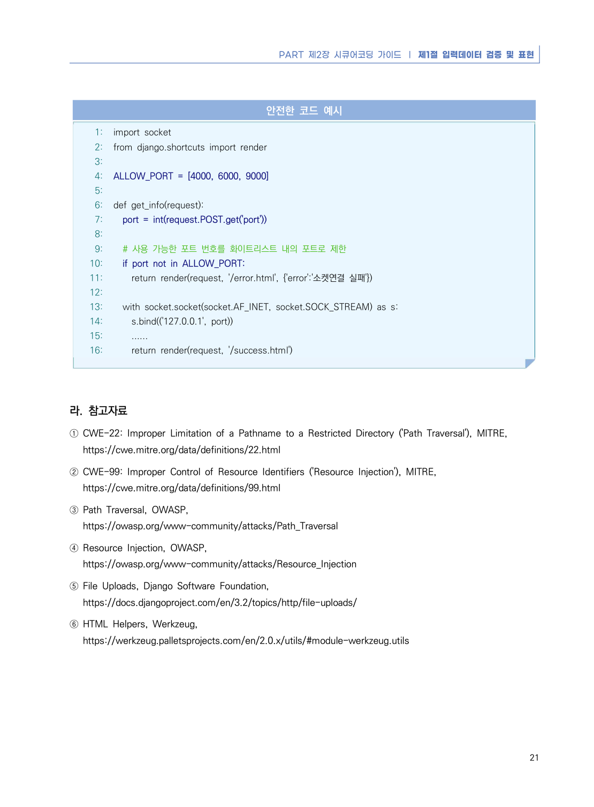

# 3. 경로 조작 및 자원 삽입

> 변환 안내(원문 외): 아래 본문은 PDF 텍스트를 추출한 전사입니다. 코드 줄번호·특수 공백·원문 오류를 유지했습니다. 실행용 코드가 아닙니다. 표·그림·들여쓰기는 연결된 페이지 이미지와 대조하세요. 페이지 경계의 줄바꿈을 보존하며, 동일 페이지가 여러 항목에 나뉘면 각 항목의 본문은 해당 구간만 포함합니다.

### PDF 24페이지 / 인쇄 18페이지

<!-- source-page:Python-2023:24; source-lines:0,1,2,3,4,5,6,7,8,9,10,11,12,13,14,15,16,17,18,19 -->

Python 시큐어코딩 가이드

18

#### 3. 경로 조작 및 자원 삽입

#### 가. 개요

검증되지 않은 외부 입력값을 통해 파일 및 서버 등 시스템 자원(파일, 소켓의 포트 등)에 대한 접근 혹은 
식별을 허용할 경우 입력값 조작으로 시스템이 보호하는 자원에 임의로 접근할 수 있는 보안약점이다. 경로조작 
및 자원삽입 약점을 이용해 공격자는 자원 수정·삭제, 시스템 정보누출, 시스템 자원 간 충돌로 인한 서비스 
장애 등을 유발시킬 수 있다. 또한 경로 조작 및 자원 삽입을 통해서 공격자가 허용되지 않은 권한을 획득해 
설정 파일을 변경하거나 실행시킬 수 있다.

파이썬에서는 subprocess.popen()과 같이 프로세스를 여는 함수, os.pipe()처럼 파이프를 여는 함수, 
socket 연결 등에서 외부 입력값을 검증 없이 사용할 경우 경로 조작 및 자원 삽입의 취약점이 발생할 수 있다.

#### 나. 안전한 코딩기법

외부로부터 받은 입력값을 자원(파일, 소켓의 포트 등)의 식별자로 사용하는 경우 적절한 검증을 거치도록 
하거나 사전에 정의된 리스트에 포함된 식별자만 사용하도록 해야 한다. 특히 외부의 입력이 파일명인 경우에는 
필터를 적용해 경로순회(directory traversal) 공격의 위험이 있는 문자( /, \, .. 등)를 제거해야 한다.

#### 다. 코드예제 

#### 가) 경로 조작 예제

다음은 외부 입력값으로 파일 경로 등을 입력받아 파일을 여는 예시를 보여 준다. 만약 공격자가 
‘../../../../etc/passwd’ 와 같은 값을 전달하면 사용자 계정 및 패스워드 정보가 담긴 파일의 내용이 클라이언트 
측에 표시되어 의도치 않은 시스템 정보노출 문제가 발생한다.

<details><summary>원본 페이지 이미지 (변환 외 보존 자료)</summary>



</details>

### PDF 25페이지 / 인쇄 19페이지

<!-- source-page:Python-2023:25; source-lines:0,1,2,3,4,5,6,7,8,9,10,11,12,13,14,15,16,17,18,19,20,21,22,23,24,25,26,27,28,29,30,31,32,33,34,35,36,37,38,39,40,41,42,43,44,45,46,47,48,49,50,51,52,53,54,55,56,57,58,59,60,61,62,63,64,65 -->

PART 제2장 시큐어코딩 가이드 ❘ 제1절 입력데이터 검증 및 표현

19

#### 안전하지 않은 코드 예시

```python
1: import os
2: from django.shortcuts import render
3:
4: def get_info(request):
5:   # 외부 입력값으로부터 파일명을 입력 받는다
6:   request_file = request.POST.get('request_file')
7:   (filename, file_ext) = os.path.splitext(request_file)
8:   file_ext = file_ext.lower()
9:
10:   if file_ext not in ['.txt', '.csv']:
11:     return render(request, '/error.html', {'error':'파일을 열 수 없습니다.'})
12:
13:   # 입력값을 검증 없이 파일 처리에 사용했다
14:   with open(request_file) as f:
15:     data = f.read()
16:         
17:   return render(request, '/success.html', {'data':data})
```

외부 입력값에서 경로 조작 문자열 ( /, \, .. 등)을 제거한 후 파일의 경로 설정에 사용하면 코드를 안전하게 
만들 수 있다. replace 함수 외에도 re.sub, filter 함수를 사용해 특수문자를 필터링 하는 것도 가능하다.

#### 안전한 코드 예시

```python
1: import os
2: from django.shortcuts import render
3:
4: def get_info(request):
5:   request_file = request.POST.get('request_file')
6:   (filename, file_ext) = os.path.splitext(request_file)
7:   file_ext = file_ext.lower()
8:
9:   # 외부 입력값으로 받은 파일 이름은 검증하여 사용한다.
10:   if file_ext not in ['.txt', '.csv']:
11:     return render(request, '/error.html', {'error':'파일을 열수 없습니다.'})
12:
13:   # 파일 명에서 경로 조작 문자열을 필터링 한다.
14:   filename = filename.replace('.', '')
15:   filename = filename.replace('/', '')
16:   filename = filename.replace('\\', '')
```

<details><summary>원본 페이지 이미지 (변환 외 보존 자료)</summary>



</details>

### PDF 26페이지 / 인쇄 20페이지

<!-- source-page:Python-2023:26; source-lines:0,1,2,3,4,5,6,7,8,9,10,11,12,13,14,15,16,17,18,19,20,21,22,23,24,25,26,27,28,29,30,31,32,33,34,35,36,37,38,39,40,41,42,43,44,45,46,47,48,49,50,51 -->

Python 시큐어코딩 가이드

20

#### 안전한 코드 예시

```python
17:
18:   try:
19:     with open(filename + file_ext) as f:
21:       data = f.read()
22:   except:
23:     return render(
24:       request, "/error.html", {"error": "파일이 존재하지 않거나 열 수 없는 파일입니다."}
25:     )
26:
27:     return render(request, '/success.html', {'data':data})
```

#### 나) 자원 삽입 예제

다음은 안전하지 않은 코드 예시로, 외부 입력을 소켓 포트 번호로 그대로 사용하고 있다. 외부 입력값을 
검증 없이 사용할 경우 기존 자원과의 충돌로 의도치 않은 에러가 발생할 수 있다. 

#### 안전하지 않은 코드 예시

```python
1: import socket
2: from django.shortcuts import render
3:
4: def get_info(request):
5:   port = int(request.POST.get('port'))
6:
7:   with socket.socket(socket.AF_INET, socket.SOCK_STREAM) as s:
8:     # 외부로부터 입력받은 검증되지 않은 포트 번호를 이용하여 
9:     # 소켓을 바인딩하여 사용하고 있어 안전하지 않다
10:     s.bind(('127.0.0.1', port))
11:     ...
12:     return render(request, '/success.html')
13:   return render(request, '/error.html', {'error':'소켓연결 실패'})
```

다음은 안전한 예제를 보여 준다. 내부 자원에 접근 시 외부에서 입력 받은 값을 포트 번호와 같은 식별자로 
그대로 사용하는 것은 바람직하지 않으며, 꼭 필요한 경우엔 허용 가능한 목록을 설정한 후 목록 내에 포함된 
포트만 할당되도록 코드를 작성해야 한다.

<details><summary>원본 페이지 이미지 (변환 외 보존 자료)</summary>



</details>

### PDF 27페이지 / 인쇄 21페이지

<!-- source-page:Python-2023:27; source-lines:0,1,2,3,4,5,6,7,8,9,10,11,12,13,14,15,16,17,18,19,20,21,22,23,24,25,26,27,28,29,30,31,32,33,34,35,36,37,38,39,40,41,42,43 -->

PART 제2장 시큐어코딩 가이드 ❘ 제1절 입력데이터 검증 및 표현

21

#### 안전한 코드 예시

```python
1: import socket
2: from django.shortcuts import render
3:
4: ALLOW_PORT = [4000, 6000, 9000]
5:
6: def get_info(request):
7:   port = int(request.POST.get('port'))
8:
9:   # 사용 가능한 포트 번호를 화이트리스트 내의 포트로 제한
10:   if port not in ALLOW_PORT:
11:     return render(request, '/error.html', {'error':'소켓연결 실패'})
12:
13:   with socket.socket(socket.AF_INET, socket.SOCK_STREAM) as s:
14:     s.bind(('127.0.0.1', port))
15:     ......
16:     return render(request, '/success.html') 
```

#### 라. 참고자료

① CWE-22: Improper Limitation of a Pathname to a Restricted Directory ('Path Traversal'), MITRE,

https://cwe.mitre.org/data/definitions/22.html
② CWE-99: Improper Control of Resource Identifiers ('Resource Injection'), MITRE,

https://cwe.mitre.org/data/definitions/99.html
③ Path Traversal, OWASP,

https://owasp.org/www-community/attacks/Path_Traversal
④ Resource Injection, OWASP,

https://owasp.org/www-community/attacks/Resource_Injection
⑤ File Uploads, Django Software Foundation,

https://docs.djangoproject.com/en/3.2/topics/http/file-uploads/
⑥ HTML Helpers, Werkzeug,

https://werkzeug.palletsprojects.com/en/2.0.x/utils/#module-werkzeug.utils

<details><summary>원본 페이지 이미지 (변환 외 보존 자료)</summary>



</details>

---

## 탐색 링크 (원문 외)

[통합 인덱스](../../../INDEX.md)

