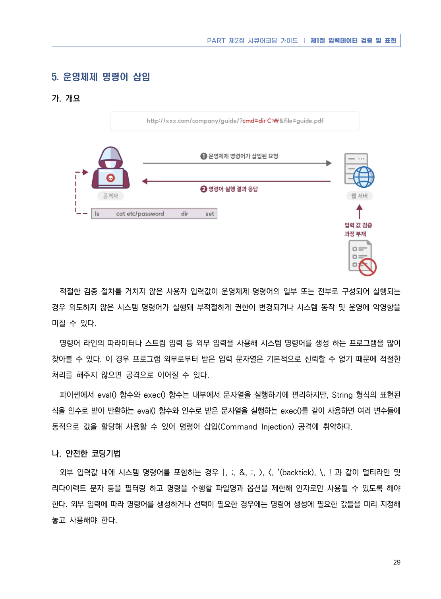
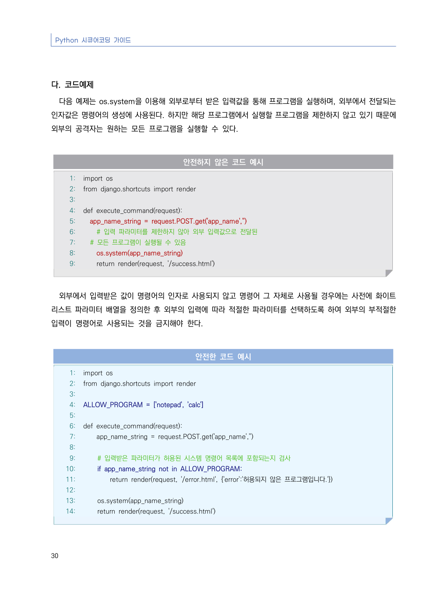
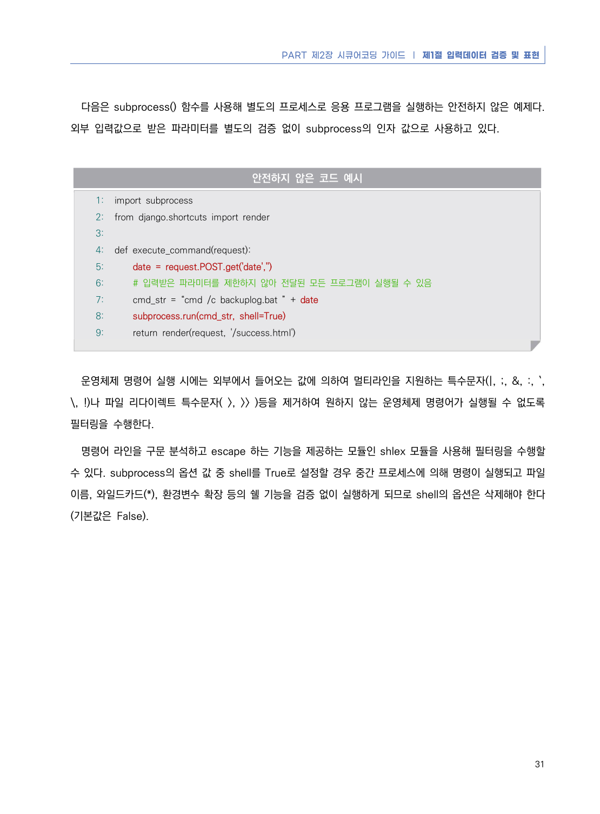
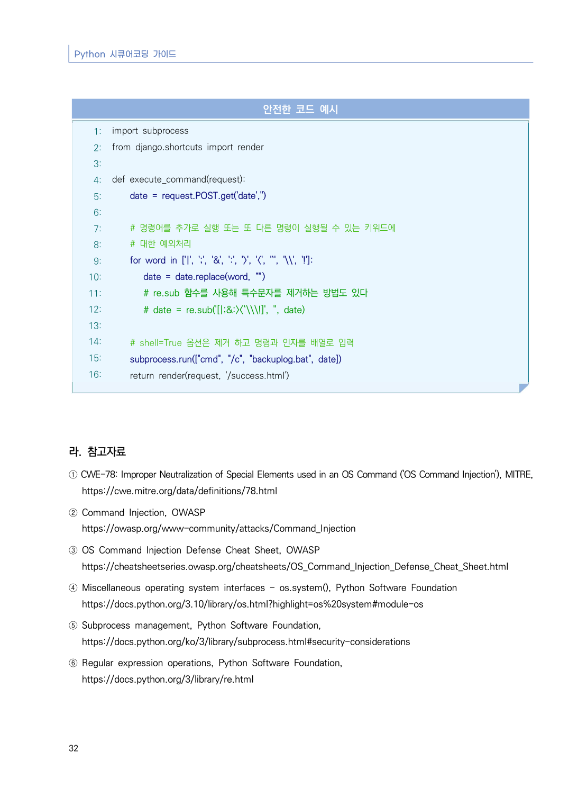

# 5. 운영체제 명령어 삽입

> 변환 안내(원문 외): 아래 본문은 PDF 텍스트를 추출한 전사입니다. 코드 줄번호·특수 공백·원문 오류를 유지했습니다. 실행용 코드가 아닙니다. 표·그림·들여쓰기는 연결된 페이지 이미지와 대조하세요. 페이지 경계의 줄바꿈을 보존하며, 동일 페이지가 여러 항목에 나뉘면 각 항목의 본문은 해당 구간만 포함합니다.

### PDF 35페이지 / 인쇄 29페이지

<!-- source-page:Python-2023:35; source-lines:0,1,2,3,4,5,6,7,8,9,10,11,12,13,14,15,16,17 -->

PART 제2장 시큐어코딩 가이드 ❘ 제1절 입력데이터 검증 및 표현

29

#### 5. 운영체제 명령어 삽입

#### 가. 개요

적절한 검증 절차를 거치지 않은 사용자 입력값이 운영체제 명령어의 일부 또는 전부로 구성되어 실행되는 
경우 의도하지 않은 시스템 명령어가 실행돼 부적절하게 권한이 변경되거나 시스템 동작 및 운영에 악영향을 
미칠 수 있다.

명령어 라인의 파라미터나 스트림 입력 등 외부 입력을 사용해 시스템 명령어를 생성 하는 프로그램을 많이 
찾아볼 수 있다. 이 경우 프로그램 외부로부터 받은 입력 문자열은 기본적으로 신뢰할 수 없기 때문에 적절한 
처리를 해주지 않으면 공격으로 이어질 수 있다.

파이썬에서 eval() 함수와 exec() 함수는 내부에서 문자열을 실행하기에 편리하지만, String 형식의 표현된 
식을 인수로 받아 반환하는 eval() 함수와 인수로 받은 문자열을 실행하는 exec()를 같이 사용하면 여러 변수들에 
동적으로 값을 할당해 사용할 수 있어 명령어 삽입(Command Injection) 공격에 취약하다.

#### 나. 안전한 코딩기법

외부 입력값 내에 시스템 명령어를 포함하는 경우 |, ;, &amp;, :, &gt;, &lt;, `(backtick), \, ! 과 같이 멀티라인 및 
리다이렉트 문자 등을 필터링 하고 명령을 수행할 파일명과 옵션을 제한해 인자로만 사용될 수 있도록 해야 
한다. 외부 입력에 따라 명령어를 생성하거나 선택이 필요한 경우에는 명령어 생성에 필요한 값들을 미리 지정해 
놓고 사용해야 한다.

<details><summary>원본 페이지 이미지 (변환 외 보존 자료)</summary>



</details>

### PDF 36페이지 / 인쇄 30페이지

<!-- source-page:Python-2023:36; source-lines:0,1,2,3,4,5,6,7,8,9,10,11,12,13,14,15,16,17,18,19,20,21,22,23,24,25,26,27,28,29,30,31,32,33,34,35,36,37,38,39,40,41,42,43,44,45,46,47,48,49,50,51,52 -->

Python 시큐어코딩 가이드

30

#### 다. 코드예제

다음 예제는 os.system을 이용해 외부로부터 받은 입력값을 통해 프로그램을 실행하며, 외부에서 전달되는 
인자값은 명령어의 생성에 사용된다. 하지만 해당 프로그램에서 실행할 프로그램을 제한하지 않고 있기 때문에 
외부의 공격자는 원하는 모든 프로그램을 실행할 수 있다.

#### 안전하지 않은 코드 예시

```python
1: import os
2: from django.shortcuts import render
3:
4: def execute_command(request):
5:   app_name_string = request.POST.get('app_name','')
6:     # 입력 파라미터를 제한하지 않아 외부 입력값으로 전달된 
7:   # 모든 프로그램이 실행될 수 있음
8:     os.system(app_name_string)
9:     return render(request, '/success.html')
```

외부에서 입력받은 값이 명령어의 인자로 사용되지 않고 명령어 그 자체로 사용될 경우에는 사전에 화이트 
리스트 파라미터 배열을 정의한 후 외부의 입력에 따라 적절한 파라미터를 선택하도록 하여 외부의 부적절한 
입력이 명령어로 사용되는 것을 금지해야 한다.

#### 안전한 코드 예시

```python
1: import os
2: from django.shortcuts import render
3:
4: ALLOW_PROGRAM = ['notepad', 'calc']
5:
6: def execute_command(request):
7:     app_name_string = request.POST.get('app_name','')
8:    
9:     # 입력받은 파라미터가 허용된 시스템 명령어 목록에 포함되는지 검사 
10:     if app_name_string not in ALLOW_PROGRAM:
11:         return render(request, '/error.html', {'error':'허용되지 않은 프로그램입니다.'})
12:
13:     os.system(app_name_string)
14:     return render(request, '/success.html')
```

<details><summary>원본 페이지 이미지 (변환 외 보존 자료)</summary>



</details>

### PDF 37페이지 / 인쇄 31페이지

<!-- source-page:Python-2023:37; source-lines:0,1,2,3,4,5,6,7,8,9,10,11,12,13,14,15,16,17,18,19,20,21,22,23,24,25,26,27,28 -->

PART 제2장 시큐어코딩 가이드 ❘ 제1절 입력데이터 검증 및 표현

31

다음은 subprocess() 함수를 사용해 별도의 프로세스로 응용 프로그램을 실행하는 안전하지 않은 예제다. 
외부 입력값으로 받은 파라미터를 별도의 검증 없이 subprocess의 인자 값으로 사용하고 있다.

#### 안전하지 않은 코드 예시

```python
1: import subprocess
2: from django.shortcuts import render
3:
4: def execute_command(request):
5:     date = request.POST.get('date','')
6:     # 입력받은 파라미터를 제한하지 않아 전달된 모든 프로그램이 실행될 수 있음
7:     cmd_str = “cmd /c backuplog.bat ” + date
8:     subprocess.run(cmd_str, shell=True)
9:     return render(request, '/success.html')
```

운영체제 명령어 실행 시에는 외부에서 들어오는 값에 의하여 멀티라인을 지원하는 특수문자(|, ;, &amp;, :, `, 
\, !)나 파일 리다이렉트 특수문자( &gt;, &gt;&gt; )등을 제거하여 원하지 않는 운영체제 명령어가 실행될 수 없도록 
필터링을 수행한다.

명령어 라인을 구문 분석하고 escape 하는 기능을 제공하는 모듈인 shlex 모듈을 사용해 필터링을 수행할 
수 있다. subprocess의 옵션 값 중 shell를 True로 설정할 경우 중간 프로세스에 의해 명령이 실행되고 파일 
이름, 와일드카드(*), 환경변수 확장 등의 쉘 기능을 검증 없이 실행하게 되므로 shell의 옵션은 삭제해야 한다
(기본값은 False).

<details><summary>원본 페이지 이미지 (변환 외 보존 자료)</summary>



</details>

### PDF 38페이지 / 인쇄 32페이지

<!-- source-page:Python-2023:38; source-lines:0,1,2,3,4,5,6,7,8,9,10,11,12,13,14,15,16,17,18,19,20,21,22,23,24,25,26,27,28,29,30,31,32,33,34,35,36,37,38,39,40,41,42,43,44 -->

Python 시큐어코딩 가이드

32

#### 안전한 코드 예시

```python
1: import subprocess
2: from django.shortcuts import render
3:
4: def execute_command(request):
5:     date = request.POST.get('date','')
6:
7:     # 명령어를 추가로 실행 또는 또 다른 명령이 실행될 수 있는 키워드에 
8:     # 대한 예외처리
9:     for word in ['|', ';', '&', ':', '>', '<', '`', '\\', '!']:
10:        date = date.replace(word, “”)
11:        # re.sub 함수를 사용해 특수문자를 제거하는 방법도 있다
12:        # date = re.sub('[|;&:><`\\\!]', '', date)
13:
14:     # shell=True 옵션은 제거 하고 명령과 인자를 배열로 입력
15:     subprocess.run(["cmd", "/c", "backuplog.bat", date])
16:     return render(request, '/success.html')
```

#### 라. 참고자료

① CWE-78: Improper Neutralization of Special Elements used in an OS Command ('OS Command Injection'), MITRE,

https://cwe.mitre.org/data/definitions/78.html
② Command Injection, OWASP

https://owasp.org/www-community/attacks/Command_Injection
③ OS Command Injection Defense Cheat Sheet, OWASP

https://cheatsheetseries.owasp.org/cheatsheets/OS_Command_Injection_Defense_Cheat_Sheet.html
④ Miscellaneous operating system interfaces - os.system(), Python Software Foundation

https://docs.python.org/3.10/library/os.html?highlight=os%20system#module-os
⑤ Subprocess management, Python Software Foundation,

https://docs.python.org/ko/3/library/subprocess.html#security-considerations
⑥ Regular expression operations, Python Software Foundation,

https://docs.python.org/3/library/re.html

<details><summary>원본 페이지 이미지 (변환 외 보존 자료)</summary>



</details>

---

## 탐색 링크 (원문 외)

[통합 인덱스](../../../INDEX.md)

