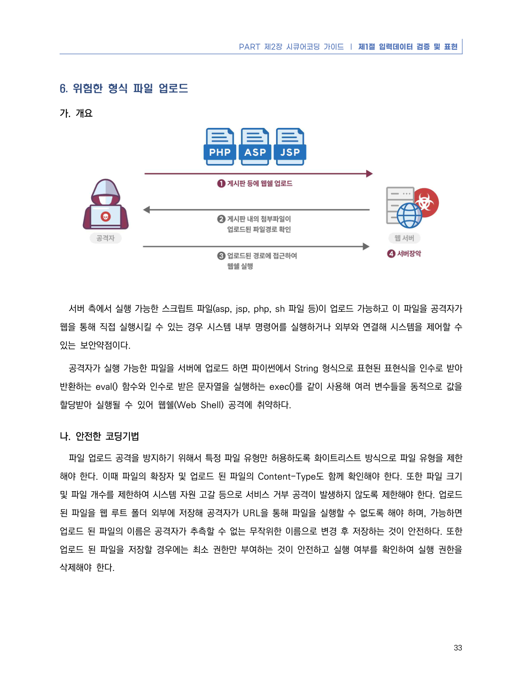
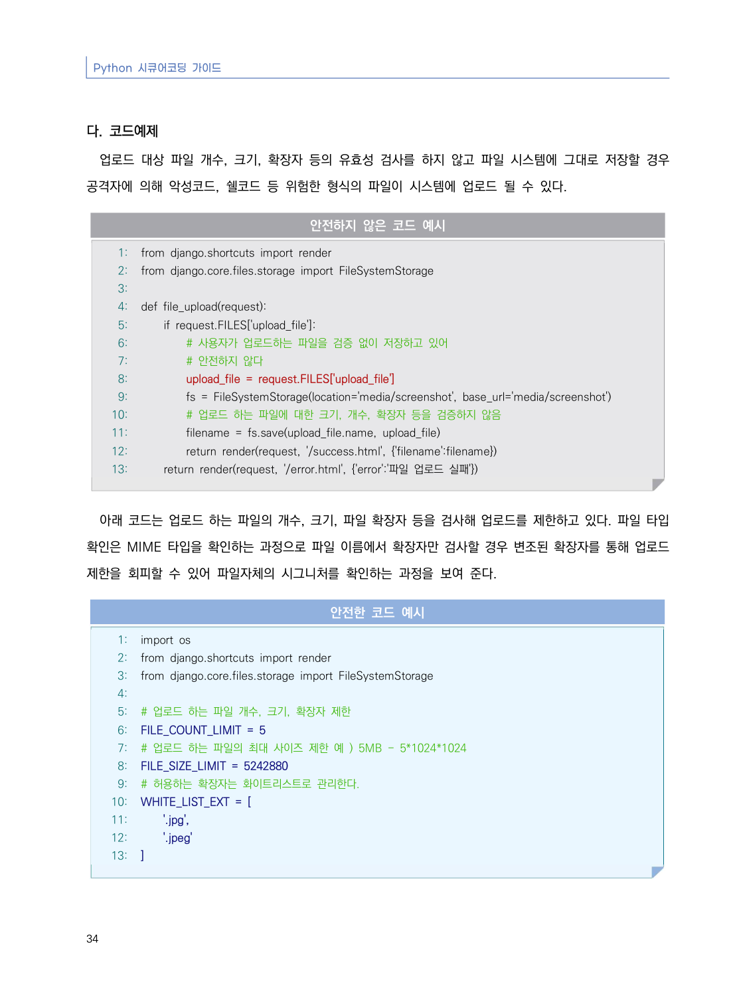
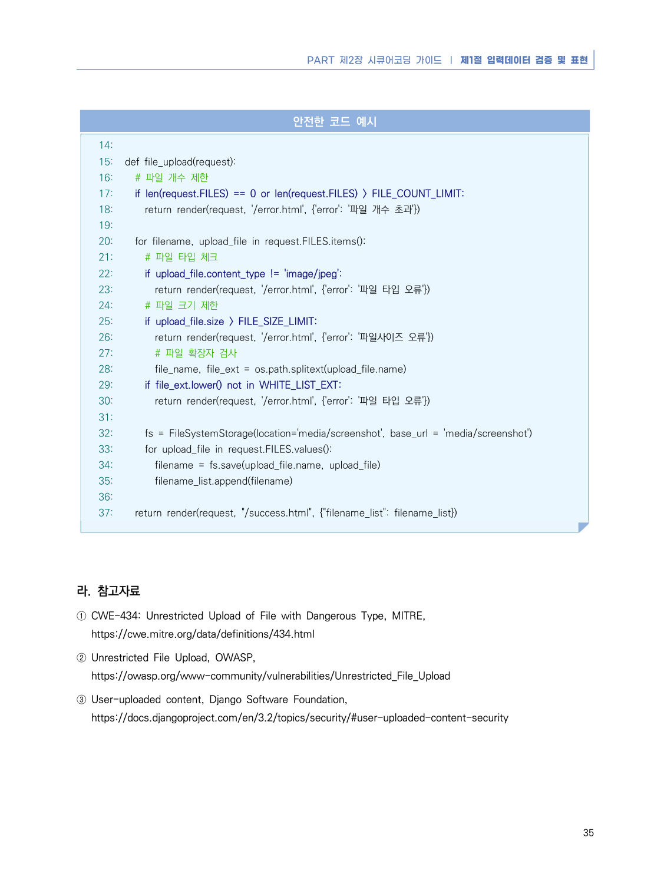

# 6. 위험한 형식 파일 업로드

> 변환 안내(원문 외): 아래 본문은 PDF 텍스트를 추출한 전사입니다. 코드 줄번호·특수 공백·원문 오류를 유지했습니다. 실행용 코드가 아닙니다. 표·그림·들여쓰기는 연결된 페이지 이미지와 대조하세요. 페이지 경계의 줄바꿈을 보존하며, 동일 페이지가 여러 항목에 나뉘면 각 항목의 본문은 해당 구간만 포함합니다.

### PDF 39페이지 / 인쇄 33페이지

<!-- source-page:Python-2023:39; source-lines:0,1,2,3,4,5,6,7,8,9,10,11,12,13,14,15,16,17 -->

PART 제2장 시큐어코딩 가이드 ❘ 제1절 입력데이터 검증 및 표현

33

#### 6. 위험한 형식 파일 업로드

#### 가. 개요

서버 측에서 실행 가능한 스크립트 파일(asp, jsp, php, sh 파일 등)이 업로드 가능하고 이 파일을 공격자가 
웹을 통해 직접 실행시킬 수 있는 경우 시스템 내부 명령어를 실행하거나 외부와 연결해 시스템을 제어할 수 
있는 보안약점이다.

공격자가 실행 가능한 파일을 서버에 업로드 하면 파이썬에서 String 형식으로 표현된 표현식을 인수로 받아 
반환하는 eval() 함수와 인수로 받은 문자열을 실행하는 exec()를 같이 사용해 여러 변수들을 동적으로 값을 
할당받아 실행될 수 있어 웹쉘(Web Shell) 공격에 취약하다.

#### 나. 안전한 코딩기법

파일 업로드 공격을 방지하기 위해서 특정 파일 유형만 허용하도록 화이트리스트 방식으로 파일 유형을 제한
해야 한다. 이때 파일의 확장자 및 업로드 된 파일의 Content-Type도 함께 확인해야 한다. 또한 파일 크기 
및 파일 개수를 제한하여 시스템 자원 고갈 등으로 서비스 거부 공격이 발생하지 않도록 제한해야 한다. 업로드 
된 파일을 웹 루트 폴더 외부에 저장해 공격자가 URL을 통해 파일을 실행할 수 없도록 해야 하며, 가능하면 
업로드 된 파일의 이름은 공격자가 추측할 수 없는 무작위한 이름으로 변경 후 저장하는 것이 안전하다. 또한 
업로드 된 파일을 저장할 경우에는 최소 권한만 부여하는 것이 안전하고 실행 여부를 확인하여 실행 권한을 
삭제해야 한다.

<details><summary>원본 페이지 이미지 (변환 외 보존 자료)</summary>



</details>

### PDF 40페이지 / 인쇄 34페이지

<!-- source-page:Python-2023:40; source-lines:0,1,2,3,4,5,6,7,8,9,10,11,12,13,14,15,16,17,18,19,20,21,22,23,24,25,26,27,28,29,30,31,32,33,34,35,36,37,38,39,40,41,42,43,44,45,46,47,48,49,50,51,52,53,54,55,56,57,58,59 -->

Python 시큐어코딩 가이드

34

#### 다. 코드예제

업로드 대상 파일 개수, 크기, 확장자 등의 유효성 검사를 하지 않고 파일 시스템에 그대로 저장할 경우 
공격자에 의해 악성코드, 쉘코드 등 위험한 형식의 파일이 시스템에 업로드 될 수 있다.

#### 안전하지 않은 코드 예시

```python
1: from django.shortcuts import render
2: from django.core.files.storage import FileSystemStorage
3:
4: def file_upload(request):
5:     if request.FILES['upload_file']:
6:         # 사용자가 업로드하는 파일을 검증 없이 저장하고 있어 
7:         # 안전하지 않다
8:         upload_file = request.FILES['upload_file']
9:         fs = FileSystemStorage(location='media/screenshot', base_url='media/screenshot')
10:         # 업로드 하는 파일에 대한 크기, 개수, 확장자 등을 검증하지 않음
11:         filename = fs.save(upload_file.name, upload_file)
12:         return render(request, '/success.html', {'filename':filename})
13:     return render(request, '/error.html', {'error':'파일 업로드 실패'})
```

아래 코드는 업로드 하는 파일의 개수, 크기, 파일 확장자 등을 검사해 업로드를 제한하고 있다. 파일 타입 
확인은 MIME 타입을 확인하는 과정으로 파일 이름에서 확장자만 검사할 경우 변조된 확장자를 통해 업로드 
제한을 회피할 수 있어 파일자체의 시그니처를 확인하는 과정을 보여 준다.

#### 안전한 코드 예시

```python
1: import os
2: from django.shortcuts import render
3: from django.core.files.storage import FileSystemStorage
4:
5: # 업로드 하는 파일 개수, 크기, 확장자 제한
6: FILE_COUNT_LIMIT = 5
7: # 업로드 하는 파일의 최대 사이즈 제한 예 ) 5MB - 5*1024*1024
8: FILE_SIZE_LIMIT = 5242880 
9: # 허용하는 확장자는 화이트리스트로 관리한다.
10: WHITE_LIST_EXT = [
11:     '.jpg',
12:     '.jpeg'
13: ]
```

<details><summary>원본 페이지 이미지 (변환 외 보존 자료)</summary>



</details>

### PDF 41페이지 / 인쇄 35페이지

<!-- source-page:Python-2023:41; source-lines:0,1,2,3,4,5,6,7,8,9,10,11,12,13,14,15,16,17,18,19,20,21,22,23,24,25,26,27,28,29,30,31,32,33,34,35,36,37,38,39,40,41,42,43,44,45,46,47,48,49,50,51,52,53 -->

PART 제2장 시큐어코딩 가이드 ❘ 제1절 입력데이터 검증 및 표현

35

#### 안전한 코드 예시

```python
14:
15: def file_upload(request):
16:   # 파일 개수 제한
17:   if len(request.FILES) == 0 or len(request.FILES) > FILE_COUNT_LIMIT:
18:     return render(request, '/error.html', {'error': '파일 개수 초과'})
19:
20:   for filename, upload_file in request.FILES.items():
21:     # 파일 타입 체크
22:     if upload_file.content_type != 'image/jpeg':
23:       return render(request, '/error.html', {'error': '파일 타입 오류'})
24:     # 파일 크기 제한
25:     if upload_file.size > FILE_SIZE_LIMIT:
26:       return render(request, '/error.html', {'error': '파일사이즈 오류'})
27:       # 파일 확장자 검사
28:       file_name, file_ext = os.path.splitext(upload_file.name)
29:     if file_ext.lower() not in WHITE_LIST_EXT:
30:       return render(request, '/error.html', {'error': '파일 타입 오류'})
31:
32:     fs = FileSystemStorage(location='media/screenshot', base_url = 'media/screenshot')
33:     for upload_file in request.FILES.values():
34:       filename = fs.save(upload_file.name, upload_file)
35:       filename_list.append(filename)
36:
37:   return render(request, "/success.html", {"filename_list": filename_list})
```

#### 라. 참고자료

① CWE-434: Unrestricted Upload of File with Dangerous Type, MITRE,

https://cwe.mitre.org/data/definitions/434.html
② Unrestricted File Upload, OWASP,

https://owasp.org/www-community/vulnerabilities/Unrestricted_File_Upload
③ User-uploaded content, Django Software Foundation,

https://docs.djangoproject.com/en/3.2/topics/security/#user-uploaded-content-security

<details><summary>원본 페이지 이미지 (변환 외 보존 자료)</summary>



</details>

---

## 탐색 링크 (원문 외)

[통합 인덱스](../../../INDEX.md)

