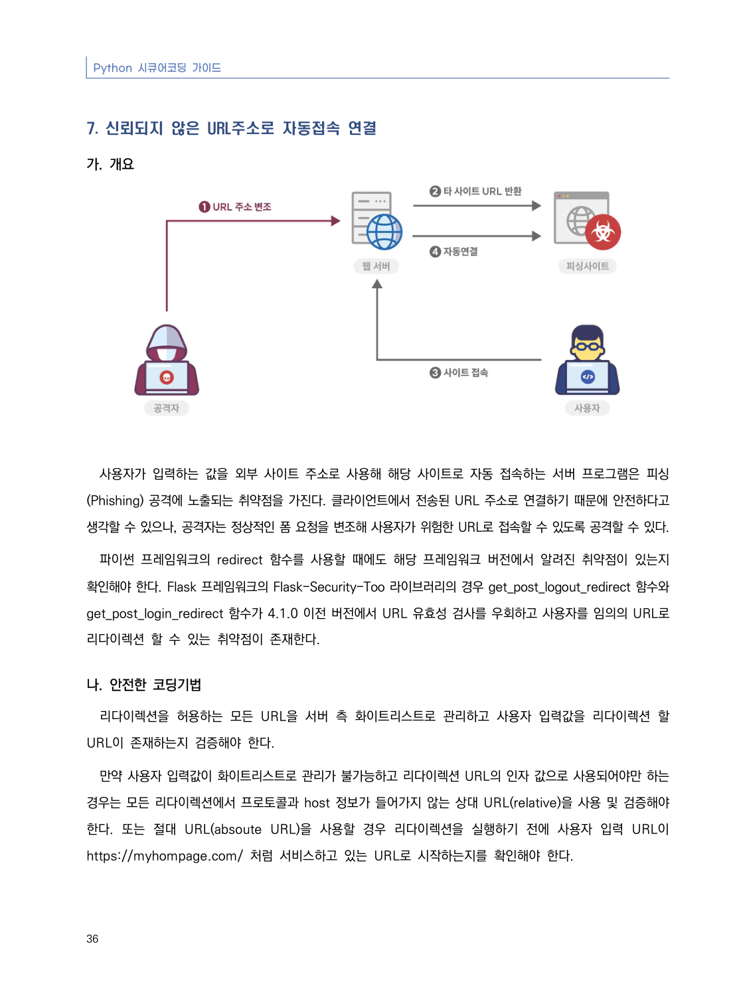
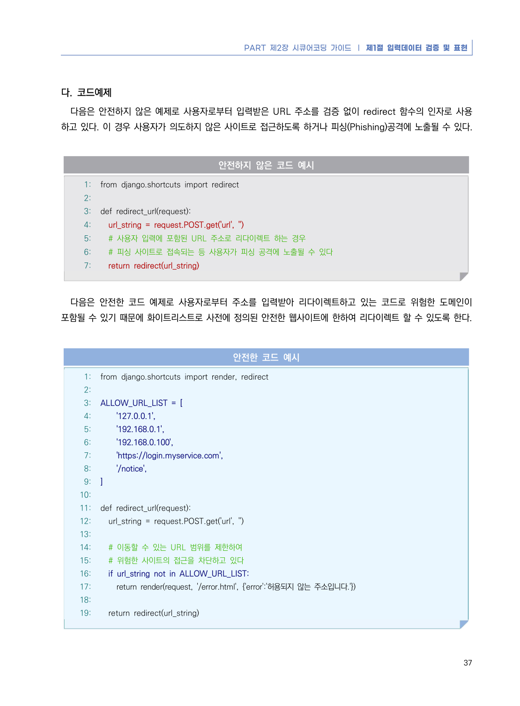
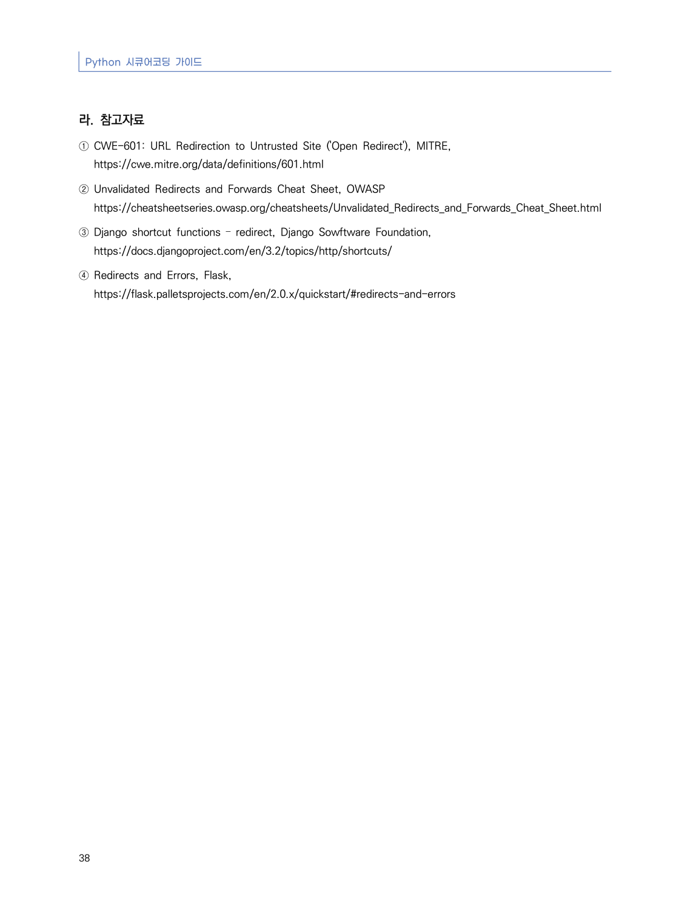

# 7. 신뢰되지 않은 URL주소로 자동접속 연결

> 변환 안내(원문 외): 아래 본문은 PDF 텍스트를 추출한 전사입니다. 코드 줄번호·특수 공백·원문 오류를 유지했습니다. 실행용 코드가 아닙니다. 표·그림·들여쓰기는 연결된 페이지 이미지와 대조하세요. 페이지 경계의 줄바꿈을 보존하며, 동일 페이지가 여러 항목에 나뉘면 각 항목의 본문은 해당 구간만 포함합니다.

### PDF 42페이지 / 인쇄 36페이지

<!-- source-page:Python-2023:42; source-lines:0,1,2,3,4,5,6,7,8,9,10,11,12,13,14,15,16,17 -->

Python 시큐어코딩 가이드

36

#### 7. 신뢰되지 않은 URL주소로 자동접속 연결

#### 가. 개요

사용자가 입력하는 값을 외부 사이트 주소로 사용해 해당 사이트로 자동 접속하는 서버 프로그램은 피싱
(Phishing) 공격에 노출되는 취약점을 가진다. 클라이언트에서 전송된 URL 주소로 연결하기 때문에 안전하다고 
생각할 수 있으나, 공격자는 정상적인 폼 요청을 변조해 사용자가 위험한 URL로 접속할 수 있도록 공격할 수 있다.

파이썬 프레임워크의 redirect 함수를 사용할 때에도 해당 프레임워크 버전에서 알려진 취약점이 있는지 
확인해야 한다. Flask 프레임워크의 Flask-Security-Too 라이브러리의 경우 get_post_logout_redirect 함수와 
get_post_login_redirect 함수가 4.1.0 이전 버전에서 URL 유효성 검사를 우회하고 사용자를 임의의 URL로 
리다이렉션 할 수 있는 취약점이 존재한다.

#### 나. 안전한 코딩기법

리다이렉션을 허용하는 모든 URL을 서버 측 화이트리스트로 관리하고 사용자 입력값을 리다이렉션 할 
URL이 존재하는지 검증해야 한다. 

만약 사용자 입력값이 화이트리스트로 관리가 불가능하고 리다이렉션 URL의 인자 값으로 사용되어야만 하는 
경우는 모든 리다이렉션에서 프로토콜과 host 정보가 들어가지 않는 상대 URL(relative)을 사용 및 검증해야 
한다. 또는 절대 URL(absoute URL)을 사용할 경우 리다이렉션을 실행하기 전에 사용자 입력 URL이 
https://myhompage.com/ 처럼 서비스하고 있는 URL로 시작하는지를 확인해야 한다.

<details><summary>원본 페이지 이미지 (변환 외 보존 자료)</summary>



</details>

### PDF 43페이지 / 인쇄 37페이지

<!-- source-page:Python-2023:43; source-lines:0,1,2,3,4,5,6,7,8,9,10,11,12,13,14,15,16,17,18,19,20,21,22,23,24,25,26,27,28,29,30,31,32,33,34,35,36,37,38,39,40,41,42,43,44,45,46,47,48,49,50,51,52,53,54,55,56 -->

PART 제2장 시큐어코딩 가이드 ❘ 제1절 입력데이터 검증 및 표현

37

#### 다. 코드예제

다음은 안전하지 않은 예제로 사용자로부터 입력받은 URL 주소를 검증 없이 redirect 함수의 인자로 사용
하고 있다. 이 경우 사용자가 의도하지 않은 사이트로 접근하도록 하거나 피싱(Phishing)공격에 노출될 수 있다.

#### 안전하지 않은 코드 예시

```python
1: from django.shortcuts import redirect
2:
3: def redirect_url(request):
4:   url_string = request.POST.get('url', '')
5:   # 사용자 입력에 포함된 URL 주소로 리다이렉트 하는 경우
6:   # 피싱 사이트로 접속되는 등 사용자가 피싱 공격에 노출될 수 있다
7:   return redirect(url_string)
```

다음은 안전한 코드 예제로 사용자로부터 주소를 입력받아 리다이렉트하고 있는 코드로 위험한 도메인이 
포함될 수 있기 때문에 화이트리스트로 사전에 정의된 안전한 웹사이트에 한하여 리다이렉트 할 수 있도록 한다.

#### 안전한 코드 예시

```python
1: from django.shortcuts import render, redirect
2:
3: ALLOW_URL_LIST = [
4:     '127.0.0.1',
5:     '192.168.0.1',
6:     '192.168.0.100',
7:     'https://login.myservice.com',
8:     '/notice',
9: ]
10:
11: def redirect_url(request):
12:   url_string = request.POST.get('url', '')
13:
14:   # 이동할 수 있는 URL 범위를 제한하여
15:   # 위험한 사이트의 접근을 차단하고 있다
16:   if url_string not in ALLOW_URL_LIST:
17:     return render(request, '/error.html', {'error':'허용되지 않는 주소입니다.'})
18:     
19:   return redirect(url_string)
```

<details><summary>원본 페이지 이미지 (변환 외 보존 자료)</summary>



</details>

### PDF 44페이지 / 인쇄 38페이지

<!-- source-page:Python-2023:44; source-lines:0,1,2,3,4,5,6,7,8,9,10 -->

Python 시큐어코딩 가이드

38

#### 라. 참고자료

① CWE-601: URL Redirection to Untrusted Site ('Open Redirect'), MITRE,

https://cwe.mitre.org/data/definitions/601.html
② Unvalidated Redirects and Forwards Cheat Sheet, OWASP

https://cheatsheetseries.owasp.org/cheatsheets/Unvalidated_Redirects_and_Forwards_Cheat_Sheet.html
③ Django shortcut functions – redirect, Django Sowftware Foundation,

https://docs.djangoproject.com/en/3.2/topics/http/shortcuts/
④ Redirects and Errors, Flask,

https://flask.palletsprojects.com/en/2.0.x/quickstart/#redirects-and-errors

<details><summary>원본 페이지 이미지 (변환 외 보존 자료)</summary>



</details>

---

## 탐색 링크 (원문 외)

[통합 인덱스](../../../INDEX.md)

