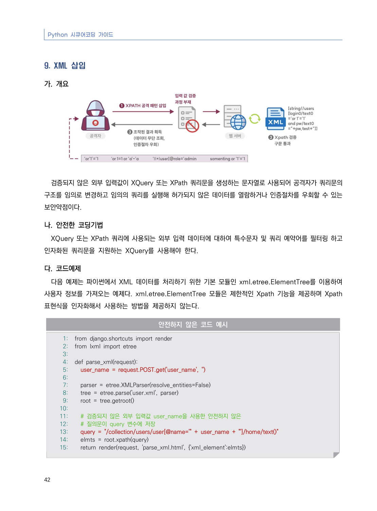
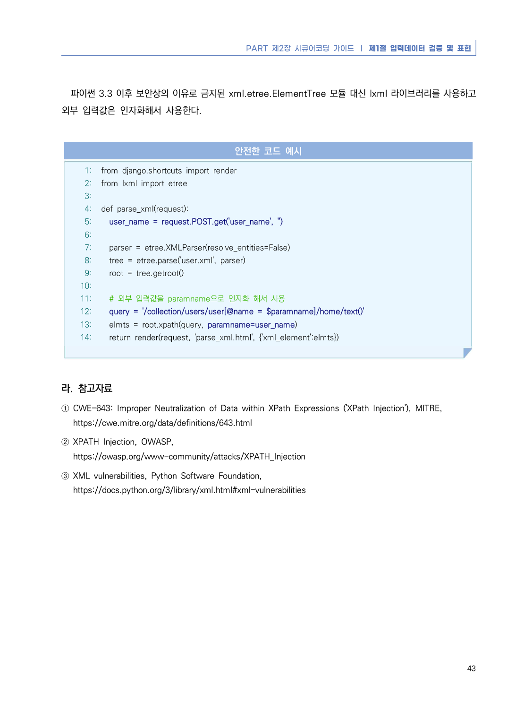

# 9. XML 삽입

> 변환 안내(원문 외): 아래 본문은 PDF 텍스트를 추출한 전사입니다. 코드 줄번호·특수 공백·원문 오류를 유지했습니다. 실행용 코드가 아닙니다. 표·그림·들여쓰기는 연결된 페이지 이미지와 대조하세요. 페이지 경계의 줄바꿈을 보존하며, 동일 페이지가 여러 항목에 나뉘면 각 항목의 본문은 해당 구간만 포함합니다.

### PDF 48페이지 / 인쇄 42페이지

<!-- source-page:Python-2023:48; source-lines:0,1,2,3,4,5,6,7,8,9,10,11,12,13,14,15,16,17,18,19,20,21,22,23,24,25,26,27,28,29,30,31,32,33,34,35,36,37,38,39,40,41 -->

Python 시큐어코딩 가이드

42

#### 9. XML 삽입

#### 가. 개요

검증되지 않은 외부 입력값이 XQuery 또는 XPath 쿼리문을 생성하는 문자열로 사용되어 공격자가 쿼리문의 
구조를 임의로 변경하고 임의의 쿼리를 실행해 허가되지 않은 데이터를 열람하거나 인증절차를 우회할 수 있는 
보안약점이다.

#### 나. 안전한 코딩기법

XQuery 또는 XPath 쿼리에 사용되는 외부 입력 데이터에 대하여 특수문자 및 쿼리 예약어를 필터링 하고 
인자화된 쿼리문을 지원하는 XQuery를 사용해야 한다.

#### 다. 코드예제

다음 예제는 파이썬에서 XML 데이터를 처리하기 위한 기본 모듈인 xml.etree.ElementTree를 이용하여 
사용자 정보를 가져오는 예제다. xml.etree.ElementTree 모듈은 제한적인 Xpath 기능을 제공하며 Xpath 
표현식을 인자화해서 사용하는 방법을 제공하지 않는다.

#### 안전하지 않은 코드 예시

```python
1: from django.shortcuts import render
2: from lxml import etree
3:
4: def parse_xml(request):
5:   user_name = request.POST.get('user_name', '')
6:
7:   parser = etree.XMLParser(resolve_entities=False)
8:   tree = etree.parse('user.xml', parser)
9:   root = tree.getroot()
10:
11:   # 검증되지 않은 외부 입력값 user_name을 사용한 안전하지 않은
12:   # 질의문이 query 변수에 저장
13:   query = "/collection/users/user[@name='" + user_name + "']/home/text()"
14:   elmts = root.xpath(query)
15:   return render(request, 'parse_xml.html', {'xml_element':elmts})
```

<details><summary>원본 페이지 이미지 (변환 외 보존 자료)</summary>



</details>

### PDF 49페이지 / 인쇄 43페이지

<!-- source-page:Python-2023:49; source-lines:0,1,2,3,4,5,6,7,8,9,10,11,12,13,14,15,16,17,18,19,20,21,22,23,24,25,26,27,28,29,30,31,32,33,34,35,36 -->

PART 제2장 시큐어코딩 가이드 ❘ 제1절 입력데이터 검증 및 표현

43

파이썬 3.3 이후 보안상의 이유로 금지된 xml.etree.ElementTree 모듈 대신 lxml 라이브러리를 사용하고 
외부 입력값은 인자화해서 사용한다.

#### 안전한 코드 예시

```python
1: from django.shortcuts import render
2: from lxml import etree
3:
4: def parse_xml(request):
5:   user_name = request.POST.get('user_name', '')
6:
7:   parser = etree.XMLParser(resolve_entities=False)
8:   tree = etree.parse('user.xml', parser)
9:   root = tree.getroot()
10:
11:   # 외부 입력값을 paramname으로 인자화 해서 사용
12:   query = '/collection/users/user[@name = $paramname]/home/text()'
13:   elmts = root.xpath(query, paramname=user_name)
14:   return render(request, 'parse_xml.html', {'xml_element':elmts})
```

#### 라. 참고자료

① CWE-643: Improper Neutralization of Data within XPath Expressions ('XPath Injection'), MITRE,

https://cwe.mitre.org/data/definitions/643.html
② XPATH Injection, OWASP,

https://owasp.org/www-community/attacks/XPATH_Injection
③ XML vulnerabilities, Python Software Foundation,

https://docs.python.org/3/library/xml.html#xml-vulnerabilities

<details><summary>원본 페이지 이미지 (변환 외 보존 자료)</summary>



</details>

---

## 탐색 링크 (원문 외)

[통합 인덱스](../../../INDEX.md)

