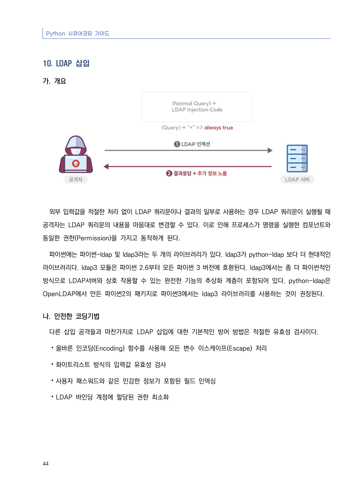
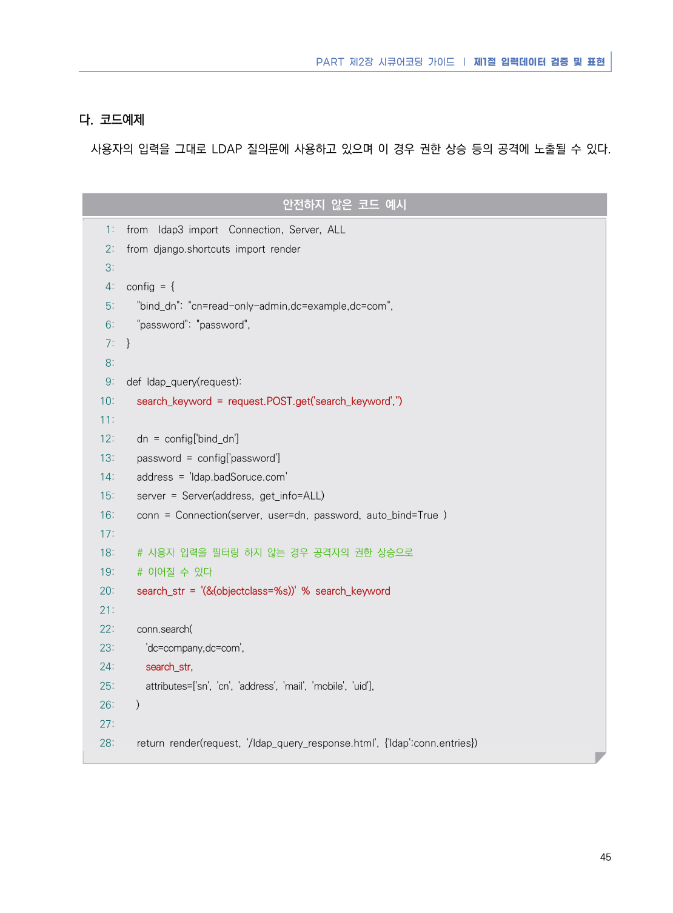
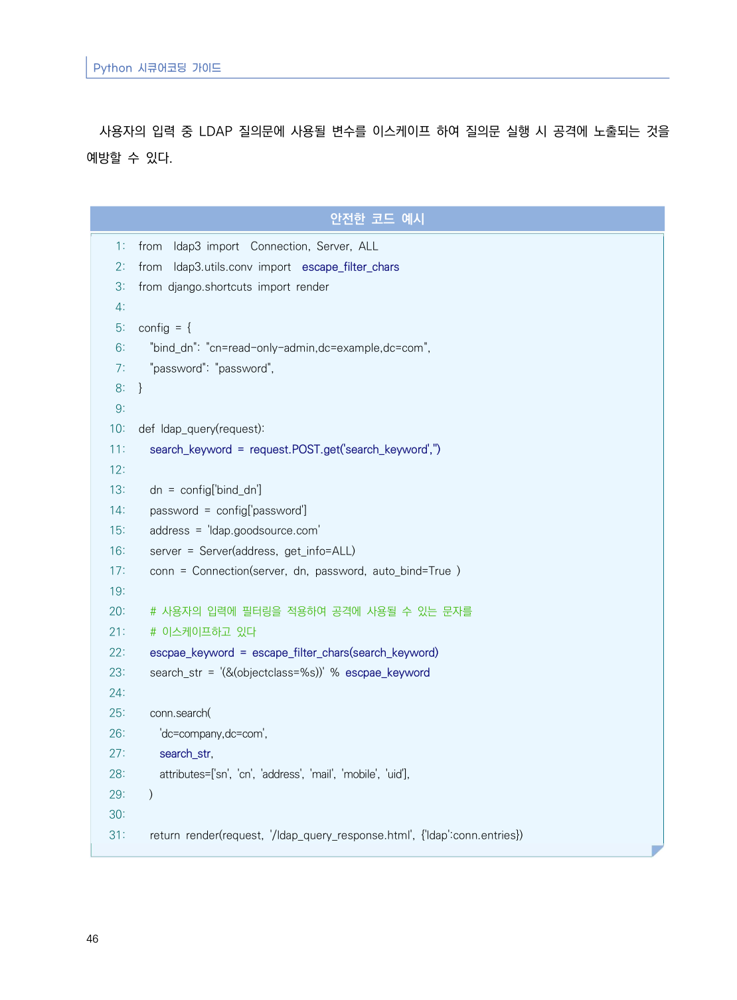
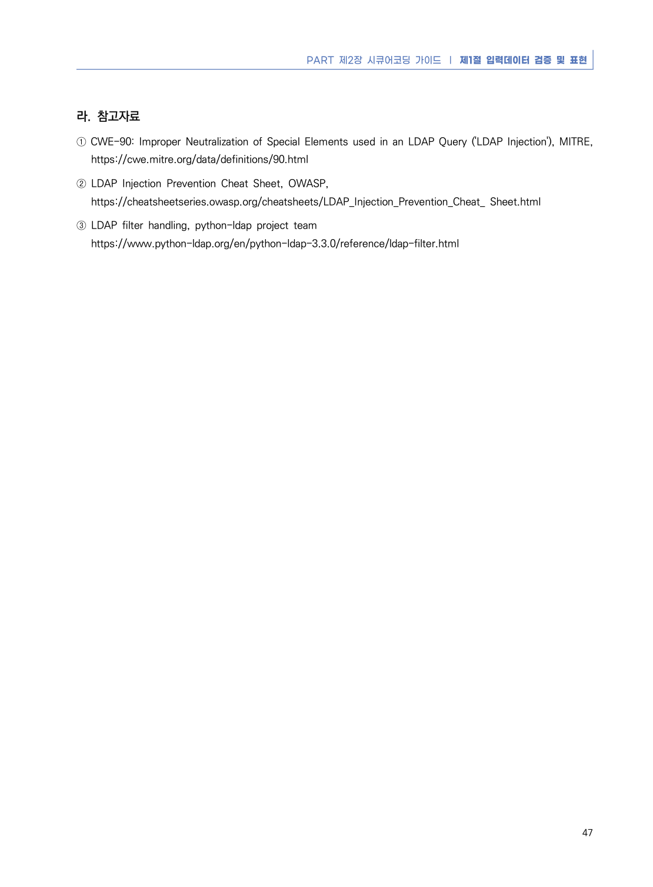

# 10. LDAP 삽입

> 변환 안내(원문 외): 아래 본문은 PDF 텍스트를 추출한 전사입니다. 코드 줄번호·특수 공백·원문 오류를 유지했습니다. 실행용 코드가 아닙니다. 표·그림·들여쓰기는 연결된 페이지 이미지와 대조하세요. 페이지 경계의 줄바꿈을 보존하며, 동일 페이지가 여러 항목에 나뉘면 각 항목의 본문은 해당 구간만 포함합니다.

### PDF 50페이지 / 인쇄 44페이지

<!-- source-page:Python-2023:50; source-lines:0,1,2,3,4,5,6,7,8,9,10,11,12,13,14,15,16 -->

Python 시큐어코딩 가이드

44

#### 10. LDAP 삽입

#### 가. 개요

외부 입력값을 적절한 처리 없이 LDAP 쿼리문이나 결과의 일부로 사용하는 경우 LDAP 쿼리문이 실행될 때 
공격자는 LDAP 쿼리문의 내용을 마음대로 변경할 수 있다. 이로 인해 프로세스가 명령을 실행한 컴포넌트와 
동일한 권한(Permission)을 가지고 동작하게 된다.

파이썬에는 파이썬-ldap 및 ldap3라는 두 개의 라이브러리가 있다. ldap3가 python-ldap 보다 더 현대적인 
라이브러리다. ldap3 모듈은 파이썬 2.6부터 모든 파이썬 3 버전에 호환된다. ldap3에서는 좀 더 파이썬적인 
방식으로 LDAP서버와 상호 작용할 수 있는 완전한 기능의 추상화 계층이 포함되어 있다. python-ldap은 
OpenLDAP에서 만든 파이썬2의 패키지로 파이썬3에서는 ldap3 라이브러리를 사용하는 것이 권장된다.

#### 나. 안전한 코딩기법

다른 삽입 공격들과 마찬가지로 LDAP 삽입에 대한 기본적인 방어 방법은 적절한 유효성 검사이다. 

⦁올바른 인코딩(Encoding) 함수를 사용해 모든 변수 이스케이프(Escape) 처리

⦁화이트리스트 방식의 입력값 유효성 검사

⦁사용자 패스워드와 같은 민감한 정보가 포함된 필드 인덱싱

⦁LDAP 바인딩 계정에 할당된 권한 최소화

<details><summary>원본 페이지 이미지 (변환 외 보존 자료)</summary>



</details>

### PDF 51페이지 / 인쇄 45페이지

<!-- source-page:Python-2023:51; source-lines:0,1,2,3,4,5,6,7,8,9,10,11,12,13,14,15,16,17,18,19,20,21,22,23,24,25,26,27,28,29,30,31,32,33,34,35,36,37,38,39,40,41,42,43,44,45,46,47,48,49,50,51,52,53,54 -->

PART 제2장 시큐어코딩 가이드 ❘ 제1절 입력데이터 검증 및 표현

45

#### 다. 코드예제

사용자의 입력을 그대로 LDAP 질의문에 사용하고 있으며 이 경우 권한 상승 등의 공격에 노출될 수 있다.

#### 안전하지 않은 코드 예시

```python
1: from  ldap3 import  Connection, Server, ALL
2: from django.shortcuts import render
3:
4: config = {
5:   "bind_dn": "cn=read-only-admin,dc=example,dc=com",
6:   "password": "password",
7: }
8:
9: def ldap_query(request):
10:   search_keyword = request.POST.get('search_keyword','')
11:
12:   dn = config['bind_dn']
13:   password = config['password']
14:   address = 'ldap.badSoruce.com'
15:   server = Server(address, get_info=ALL)
16:   conn = Connection(server, user=dn, password, auto_bind=True )
17:
18:   # 사용자 입력을 필터링 하지 않는 경우 공격자의 권한 상승으로 
19:   # 이어질 수 있다
20:   search_str = '(&(objectclass=%s))' % search_keyword
21:
22:   conn.search(
23:     'dc=company,dc=com',
24:     search_str,
25:     attributes=['sn', 'cn', 'address', 'mail', 'mobile', 'uid'],
26:   )
27:
28:   return render(request, '/ldap_query_response.html', {'ldap':conn.entries})
```

<details><summary>원본 페이지 이미지 (변환 외 보존 자료)</summary>



</details>

### PDF 52페이지 / 인쇄 46페이지

<!-- source-page:Python-2023:52; source-lines:0,1,2,3,4,5,6,7,8,9,10,11,12,13,14,15,16,17,18,19,20,21,22,23,24,25,26,27,28,29,30,31,32,33,34,35,36,37,38,39,40,41,42,43,44,45,46,47,48,49,50,51,52,53,54,55,56,57,58 -->

Python 시큐어코딩 가이드

46

사용자의 입력 중 LDAP 질의문에 사용될 변수를 이스케이프 하여 질의문 실행 시 공격에 노출되는 것을 
예방할 수 있다.

#### 안전한 코드 예시

```python
1: from  ldap3 import  Connection, Server, ALL
2: from  ldap3.utils.conv import  escape_filter_chars
3: from django.shortcuts import render
4:
5: config = {
6:   "bind_dn": "cn=read-only-admin,dc=example,dc=com",
7:   "password": "password",
8: }
9:
10: def ldap_query(request):
11:   search_keyword = request.POST.get('search_keyword','')
12:
13:   dn = config['bind_dn']
14:   password = config['password']
15:   address = 'ldap.goodsource.com'
16:   server = Server(address, get_info=ALL)
17:   conn = Connection(server, dn, password, auto_bind=True )
19:
20:   # 사용자의 입력에 필터링을 적용하여 공격에 사용될 수 있는 문자를 
21:   # 이스케이프하고 있다
22:   escpae_keyword = escape_filter_chars(search_keyword)
23:   search_str = '(&(objectclass=%s))' % escpae_keyword
24:
25:   conn.search(
26:     'dc=company,dc=com',
27:     search_str,
28:     attributes=['sn', 'cn', 'address', 'mail', 'mobile', 'uid'],
29:   )
30:
31:   return render(request, '/ldap_query_response.html', {'ldap':conn.entries})
```

<details><summary>원본 페이지 이미지 (변환 외 보존 자료)</summary>



</details>

### PDF 53페이지 / 인쇄 47페이지

<!-- source-page:Python-2023:53; source-lines:0,1,2,3,4,5,6,7,8 -->

PART 제2장 시큐어코딩 가이드 ❘ 제1절 입력데이터 검증 및 표현

47

#### 라. 참고자료

① CWE-90: Improper Neutralization of Special Elements used in an LDAP Query ('LDAP Injection'), MITRE,

https://cwe.mitre.org/data/definitions/90.html
② LDAP Injection Prevention Cheat Sheet, OWASP,

https://cheatsheetseries.owasp.org/cheatsheets/LDAP_Injection_Prevention_Cheat_ Sheet.html
③ LDAP filter handling, python-ldap project team

https://www.python-ldap.org/en/python-ldap-3.3.0/reference/ldap-filter.html

<details><summary>원본 페이지 이미지 (변환 외 보존 자료)</summary>



</details>

---

## 탐색 링크 (원문 외)

[통합 인덱스](../../../INDEX.md)

