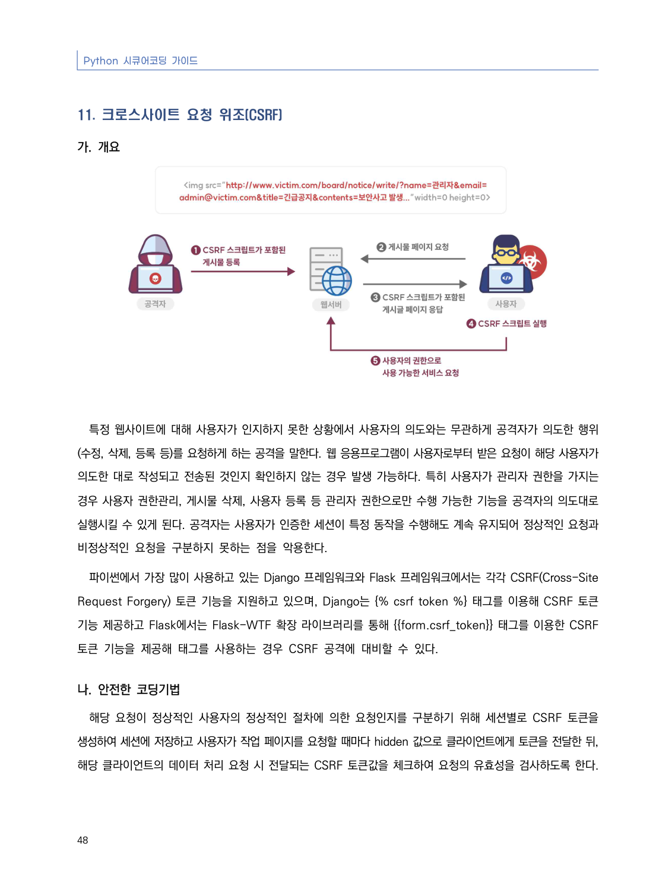
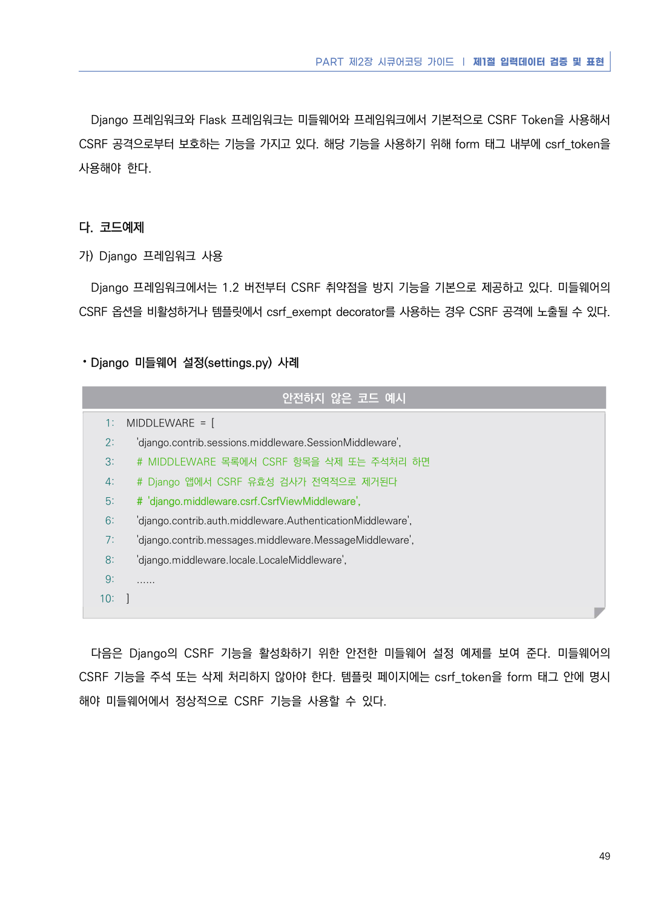
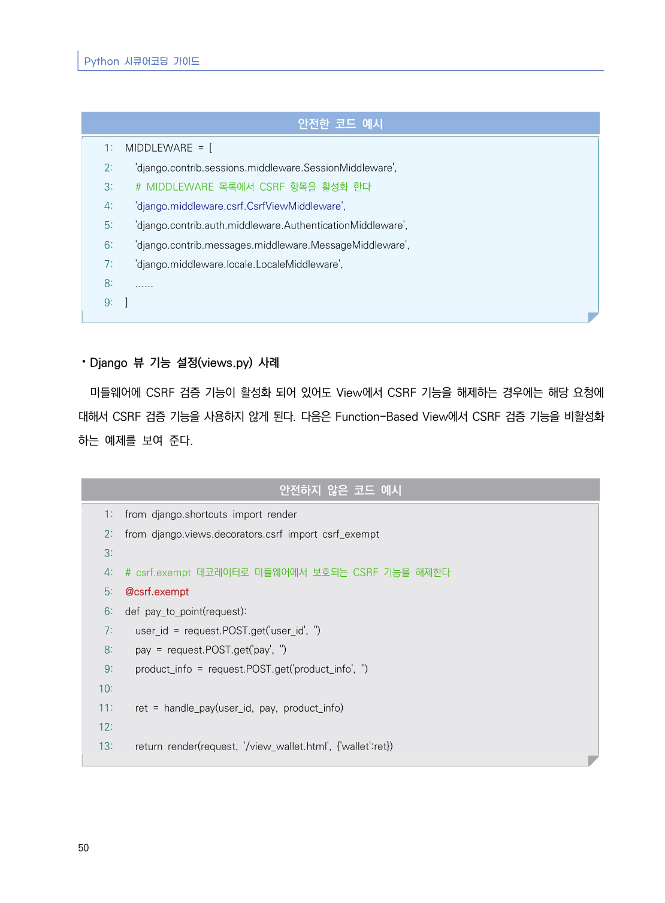
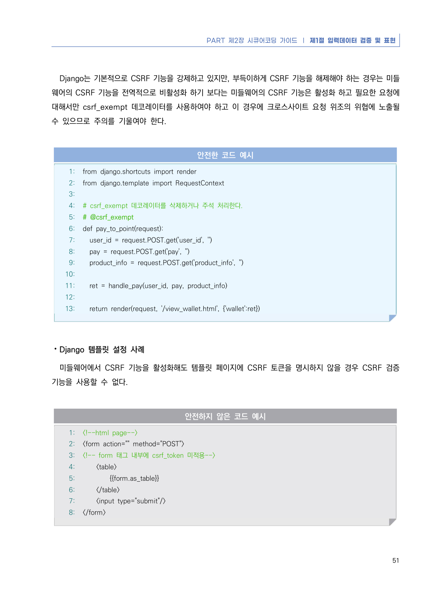
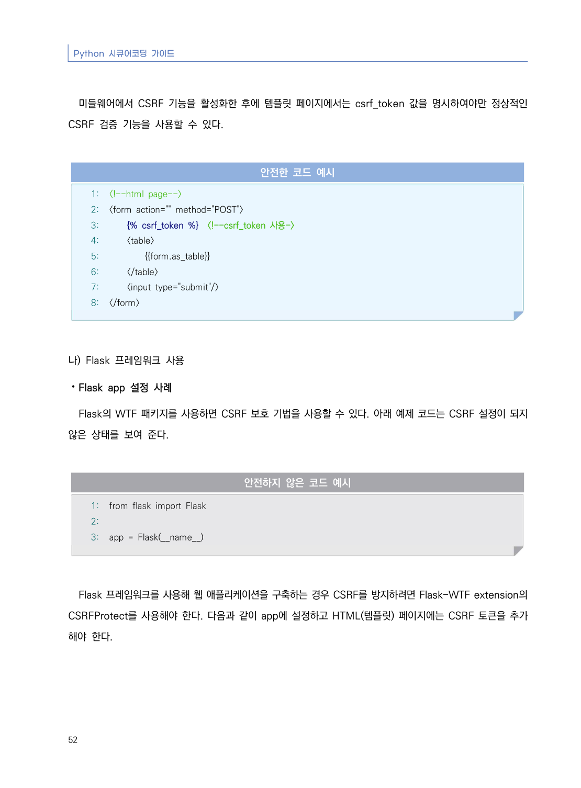
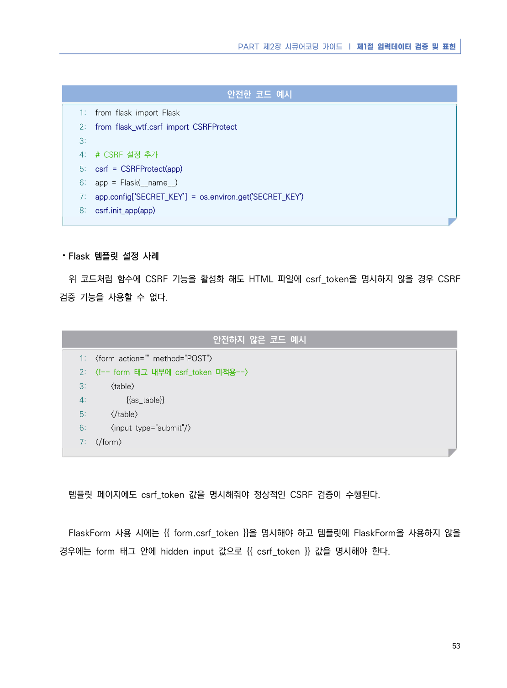
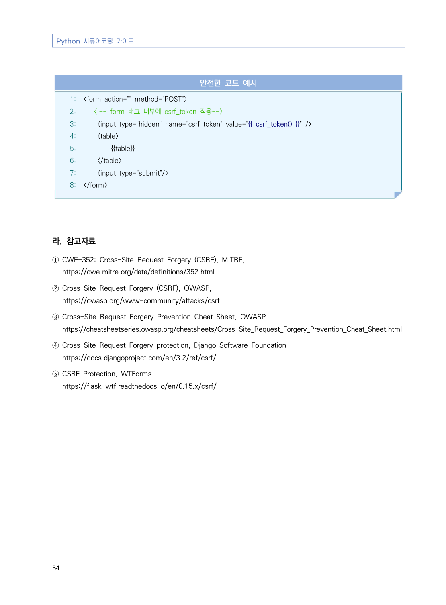

# 11. 크로스사이트 요청 위조(CSRF)

> 변환 안내(원문 외): 아래 본문은 PDF 텍스트를 추출한 전사입니다. 코드 줄번호·특수 공백·원문 오류를 유지했습니다. 실행용 코드가 아닙니다. 표·그림·들여쓰기는 연결된 페이지 이미지와 대조하세요. 페이지 경계의 줄바꿈을 보존하며, 동일 페이지가 여러 항목에 나뉘면 각 항목의 본문은 해당 구간만 포함합니다.

### PDF 54페이지 / 인쇄 48페이지

<!-- source-page:Python-2023:54; source-lines:0,1,2,3,4,5,6,7,8,9,10,11,12,13,14,15,16,17 -->

Python 시큐어코딩 가이드

48

#### 11. 크로스사이트 요청 위조(CSRF)

#### 가. 개요

특정 웹사이트에 대해 사용자가 인지하지 못한 상황에서 사용자의 의도와는 무관하게 공격자가 의도한 행위
(수정, 삭제, 등록 등)를 요청하게 하는 공격을 말한다. 웹 응용프로그램이 사용자로부터 받은 요청이 해당 사용자가 
의도한 대로 작성되고 전송된 것인지 확인하지 않는 경우 발생 가능하다. 특히 사용자가 관리자 권한을 가지는 
경우 사용자 권한관리, 게시물 삭제, 사용자 등록 등 관리자 권한으로만 수행 가능한 기능을 공격자의 의도대로 
실행시킬 수 있게 된다. 공격자는 사용자가 인증한 세션이 특정 동작을 수행해도 계속 유지되어 정상적인 요청과 
비정상적인 요청을 구분하지 못하는 점을 악용한다.

파이썬에서 가장 많이 사용하고 있는 Django 프레임워크와 Flask 프레임워크에서는 각각 CSRF(Cross-Site 
Request Forgery) 토큰 기능을 지원하고 있으며, Django는  태그를 이용해 CSRF 토큰 
기능 제공하고 Flask에서는 Flask-WTF 확장 라이브러리를 통해 {{form.csrf_token}} 태그를 이용한 CSRF 
토큰 기능을 제공해 태그를 사용하는 경우 CSRF 공격에 대비할 수 있다.

#### 나. 안전한 코딩기법

해당 요청이 정상적인 사용자의 정상적인 절차에 의한 요청인지를 구분하기 위해 세션별로 CSRF 토큰을 
생성하여 세션에 저장하고 사용자가 작업 페이지를 요청할 때마다 hidden 값으로 클라이언트에게 토큰을 전달한 뒤, 
해당 클라이언트의 데이터 처리 요청 시 전달되는 CSRF 토큰값을 체크하여 요청의 유효성을 검사하도록 한다.

<details><summary>원본 페이지 이미지 (변환 외 보존 자료)</summary>



</details>

### PDF 55페이지 / 인쇄 49페이지

<!-- source-page:Python-2023:55; source-lines:0,1,2,3,4,5,6,7,8,9,10,11,12,13,14,15,16,17,18,19,20,21,22,23,24,25,26,27,28,29,30,31,32,33 -->

PART 제2장 시큐어코딩 가이드 ❘ 제1절 입력데이터 검증 및 표현

49

Django 프레임워크와 Flask 프레임워크는 미들웨어와 프레임워크에서 기본적으로 CSRF Token을 사용해서 
CSRF 공격으로부터 보호하는 기능을 가지고 있다. 해당 기능을 사용하기 위해 form 태그 내부에 csrf_token을 
사용해야 한다.

#### 다. 코드예제

#### 가) Django 프레임워크 사용

Django 프레임워크에서는 1.2 버전부터 CSRF 취약점을 방지 기능을 기본으로 제공하고 있다. 미들웨어의 
CSRF 옵션을 비활성하거나 템플릿에서 csrf_exempt decorator를 사용하는 경우 CSRF 공격에 노출될 수 있다.

⦁Django 미들웨어 설정(settings.py) 사례

#### 안전하지 않은 코드 예시

```python
1: MIDDLEWARE = [
2:   'django.contrib.sessions.middleware.SessionMiddleware',
3:   # MIDDLEWARE 목록에서 CSRF 항목을 삭제 또는 주석처리 하면
4:   # Django 앱에서 CSRF 유효성 검사가 전역적으로 제거된다
5:   # 'django.middleware.csrf.CsrfViewMiddleware',
6:   'django.contrib.auth.middleware.AuthenticationMiddleware',
7:   'django.contrib.messages.middleware.MessageMiddleware',
8:   'django.middleware.locale.LocaleMiddleware',
9:   ......
10: ]
```

다음은 Django의 CSRF 기능을 활성화하기 위한 안전한 미들웨어 설정 예제를 보여 준다. 미들웨어의 
CSRF 기능을 주석 또는 삭제 처리하지 않아야 한다. 템플릿 페이지에는 csrf_token을 form 태그 안에 명시
해야 미들웨어에서 정상적으로 CSRF 기능을 사용할 수 있다.

<details><summary>원본 페이지 이미지 (변환 외 보존 자료)</summary>



</details>

### PDF 56페이지 / 인쇄 50페이지

<!-- source-page:Python-2023:56; source-lines:0,1,2,3,4,5,6,7,8,9,10,11,12,13,14,15,16,17,18,19,20,21,22,23,24,25,26,27,28,29,30,31,32,33,34,35,36,37,38,39,40,41,42,43,44,45,46,47,48,49 -->

Python 시큐어코딩 가이드

50

#### 안전한 코드 예시

```python
1: MIDDLEWARE = [
2:   'django.contrib.sessions.middleware.SessionMiddleware',
3:   # MIDDLEWARE 목록에서 CSRF 항목을 활성화 한다
4:   'django.middleware.csrf.CsrfViewMiddleware',
5:   'django.contrib.auth.middleware.AuthenticationMiddleware',
6:   'django.contrib.messages.middleware.MessageMiddleware',
7:   'django.middleware.locale.LocaleMiddleware',
8:   ......
9: ]
```

⦁Django 뷰 기능 설정(views.py) 사례

미들웨어에 CSRF 검증 기능이 활성화 되어 있어도 View에서 CSRF 기능을 해제하는 경우에는 해당 요청에 
대해서 CSRF 검증 기능을 사용하지 않게 된다. 다음은 Function-Based View에서 CSRF 검증 기능을 비활성화 
하는 예제를 보여 준다.

#### 안전하지 않은 코드 예시

```python
1: from django.shortcuts import render
2: from django.views.decorators.csrf import csrf_exempt
3:
4: # csrf.exempt 데코레이터로 미들웨어에서 보호되는 CSRF 기능을 해제한다
5: @csrf.exempt
6: def pay_to_point(request):
7:   user_id = request.POST.get('user_id', '')
8:   pay = request.POST.get('pay', '')
9:   product_info = request.POST.get('product_info', '')
10:
11:   ret = handle_pay(user_id, pay, product_info)
12:     
13:   return render(request, '/view_wallet.html', {'wallet':ret})
```

<details><summary>원본 페이지 이미지 (변환 외 보존 자료)</summary>



</details>

### PDF 57페이지 / 인쇄 51페이지

<!-- source-page:Python-2023:57; source-lines:0,1,2,3,4,5,6,7,8,9,10,11,12,13,14,15,16,17,18,19,20,21,22,23,24,25,26,27,28,29,30,31,32,33,34,35,36,37,38,39,40,41,42,43,44,45,46,47,48,49 -->

PART 제2장 시큐어코딩 가이드 ❘ 제1절 입력데이터 검증 및 표현

51

Django는 기본적으로 CSRF 기능을 강제하고 있지만, 부득이하게 CSRF 기능을 해제해야 하는 경우는 미들
웨어의 CSRF 기능을 전역적으로 비활성화 하기 보다는 미들웨어의 CSRF 기능은 활성화 하고 필요한 요청에 
대해서만 csrf_exempt 데코레이터를 사용하여야 하고 이 경우에 크로스사이트 요청 위조의 위협에 노출될 
수 있으므로 주의를 기울여야 한다.

#### 안전한 코드 예시

```python
1: from django.shortcuts import render
2: from django.template import RequestContext
3:
4: # csrf_exempt 데코레이터를 삭제하거나 주석 처리한다.
5: # @csrf_exempt
6: def pay_to_point(request):
7:   user_id = request.POST.get('user_id', '')
8:   pay = request.POST.get('pay', '')
9:   product_info = request.POST.get('product_info', '')
10:
11:   ret = handle_pay(user_id, pay, product_info)
12:
13:   return render(request, '/view_wallet.html', {'wallet':ret})
```

⦁Django 템플릿 설정 사례

미들웨어에서 CSRF 기능을 활성화해도 템플릿 페이지에 CSRF 토큰을 명시하지 않을 경우 CSRF 검증 
기능을 사용할 수 없다.

#### 안전하지 않은 코드 예시

```html
1: <!--html page-->
2: <form action="" method="POST">
3: <!-- form 태그 내부에 csrf_token 미적용-->
4:     <table>
5:         {{form.as_table}}
6:     </table>
7:     <input type="submit"/>
8: </form>
```

<details><summary>원본 페이지 이미지 (변환 외 보존 자료)</summary>



</details>

### PDF 58페이지 / 인쇄 52페이지

<!-- source-page:Python-2023:58; source-lines:0,1,2,3,4,5,6,7,8,9,10,11,12,13,14,15,16,17,18,19,20,21,22,23,24,25,26,27,28,29,30,31,32,33 -->

Python 시큐어코딩 가이드

52

미들웨어에서 CSRF 기능을 활성화한 후에 템플릿 페이지에서는 csrf_token 값을 명시하여야만 정상적인 
CSRF 검증 기능을 사용할 수 있다.

#### 안전한 코드 예시

```html
1: <!--html page-->
2: <form action="" method="POST">
3:       <!--csrf_token 사용->
4:     <table>
5:         {{form.as_table}}
6:     </table>
7:     <input type="submit"/>
8: </form>
```

#### 나) Flask 프레임워크 사용

⦁Flask app 설정 사례

Flask의 WTF 패키지를 사용하면 CSRF 보호 기법을 사용할 수 있다. 아래 예제 코드는 CSRF 설정이 되지 
않은 상태를 보여 준다.

#### 안전하지 않은 코드 예시

```python
1: from flask import Flask
2:
3: app = Flask(__name__)
```

Flask 프레임워크를 사용해 웹 애플리케이션을 구축하는 경우 CSRF를 방지하려면 Flask-WTF extension의 
CSRFProtect를 사용해야 한다. 다음과 같이 app에 설정하고 HTML(템플릿) 페이지에는 CSRF 토큰을 추가
해야 한다.

<details><summary>원본 페이지 이미지 (변환 외 보존 자료)</summary>



</details>

### PDF 59페이지 / 인쇄 53페이지

<!-- source-page:Python-2023:59; source-lines:0,1,2,3,4,5,6,7,8,9,10,11,12,13,14,15,16,17,18,19,20,21,22,23,24,25,26,27,28,29,30,31,32,33,34,35,36,37,38 -->

PART 제2장 시큐어코딩 가이드 ❘ 제1절 입력데이터 검증 및 표현

53

#### 안전한 코드 예시

```python
1: from flask import Flask
2: from flask_wtf.csrf import CSRFProtect
3:
4: # CSRF 설정 추가
5: csrf = CSRFProtect(app)
6: app = Flask(__name__)
7: app.config[‘SECRET_KEY’] = os.environ.get('SECRET_KEY')
8: csrf.init_app(app)
```

⦁Flask 템플릿 설정 사례

위 코드처럼 함수에 CSRF 기능을 활성화 해도 HTML 파일에 csrf_token을 명시하지 않을 경우 CSRF 
검증 기능을 사용할 수 없다.

#### 안전하지 않은 코드 예시

```html
1: <form action="" method="POST">
2: <!-- form 태그 내부에 csrf_token 미적용-->
3:     <table>
4:         {{as_table}}
5:     </table>
6:     <input type="submit"/>
7: </form>
```

템플릿 페이지에도 csrf_token 값을 명시해줘야 정상적인 CSRF 검증이 수행된다.

FlaskForm 사용 시에는 {{ form.csrf_token }}을 명시해야 하고 템플릿에 FlaskForm을 사용하지 않을 
경우에는 form 태그 안에 hidden input 값으로 {{ csrf_token }} 값을 명시해야 한다.

<details><summary>원본 페이지 이미지 (변환 외 보존 자료)</summary>



</details>

### PDF 60페이지 / 인쇄 54페이지

<!-- source-page:Python-2023:60; source-lines:0,1,2,3,4,5,6,7,8,9,10,11,12,13,14,15,16,17,18,19,20,21,22,23,24,25,26,27,28,29 -->

Python 시큐어코딩 가이드

54

#### 안전한 코드 예시

```html
1: <form action="" method="POST">
2:    <!-- form 태그 내부에 csrf_token 적용-->
3:     <input type="hidden" name="csrf_token" value="{{ csrf_token() }}" />
4:     <table>
5:         {{table}}
6:     </table>
7:     <input type="submit"/>
8: </form>
```

#### 라. 참고자료

① CWE-352: Cross-Site Request Forgery (CSRF), MITRE,

https://cwe.mitre.org/data/definitions/352.html
② Cross Site Request Forgery (CSRF), OWASP,

https://owasp.org/www-community/attacks/csrf
③ Cross-Site Request Forgery Prevention Cheat Sheet, OWASP

https://cheatsheetseries.owasp.org/cheatsheets/Cross-Site_Request_Forgery_Prevention_Cheat_Sheet.html
④ Cross Site Request Forgery protection, Django Software Foundation

https://docs.djangoproject.com/en/3.2/ref/csrf/
⑤ CSRF Protection, WTForms

https://flask-wtf.readthedocs.io/en/0.15.x/csrf/

<details><summary>원본 페이지 이미지 (변환 외 보존 자료)</summary>



</details>

---

## 탐색 링크 (원문 외)

[통합 인덱스](../../../INDEX.md)

