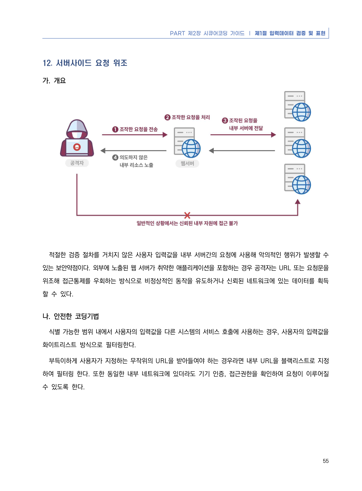
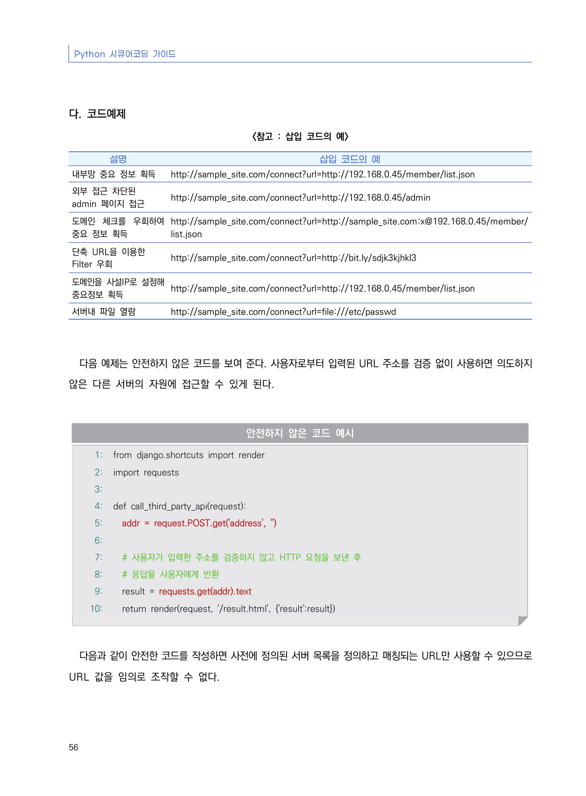
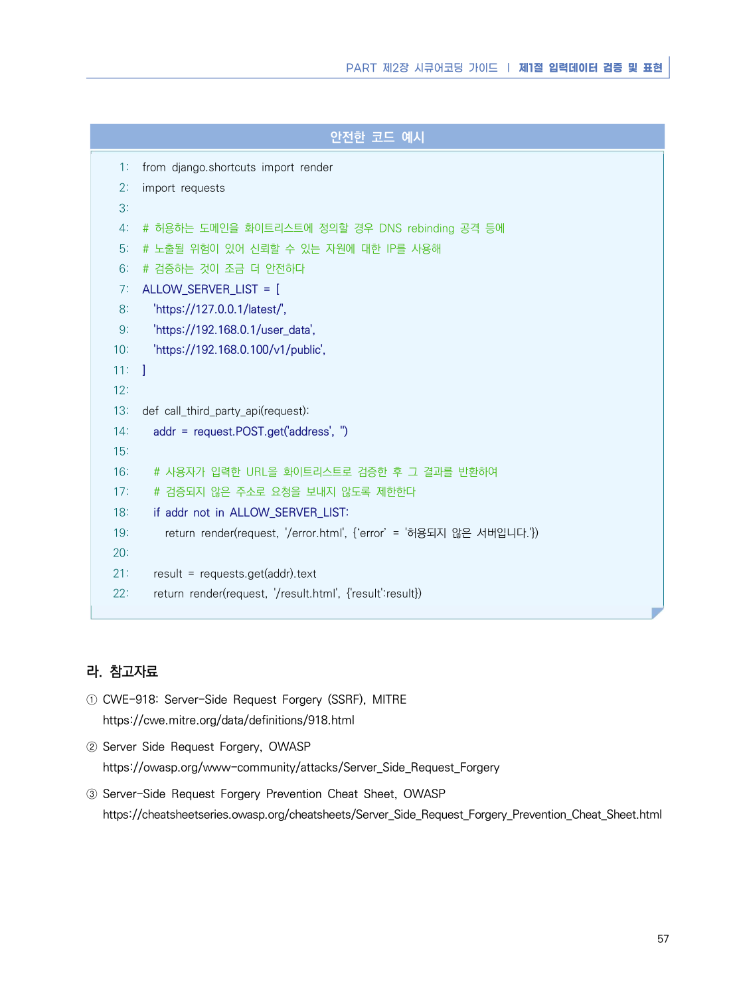

# 12. 서버사이드 요청 위조

> 변환 안내(원문 외): 아래 본문은 PDF 텍스트를 추출한 전사입니다. 코드 줄번호·특수 공백·원문 오류를 유지했습니다. 실행용 코드가 아닙니다. 표·그림·들여쓰기는 연결된 페이지 이미지와 대조하세요. 페이지 경계의 줄바꿈을 보존하며, 동일 페이지가 여러 항목에 나뉘면 각 항목의 본문은 해당 구간만 포함합니다.

### PDF 61페이지 / 인쇄 55페이지

<!-- source-page:Python-2023:61; source-lines:0,1,2,3,4,5,6,7,8,9,10,11,12,13 -->

PART 제2장 시큐어코딩 가이드 ❘ 제1절 입력데이터 검증 및 표현

55

#### 12. 서버사이드 요청 위조

#### 가. 개요

적절한 검증 절차를 거치지 않은 사용자 입력값을 내부 서버간의 요청에 사용해 악의적인 행위가 발생할 수 
있는 보안약점이다. 외부에 노출된 웹 서버가 취약한 애플리케이션을 포함하는 경우 공격자는 URL 또는 요청문을 
위조해 접근통제를 우회하는 방식으로 비정상적인 동작을 유도하거나 신뢰된 네트워크에 있는 데이터를 획득
할 수 있다.

#### 나. 안전한 코딩기법

식별 가능한 범위 내에서 사용자의 입력값을 다른 시스템의 서비스 호출에 사용하는 경우, 사용자의 입력값을 
화이트리스트 방식으로 필터링한다. 

부득이하게 사용자가 지정하는 무작위의 URL을 받아들여야 하는 경우라면 내부 URL을 블랙리스트로 지정
하여 필터링 한다. 또한 동일한 내부 네트워크에 있더라도 기기 인증, 접근권한을 확인하여 요청이 이루어질 
수 있도록 한다. 

<details><summary>원본 페이지 이미지 (변환 외 보존 자료)</summary>



</details>

### PDF 62페이지 / 인쇄 56페이지

<!-- source-page:Python-2023:62; source-lines:0,1,2,3,4,5,6,7,8,9,10,11,12,13,14,15,16,17,18,19,20,21,22,23,24,25,26,27,28,29,30,31,32,33,34,35,36,37,38,39,40,41,42,43,44,45 -->

Python 시큐어코딩 가이드

56

#### 다. 코드예제

&lt;참고 : 삽입 코드의 예&gt;

설명

삽입 코드의 예

내부망 중요 정보 획득

http://sample_site.com/connect?url=http://192.168.0.45/member/list.json

외부 접근 차단된 
admin 페이지 접근

http://sample_site.com/connect?url=http://192.168.0.45/admin

도메인 체크를 우회하여 
중요 정보 획득

http://sample_site.com/connect?url=http://sample_site.com:x@192.168.0.45/member/
list.json

단축 URL을 이용한 
Filter 우회

http://sample_site.com/connect?url=http://bit.ly/sdjk3kjhkl3

도메인을 사설IP로 설정해 
중요정보 획득

http://sample_site.com/connect?url=http://192.168.0.45/member/list.json

서버내 파일 열람

http://sample_site.com/connect?url=file:///etc/passwd

다음 예제는 안전하지 않은 코드를 보여 준다. 사용자로부터 입력된 URL 주소를 검증 없이 사용하면 의도하지 
않은 다른 서버의 자원에 접근할 수 있게 된다.

#### 안전하지 않은 코드 예시

```python
1: from django.shortcuts import render
2: import requests
3:
4: def call_third_party_api(request):
5:   addr = request.POST.get('address', '')
6:
7:   # 사용자가 입력한 주소를 검증하지 않고 HTTP 요청을 보낸 후  
8:   # 응답을 사용자에게 반환
9:   result = requests.get(addr).text
10:   return render(request, '/result.html', {'result':result})
```

다음과 같이 안전한 코드를 작성하면 사전에 정의된 서버 목록을 정의하고 매칭되는 URL만 사용할 수 있으므로 
URL 값을 임의로 조작할 수 없다.

<details><summary>원본 페이지 이미지 (변환 외 보존 자료)</summary>



</details>

### PDF 63페이지 / 인쇄 57페이지

<!-- source-page:Python-2023:63; source-lines:0,1,2,3,4,5,6,7,8,9,10,11,12,13,14,15,16,17,18,19,20,21,22,23,24,25,26,27,28,29,30,31,32,33,34,35,36,37,38,39,40,41,42,43,44,45,46,47,48,49,50 -->

PART 제2장 시큐어코딩 가이드 ❘ 제1절 입력데이터 검증 및 표현

57

#### 안전한 코드 예시

```python
1: from django.shortcuts import render
2: import requests
3:
4: # 허용하는 도메인을 화이트리스트에 정의할 경우 DNS rebinding 공격 등에 
5: # 노출될 위험이 있어 신뢰할 수 있는 자원에 대한 IP를 사용해 
6: # 검증하는 것이 조금 더 안전하다
7: ALLOW_SERVER_LIST = [
8:   'https://127.0.0.1/latest/',
9:   'https://192.168.0.1/user_data',
10:   'https://192.168.0.100/v1/public',
11: ]
12:
13: def call_third_party_api(request):
14:   addr = request.POST.get('address', '')
15:
16:   # 사용자가 입력한 URL을 화이트리스트로 검증한 후 그 결과를 반환하여
17:   # 검증되지 않은 주소로 요청을 보내지 않도록 제한한다
18:   if addr not in ALLOW_SERVER_LIST:
19:     return render(request, '/error.html', {‘error’ = '허용되지 않은 서버입니다.'})
20:         
21:   result = requests.get(addr).text
22:   return render(request, '/result.html', {'result':result})
```

#### 라. 참고자료

① CWE-918: Server-Side Request Forgery (SSRF), MITRE

https://cwe.mitre.org/data/definitions/918.html
② Server Side Request Forgery, OWASP

https://owasp.org/www-community/attacks/Server_Side_Request_Forgery
③ Server-Side Request Forgery Prevention Cheat Sheet, OWASP

https://cheatsheetseries.owasp.org/cheatsheets/Server_Side_Request_Forgery_Prevention_Cheat_Sheet.html

<details><summary>원본 페이지 이미지 (변환 외 보존 자료)</summary>



</details>

---

## 탐색 링크 (원문 외)

[통합 인덱스](../../../INDEX.md)

