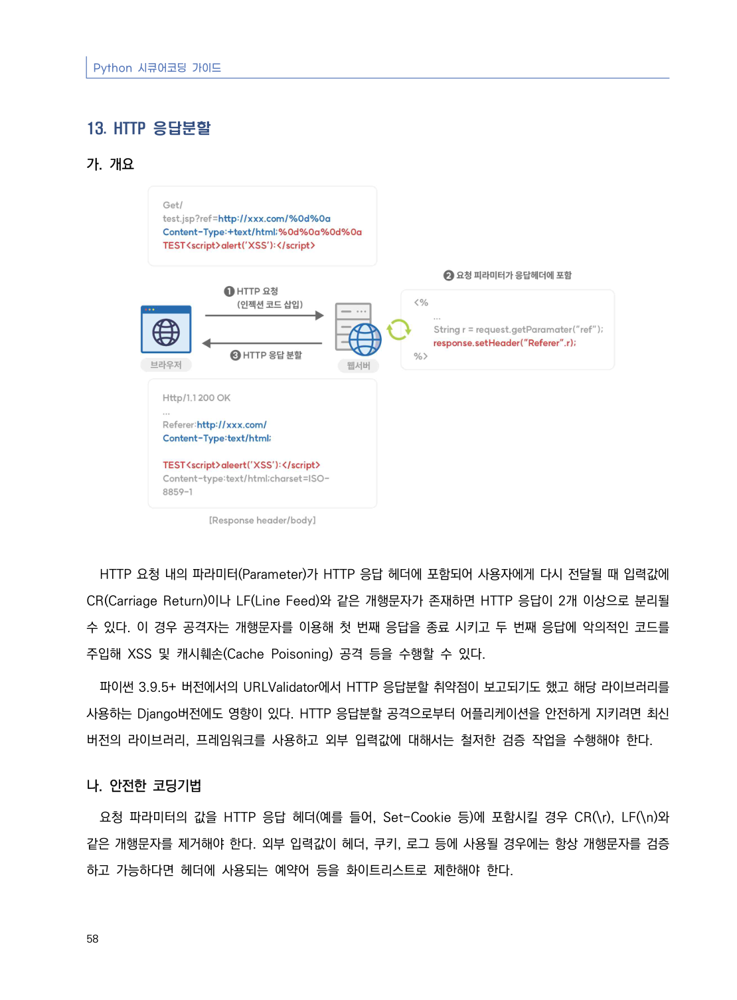
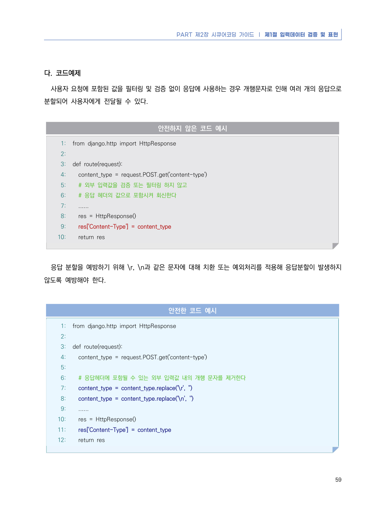
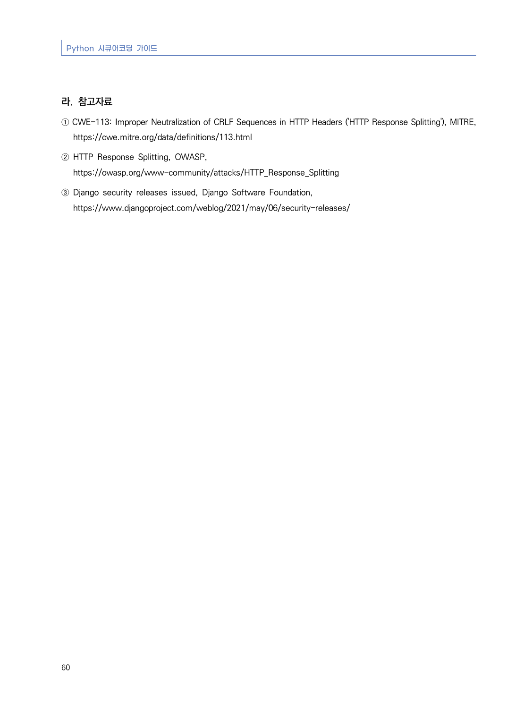

# 13. HTTP 응답분할

> 변환 안내(원문 외): 아래 본문은 PDF 텍스트를 추출한 전사입니다. 코드 줄번호·특수 공백·원문 오류를 유지했습니다. 실행용 코드가 아닙니다. 표·그림·들여쓰기는 연결된 페이지 이미지와 대조하세요. 페이지 경계의 줄바꿈을 보존하며, 동일 페이지가 여러 항목에 나뉘면 각 항목의 본문은 해당 구간만 포함합니다.

### PDF 64페이지 / 인쇄 58페이지

<!-- source-page:Python-2023:64; source-lines:0,1,2,3,4,5,6,7,8,9,10,11,12,13,14 -->

Python 시큐어코딩 가이드

58

#### 13. HTTP 응답분할

#### 가. 개요

HTTP 요청 내의 파라미터(Parameter)가 HTTP 응답 헤더에 포함되어 사용자에게 다시 전달될 때 입력값에  
CR(Carriage Return)이나 LF(Line Feed)와 같은 개행문자가 존재하면 HTTP 응답이 2개 이상으로 분리될 
수 있다. 이 경우 공격자는 개행문자를 이용해 첫 번째 응답을 종료 시키고 두 번째 응답에 악의적인 코드를 
주입해 XSS 및 캐시훼손(Cache Poisoning) 공격 등을 수행할 수 있다.

파이썬 3.9.5+ 버전에서의 URLValidator에서 HTTP 응답분할 취약점이 보고되기도 했고 해당 라이브러리를 
사용하는 Django버전에도 영향이 있다. HTTP 응답분할 공격으로부터 어플리케이션을 안전하게 지키려면 최신 
버전의 라이브러리, 프레임워크를 사용하고 외부 입력값에 대해서는 철저한 검증 작업을 수행해야 한다.

#### 나. 안전한 코딩기법

요청 파라미터의 값을 HTTP 응답 헤더(예를 들어, Set-Cookie 등)에 포함시킬 경우 CR(\r), LF(\n)와 
같은 개행문자를 제거해야 한다. 외부 입력값이 헤더, 쿠키, 로그 등에 사용될 경우에는 항상 개행문자를 검증
하고 가능하다면 헤더에 사용되는 예약어 등을 화이트리스트로 제한해야 한다.

<details><summary>원본 페이지 이미지 (변환 외 보존 자료)</summary>



</details>

### PDF 65페이지 / 인쇄 59페이지

<!-- source-page:Python-2023:65; source-lines:0,1,2,3,4,5,6,7,8,9,10,11,12,13,14,15,16,17,18,19,20,21,22,23,24,25,26,27,28,29,30,31,32,33,34,35,36,37,38,39,40,41,42,43,44,45,46,47,48,49 -->

PART 제2장 시큐어코딩 가이드 ❘ 제1절 입력데이터 검증 및 표현

59

#### 다. 코드예제

사용자 요청에 포함된 값을 필터링 및 검증 없이 응답에 사용하는 경우 개행문자로 인해 여러 개의 응답으로 
분할되어 사용자에게 전달될 수 있다.

#### 안전하지 않은 코드 예시

```python
1: from django.http import HttpResponse
2:
3: def route(request):
4:   content_type = request.POST.get('content-type')
5:   # 외부 입력값을 검증 또는 필터링 하지 않고
6:   # 응답 헤더의 값으로 포함시켜 회신한다
7:   ......
8:   res = HttpResponse()
9:   res['Content-Type'] = content_type
10:   return res
```

응답 분할을 예방하기 위해 \r, \n과 같은 문자에 대해 치환 또는 예외처리를 적용해 응답분할이 발생하지 
않도록 예방해야 한다.

#### 안전한 코드 예시

```python
1: from django.http import HttpResponse
2:
3: def route(request):
4:   content_type = request.POST.get('content-type')
5:
6:   # 응답헤더에 포함될 수 있는 외부 입력값 내의 개행 문자를 제거한다
7:   content_type = content_type.replace('\r', '')
8:   content_type = content_type.replace('\n', '')
9:   ......
10:   res = HttpResponse()
11:   res['Content-Type'] = content_type
12:   return res
```

<details><summary>원본 페이지 이미지 (변환 외 보존 자료)</summary>



</details>

### PDF 66페이지 / 인쇄 60페이지

<!-- source-page:Python-2023:66; source-lines:0,1,2,3,4,5,6,7,8 -->

Python 시큐어코딩 가이드

60

#### 라. 참고자료

① CWE-113: Improper Neutralization of CRLF Sequences in HTTP Headers ('HTTP Response Splitting'), MITRE,

https://cwe.mitre.org/data/definitions/113.html
② HTTP Response Splitting, OWASP,

https://owasp.org/www-community/attacks/HTTP_Response_Splitting
③ Django security releases issued, Django Software Foundation,

https://www.djangoproject.com/weblog/2021/may/06/security-releases/

<details><summary>원본 페이지 이미지 (변환 외 보존 자료)</summary>



</details>

---

## 탐색 링크 (원문 외)

[통합 인덱스](../../../INDEX.md)

