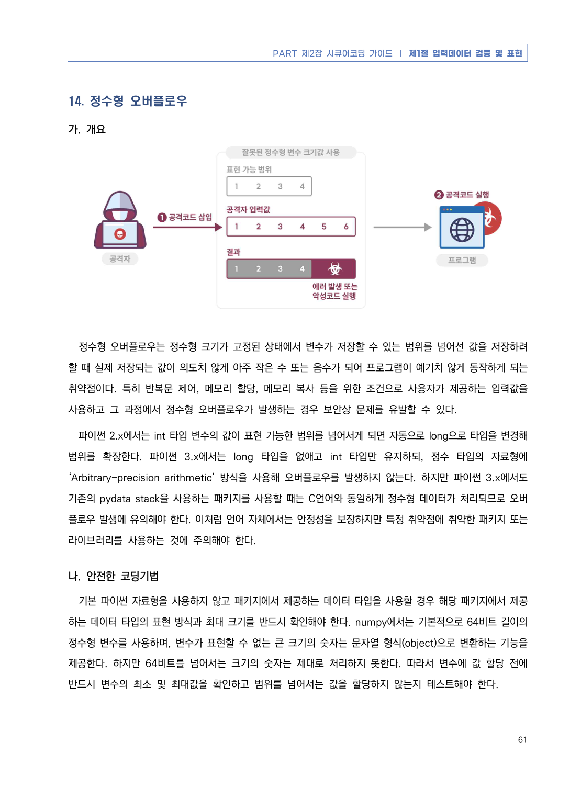
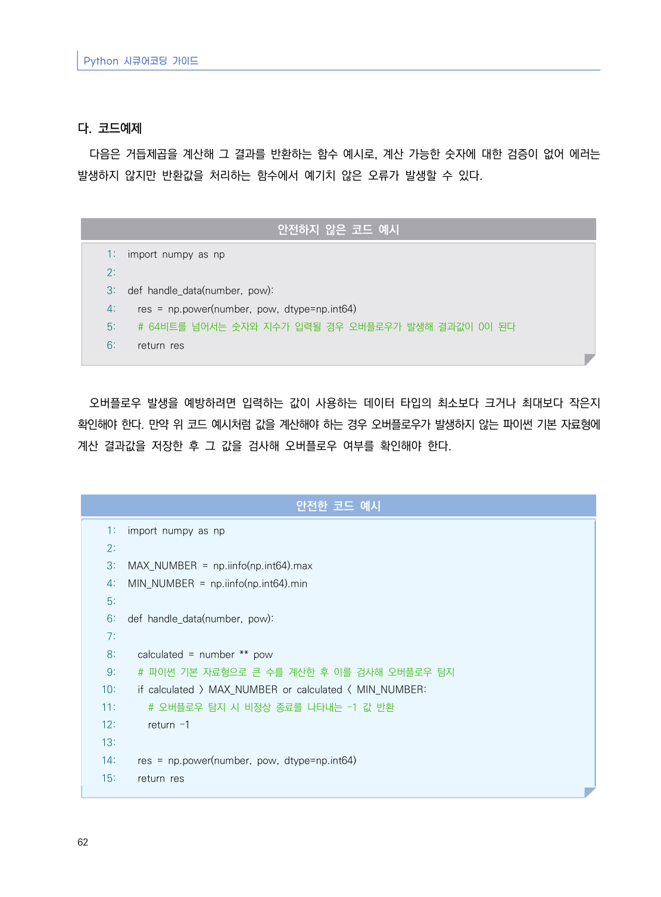
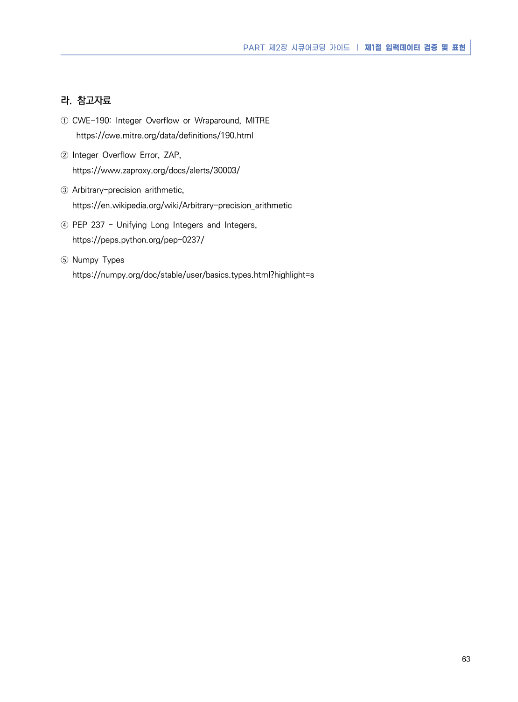

# 14. 정수형 오버플로우

> 변환 안내(원문 외): 아래 본문은 PDF 텍스트를 추출한 전사입니다. 코드 줄번호·특수 공백·원문 오류를 유지했습니다. 실행용 코드가 아닙니다. 표·그림·들여쓰기는 연결된 페이지 이미지와 대조하세요. 페이지 경계의 줄바꿈을 보존하며, 동일 페이지가 여러 항목에 나뉘면 각 항목의 본문은 해당 구간만 포함합니다.

### PDF 67페이지 / 인쇄 61페이지

<!-- source-page:Python-2023:67; source-lines:0,1,2,3,4,5,6,7,8,9,10,11,12,13,14,15,16,17,18,19 -->

PART 제2장 시큐어코딩 가이드 ❘ 제1절 입력데이터 검증 및 표현

61

#### 14. 정수형 오버플로우

#### 가. 개요

정수형 오버플로우는 정수형 크기가 고정된 상태에서 변수가 저장할 수 있는 범위를 넘어선 값을 저장하려 
할 때 실제 저장되는 값이 의도치 않게 아주 작은 수 또는 음수가 되어 프로그램이 예기치 않게 동작하게 되는 
취약점이다. 특히 반복문 제어, 메모리 할당, 메모리 복사 등을 위한 조건으로 사용자가 제공하는 입력값을 
사용하고 그 과정에서 정수형 오버플로우가 발생하는 경우 보안상 문제를 유발할 수 있다.

파이썬 2.x에서는 int 타입 변수의 값이 표현 가능한 범위를 넘어서게 되면 자동으로 long으로 타입을 변경해 
범위를 확장한다. 파이썬 3.x에서는 long 타입을 없애고 int 타입만 유지하되, 정수 타입의 자료형에 
‘Arbitrary-precision arithmetic’ 방식을 사용해 오버플로우를 발생하지 않는다. 하지만 파이썬 3.x에서도 
기존의 pydata stack을 사용하는 패키지를 사용할 때는 C언어와 동일하게 정수형 데이터가 처리되므로 오버
플로우 발생에 유의해야 한다. 이처럼 언어 자체에서는 안정성을 보장하지만 특정 취약점에 취약한 패키지 또는 
라이브러리를 사용하는 것에 주의해야 한다.

#### 나. 안전한 코딩기법

기본 파이썬 자료형을 사용하지 않고 패키지에서 제공하는 데이터 타입을 사용할 경우 해당 패키지에서 제공
하는 데이터 타입의 표현 방식과 최대 크기를 반드시 확인해야 한다. numpy에서는 기본적으로 64비트 길이의 
정수형 변수를 사용하며, 변수가 표현할 수 없는 큰 크기의 숫자는 문자열 형식(object)으로 변환하는 기능을 
제공한다. 하지만 64비트를 넘어서는 크기의 숫자는 제대로 처리하지 못한다. 따라서 변수에 값 할당 전에 
반드시 변수의 최소 및 최대값을 확인하고 범위를 넘어서는 값을 할당하지 않는지 테스트해야 한다.

<details><summary>원본 페이지 이미지 (변환 외 보존 자료)</summary>



</details>

### PDF 68페이지 / 인쇄 62페이지

<!-- source-page:Python-2023:68; source-lines:0,1,2,3,4,5,6,7,8,9,10,11,12,13,14,15,16,17,18,19,20,21,22,23,24,25,26,27,28,29,30,31,32,33,34,35,36,37,38,39,40,41,42,43,44,45,46,47 -->

Python 시큐어코딩 가이드

62

#### 다. 코드예제

다음은 거듭제곱을 계산해 그 결과를 반환하는 함수 예시로, 계산 가능한 숫자에 대한 검증이 없어 에러는 
발생하지 않지만 반환값을 처리하는 함수에서 예기치 않은 오류가 발생할 수 있다.

#### 안전하지 않은 코드 예시

```python
1: import numpy as np
2:
3: def handle_data(number, pow):
4:   res = np.power(number, pow, dtype=np.int64)
5:   # 64비트를 넘어서는 숫자와 지수가 입력될 경우 오버플로우가 발생해 결과값이 0이 된다
6:   return res
```

오버플로우 발생을 예방하려면 입력하는 값이 사용하는 데이터 타입의 최소보다 크거나 최대보다 작은지 
확인해야 한다. 만약 위 코드 예시처럼 값을 계산해야 하는 경우 오버플로우가 발생하지 않는 파이썬 기본 자료형에 
계산 결과값을 저장한 후 그 값을 검사해 오버플로우 여부를 확인해야 한다.

#### 안전한 코드 예시

```python
1: import numpy as np
2:
3: MAX_NUMBER = np.iinfo(np.int64).max
4: MIN_NUMBER = np.iinfo(np.int64).min
5:
6: def handle_data(number, pow):
7:  
8:   calculated = number ** pow
9:   # 파이썬 기본 자료형으로 큰 수를 계산한 후 이를 검사해 오버플로우 탐지
10:   if calculated > MAX_NUMBER or calculated < MIN_NUMBER:
11:     # 오버플로우 탐지 시 비정상 종료를 나타내는 –1 값 반환
12:     return –1
13:
14:   res = np.power(number, pow, dtype=np.int64)
15:   return res
```

<details><summary>원본 페이지 이미지 (변환 외 보존 자료)</summary>



</details>

### PDF 69페이지 / 인쇄 63페이지

<!-- source-page:Python-2023:69; source-lines:0,1,2,3,4,5,6,7,8,9,10,11,12 -->

PART 제2장 시큐어코딩 가이드 ❘ 제1절 입력데이터 검증 및 표현

63

#### 라. 참고자료

① CWE-190: Integer Overflow or Wraparound, MITRE

 https://cwe.mitre.org/data/definitions/190.html
② Integer Overflow Error, ZAP,

https://www.zaproxy.org/docs/alerts/30003/
③ Arbitrary-precision arithmetic,

https://en.wikipedia.org/wiki/Arbitrary-precision_arithmetic
④ PEP 237 – Unifying Long Integers and Integers,

https://peps.python.org/pep-0237/
⑤ Numpy Types

https://numpy.org/doc/stable/user/basics.types.html?highlight=s

<details><summary>원본 페이지 이미지 (변환 외 보존 자료)</summary>



</details>

---

## 탐색 링크 (원문 외)

[통합 인덱스](../../../INDEX.md)

