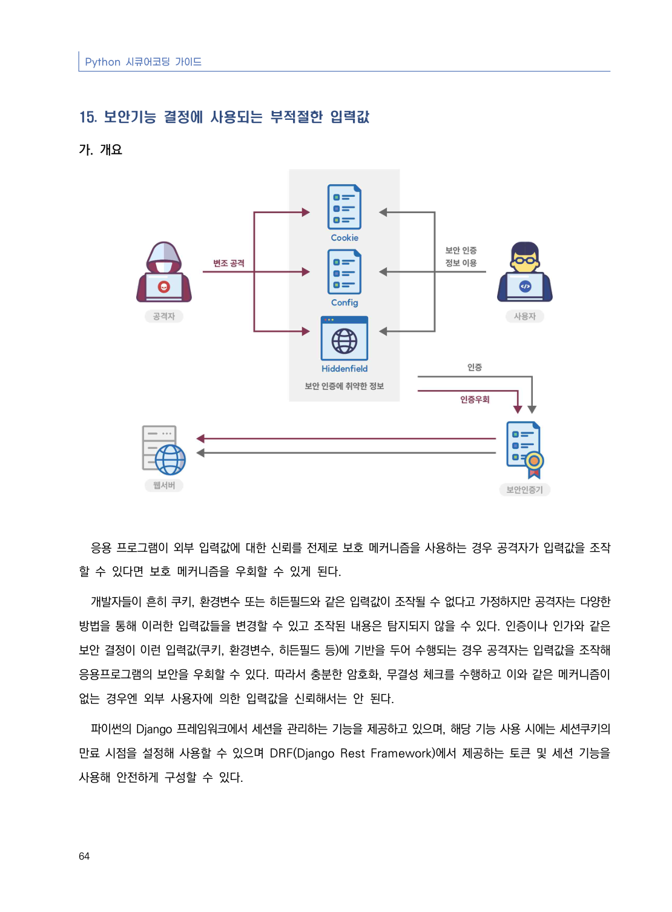
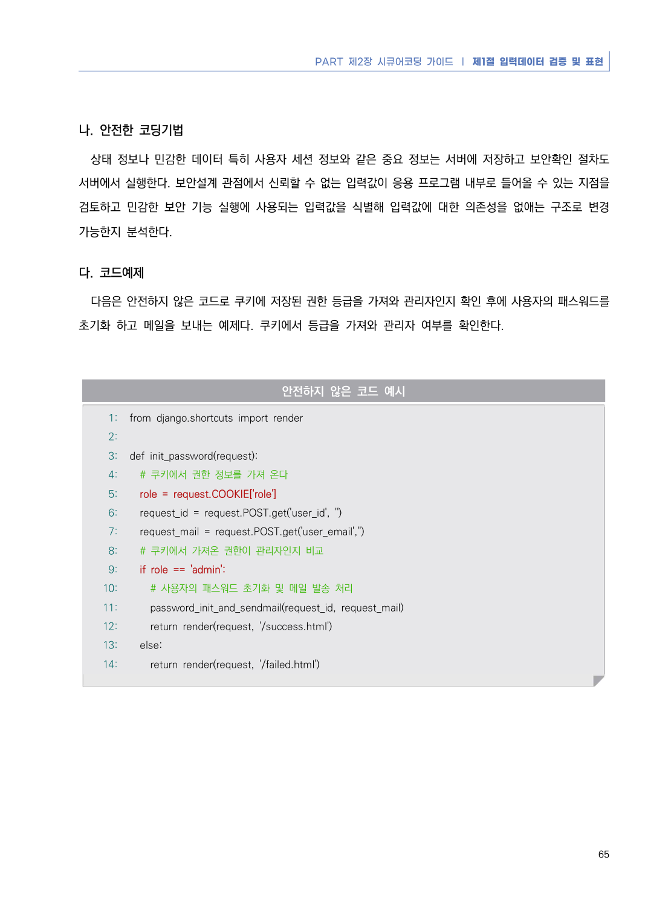
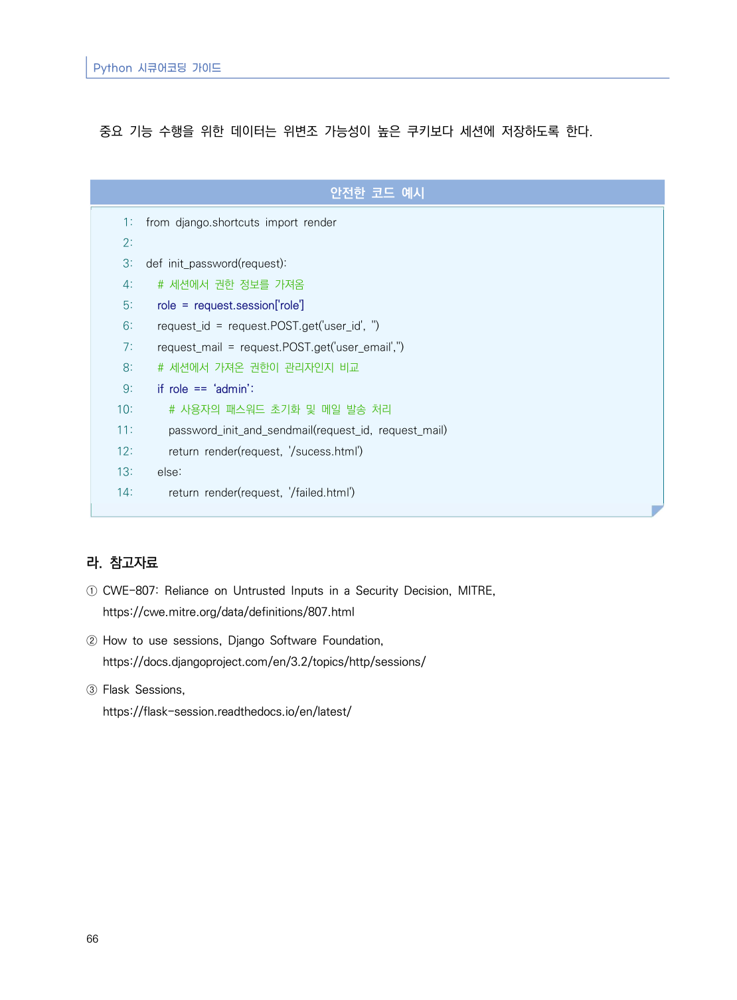

# 15. 보안기능 결정에 사용되는 부적절한 입력값

> 변환 안내(원문 외): 아래 본문은 PDF 텍스트를 추출한 전사입니다. 코드 줄번호·특수 공백·원문 오류를 유지했습니다. 실행용 코드가 아닙니다. 표·그림·들여쓰기는 연결된 페이지 이미지와 대조하세요. 페이지 경계의 줄바꿈을 보존하며, 동일 페이지가 여러 항목에 나뉘면 각 항목의 본문은 해당 구간만 포함합니다.

### PDF 70페이지 / 인쇄 64페이지

<!-- source-page:Python-2023:70; source-lines:0,1,2,3,4,5,6,7,8,9,10,11,12,13 -->

Python 시큐어코딩 가이드

64

#### 15. 보안기능 결정에 사용되는 부적절한 입력값

#### 가. 개요

응용 프로그램이 외부 입력값에 대한 신뢰를 전제로 보호 메커니즘을 사용하는 경우 공격자가 입력값을 조작
할 수 있다면 보호 메커니즘을 우회할 수 있게 된다.

개발자들이 흔히 쿠키, 환경변수 또는 히든필드와 같은 입력값이 조작될 수 없다고 가정하지만 공격자는 다양한 
방법을 통해 이러한 입력값들을 변경할 수 있고 조작된 내용은 탐지되지 않을 수 있다. 인증이나 인가와 같은 
보안 결정이 이런 입력값(쿠키, 환경변수, 히든필드 등)에 기반을 두어 수행되는 경우 공격자는 입력값을 조작해 
응용프로그램의 보안을 우회할 수 있다. 따라서 충분한 암호화, 무결성 체크를 수행하고 이와 같은 메커니즘이 
없는 경우엔 외부 사용자에 의한 입력값을 신뢰해서는 안 된다.

파이썬의 Django 프레임워크에서 세션을 관리하는 기능을 제공하고 있으며, 해당 기능 사용 시에는 세션쿠키의 
만료 시점을 설정해 사용할 수 있으며 DRF(Django Rest Framework)에서 제공하는 토큰 및 세션 기능을 
사용해 안전하게 구성할 수 있다.

<details><summary>원본 페이지 이미지 (변환 외 보존 자료)</summary>



</details>

### PDF 71페이지 / 인쇄 65페이지

<!-- source-page:Python-2023:71; source-lines:0,1,2,3,4,5,6,7,8,9,10,11,12,13,14,15,16,17,18,19,20,21,22,23,24,25,26,27,28,29,30,31,32,33,34,35,36,37 -->

PART 제2장 시큐어코딩 가이드 ❘ 제1절 입력데이터 검증 및 표현

65

#### 나. 안전한 코딩기법

상태 정보나 민감한 데이터 특히 사용자 세션 정보와 같은 중요 정보는 서버에 저장하고 보안확인 절차도 
서버에서 실행한다. 보안설계 관점에서 신뢰할 수 없는 입력값이 응용 프로그램 내부로 들어올 수 있는 지점을 
검토하고 민감한 보안 기능 실행에 사용되는 입력값을 식별해 입력값에 대한 의존성을 없애는 구조로 변경 
가능한지 분석한다.

#### 다. 코드예제

다음은 안전하지 않은 코드로 쿠키에 저장된 권한 등급을 가져와 관리자인지 확인 후에 사용자의 패스워드를 
초기화 하고 메일을 보내는 예제다. 쿠키에서 등급을 가져와 관리자 여부를 확인한다. 

#### 안전하지 않은 코드 예시

```python
1: from django.shortcuts import render
2:
3: def init_password(request):
4:   # 쿠키에서 권한 정보를 가져 온다
5:   role = request.COOKIE['role']
6:   request_id = request.POST.get('user_id', '')
7:   request_mail = request.POST.get('user_email','')
8:   # 쿠키에서 가져온 권한이 관리자인지 비교
9:   if role == 'admin':
10:     # 사용자의 패스워드 초기화 및 메일 발송 처리
11:     password_init_and_sendmail(request_id, request_mail)
12:     return render(request, '/success.html')
13:   else:
14:     return render(request, '/failed.html')
```

<details><summary>원본 페이지 이미지 (변환 외 보존 자료)</summary>



</details>

### PDF 72페이지 / 인쇄 66페이지

<!-- source-page:Python-2023:72; source-lines:0,1,2,3,4,5,6,7,8,9,10,11,12,13,14,15,16,17,18,19,20,21,22,23,24,25,26,27,28,29,30,31,32,33,34,35,36,37 -->

Python 시큐어코딩 가이드

66

중요 기능 수행을 위한 데이터는 위변조 가능성이 높은 쿠키보다 세션에 저장하도록 한다.

#### 안전한 코드 예시

```python
1: from django.shortcuts import render
2:
3: def init_password(request):
4:   # 세션에서 권한 정보를 가져옴
5:   role = request.session['role']
6:   request_id = request.POST.get('user_id', '')
7:   request_mail = request.POST.get('user_email','')
8:   # 세션에서 가져온 권한이 관리자인지 비교
9:   if role == ‘admin’:
10:     # 사용자의 패스워드 초기화 및 메일 발송 처리
11:     password_init_and_sendmail(request_id, request_mail)
12:     return render(request, '/sucess.html')
13:   else:
14:     return render(request, '/failed.html')
```

#### 라. 참고자료

① CWE-807: Reliance on Untrusted Inputs in a Security Decision, MITRE,

https://cwe.mitre.org/data/definitions/807.html
② How to use sessions, Django Software Foundation,

https://docs.djangoproject.com/en/3.2/topics/http/sessions/
③ Flask Sessions, 

https://flask-session.readthedocs.io/en/latest/

<details><summary>원본 페이지 이미지 (변환 외 보존 자료)</summary>



</details>

---

## 탐색 링크 (원문 외)

[통합 인덱스](../../../INDEX.md)

