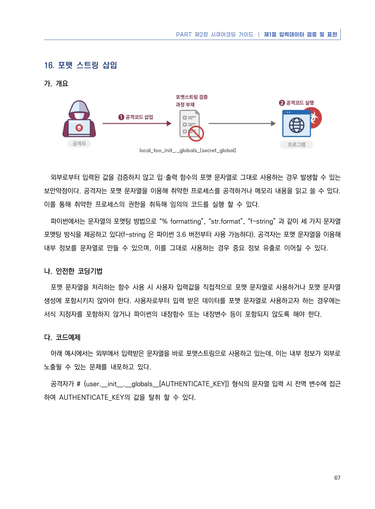
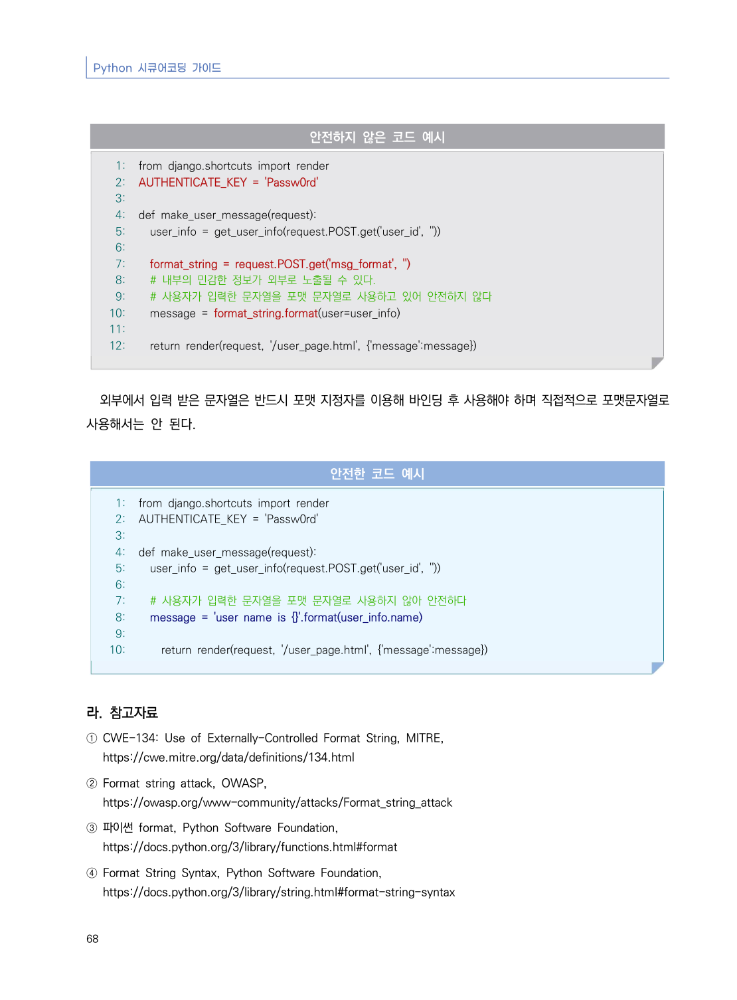

# 16. 포맷 스트링 삽입

> 변환 안내(원문 외): 아래 본문은 PDF 텍스트를 추출한 전사입니다. 코드 줄번호·특수 공백·원문 오류를 유지했습니다. 실행용 코드가 아닙니다. 표·그림·들여쓰기는 연결된 페이지 이미지와 대조하세요. 페이지 경계의 줄바꿈을 보존하며, 동일 페이지가 여러 항목에 나뉘면 각 항목의 본문은 해당 구간만 포함합니다.

### PDF 73페이지 / 인쇄 67페이지

<!-- source-page:Python-2023:73; source-lines:0,1,2,3,4,5,6,7,8,9,10,11,12,13,14,15,16,17,18 -->

PART 제2장 시큐어코딩 가이드 ❘ 제1절 입력데이터 검증 및 표현

67

#### 16. 포맷 스트링 삽입

#### 가. 개요

외부로부터 입력된 값을 검증하지 않고 입·출력 함수의 포맷 문자열로 그대로 사용하는 경우 발생할 수 있는 
보안약점이다. 공격자는 포맷 문자열을 이용해 취약한 프로세스를 공격하거나 메모리 내용을 읽고 쓸 수 있다. 
이를 통해 취약한 프로세스의 권한을 취득해 임의의 코드를 실행 할 수 있다.

파이썬에서는 문자열의 포맷팅 방법으로 “% formatting”, “str.format”, “f-string” 과 같이 세 가지 문자열 
포맷팅 방식을 제공하고 있다(f-string 은 파이썬 3.6 버전부터 사용 가능하다). 공격자는 포맷 문자열을 이용해 
내부 정보를 문자열로 만들 수 있으며, 이를 그대로 사용하는 경우 중요 정보 유출로 이어질 수 있다.

#### 나. 안전한 코딩기법

포맷 문자열을 처리하는 함수 사용 시 사용자 입력값을 직접적으로 포맷 문자열로 사용하거나 포맷 문자열 
생성에 포함시키지 않아야 한다. 사용자로부터 입력 받은 데이터를 포맷 문자열로 사용하고자 하는 경우에는 
서식 지정자를 포함하지 않거나 파이썬의 내장함수 또는 내장변수 등이 포함되지 않도록 해야 한다.

#### 다. 코드예제 

아래 예시에서는 외부에서 입력받은 문자열을 바로 포맷스트링으로 사용하고 있는데, 이는 내부 정보가 외부로 
노출될 수 있는 문제를 내포하고 있다. 

공격자가 # {user.__init__.__globals__[AUTHENTICATE_KEY]} 형식의 문자열 입력 시 전역 변수에 접근
하여 AUTHENTICATE_KEY의 값을 탈취 할 수 있다.

<details><summary>원본 페이지 이미지 (변환 외 보존 자료)</summary>



</details>

### PDF 74페이지 / 인쇄 68페이지

<!-- source-page:Python-2023:74; source-lines:0,1,2,3,4,5,6,7,8,9,10,11,12,13,14,15,16,17,18,19,20,21,22,23,24,25,26,27,28,29,30,31,32,33,34,35,36,37,38,39,40,41,42,43,44,45,46,47,48,49,50,51,52,53,54,55,56 -->

Python 시큐어코딩 가이드

68

#### 안전하지 않은 코드 예시

```python
1: from django.shortcuts import render
2: AUTHENTICATE_KEY = 'Passw0rd'
3:
4: def make_user_message(request):
5:   user_info = get_user_info(request.POST.get('user_id', ''))
6:     
7:   format_string = request.POST.get('msg_format', '')
8:   # 내부의 민감한 정보가 외부로 노출될 수 있다.
9:   # 사용자가 입력한 문자열을 포맷 문자열로 사용하고 있어 안전하지 않다
10:   message = format_string.format(user=user_info)
11:     
12:   return render(request, '/user_page.html', {'message':message})
```

외부에서 입력 받은 문자열은 반드시 포맷 지정자를 이용해 바인딩 후 사용해야 하며 직접적으로 포맷문자열로 
사용해서는 안 된다.

#### 안전한 코드 예시

```python
1: from django.shortcuts import render
2: AUTHENTICATE_KEY = 'Passw0rd'
3:
4: def make_user_message(request):
5:   user_info = get_user_info(request.POST.get('user_id', ''))
6:     
7:   # 사용자가 입력한 문자열을 포맷 문자열로 사용하지 않아 안전하다
8:   message = 'user name is {}'.format(user_info.name)
9:     
10:     return render(request, '/user_page.html', {'message':message})
```

#### 라. 참고자료

① CWE-134: Use of Externally-Controlled Format String, MITRE,

https://cwe.mitre.org/data/definitions/134.html
② Format string attack, OWASP,

https://owasp.org/www-community/attacks/Format_string_attack
③ 파이썬 format, Python Software Foundation,

https://docs.python.org/3/library/functions.html#format
④ Format String Syntax, Python Software Foundation,

https://docs.python.org/3/library/string.html#format-string-syntax

<details><summary>원본 페이지 이미지 (변환 외 보존 자료)</summary>



</details>

---

## 탐색 링크 (원문 외)

[통합 인덱스](../../../INDEX.md)

