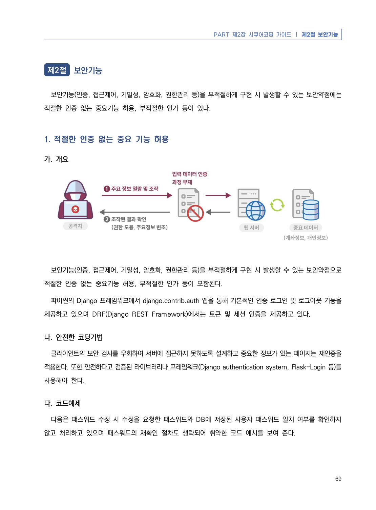
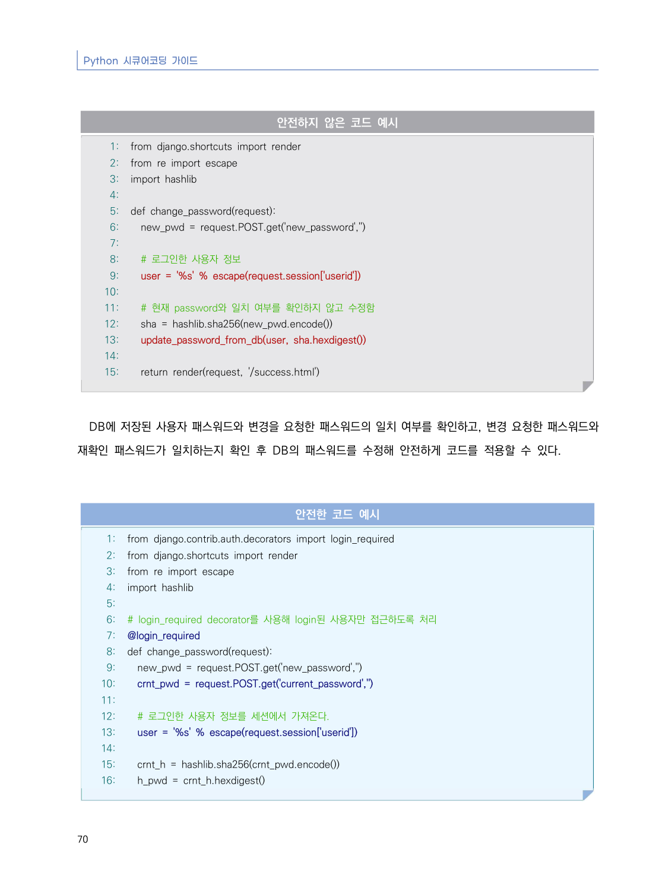
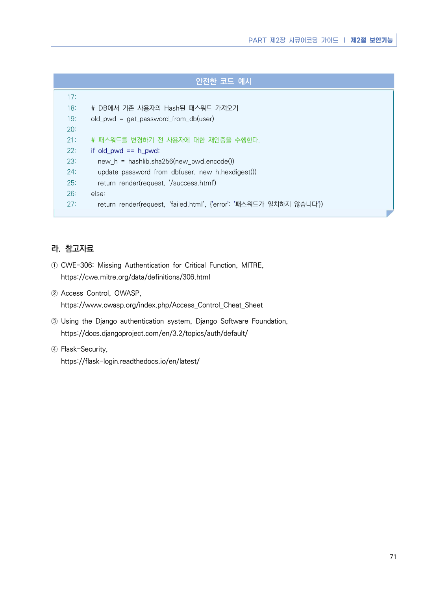

# 1. 적절한 인증 없는 중요 기능 허용

> 변환 안내(원문 외): 아래 본문은 PDF 텍스트를 추출한 전사입니다. 코드 줄번호·특수 공백·원문 오류를 유지했습니다. 실행용 코드가 아닙니다. 표·그림·들여쓰기는 연결된 페이지 이미지와 대조하세요. 페이지 경계의 줄바꿈을 보존하며, 동일 페이지가 여러 항목에 나뉘면 각 항목의 본문은 해당 구간만 포함합니다.

### PDF 75페이지 / 인쇄 69페이지

<!-- source-page:Python-2023:75; source-lines:1,5,6,7,8,9,10,11,12,13,14,15,16,17 -->

69

#### 1. 적절한 인증 없는 중요 기능 허용

#### 가. 개요

보안기능(인증, 접근제어, 기밀성, 암호화, 권한관리 등)을 부적절하게 구현 시 발생할 수 있는 보안약점으로 
적절한 인증 없는 중요기능 허용, 부적절한 인가 등이 포함된다.

파이썬의 Django 프레임워크에서 django.contrib.auth 앱을 통해 기본적인 인증 로그인 및 로그아웃 기능을 
제공하고 있으며 DRF(Django REST Framework)에서는 토큰 및 세션 인증을 제공하고 있다.

#### 나. 안전한 코딩기법

클라이언트의 보안 검사를 우회하여 서버에 접근하지 못하도록 설계하고 중요한 정보가 있는 페이지는 재인증을 
적용한다. 또한 안전하다고 검증된 라이브러리나 프레임워크(Django authentication system, Flask-Login 등)를 
사용해야 한다. 

#### 다. 코드예제

다음은 패스워드 수정 시 수정을 요청한 패스워드와 DB에 저장된 사용자 패스워드 일치 여부를 확인하지 
않고 처리하고 있으며 패스워드의 재확인 절차도 생략되어 취약한 코드 예시를 보여 준다.

<details><summary>원본 페이지 이미지 (변환 외 보존 자료)</summary>



</details>

### PDF 76페이지 / 인쇄 70페이지

<!-- source-page:Python-2023:76; source-lines:0,1,2,3,4,5,6,7,8,9,10,11,12,13,14,15,16,17,18,19,20,21,22,23,24,25,26,27,28,29,30,31,32,33,34,35,36,37,38,39,40,41,42,43,44,45,46,47,48,49,50,51,52,53,54,55,56,57,58,59,60 -->

Python 시큐어코딩 가이드

70

#### 안전하지 않은 코드 예시

```python
1: from django.shortcuts import render
2: from re import escape
3: import hashlib
4:
5: def change_password(request):
6:   new_pwd = request.POST.get('new_password','')
7:
8:   # 로그인한 사용자 정보
9:   user = '%s' % escape(request.session['userid'])
10:
11:   # 현재 password와 일치 여부를 확인하지 않고 수정함
12:   sha = hashlib.sha256(new_pwd.encode())
13:   update_password_from_db(user, sha.hexdigest())
14:
15:   return render(request, '/success.html')
```

DB에 저장된 사용자 패스워드와 변경을 요청한 패스워드의 일치 여부를 확인하고, 변경 요청한 패스워드와 
재확인 패스워드가 일치하는지 확인 후 DB의 패스워드를 수정해 안전하게 코드를 적용할 수 있다.

#### 안전한 코드 예시

```python
1: from django.contrib.auth.decorators import login_required
2: from django.shortcuts import render
3: from re import escape
4: import hashlib
5:
6: # login_required decorator를 사용해 login된 사용자만 접근하도록 처리
7: @login_required
8: def change_password(request):
9:   new_pwd = request.POST.get('new_password','')
10:   crnt_pwd = request.POST.get('current_password','')
11:
12:   # 로그인한 사용자 정보를 세션에서 가져온다.
13:   user = '%s' % escape(request.session['userid'])
14:
15:   crnt_h = hashlib.sha256(crnt_pwd.encode())
16:   h_pwd = crnt_h.hexdigest()
```

<details><summary>원본 페이지 이미지 (변환 외 보존 자료)</summary>



</details>

### PDF 77페이지 / 인쇄 71페이지

<!-- source-page:Python-2023:77; source-lines:0,1,2,3,4,5,6,7,8,9,10,11,12,13,14,15,16,17,18,19,20,21,22,23,24,25,26,27,28,29,30,31,32 -->

PART 제2장 시큐어코딩 가이드 ❘ 제2절 보안기능

71

#### 안전한 코드 예시

```python
17:     
18:   # DB에서 기존 사용자의 Hash된 패스워드 가져오기
19:   old_pwd = get_password_from_db(user)
20:
21:   # 패스워드를 변경하기 전 사용자에 대한 재인증을 수행한다.
22:   if old_pwd == h_pwd:
23:     new_h = hashlib.sha256(new_pwd.encode())
24:     update_password_from_db(user, new_h.hexdigest())
25:     return render(request, '/success.html')
26:   else:
27:     return render(request, ‘failed.html’, {'error': '패스워드가 일치하지 않습니다'})
```

#### 라. 참고자료

① CWE-306: Missing Authentication for Critical Function, MITRE,

https://cwe.mitre.org/data/definitions/306.html
② Access Control, OWASP,

https://www.owasp.org/index.php/Access_Control_Cheat_Sheet
③ Using the Django authentication system, Django Software Foundation,

https://docs.djangoproject.com/en/3.2/topics/auth/default/
④ Flask-Security, 

https://flask-login.readthedocs.io/en/latest/

<details><summary>원본 페이지 이미지 (변환 외 보존 자료)</summary>



</details>

---

## 탐색 링크 (원문 외)

[통합 인덱스](../../../INDEX.md)

