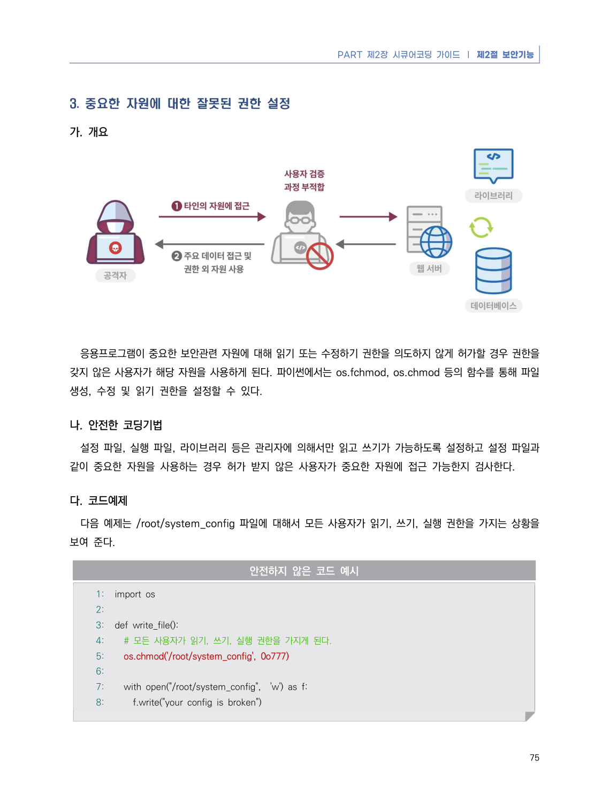
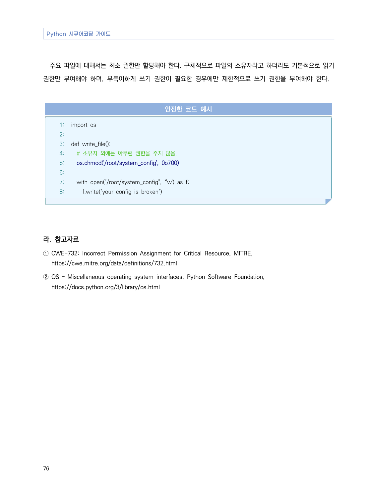

# 3. 중요한 자원에 대한 잘못된 권한 설정

> 변환 안내(원문 외): 아래 본문은 PDF 텍스트를 추출한 전사입니다. 코드 줄번호·특수 공백·원문 오류를 유지했습니다. 실행용 코드가 아닙니다. 표·그림·들여쓰기는 연결된 페이지 이미지와 대조하세요. 페이지 경계의 줄바꿈을 보존하며, 동일 페이지가 여러 항목에 나뉘면 각 항목의 본문은 해당 구간만 포함합니다.

### PDF 81페이지 / 인쇄 75페이지

<!-- source-page:Python-2023:81; source-lines:0,1,2,3,4,5,6,7,8,9,10,11,12,13,14,15,16,17,18,19,20,21,22,23,24,25,26,27 -->

PART 제2장 시큐어코딩 가이드 ❘ 제2절 보안기능

75

#### 3. 중요한 자원에 대한 잘못된 권한 설정

#### 가. 개요

응용프로그램이 중요한 보안관련 자원에 대해 읽기 또는 수정하기 권한을 의도하지 않게 허가할 경우 권한을 
갖지 않은 사용자가 해당 자원을 사용하게 된다. 파이썬에서는 os.fchmod, os.chmod 등의 함수를 통해 파일 
생성, 수정 및 읽기 권한을 설정할 수 있다.

#### 나. 안전한 코딩기법

설정 파일, 실행 파일, 라이브러리 등은 관리자에 의해서만 읽고 쓰기가 가능하도록 설정하고 설정 파일과 
같이 중요한 자원을 사용하는 경우 허가 받지 않은 사용자가 중요한 자원에 접근 가능한지 검사한다.

#### 다. 코드예제

다음 예제는 /root/system_config 파일에 대해서 모든 사용자가 읽기, 쓰기, 실행 권한을 가지는 상황을 
보여 준다.

#### 안전하지 않은 코드 예시

```python
1: import os
2:
3: def write_file():
4:   # 모든 사용자가 읽기, 쓰기, 실행 권한을 가지게 된다.
5:   os.chmod('/root/system_config', 0o777)
6:
7:   with open("/root/system_config",  'w') as f:
8:     f.write("your config is broken")
```

<details><summary>원본 페이지 이미지 (변환 외 보존 자료)</summary>



</details>

### PDF 82페이지 / 인쇄 76페이지

<!-- source-page:Python-2023:82; source-lines:0,1,2,3,4,5,6,7,8,9,10,11,12,13,14,15,16,17,18,19,20,21,22,23 -->

Python 시큐어코딩 가이드

76

주요 파일에 대해서는 최소 권한만 할당해야 한다. 구체적으로 파일의 소유자라고 하더라도 기본적으로 읽기 
권한만 부여해야 하며, 부득이하게 쓰기 권한이 필요한 경우에만 제한적으로 쓰기 권한을 부여해야 한다.

#### 안전한 코드 예시

```python
1: import os
2:
3: def write_file():
4:   # 소유자 외에는 아무런 권한을 주지 않음.
5:   os.chmod('/root/system_config', 0o700)
6:
7:   with open("/root/system_config", ‘'w') as f:
8:     f.write("your config is broken")
```

#### 라. 참고자료

① CWE-732: Incorrect Permission Assignment for Critical Resource, MITRE,

https://cwe.mitre.org/data/definitions/732.html
② OS – Miscellaneous operating system interfaces, Python Software Foundation,

https://docs.python.org/3/library/os.html

<details><summary>원본 페이지 이미지 (변환 외 보존 자료)</summary>



</details>

---

## 탐색 링크 (원문 외)

[통합 인덱스](../../../INDEX.md)

