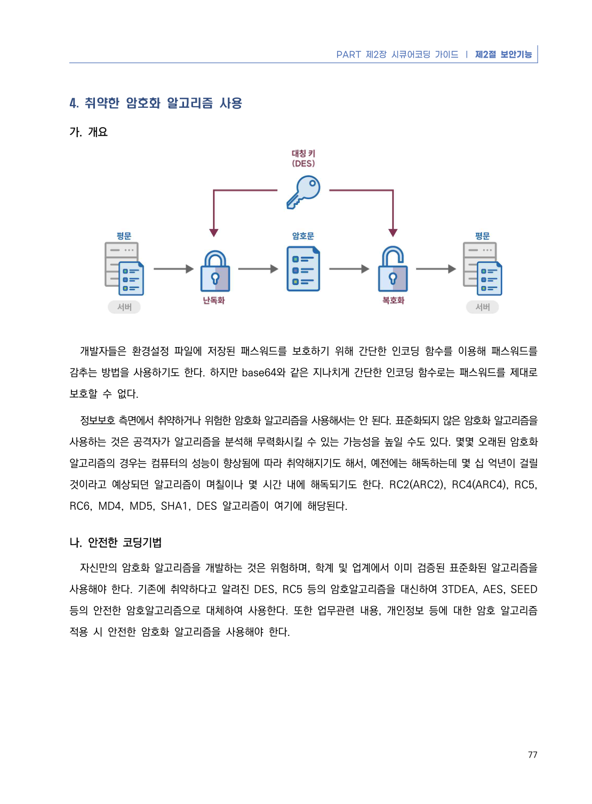
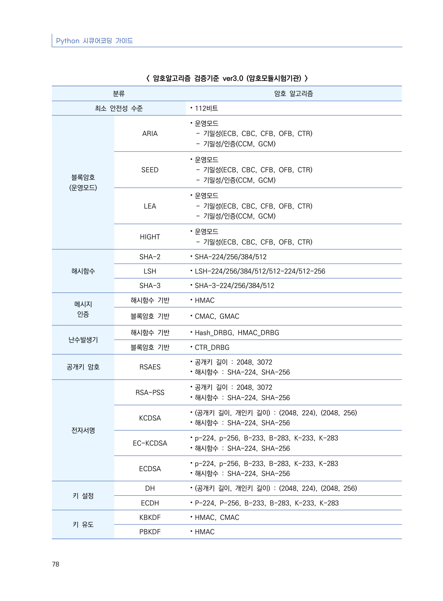
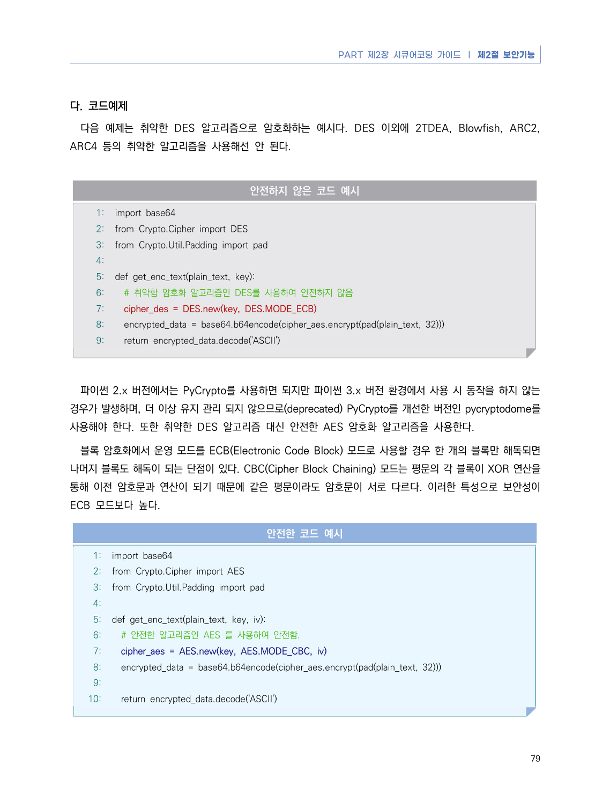
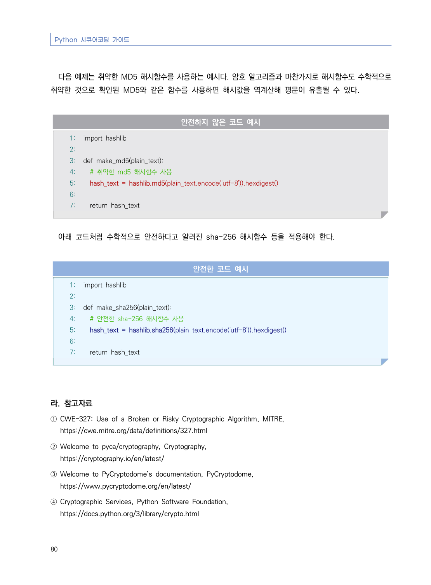

# 4. 취약한 암호화 알고리즘 사용

> 변환 안내(원문 외): 아래 본문은 PDF 텍스트를 추출한 전사입니다. 코드 줄번호·특수 공백·원문 오류를 유지했습니다. 실행용 코드가 아닙니다. 표·그림·들여쓰기는 연결된 페이지 이미지와 대조하세요. 페이지 경계의 줄바꿈을 보존하며, 동일 페이지가 여러 항목에 나뉘면 각 항목의 본문은 해당 구간만 포함합니다.

### PDF 83페이지 / 인쇄 77페이지

<!-- source-page:Python-2023:83; source-lines:0,1,2,3,4,5,6,7,8,9,10,11,12,13,14,15,16 -->

PART 제2장 시큐어코딩 가이드 ❘ 제2절 보안기능

77

#### 4. 취약한 암호화 알고리즘 사용

#### 가. 개요

개발자들은 환경설정 파일에 저장된 패스워드를 보호하기 위해 간단한 인코딩 함수를 이용해 패스워드를 
감추는 방법을 사용하기도 한다. 하지만 base64와 같은 지나치게 간단한 인코딩 함수로는 패스워드를 제대로 
보호할 수 없다.

정보보호 측면에서 취약하거나 위험한 암호화 알고리즘을 사용해서는 안 된다. 표준화되지 않은 암호화 알고리즘을 
사용하는 것은 공격자가 알고리즘을 분석해 무력화시킬 수 있는 가능성을 높일 수도 있다. 몇몇 오래된 암호화 
알고리즘의 경우는 컴퓨터의 성능이 향상됨에 따라 취약해지기도 해서, 예전에는 해독하는데 몇 십 억년이 걸릴 
것이라고 예상되던 알고리즘이 며칠이나 몇 시간 내에 해독되기도 한다. RC2(ARC2), RC4(ARC4), RC5, 
RC6, MD4, MD5, SHA1, DES 알고리즘이 여기에 해당된다.

#### 나. 안전한 코딩기법

자신만의 암호화 알고리즘을 개발하는 것은 위험하며, 학계 및 업계에서 이미 검증된 표준화된 알고리즘을 
사용해야 한다. 기존에 취약하다고 알려진 DES, RC5 등의 암호알고리즘을 대신하여 3TDEA, AES, SEED 
등의 안전한 암호알고리즘으로 대체하여 사용한다. 또한 업무관련 내용, 개인정보 등에 대한 암호 알고리즘 
적용 시 안전한 암호화 알고리즘을 사용해야 한다.

<details><summary>원본 페이지 이미지 (변환 외 보존 자료)</summary>



</details>

### PDF 84페이지 / 인쇄 78페이지

<!-- source-page:Python-2023:84; source-lines:0,1,2,3,4,5,6,7,8,9,10,11,12,13,14,15,16,17,18,19,20,21,22,23,24,25,26,27,28,29,30,31,32,33,34,35,36,37,38,39,40,41,42,43,44,45,46,47,48,49,50,51,52,53,54,55,56,57,58,59,60,61,62,63,64,65,66,67,68 -->

Python 시큐어코딩 가이드

78

&lt; 암호알고리즘 검증기준 ver3.0 (암호모듈시험기관) &gt;
분류

암호 알고리즘

최소 안전성 수준

⦁112비트

블록암호
(운영모드)

ARIA

⦁운영모드

- 기밀성(ECB, CBC, CFB, OFB, CTR)
- 기밀성/인증(CCM, GCM)

SEED

⦁운영모드

- 기밀성(ECB, CBC, CFB, OFB, CTR)
- 기밀성/인증(CCM, GCM)

LEA

⦁운영모드

- 기밀성(ECB, CBC, CFB, OFB, CTR)
- 기밀성/인증(CCM, GCM)

HIGHT

⦁운영모드

- 기밀성(ECB, CBC, CFB, OFB, CTR)

해시함수

SHA-2

⦁SHA-224/256/384/512

LSH

⦁LSH-224/256/384/512/512-224/512-256

SHA-3

⦁SHA-3-224/256/384/512

메시지
인증

해시함수 기반

⦁HMAC

블록암호 기반

⦁CMAC, GMAC

난수발생기

해시함수 기반

⦁Hash_DRBG, HMAC_DRBG

블록암호 기반

⦁CTR_DRBG

공개키 암호

RSAES

⦁공개키 길이 : 2048, 3072
⦁해시함수 : SHA-224, SHA-256

전자서명

RSA-PSS

⦁공개키 길이 : 2048, 3072
⦁해시함수 : SHA-224, SHA-256

KCDSA

⦁(공개키 길이, 개인키 길이) : (2048, 224), (2048, 256)
⦁해시함수 : SHA-224, SHA-256

EC-KCDSA

⦁p-224, p-256, B-233, B-283, K-233, K-283
⦁해시함수 : SHA-224, SHA-256

ECDSA

⦁p-224, p-256, B-233, B-283, K-233, K-283
⦁해시함수 : SHA-224, SHA-256

키 설정

DH

⦁(공개키 길이, 개인키 길이) : (2048, 224), (2048, 256)

ECDH

⦁P-224, P-256, B-233, B-283, K-233, K-283

키 유도

KBKDF

⦁HMAC, CMAC

PBKDF

⦁HMAC

<details><summary>원본 페이지 이미지 (변환 외 보존 자료)</summary>



</details>

### PDF 85페이지 / 인쇄 79페이지

<!-- source-page:Python-2023:85; source-lines:0,1,2,3,4,5,6,7,8,9,10,11,12,13,14,15,16,17,18,19,20,21,22,23,24,25,26,27,28,29,30,31,32,33,34,35,36,37,38,39,40,41,42,43,44,45,46,47,48,49 -->

PART 제2장 시큐어코딩 가이드 ❘ 제2절 보안기능

79

#### 다. 코드예제

다음 예제는 취약한 DES 알고리즘으로 암호화하는 예시다. DES 이외에 2TDEA, Blowfish, ARC2, 
ARC4 등의 취약한 알고리즘을 사용해선 안 된다.

#### 안전하지 않은 코드 예시

```python
1: import base64
2: from Crypto.Cipher import DES
3: from Crypto.Util.Padding import pad
4:
5: def get_enc_text(plain_text, key):
6:   # 취약함 암호화 알고리즘인 DES를 사용하여 안전하지 않음
7:   cipher_des = DES.new(key, DES.MODE_ECB)
8:   encrypted_data = base64.b64encode(cipher_aes.encrypt(pad(plain_text, 32)))
9:   return encrypted_data.decode('ASCII')
```

파이썬 2.x 버전에서는 PyCrypto를 사용하면 되지만 파이썬 3.x 버전 환경에서 사용 시 동작을 하지 않는 
경우가 발생하며, 더 이상 유지 관리 되지 않으므로(deprecated) PyCrypto를 개선한 버전인 pycryptodome를 
사용해야 한다. 또한 취약한 DES 알고리즘 대신 안전한 AES 암호화 알고리즘을 사용한다.

블록 암호화에서 운영 모드를 ECB(Electronic Code Block) 모드로 사용할 경우 한 개의 블록만 해독되면 
나머지 블록도 해독이 되는 단점이 있다. CBC(Cipher Block Chaining) 모드는 평문의 각 블록이 XOR 연산을 
통해 이전 암호문과 연산이 되기 때문에 같은 평문이라도 암호문이 서로 다르다. 이러한 특성으로 보안성이 
ECB 모드보다 높다.

#### 안전한 코드 예시

```python
1: import base64
2: from Crypto.Cipher import AES
3: from Crypto.Util.Padding import pad
4:
5: def get_enc_text(plain_text, key, iv):
6:   # 안전한 알고리즘인 AES 를 사용하여 안전함.
7:   cipher_aes = AES.new(key, AES.MODE_CBC, iv)
8:   encrypted_data = base64.b64encode(cipher_aes.encrypt(pad(plain_text, 32)))
9:     
10:   return encrypted_data.decode('ASCII')
```

<details><summary>원본 페이지 이미지 (변환 외 보존 자료)</summary>



</details>

### PDF 86페이지 / 인쇄 80페이지

<!-- source-page:Python-2023:86; source-lines:0,1,2,3,4,5,6,7,8,9,10,11,12,13,14,15,16,17,18,19,20,21,22,23,24,25,26,27,28,29,30,31,32,33,34,35,36,37,38,39,40 -->

Python 시큐어코딩 가이드

80

다음 예제는 취약한 MD5 해시함수를 사용하는 예시다. 암호 알고리즘과 마찬가지로 해시함수도 수학적으로 
취약한 것으로 확인된 MD5와 같은 함수를 사용하면 해시값을 역계산해 평문이 유출될 수 있다. 

#### 안전하지 않은 코드 예시

```python
1: import hashlib
2:
3: def make_md5(plain_text):
4:   # 취약한 md5 해시함수 사용
5:   hash_text = hashlib.md5(plain_text.encode('utf-8')).hexdigest()
6:     
7:   return hash_text
```

아래 코드처럼 수학적으로 안전하다고 알려진 sha-256 해시함수 등을 적용해야 한다.

#### 안전한 코드 예시

```python
1: import hashlib
2:
3: def make_sha256(plain_text):
4:   # 안전한 sha-256 해시함수 사용
5:   hash_text = hashlib.sha256(plain_text.encode('utf-8')).hexdigest()
6:
7:   return hash_text
```

#### 라. 참고자료

① CWE-327: Use of a Broken or Risky Cryptographic Algorithm, MITRE,

https://cwe.mitre.org/data/definitions/327.html
② Welcome to pyca/cryptography, Cryptography,

https://cryptography.io/en/latest/
③ Welcome to PyCryptodome’s documentation, PyCryptodome,

https://www.pycryptodome.org/en/latest/
④ Cryptographic Services, Python Software Foundation,

https://docs.python.org/3/library/crypto.html

<details><summary>원본 페이지 이미지 (변환 외 보존 자료)</summary>



</details>

---

## 탐색 링크 (원문 외)

[통합 인덱스](../../../INDEX.md)

