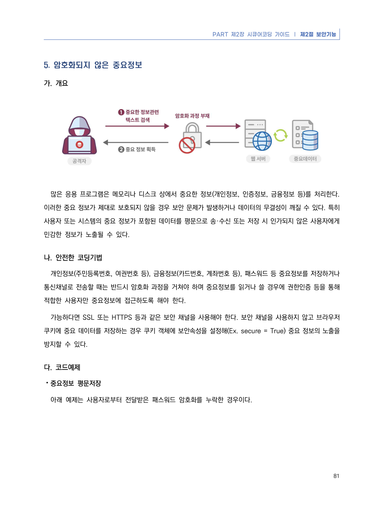
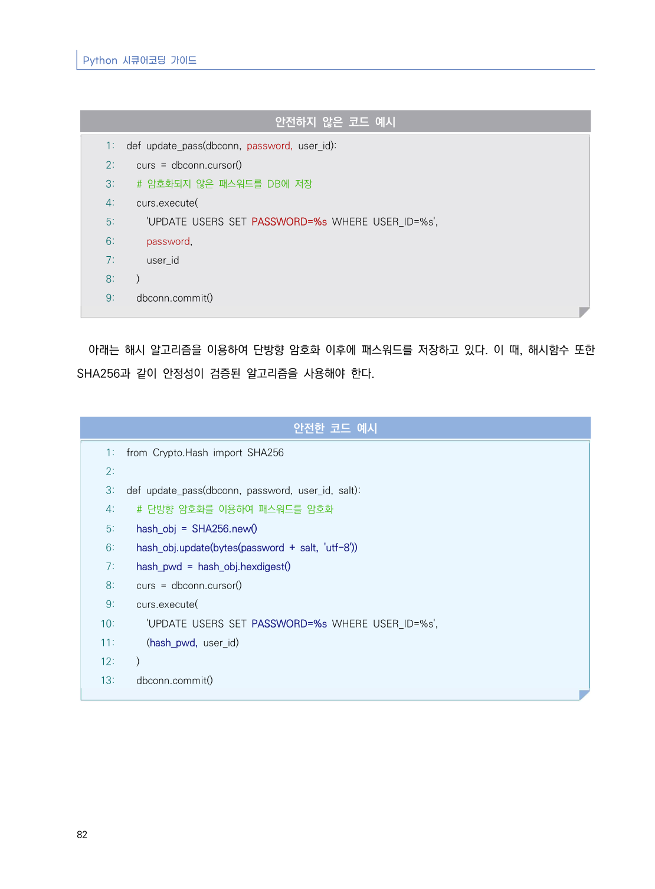
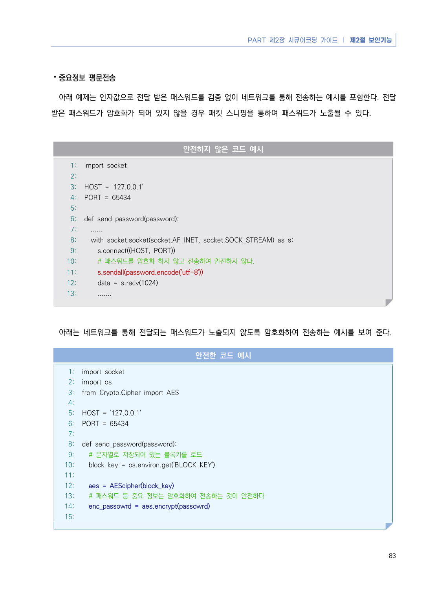
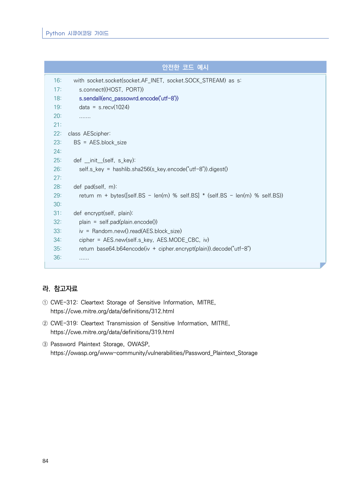

# 5. 암호화되지 않은 중요정보

> 변환 안내(원문 외): 아래 본문은 PDF 텍스트를 추출한 전사입니다. 코드 줄번호·특수 공백·원문 오류를 유지했습니다. 실행용 코드가 아닙니다. 표·그림·들여쓰기는 연결된 페이지 이미지와 대조하세요. 페이지 경계의 줄바꿈을 보존하며, 동일 페이지가 여러 항목에 나뉘면 각 항목의 본문은 해당 구간만 포함합니다.

### PDF 87페이지 / 인쇄 81페이지

<!-- source-page:Python-2023:87; source-lines:0,1,2,3,4,5,6,7,8,9,10,11,12,13,14,15,16,17 -->

PART 제2장 시큐어코딩 가이드 ❘ 제2절 보안기능

81

#### 5. 암호화되지 않은 중요정보

#### 가. 개요

많은 응용 프로그램은 메모리나 디스크 상에서 중요한 정보(개인정보, 인증정보, 금융정보 등)를 처리한다. 
이러한 중요 정보가 제대로 보호되지 않을 경우 보안 문제가 발생하거나 데이터의 무결성이 깨질 수 있다. 특히 
사용자 또는 시스템의 중요 정보가 포함된 데이터를 평문으로 송·수신 또는 저장 시 인가되지 않은 사용자에게 
민감한 정보가 노출될 수 있다.

#### 나. 안전한 코딩기법

개인정보(주민등록번호, 여권번호 등), 금융정보(카드번호, 계좌번호 등), 패스워드 등 중요정보를 저장하거나 
통신채널로 전송할 때는 반드시 암호화 과정을 거쳐야 하며 중요정보를 읽거나 쓸 경우에 권한인증 등을 통해 
적합한 사용자만 중요정보에 접근하도록 해야 한다.

가능하다면 SSL 또는 HTTPS 등과 같은 보안 채널을 사용해야 한다. 보안 채널을 사용하지 않고 브라우저 
쿠키에 중요 데이터를 저장하는 경우 쿠키 객체에 보안속성을 설정해(Ex. secure = True) 중요 정보의 노출을 
방지할 수 있다.

#### 다. 코드예제

⦁중요정보 평문저장

아래 예제는 사용자로부터 전달받은 패스워드 암호화를 누락한 경우이다.

<details><summary>원본 페이지 이미지 (변환 외 보존 자료)</summary>



</details>

### PDF 88페이지 / 인쇄 82페이지

<!-- source-page:Python-2023:88; source-lines:0,1,2,3,4,5,6,7,8,9,10,11,12,13,14,15,16,17,18,19,20,21,22,23,24,25,26,27,28,29,30,31,32,33,34,35,36,37,38,39,40,41,42,43,44,45,46,47,48 -->

Python 시큐어코딩 가이드

82

#### 안전하지 않은 코드 예시

```python
1: def update_pass(dbconn, password, user_id):
2:   curs = dbconn.cursor()
3:   # 암호화되지 않은 패스워드를 DB에 저장
4:   curs.execute(
5:     'UPDATE USERS SET PASSWORD=%s WHERE USER_ID=%s',
6:     password,
7:     user_id
8:   )
9:   dbconn.commit()
```

아래는 해시 알고리즘을 이용하여 단방향 암호화 이후에 패스워드를 저장하고 있다. 이 때, 해시함수 또한 
SHA256과 같이 안정성이 검증된 알고리즘을 사용해야 한다.

#### 안전한 코드 예시

```python
1: from Crypto.Hash import SHA256
2:
3: def update_pass(dbconn, password, user_id, salt):
4:   # 단방향 암호화를 이용하여 패스워드를 암호화
5:   hash_obj = SHA256.new()
6:   hash_obj.update(bytes(password + salt, 'utf-8'))
7:   hash_pwd = hash_obj.hexdigest()
8:   curs = dbconn.cursor()
9:   curs.execute(
10:     'UPDATE USERS SET PASSWORD=%s WHERE USER_ID=%s',
11:     (hash_pwd, user_id)
12:   )
13:   dbconn.commit()
```

<details><summary>원본 페이지 이미지 (변환 외 보존 자료)</summary>



</details>

### PDF 89페이지 / 인쇄 83페이지

<!-- source-page:Python-2023:89; source-lines:0,1,2,3,4,5,6,7,8,9,10,11,12,13,14,15,16,17,18,19,20,21,22,23,24,25,26,27,28,29,30,31,32,33,34,35,36,37,38,39,40,41,42,43,44,45,46,47,48,49,50,51,52,53,54,55,56,57 -->

PART 제2장 시큐어코딩 가이드 ❘ 제2절 보안기능

83

⦁중요정보 평문전송

아래 예제는 인자값으로 전달 받은 패스워드를 검증 없이 네트워크를 통해 전송하는 예시를 포함한다. 전달 
받은 패스워드가 암호화가 되어 있지 않을 경우 패킷 스니핑을 통하여 패스워드가 노출될 수 있다.

#### 안전하지 않은 코드 예시

```python
1: import socket
2:
3: HOST = '127.0.0.1'
4: PORT = 65434
5:
6: def send_password(password):
7:   ......
8:   with socket.socket(socket.AF_INET, socket.SOCK_STREAM) as s:
9:     s.connect((HOST, PORT))
10:     # 패스워드를 암호화 하지 않고 전송하여 안전하지 않다.
11:     s.sendall(password.encode('utf-8'))
12:     data = s.recv(1024)
13:     .......
```

아래는 네트워크를 통해 전달되는 패스워드가 노출되지 않도록 암호화하여 전송하는 예시를 보여 준다.

#### 안전한 코드 예시

```python
1: import socket
2: import os
3: from Crypto.Cipher import AES 
4:
5: HOST = '127.0.0.1'
6: PORT = 65434
7:
8: def send_password(password):
9:   # 문자열로 저장되어 있는 블록키를 로드
10:   block_key = os.environ.get('BLOCK_KEY')
11:
12:   aes = AEScipher(block_key) 
13:   # 패스워드 등 중요 정보는 암호화하여 전송하는 것이 안전하다
14:   enc_passowrd = aes.encrypt(passowrd)
15:
```

<details><summary>원본 페이지 이미지 (변환 외 보존 자료)</summary>



</details>

### PDF 90페이지 / 인쇄 84페이지

<!-- source-page:Python-2023:90; source-lines:0,1,2,3,4,5,6,7,8,9,10,11,12,13,14,15,16,17,18,19,20,21,22,23,24,25,26,27,28,29,30,31,32,33,34,35,36,37,38,39,40,41,42,43,44,45,46,47 -->

Python 시큐어코딩 가이드

84

#### 안전한 코드 예시

```python
16:   with socket.socket(socket.AF_INET, socket.SOCK_STREAM) as s:
17:     s.connect((HOST, PORT))
18:     s.sendall(enc_passowrd.encode('utf-8'))
19:     data = s.recv(1024)
20:     .......
21:
22: class AEScipher:
23:   BS = AES.block_size
24:
25:   def __init__(self, s_key):
26:     self.s_key = hashlib.sha256(s_key.encode("utf-8")).digest()
27:
28:   def pad(self, m):
29:     return m + bytes([self.BS - len(m) % self.BS] * (self.BS - len(m) % self.BS))
30:
31:   def encrypt(self, plain):
32:     plain = self.pad(plain.encode())
33:     iv = Random.new().read(AES.block_size)
34:     cipher = AES.new(self.s_key, AES.MODE_CBC, iv)
35:     return base64.b64encode(iv + cipher.encrypt(plain)).decode("utf-8")
36:     ......
```

#### 라. 참고자료

① CWE-312: Cleartext Storage of Sensitive Information, MITRE,

https://cwe.mitre.org/data/definitions/312.html
② CWE-319: Cleartext Transmission of Sensitive Information, MITRE,

https://cwe.mitre.org/data/definitions/319.html
③ Password Plaintext Storage, OWASP,

https://owasp.org/www-community/vulnerabilities/Password_Plaintext_Storage

<details><summary>원본 페이지 이미지 (변환 외 보존 자료)</summary>



</details>

---

## 탐색 링크 (원문 외)

[통합 인덱스](../../../INDEX.md)

