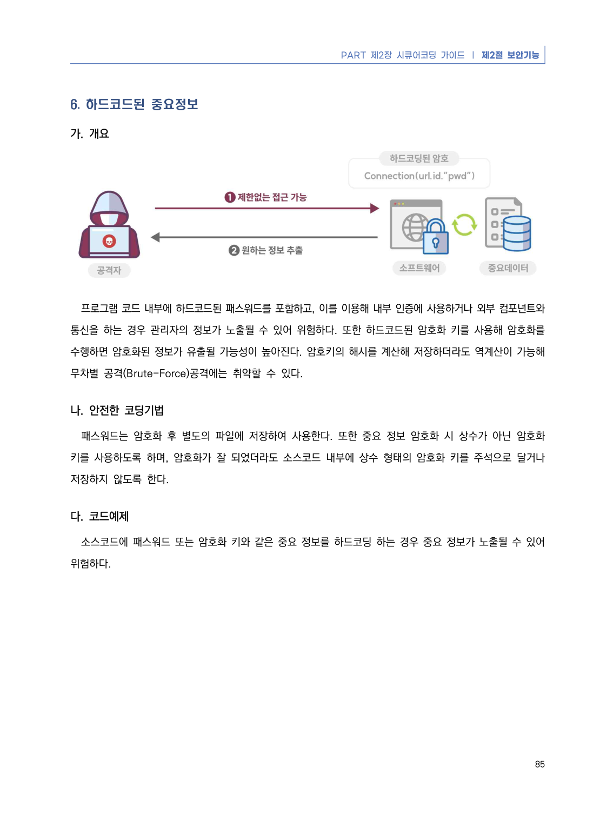
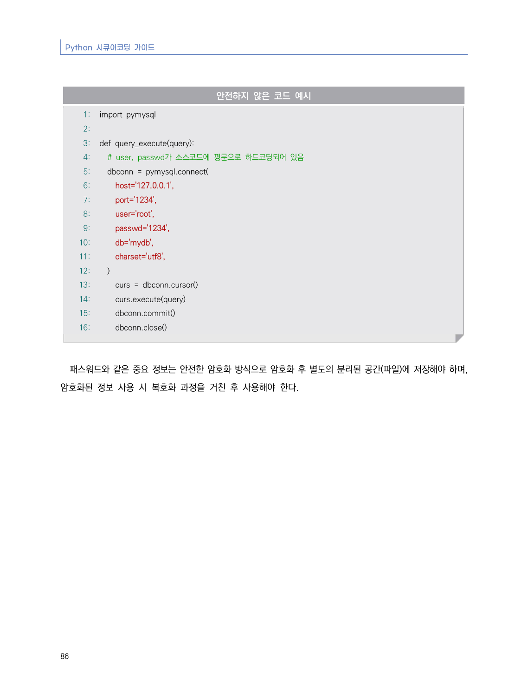
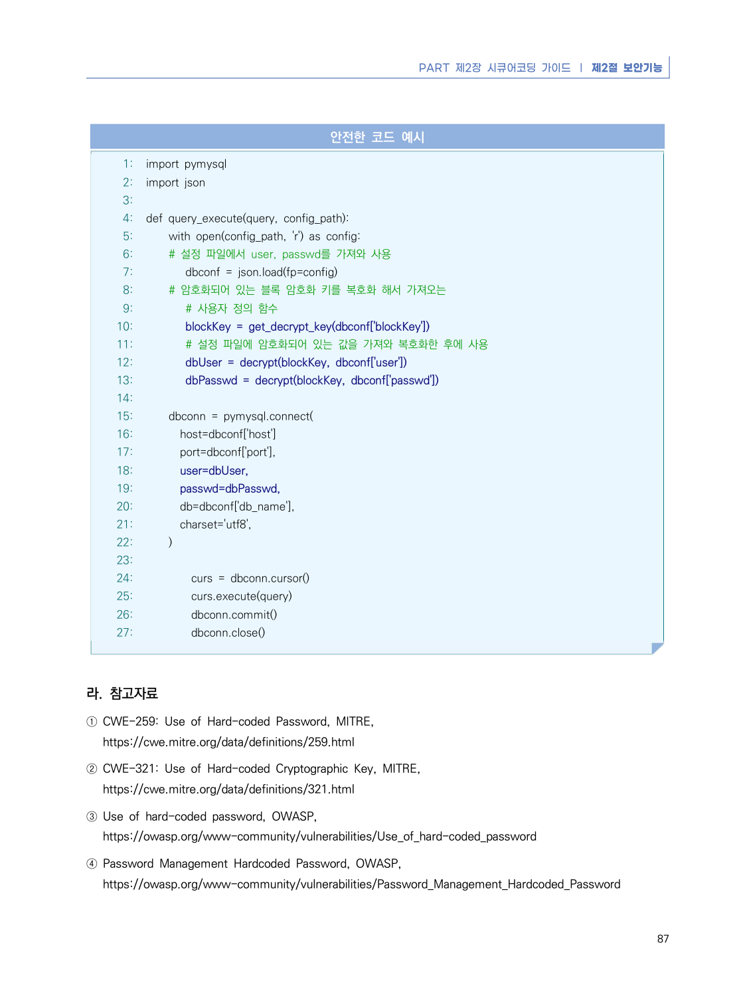

# 6. 하드코드된 중요정보

> 변환 안내(원문 외): 아래 본문은 PDF 텍스트를 추출한 전사입니다. 코드 줄번호·특수 공백·원문 오류를 유지했습니다. 실행용 코드가 아닙니다. 표·그림·들여쓰기는 연결된 페이지 이미지와 대조하세요. 페이지 경계의 줄바꿈을 보존하며, 동일 페이지가 여러 항목에 나뉘면 각 항목의 본문은 해당 구간만 포함합니다.

### PDF 91페이지 / 인쇄 85페이지

<!-- source-page:Python-2023:91; source-lines:0,1,2,3,4,5,6,7,8,9,10,11,12,13,14 -->

PART 제2장 시큐어코딩 가이드 ❘ 제2절 보안기능

85

#### 6. 하드코드된 중요정보

#### 가. 개요

프로그램 코드 내부에 하드코드된 패스워드를 포함하고, 이를 이용해 내부 인증에 사용하거나 외부 컴포넌트와 
통신을 하는 경우 관리자의 정보가 노출될 수 있어 위험하다. 또한 하드코드된 암호화 키를 사용해 암호화를 
수행하면 암호화된 정보가 유출될 가능성이 높아진다. 암호키의 해시를 계산해 저장하더라도 역계산이 가능해  
무차별 공격(Brute-Force)공격에는 취약할 수 있다.

#### 나. 안전한 코딩기법

패스워드는 암호화 후 별도의 파일에 저장하여 사용한다. 또한 중요 정보 암호화 시 상수가 아닌 암호화 
키를 사용하도록 하며, 암호화가 잘 되었더라도 소스코드 내부에 상수 형태의 암호화 키를 주석으로 달거나 
저장하지 않도록 한다. 

#### 다. 코드예제

소스코드에 패스워드 또는 암호화 키와 같은 중요 정보를 하드코딩 하는 경우 중요 정보가 노출될 수 있어 
위험하다.

<details><summary>원본 페이지 이미지 (변환 외 보존 자료)</summary>



</details>

### PDF 92페이지 / 인쇄 86페이지

<!-- source-page:Python-2023:92; source-lines:0,1,2,3,4,5,6,7,8,9,10,11,12,13,14,15,16,17,18,19,20,21,22,23,24,25,26,27,28,29,30,31,32,33,34,35 -->

Python 시큐어코딩 가이드

86

#### 안전하지 않은 코드 예시

```python
1: import pymysql
2:
3: def query_execute(query):
4:   # user, passwd가 소스코드에 평문으로 하드코딩되어 있음
5:   dbconn = pymysql.connect(
6:     host='127.0.0.1',
7:     port='1234',
8:     user='root',
9:     passwd='1234',
10:     db='mydb',
11:     charset='utf8',
12:   )
13:     curs = dbconn.cursor()
14:     curs.execute(query)
15:     dbconn.commit()
16:     dbconn.close()
```

패스워드와 같은 중요 정보는 안전한 암호화 방식으로 암호화 후 별도의 분리된 공간(파일)에 저장해야 하며, 
암호화된 정보 사용 시 복호화 과정을 거친 후 사용해야 한다.

<details><summary>원본 페이지 이미지 (변환 외 보존 자료)</summary>



</details>

### PDF 93페이지 / 인쇄 87페이지

<!-- source-page:Python-2023:93; source-lines:0,1,2,3,4,5,6,7,8,9,10,11,12,13,14,15,16,17,18,19,20,21,22,23,24,25,26,27,28,29,30,31,32,33,34,35,36,37,38,39,40,41,42,43,44,45,46,47,48,49,50,51,52,53,54,55,56,57,58,59,60,61,62 -->

PART 제2장 시큐어코딩 가이드 ❘ 제2절 보안기능

87

#### 안전한 코드 예시

```python
1: import pymysql
2: import json
3:
4: def query_execute(query, config_path):
5:     with open(config_path, 'r') as config:
6:     # 설정 파일에서 user, passwd를 가져와 사용
7:        dbconf = json.load(fp=config)
8:     # 암호화되어 있는 블록 암호화 키를 복호화 해서 가져오는  
9:        # 사용자 정의 함수
10:        blockKey = get_decrypt_key(dbconf['blockKey'])
11:        # 설정 파일에 암호화되어 있는 값을 가져와 복호화한 후에 사용
12:        dbUser = decrypt(blockKey, dbconf['user'])
13:        dbPasswd = decrypt(blockKey, dbconf['passwd'])
14:
15:     dbconn = pymysql.connect(
16:       host=dbconf['host']
17:       port=dbconf['port'],
18:       user=dbUser,
19:       passwd=dbPasswd,
20:       db=dbconf['db_name'],
21:       charset='utf8',
22:     )
23:
24:         curs = dbconn.cursor()
25:         curs.execute(query)
26:         dbconn.commit()
27:         dbconn.close()
```

#### 라. 참고자료

① CWE-259: Use of Hard-coded Password, MITRE,

https://cwe.mitre.org/data/definitions/259.html
② CWE-321: Use of Hard-coded Cryptographic Key, MITRE,

https://cwe.mitre.org/data/definitions/321.html
③ Use of hard-coded password, OWASP,

https://owasp.org/www-community/vulnerabilities/Use_of_hard-coded_password
④ Password Management Hardcoded Password, OWASP,

https://owasp.org/www-community/vulnerabilities/Password_Management_Hardcoded_Password

<details><summary>원본 페이지 이미지 (변환 외 보존 자료)</summary>



</details>

---

## 탐색 링크 (원문 외)

[통합 인덱스](../../../INDEX.md)

