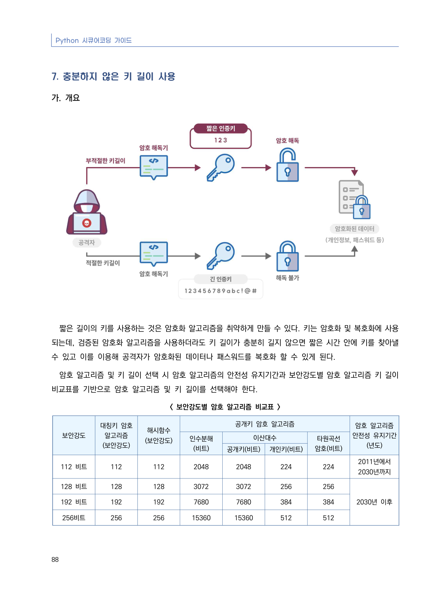
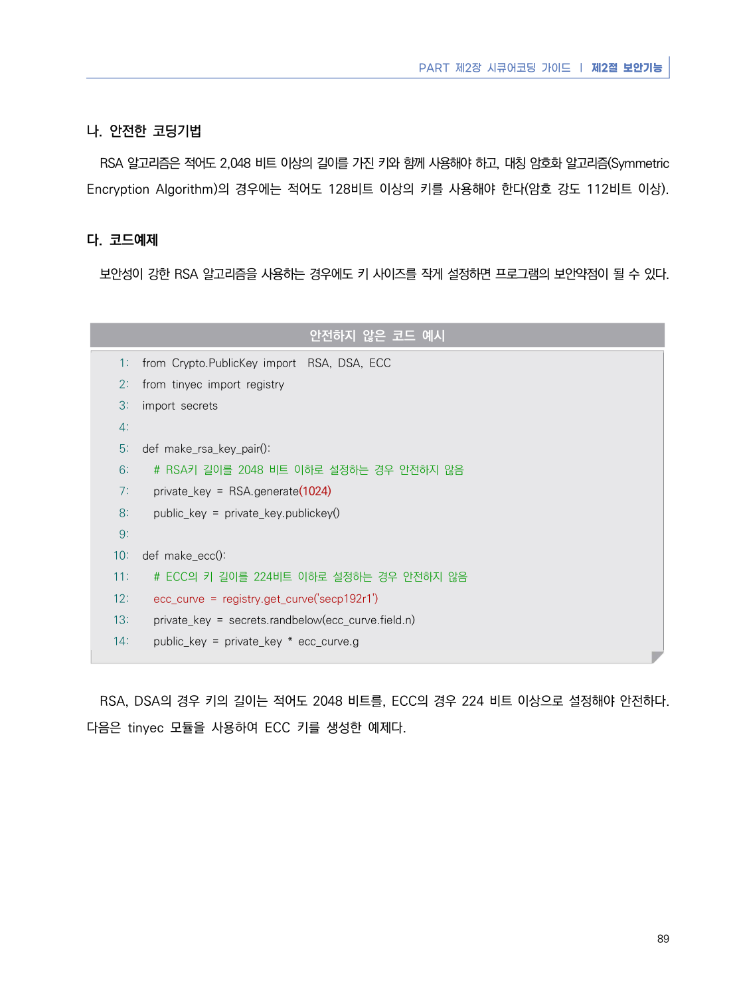
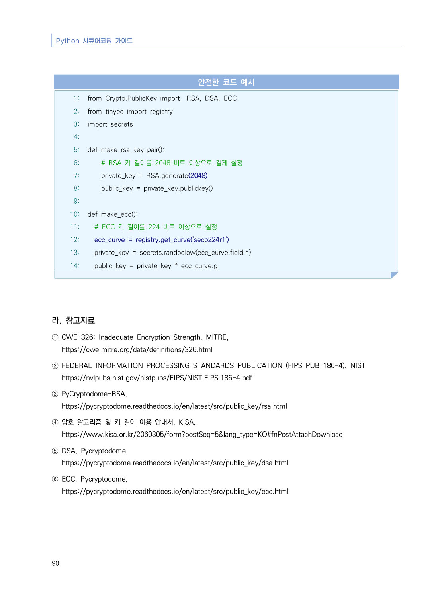

# 7. 충분하지 않은 키 길이 사용

> 변환 안내(원문 외): 아래 본문은 PDF 텍스트를 추출한 전사입니다. 코드 줄번호·특수 공백·원문 오류를 유지했습니다. 실행용 코드가 아닙니다. 표·그림·들여쓰기는 연결된 페이지 이미지와 대조하세요. 페이지 경계의 줄바꿈을 보존하며, 동일 페이지가 여러 항목에 나뉘면 각 항목의 본문은 해당 구간만 포함합니다.

### PDF 94페이지 / 인쇄 88페이지

<!-- source-page:Python-2023:94; source-lines:0,1,2,3,4,5,6,7,8,9,10,11,12,13,14,15,16,17,18,19,20,21,22,23,24,25,26,27,28,29,30,31,32,33,34,35,36,37,38,39,40,41,42,43,44,45,46,47,48,49,50,51,52,53,54,55,56,57 -->

Python 시큐어코딩 가이드

88

#### 7. 충분하지 않은 키 길이 사용

#### 가. 개요

짧은 길이의 키를 사용하는 것은 암호화 알고리즘을 취약하게 만들 수 있다. 키는 암호화 및 복호화에 사용
되는데, 검증된 암호화 알고리즘을 사용하더라도 키 길이가 충분히 길지 않으면 짧은 시간 안에 키를 찾아낼 
수 있고 이를 이용해 공격자가 암호화된 데이터나 패스워드를 복호화 할 수 있게 된다.

암호 알고리즘 및 키 길이 선택 시 암호 알고리즘의 안전성 유지기간과 보안강도별 암호 알고리즘 키 길이 
비교표를 기반으로 암호 알고리즘 및 키 길이를 선택해야 한다.

&lt; 보안강도별 암호 알고리즘 비교표 &gt;

```text
보안강도
대칭키 암호
알고리즘
(보안강도)
해시함수
(보안강도)
공개키 암호 알고리즘
암호 알고리즘
안전성 유지기간
(년도)
인수분해
(비트)
이산대수
타원곡선
암호(비트)
공개키(비트)
개인키(비트)
112 비트
112
112
2048
2048
224
224
2011년에서
2030년까지
128 비트
128
128
3072
3072
256
256
2030년 이후
192 비트
192
192
7680
7680
384
384
256비트
256
256
15360
15360
512
512
```

<details><summary>원본 페이지 이미지 (변환 외 보존 자료)</summary>



</details>

### PDF 95페이지 / 인쇄 89페이지

<!-- source-page:Python-2023:95; source-lines:0,1,2,3,4,5,6,7,8,9,10,11,12,13,14,15,16,17,18,19,20,21,22,23,24,25,26,27,28,29,30,31,32,33,34,35 -->

PART 제2장 시큐어코딩 가이드 ❘ 제2절 보안기능

89

#### 나. 안전한 코딩기법

RSA 알고리즘은 적어도 2,048 비트 이상의 길이를 가진 키와 함께 사용해야 하고, 대칭 암호화 알고리즘(Symmetric 
Encryption Algorithm)의 경우에는 적어도 128비트 이상의 키를 사용해야 한다(암호 강도 112비트 이상).

#### 다. 코드예제

보안성이 강한 RSA 알고리즘을 사용하는 경우에도 키 사이즈를 작게 설정하면 프로그램의 보안약점이 될 수 있다.

#### 안전하지 않은 코드 예시

```python
1: from Crypto.PublicKey import  RSA, DSA, ECC
2: from tinyec import registry
3: import secrets
4:
5: def make_rsa_key_pair():
6:   # RSA키 길이를 2048 비트 이하로 설정하는 경우 안전하지 않음
7:   private_key = RSA.generate(1024)
8:   public_key = private_key.publickey()
9:
10: def make_ecc():
11:   # ECC의 키 길이를 224비트 이하로 설정하는 경우 안전하지 않음
12:   ecc_curve = registry.get_curve('secp192r1')
13:   private_key = secrets.randbelow(ecc_curve.field.n)
14:   public_key = private_key * ecc_curve.g
```

RSA, DSA의 경우 키의 길이는 적어도 2048 비트를, ECC의 경우 224 비트 이상으로 설정해야 안전하다. 
다음은 tinyec 모듈을 사용하여 ECC 키를 생성한 예제다.

<details><summary>원본 페이지 이미지 (변환 외 보존 자료)</summary>



</details>

### PDF 96페이지 / 인쇄 90페이지

<!-- source-page:Python-2023:96; source-lines:0,1,2,3,4,5,6,7,8,9,10,11,12,13,14,15,16,17,18,19,20,21,22,23,24,25,26,27,28,29,30,31,32,33,34,35,36,37,38,39,40,41 -->

Python 시큐어코딩 가이드

90

#### 안전한 코드 예시

```python
1: from Crypto.PublicKey import  RSA, DSA, ECC
2: from tinyec import registry
3: import secrets
4:
5: def make_rsa_key_pair():
6:     # RSA 키 길이를 2048 비트 이상으로 길게 설정
7:     private_key = RSA.generate(2048)
8:     public_key = private_key.publickey()
9:
10: def make_ecc():
11:   # ECC 키 길이를 224 비트 이상으로 설정
12:   ecc_curve = registry.get_curve('secp224r1')
13:   private_key = secrets.randbelow(ecc_curve.field.n)
14:   public_key = private_key * ecc_curve.g
```

#### 라. 참고자료

① CWE-326: Inadequate Encryption Strength, MITRE,

https://cwe.mitre.org/data/definitions/326.html
② FEDERAL INFORMATION PROCESSING STANDARDS PUBLICATION (FIPS PUB 186-4), NIST

https://nvlpubs.nist.gov/nistpubs/FIPS/NIST.FIPS.186-4.pdf
③ PyCryptodome-RSA, 

https://pycryptodome.readthedocs.io/en/latest/src/public_key/rsa.html
④ 암호 알고리즘 및 키 길이 이용 안내서, KISA,

https://www.kisa.or.kr/2060305/form?postSeq=5&amp;lang_type=KO#fnPostAttachDownload
⑤ DSA, Pycryptodome,

https://pycryptodome.readthedocs.io/en/latest/src/public_key/dsa.html
⑥ ECC, Pycryptodome,

https://pycryptodome.readthedocs.io/en/latest/src/public_key/ecc.html

<details><summary>원본 페이지 이미지 (변환 외 보존 자료)</summary>



</details>

---

## 탐색 링크 (원문 외)

[통합 인덱스](../../../INDEX.md)

