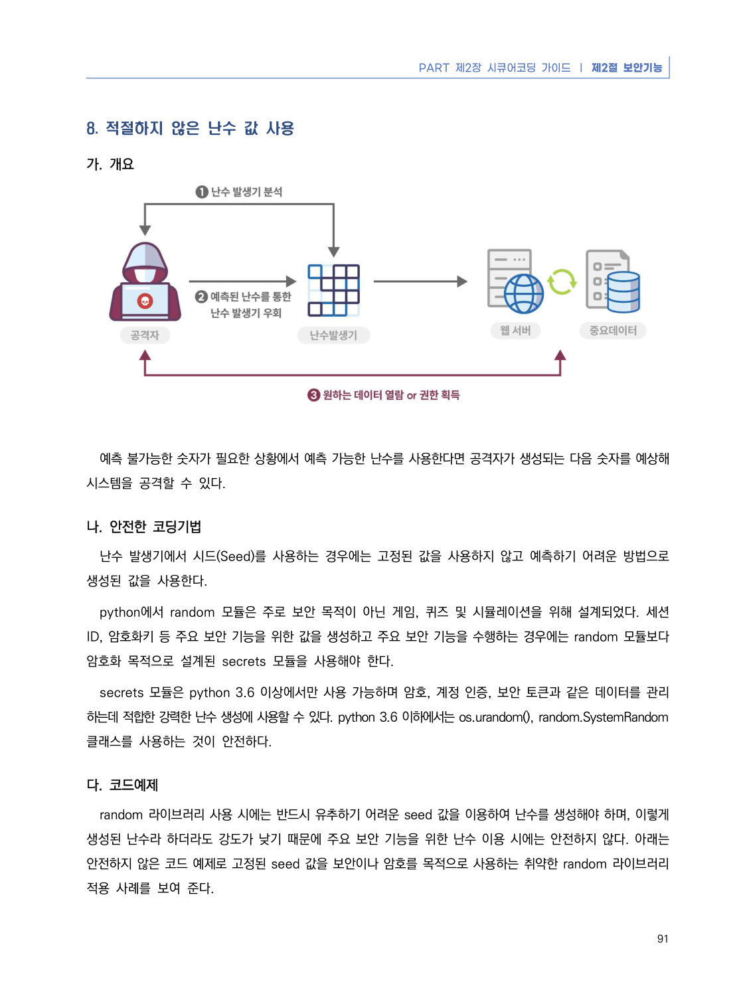
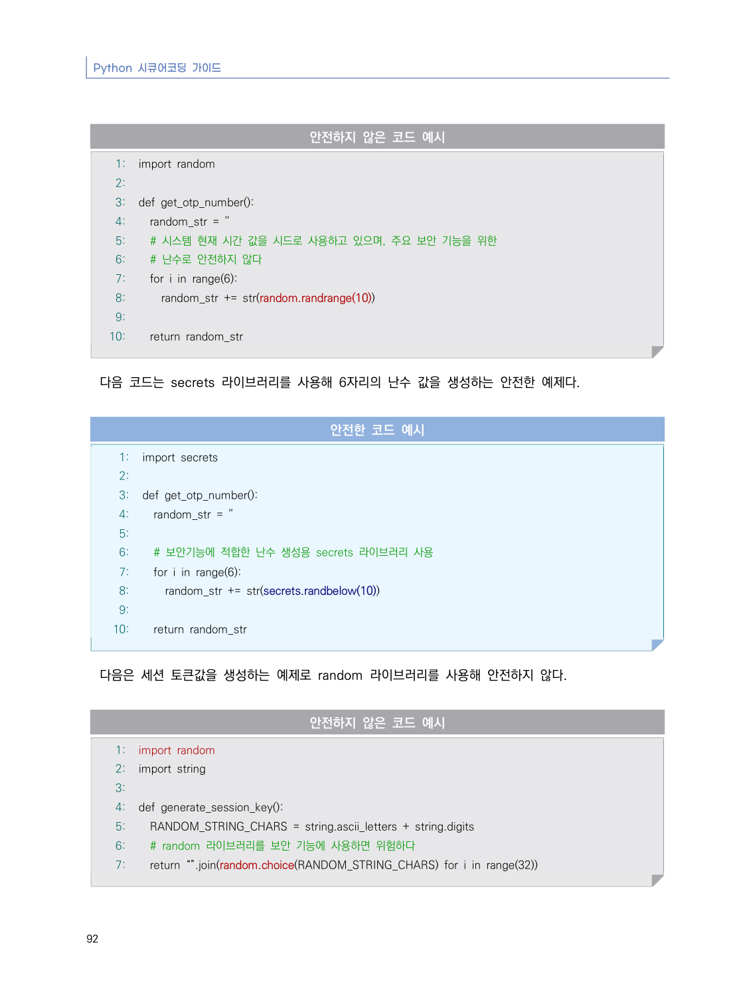
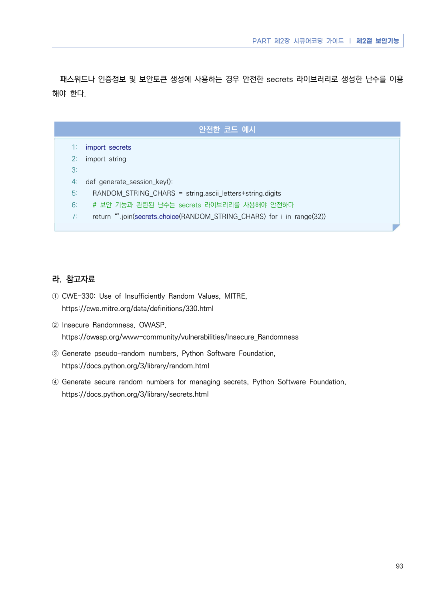

# 8. 적절하지 않은 난수 값 사용

> 변환 안내(원문 외): 아래 본문은 PDF 텍스트를 추출한 전사입니다. 코드 줄번호·특수 공백·원문 오류를 유지했습니다. 실행용 코드가 아닙니다. 표·그림·들여쓰기는 연결된 페이지 이미지와 대조하세요. 페이지 경계의 줄바꿈을 보존하며, 동일 페이지가 여러 항목에 나뉘면 각 항목의 본문은 해당 구간만 포함합니다.

### PDF 97페이지 / 인쇄 91페이지

<!-- source-page:Python-2023:97; source-lines:0,1,2,3,4,5,6,7,8,9,10,11,12,13,14,15,16,17,18,19 -->

PART 제2장 시큐어코딩 가이드 ❘ 제2절 보안기능

91

#### 8. 적절하지 않은 난수 값 사용

#### 가. 개요

예측 불가능한 숫자가 필요한 상황에서 예측 가능한 난수를 사용한다면 공격자가 생성되는 다음 숫자를 예상해 
시스템을 공격할 수 있다.

#### 나. 안전한 코딩기법

난수 발생기에서 시드(Seed)를 사용하는 경우에는 고정된 값을 사용하지 않고 예측하기 어려운 방법으로 
생성된 값을 사용한다.

python에서 random 모듈은 주로 보안 목적이 아닌 게임, 퀴즈 및 시뮬레이션을 위해 설계되었다. 세션 
ID, 암호화키 등 주요 보안 기능을 위한 값을 생성하고 주요 보안 기능을 수행하는 경우에는 random 모듈보다 
암호화 목적으로 설계된 secrets 모듈을 사용해야 한다. 

secrets 모듈은 python 3.6 이상에서만 사용 가능하며 암호, 계정 인증, 보안 토큰과 같은 데이터를 관리
하는데 적합한 강력한 난수 생성에 사용할 수 있다. python 3.6 이하에서는 os.urandom(), random.SystemRandom 
클래스를 사용하는 것이 안전하다.

#### 다. 코드예제

random 라이브러리 사용 시에는 반드시 유추하기 어려운 seed 값을 이용하여 난수를 생성해야 하며, 이렇게 
생성된 난수라 하더라도 강도가 낮기 때문에 주요 보안 기능을 위한 난수 이용 시에는 안전하지 않다. 아래는 

#### 안전하지 않은 코드 예제로 고정된 seed 값을 보안이나 암호를 목적으로 사용하는 취약한 random 라이브러리 

적용 사례를 보여 준다.

<details><summary>원본 페이지 이미지 (변환 외 보존 자료)</summary>



</details>

### PDF 98페이지 / 인쇄 92페이지

<!-- source-page:Python-2023:98; source-lines:0,1,2,3,4,5,6,7,8,9,10,11,12,13,14,15,16,17,18,19,20,21,22,23,24,25,26,27,28,29,30,31,32,33,34,35,36,37,38,39,40,41,42,43,44,45,46,47,48,49,50,51,52,53,54 -->

Python 시큐어코딩 가이드

92

#### 안전하지 않은 코드 예시

```python
1: import random
2:
3: def get_otp_number():
4:   random_str = ''
5:   # 시스템 현재 시간 값을 시드로 사용하고 있으며, 주요 보안 기능을 위한 
6:   # 난수로 안전하지 않다
7:   for i in range(6):
8:     random_str += str(random.randrange(10))
9:
10:   return random_str
```

다음 코드는 secrets 라이브러리를 사용해 6자리의 난수 값을 생성하는 안전한 예제다.

#### 안전한 코드 예시

```python
1: import secrets
2:
3: def get_otp_number():
4:   random_str = ''
5:
6:   # 보안기능에 적합한 난수 생성용 secrets 라이브러리 사용
7:   for i in range(6):
8:     random_str += str(secrets.randbelow(10))
9:
10:   return random_str
```

다음은 세션 토큰값을 생성하는 예제로 random 라이브러리를 사용해 안전하지 않다.

#### 안전하지 않은 코드 예시

```python
1: import random
2: import string
3:
4: def generate_session_key():
5:   RANDOM_STRING_CHARS = string.ascii_letters + string.digits
6:   # random 라이브러리를 보안 기능에 사용하면 위험하다
7:   return “”.join(random.choice(RANDOM_STRING_CHARS) for i in range(32))
```

<details><summary>원본 페이지 이미지 (변환 외 보존 자료)</summary>



</details>

### PDF 99페이지 / 인쇄 93페이지

<!-- source-page:Python-2023:99; source-lines:0,1,2,3,4,5,6,7,8,9,10,11,12,13,14,15,16,17,18,19,20,21,22,23,24,25,26 -->

PART 제2장 시큐어코딩 가이드 ❘ 제2절 보안기능

93

패스워드나 인증정보 및 보안토큰 생성에 사용하는 경우 안전한 secrets 라이브러리로 생성한 난수를 이용
해야 한다.

#### 안전한 코드 예시

```python
1: import secrets
2: import string
3:
4: def generate_session_key():
5:   RANDOM_STRING_CHARS = string.ascii_letters+string.digits
6:   # 보안 기능과 관련된 난수는 secrets 라이브러리를 사용해야 안전하다
7:   return “”.join(secrets.choice(RANDOM_STRING_CHARS) for i in range(32))
```

#### 라. 참고자료

① CWE-330: Use of Insufficiently Random Values, MITRE,

https://cwe.mitre.org/data/definitions/330.html
② Insecure Randomness, OWASP,

https://owasp.org/www-community/vulnerabilities/Insecure_Randomness
③ Generate pseudo-random numbers, Python Software Foundation,

https://docs.python.org/3/library/random.html
④ Generate secure random numbers for managing secrets, Python Software Foundation,

https://docs.python.org/3/library/secrets.html

<details><summary>원본 페이지 이미지 (변환 외 보존 자료)</summary>



</details>

---

## 탐색 링크 (원문 외)

[통합 인덱스](../../../INDEX.md)

