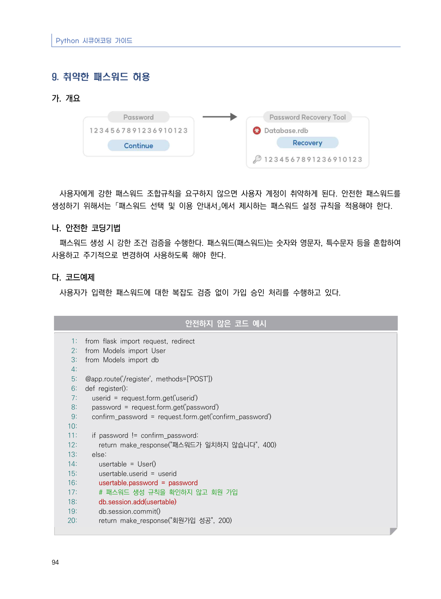
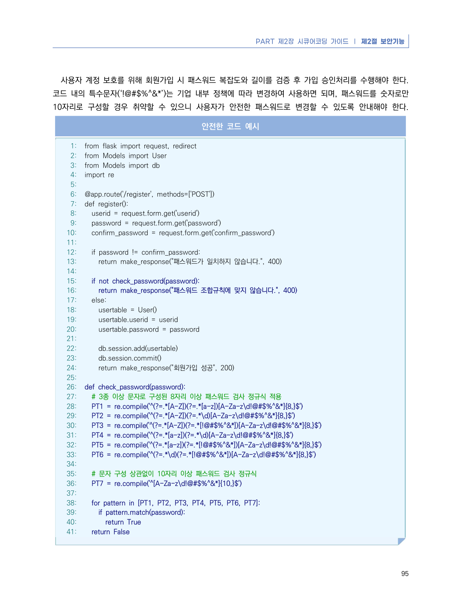
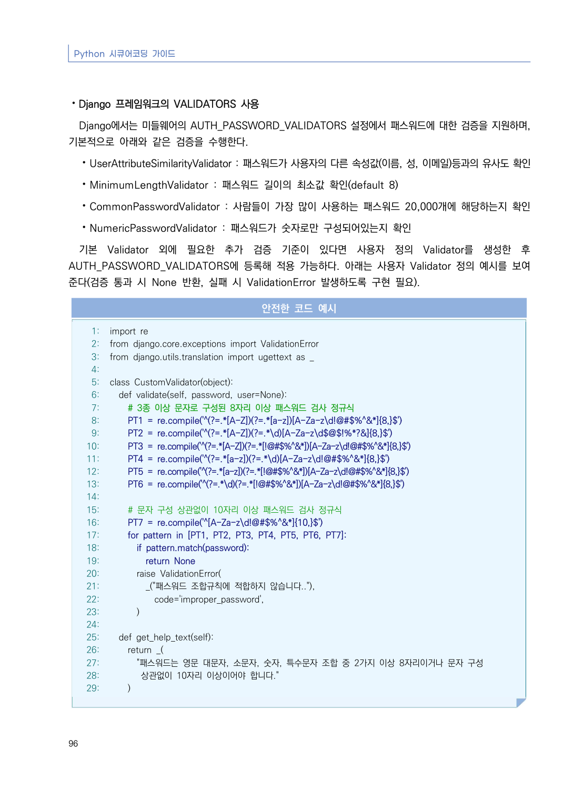
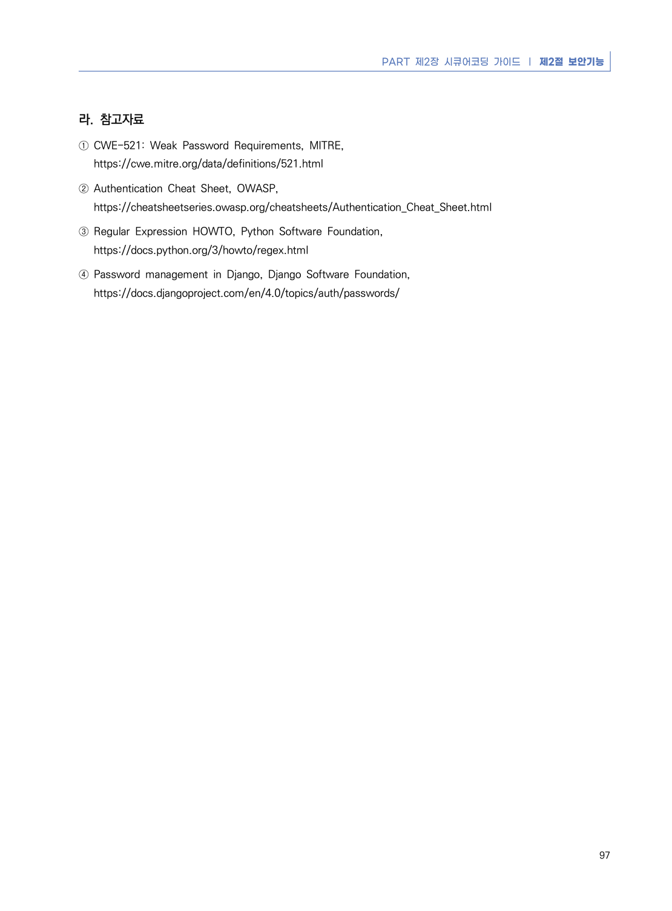

# 9. 취약한 패스워드 허용

> 변환 안내(원문 외): 아래 본문은 PDF 텍스트를 추출한 전사입니다. 코드 줄번호·특수 공백·원문 오류를 유지했습니다. 실행용 코드가 아닙니다. 표·그림·들여쓰기는 연결된 페이지 이미지와 대조하세요. 페이지 경계의 줄바꿈을 보존하며, 동일 페이지가 여러 항목에 나뉘면 각 항목의 본문은 해당 구간만 포함합니다.

### PDF 100페이지 / 인쇄 94페이지

<!-- source-page:Python-2023:100; source-lines:0,1,2,3,4,5,6,7,8,9,10,11,12,13,14,15,16,17,18,19,20,21,22,23,24,25,26,27,28,29,30,31,32,33,34,35,36,37,38,39,40,41,42,43,44,45,46,47,48,49 -->

Python 시큐어코딩 가이드

94

#### 9. 취약한 패스워드 허용

#### 가. 개요

사용자에게 강한 패스워드 조합규칙을 요구하지 않으면 사용자 계정이 취약하게 된다. 안전한 패스워드를 
생성하기 위해서는 「패스워드 선택 및 이용 안내서」에서 제시하는 패스워드 설정 규칙을 적용해야 한다.

#### 나. 안전한 코딩기법

패스워드 생성 시 강한 조건 검증을 수행한다. 패스워드(패스워드)는 숫자와 영문자, 특수문자 등을 혼합하여 
사용하고 주기적으로 변경하여 사용하도록 해야 한다.

#### 다. 코드예제

사용자가 입력한 패스워드에 대한 복잡도 검증 없이 가입 승인 처리를 수행하고 있다.

#### 안전하지 않은 코드 예시

```python
1: from flask import request, redirect
2: from Models import User
3: from Models import db
4:
5: @app.route('/register', methods=['POST'])
6: def register():
7:   userid = request.form.get('userid')
8:   password = request.form.get('password')
9:   confirm_password = request.form.get('confirm_password')
10:
11:   if password != confirm_password:
12:     return make_response("패스워드가 일치하지 않습니다", 400)
13:   else:
14:     usertable = User() 
15:     usertable.userid = userid
16:     usertable.password = password
17:     # 패스워드 생성 규칙을 확인하지 않고 회원 가입 
18:     db.session.add(usertable)
19:     db.session.commit()
20:     return make_response("회원가입 성공", 200)
```

<details><summary>원본 페이지 이미지 (변환 외 보존 자료)</summary>



</details>

### PDF 101페이지 / 인쇄 95페이지

<!-- source-page:Python-2023:101; source-lines:0,1,2,3,4,5,6,7,8,9,10,11,12,13,14,15,16,17,18,19,20,21,22,23,24,25,26,27,28,29,30,31,32,33,34,35,36,37,38,39,40,41,42,43,44,45,46,47,48,49,50,51,52,53,54,55,56,57,58,59,60,61,62,63,64,65,66,67,68,69,70,71,72,73,74,75,76,77,78,79,80,81,82 -->

PART 제2장 시큐어코딩 가이드 ❘ 제2절 보안기능

95

사용자 계정 보호를 위해 회원가입 시 패스워드 복잡도와 길이를 검증 후 가입 승인처리를 수행해야 한다. 
코드 내의 특수문자(‘!@#$%^&amp;*’)는 기업 내부 정책에 따라 변경하여 사용하면 되며, 패스워드를 숫자로만 
10자리로 구성할 경우 취약할 수 있으니 사용자가 안전한 패스워드로 변경할 수 있도록 안내해야 한다.

#### 안전한 코드 예시

```python
1: from flask import request, redirect
2: from Models import User
3: from Models import db
4: import re
5:
6: @app.route('/register', methods=['POST'])
7: def register():
8:   userid = request.form.get('userid')
9:   password = request.form.get('password')
10:   confirm_password = request.form.get('confirm_password')
11:
12:   if password != confirm_password:
13:     return make_response("패스워드가 일치하지 않습니다.", 400)
14:     
15:   if not check_password(password):
16:     return make_response("패스워드 조합규칙에 맞지 않습니다.", 400)
17:   else:
18:     usertable = User() 
19:     usertable.userid = userid
20:     usertable.password = password
21:         
22:     db.session.add(usertable)
23:     db.session.commit()
24:     return make_response("회원가입 성공", 200)
25:
26: def check_password(password):
27:   # 3종 이상 문자로 구성된 8자리 이상 패스워드 검사 정규식 적용
28:   PT1 = re.compile('^(?=.*[A-Z])(?=.*[a-z])[A-Za-z\d!@#$%^&*]{8,}$')
29:   PT2 = re.compile('^(?=.*[A-Z])(?=.*\d)[A-Za-z\d!@#$%^&*]{8,}$')
30:   PT3 = re.compile('^(?=.*[A-Z])(?=.*[!@#$%^&*])[A-Za-z\d!@#$%^&*]{8,}$')
31:   PT4 = re.compile('^(?=.*[a-z])(?=.*\d)[A-Za-z\d!@#$%^&*]{8,}$')
32:   PT5 = re.compile('^(?=.*[a-z])(?=.*[!@#$%^&*])[A-Za-z\d!@#$%^&*]{8,}$')
33:   PT6 = re.compile('^(?=.*\d)(?=.*[!@#$%^&*])[A-Za-z\d!@#$%^&*]{8,}$')
34:
35:   # 문자 구성 상관없이 10자리 이상 패스워드 검사 정규식
36:   PT7 = re.compile('^[A-Za-z\d!@#$%^&*]{10,}$')
37:
38:   for pattern in [PT1, PT2, PT3, PT4, PT5, PT6, PT7]:
39:     if pattern.match(password):
40:       return True
41:   return False
```

<details><summary>원본 페이지 이미지 (변환 외 보존 자료)</summary>



</details>

### PDF 102페이지 / 인쇄 96페이지

<!-- source-page:Python-2023:102; source-lines:0,1,2,3,4,5,6,7,8,9,10,11,12,13,14,15,16,17,18,19,20,21,22,23,24,25,26,27,28,29,30,31,32,33,34,35,36,37,38,39,40,41,42,43,44,45,46,47,48,49,50,51,52,53,54,55,56,57,58,59,60,61,62,63,64,65,66,67 -->

Python 시큐어코딩 가이드

96

⦁Django 프레임워크의 VALIDATORS 사용

Django에서는 미들웨어의 AUTH_PASSWORD_VALIDATORS 설정에서 패스워드에 대한 검증을 지원하며, 
기본적으로 아래와 같은 검증을 수행한다. 

⦁UserAttributeSimilarityValidator : 패스워드가 사용자의 다른 속성값(이름, 성, 이메일)등과의 유사도 확인
⦁MinimumLengthValidator : 패스워드 길이의 최소값 확인(default 8)
⦁CommonPasswordValidator : 사람들이 가장 많이 사용하는 패스워드 20,000개에 해당하는지 확인
⦁NumericPasswordValidator : 패스워드가 숫자로만 구성되어있는지 확인
기본 Validator 외에 필요한 추가 검증 기준이 있다면 사용자 정의 Validator를 생성한 후 
AUTH_PASSWORD_VALIDATORS에 등록해 적용 가능하다. 아래는 사용자 Validator 정의 예시를 보여 
준다(검증 통과 시 None 반환, 실패 시 ValidationError 발생하도록 구현 필요).

#### 안전한 코드 예시

```python
1: import re
2: from django.core.exceptions import ValidationError
3: from django.utils.translation import ugettext as _
4:
5: class CustomValidator(object):
6:   def validate(self, password, user=None):
7:     # 3종 이상 문자로 구성된 8자리 이상 패스워드 검사 정규식
8:     PT1 = re.compile('^(?=.*[A-Z])(?=.*[a-z])[A-Za-z\d!@#$%^&*]{8,}$')
9:     PT2 = re.compile('^(?=.*[A-Z])(?=.*\d)[A-Za-z\d$@$!%*?&]{8,}$')
10:     PT3 = re.compile('^(?=.*[A-Z])(?=.*[!@#$%^&*])[A-Za-z\d!@#$%^&*]{8,}$')
11:     PT4 = re.compile('^(?=.*[a-z])(?=.*\d)[A-Za-z\d!@#$%^&*]{8,}$')
12:     PT5 = re.compile('^(?=.*[a-z])(?=.*[!@#$%^&*])[A-Za-z\d!@#$%^&*]{8,}$')
13:     PT6 = re.compile('^(?=.*\d)(?=.*[!@#$%^&*])[A-Za-z\d!@#$%^&*]{8,}$')
14:
15:     # 문자 구성 상관없이 10자리 이상 패스워드 검사 정규식
16:     PT7 = re.compile('^[A-Za-z\d!@#$%^&*]{10,}$')
17:     for pattern in [PT1, PT2, PT3, PT4, PT5, PT6, PT7]:
18:       if pattern.match(password):
19:         return None
20:       raise ValidationError(
21:         _("패스워드 조합규칙에 적합하지 않습니다.."),
22:           code='improper_password',
23:       )
24:
25:   def get_help_text(self):
26:     return _(
27:       "패스워드는 영문 대문자, 소문자, 숫자, 특수문자 조합 중 2가지 이상 8자리이거나 문자 구성 
28:        상관없이 10자리 이상이어야 합니다."
29:     )
```

<details><summary>원본 페이지 이미지 (변환 외 보존 자료)</summary>



</details>

### PDF 103페이지 / 인쇄 97페이지

<!-- source-page:Python-2023:103; source-lines:0,1,2,3,4,5,6,7,8,9,10 -->

PART 제2장 시큐어코딩 가이드 ❘ 제2절 보안기능

97

#### 라. 참고자료

① CWE-521: Weak Password Requirements, MITRE,

https://cwe.mitre.org/data/definitions/521.html
② Authentication Cheat Sheet, OWASP,

https://cheatsheetseries.owasp.org/cheatsheets/Authentication_Cheat_Sheet.html
③ Regular Expression HOWTO, Python Software Foundation,

https://docs.python.org/3/howto/regex.html
④ Password management in Django, Django Software Foundation, 

https://docs.djangoproject.com/en/4.0/topics/auth/passwords/

<details><summary>원본 페이지 이미지 (변환 외 보존 자료)</summary>



</details>

---

## 탐색 링크 (원문 외)

[통합 인덱스](../../../INDEX.md)

