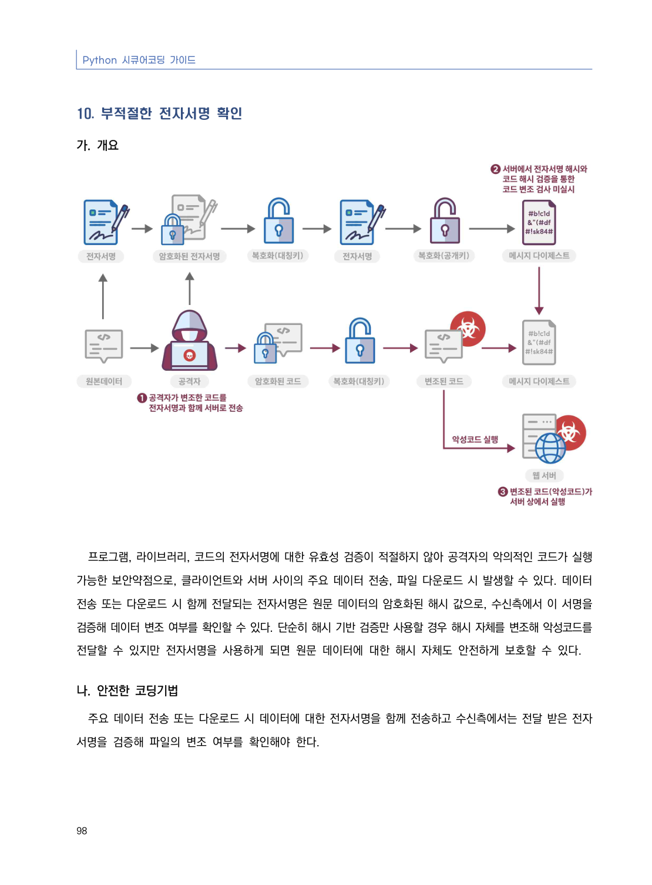
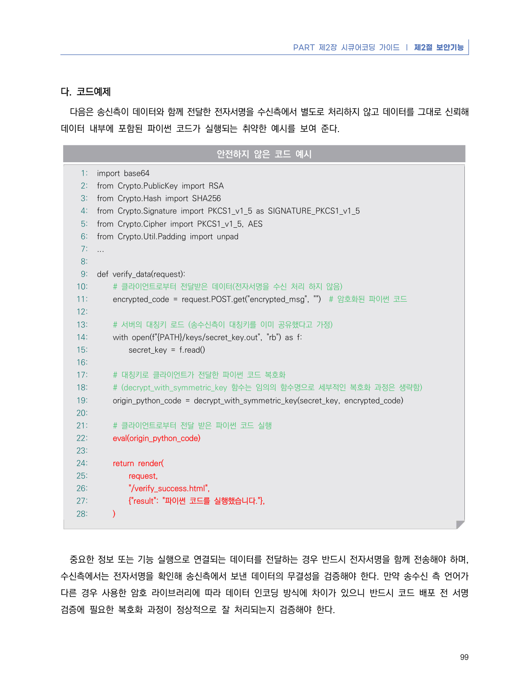
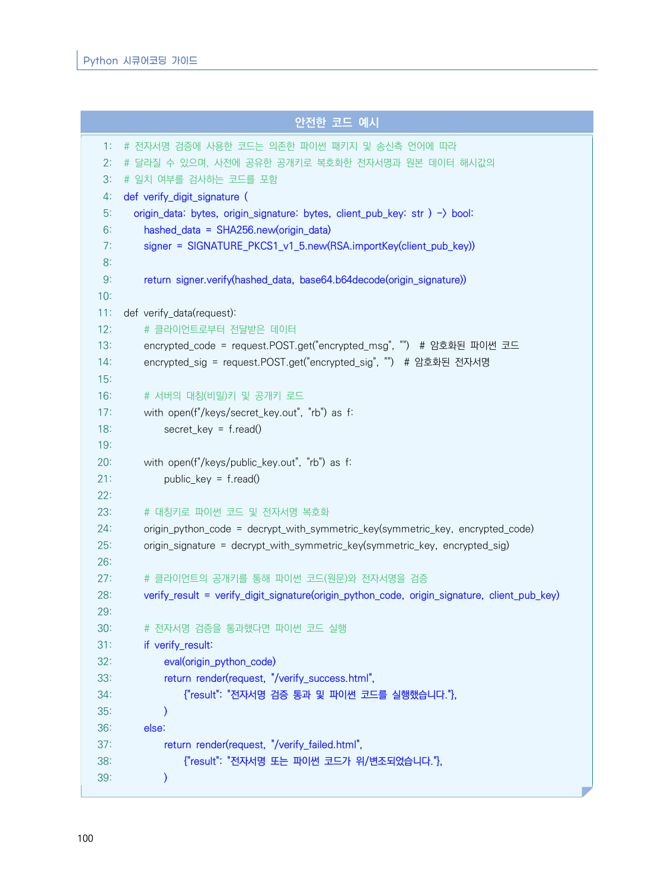
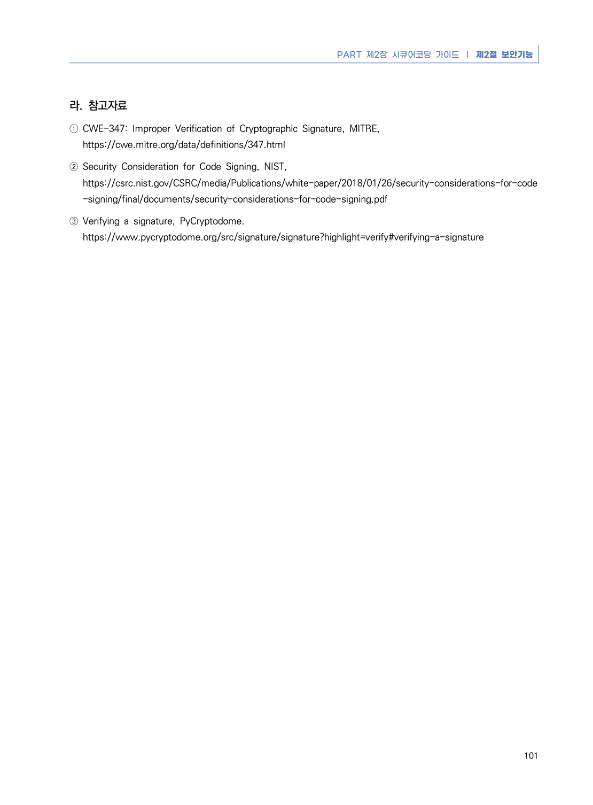

# 10. 부적절한 전자서명 확인

> 변환 안내(원문 외): 아래 본문은 PDF 텍스트를 추출한 전사입니다. 코드 줄번호·특수 공백·원문 오류를 유지했습니다. 실행용 코드가 아닙니다. 표·그림·들여쓰기는 연결된 페이지 이미지와 대조하세요. 페이지 경계의 줄바꿈을 보존하며, 동일 페이지가 여러 항목에 나뉘면 각 항목의 본문은 해당 구간만 포함합니다.

### PDF 104페이지 / 인쇄 98페이지

<!-- source-page:Python-2023:104; source-lines:0,1,2,3,4,5,6,7,8,9,10,11 -->

Python 시큐어코딩 가이드

98

#### 10. 부적절한 전자서명 확인

#### 가. 개요

프로그램, 라이브러리, 코드의 전자서명에 대한 유효성 검증이 적절하지 않아 공격자의 악의적인 코드가 실행 
가능한 보안약점으로, 클라이언트와 서버 사이의 주요 데이터 전송, 파일 다운로드 시 발생할 수 있다. 데이터 
전송 또는 다운로드 시 함께 전달되는 전자서명은 원문 데이터의 암호화된 해시 값으로, 수신측에서 이 서명을 
검증해 데이터 변조 여부를 확인할 수 있다. 단순히 해시 기반 검증만 사용할 경우 해시 자체를 변조해 악성코드를 
전달할 수 있지만 전자서명을 사용하게 되면 원문 데이터에 대한 해시 자체도 안전하게 보호할 수 있다. 

#### 나. 안전한 코딩기법

주요 데이터 전송 또는 다운로드 시 데이터에 대한 전자서명을 함께 전송하고 수신측에서는 전달 받은 전자
서명을 검증해 파일의 변조 여부를 확인해야 한다.

<details><summary>원본 페이지 이미지 (변환 외 보존 자료)</summary>



</details>

### PDF 105페이지 / 인쇄 99페이지

<!-- source-page:Python-2023:105; source-lines:0,1,2,3,4,5,6,7,8,9,10,11,12,13,14,15,16,17,18,19,20,21,22,23,24,25,26,27,28,29,30,31,32,33,34,35,36,37,38,39,40,41,42,43,44,45,46,47,48,49,50,51,52,53,54,55,56,57,58,59,60 -->

PART 제2장 시큐어코딩 가이드 ❘ 제2절 보안기능

99

#### 다. 코드예제

다음은 송신측이 데이터와 함께 전달한 전자서명을 수신측에서 별도로 처리하지 않고 데이터를 그대로 신뢰해 
데이터 내부에 포함된 파이썬 코드가 실행되는 취약한 예시를 보여 준다.

#### 안전하지 않은 코드 예시

```python
1: import base64
2: from Crypto.PublicKey import RSA
3: from Crypto.Hash import SHA256
4: from Crypto.Signature import PKCS1_v1_5 as SIGNATURE_PKCS1_v1_5
5: from Crypto.Cipher import PKCS1_v1_5, AES
6: from Crypto.Util.Padding import unpad
7: ...
8:
9: def verify_data(request):
10:     # 클라이언트로부터 전달받은 데이터(전자서명을 수신 처리 하지 않음)
11:     encrypted_code = request.POST.get("encrypted_msg", "")  # 암호화된 파이썬 코드
12:
13:     # 서버의 대칭키 로드 (송수신측이 대칭키를 이미 공유했다고 가정)
14:     with open(f"{PATH}/keys/secret_key.out", "rb") as f:
15:         secret_key = f.read()
16:
17:     # 대칭키로 클라이언트가 전달한 파이썬 코드 복호화
18:     # (decrypt_with_symmetric_key 함수는 임의의 함수명으로 세부적인 복호화 과정은 생략함)
19:     origin_python_code = decrypt_with_symmetric_key(secret_key, encrypted_code)
20:
21:     # 클라이언트로부터 전달 받은 파이썬 코드 실행
22:     eval(origin_python_code)
23:
24:     return render(
25:         request,
26:         "/verify_success.html",
27:         {"result": "파이썬 코드를 실행했습니다."},
28:     )
```

중요한 정보 또는 기능 실행으로 연결되는 데이터를 전달하는 경우 반드시 전자서명을 함께 전송해야 하며, 
수신측에서는 전자서명을 확인해 송신측에서 보낸 데이터의 무결성을 검증해야 한다. 만약 송수신 측 언어가 
다른 경우 사용한 암호 라이브러리에 따라 데이터 인코딩 방식에 차이가 있으니 반드시 코드 배포 전 서명 
검증에 필요한 복호화 과정이 정상적으로 잘 처리되는지 검증해야 한다.

<details><summary>원본 페이지 이미지 (변환 외 보존 자료)</summary>



</details>

### PDF 106페이지 / 인쇄 100페이지

<!-- source-page:Python-2023:106; source-lines:0,1,2,3,4,5,6,7,8,9,10,11,12,13,14,15,16,17,18,19,20,21,22,23,24,25,26,27,28,29,30,31,32,33,34,35,36,37,38,39,40,41,42,43,44,45,46,47,48,49,50,51,52,53,54,55,56,57,58,59,60,61,62,63,64,65,66,67,68,69,70,71,72,73,74 -->

Python 시큐어코딩 가이드

100

#### 안전한 코드 예시

```python
1: # 전자서명 검증에 사용한 코드는 의존한 파이썬 패키지 및 송신측 언어에 따라 
2: # 달라질 수 있으며, 사전에 공유한 공개키로 복호화한 전자서명과 원본 데이터 해시값의
3: # 일치 여부를 검사하는 코드를 포함
4: def verify_digit_signature (
5:   origin_data: bytes, origin_signature: bytes, client_pub_key: str ) -> bool:
6:     hashed_data = SHA256.new(origin_data)
7:     signer = SIGNATURE_PKCS1_v1_5.new(RSA.importKey(client_pub_key))
8:
9:     return signer.verify(hashed_data, base64.b64decode(origin_signature))
10:
11: def verify_data(request):
12:     # 클라이언트로부터 전달받은 데이터
13:     encrypted_code = request.POST.get("encrypted_msg", "")  # 암호화된 파이썬 코드
14:     encrypted_sig = request.POST.get("encrypted_sig", "")  # 암호화된 전자서명
15:    
16:     # 서버의 대칭(비밀)키 및 공개키 로드
17:     with open(f"/keys/secret_key.out", "rb") as f:
18:         secret_key = f.read()
19:
20:     with open(f"/keys/public_key.out", "rb") as f:
21:         public_key = f.read()
22:
23:     # 대칭키로 파이썬 코드 및 전자서명 복호화
24:     origin_python_code = decrypt_with_symmetric_key(symmetric_key, encrypted_code)
25:     origin_signature = decrypt_with_symmetric_key(symmetric_key, encrypted_sig)
26:
27:     # 클라이언트의 공개키를 통해 파이썬 코드(원문)와 전자서명을 검증
28:     verify_result = verify_digit_signature(origin_python_code, origin_signature, client_pub_key)
29:
30:     # 전자서명 검증을 통과했다면 파이썬 코드 실행
31:     if verify_result:
32:         eval(origin_python_code)
33:         return render(request, "/verify_success.html",
34:             {"result": "전자서명 검증 통과 및 파이썬 코드를 실행했습니다."},
35:         )
36:     else:
37:         return render(request, "/verify_failed.html",
38:             {"result": "전자서명 또는 파이썬 코드가 위/변조되었습니다."},
39:         )
```

<details><summary>원본 페이지 이미지 (변환 외 보존 자료)</summary>



</details>

### PDF 107페이지 / 인쇄 101페이지

<!-- source-page:Python-2023:107; source-lines:0,1,2,3,4,5,6,7,8,9 -->

PART 제2장 시큐어코딩 가이드 ❘ 제2절 보안기능

101

#### 라. 참고자료

① CWE-347: Improper Verification of Cryptographic Signature, MITRE,

https://cwe.mitre.org/data/definitions/347.html
② Security Consideration for Code Signing, NIST,

https://csrc.nist.gov/CSRC/media/Publications/white-paper/2018/01/26/security-considerations-for-code
-signing/final/documents/security-considerations-for-code-signing.pdf
③ Verifying a signature, PyCryptodome.

https://www.pycryptodome.org/src/signature/signature?highlight=verify#verifying-a-signature

<details><summary>원본 페이지 이미지 (변환 외 보존 자료)</summary>



</details>

---

## 탐색 링크 (원문 외)

[통합 인덱스](../../../INDEX.md)

