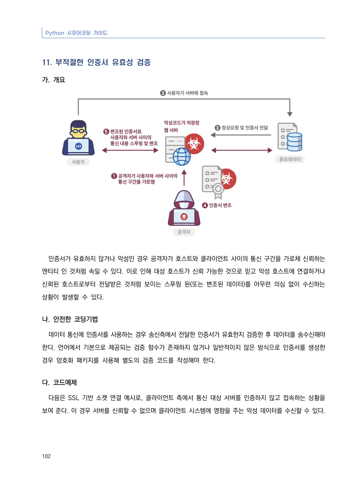
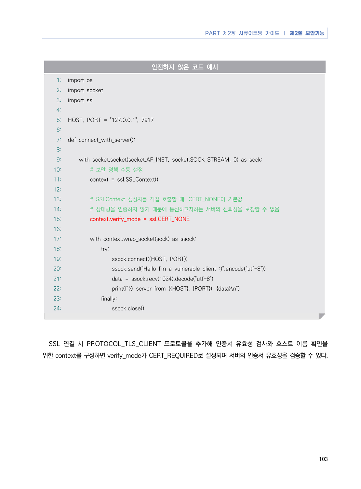
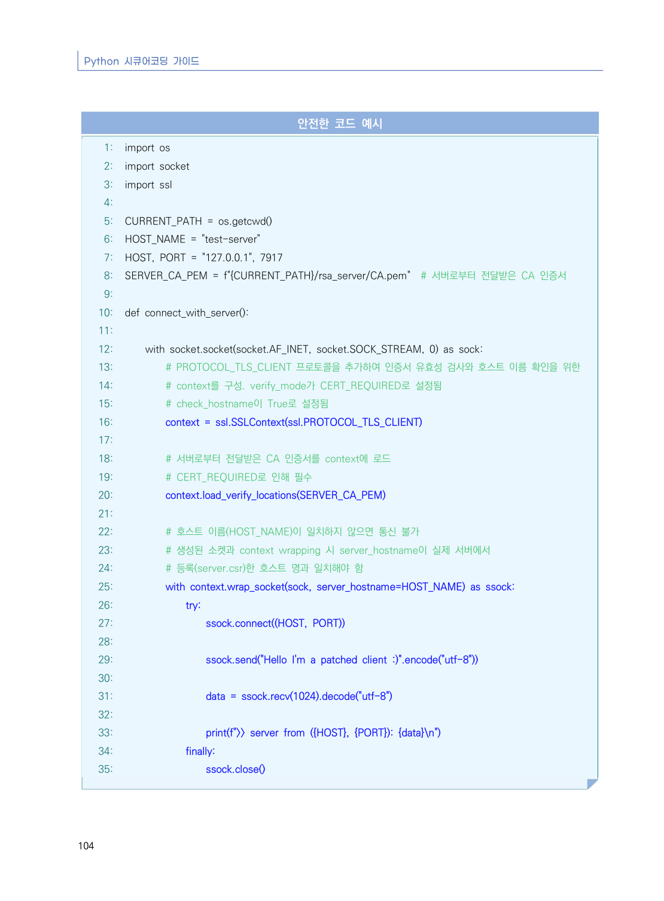
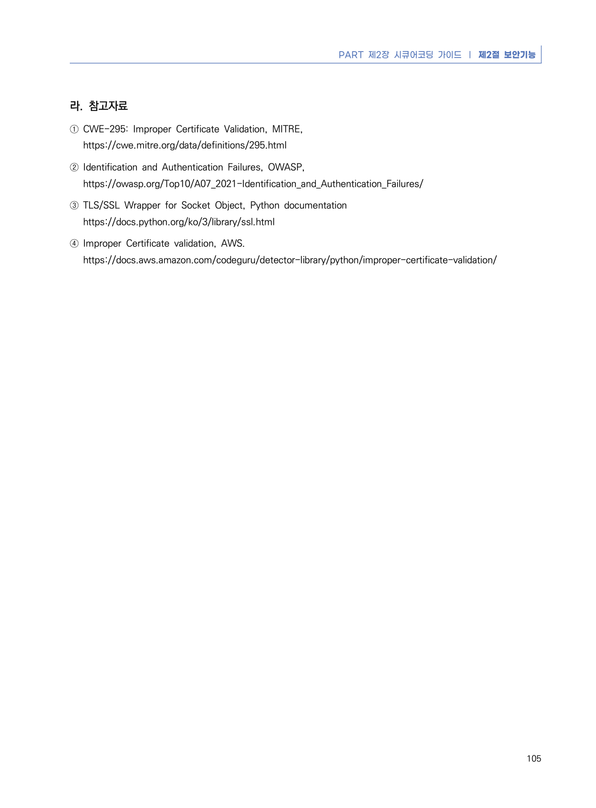

# 11. 부적절한 인증서 유효성 검증

> 변환 안내(원문 외): 아래 본문은 PDF 텍스트를 추출한 전사입니다. 코드 줄번호·특수 공백·원문 오류를 유지했습니다. 실행용 코드가 아닙니다. 표·그림·들여쓰기는 연결된 페이지 이미지와 대조하세요. 페이지 경계의 줄바꿈을 보존하며, 동일 페이지가 여러 항목에 나뉘면 각 항목의 본문은 해당 구간만 포함합니다.

### PDF 108페이지 / 인쇄 102페이지

<!-- source-page:Python-2023:108; source-lines:0,1,2,3,4,5,6,7,8,9,10,11,12,13,14 -->

Python 시큐어코딩 가이드

102

#### 11. 부적절한 인증서 유효성 검증

#### 가. 개요

인증서가 유효하지 않거나 악성인 경우 공격자가 호스트와 클라이언트 사이의 통신 구간을 가로채 신뢰하는 
엔티티 인 것처럼 속일 수 있다. 이로 인해 대상 호스트가 신뢰 가능한 것으로 믿고 악성 호스트에 연결하거나 
신뢰된 호스트로부터 전달받은 것처럼 보이는 스푸핑 된(또는 변조된 데이터)를 아무런 의심 없이 수신하는 
상황이 발생할 수 있다.

#### 나. 안전한 코딩기법

데이터 통신에 인증서를 사용하는 경우 송신측에서 전달한 인증서가 유효한지 검증한 후 데이터를 송수신해야 
한다. 언어에서 기본으로 제공되는 검증 함수가 존재하지 않거나 일반적이지 않은 방식으로 인증서를 생성한 
경우 암호화 패키지를 사용해 별도의 검증 코드를 작성해야 한다.

#### 다. 코드예제

다음은 SSL 기반 소켓 연결 예시로, 클라이언트 측에서 통신 대상 서버를 인증하지 않고 접속하는 상황을 
보여 준다. 이 경우 서버를 신뢰할 수 없으며 클라이언트 시스템에 영향을 주는 악성 데이터를 수신할 수 있다.

<details><summary>원본 페이지 이미지 (변환 외 보존 자료)</summary>



</details>

### PDF 109페이지 / 인쇄 103페이지

<!-- source-page:Python-2023:109; source-lines:0,1,2,3,4,5,6,7,8,9,10,11,12,13,14,15,16,17,18,19,20,21,22,23,24,25,26,27,28,29,30,31,32,33,34,35,36,37,38,39,40,41,42,43,44,45,46,47 -->

PART 제2장 시큐어코딩 가이드 ❘ 제2절 보안기능

103

#### 안전하지 않은 코드 예시

```python
1: import os
2: import socket
3: import ssl
4:
5: HOST, PORT = "127.0.0.1", 7917
6:
7: def connect_with_server():
8:
9:     with socket.socket(socket.AF_INET, socket.SOCK_STREAM, 0) as sock:
10:         # 보안 정책 수동 설정
11:         context = ssl.SSLContext()
12:
13:         # SSLContext 생성자를 직접 호출할 때, CERT_NONE이 기본값
14:         # 상대방을 인증하지 않기 때문에 통신하고자하는 서버의 신뢰성을 보장할 수 없음
15:         context.verify_mode = ssl.CERT_NONE 
16:
17:         with context.wrap_socket(sock) as ssock:
18:             try:
19:                 ssock.connect((HOST, PORT))
20:                 ssock.send("Hello I'm a vulnerable client :)".encode("utf-8"))
21:                 data = ssock.recv(1024).decode("utf-8")
22:                 print(f">> server from ({HOST}, {PORT}): {data}\n")
23:             finally:
24:                 ssock.close()
```

SSL 연결 시 PROTOCOL_TLS_CLIENT 프로토콜을 추가해 인증서 유효성 검사와 호스트 이름 확인을 
위한 context를 구성하면 verify_mode가 CERT_REQUIRED로 설정되며 서버의 인증서 유효성을 검증할 수 있다.

<details><summary>원본 페이지 이미지 (변환 외 보존 자료)</summary>



</details>

### PDF 110페이지 / 인쇄 104페이지

<!-- source-page:Python-2023:110; source-lines:0,1,2,3,4,5,6,7,8,9,10,11,12,13,14,15,16,17,18,19,20,21,22,23,24,25,26,27,28,29,30,31,32,33,34,35,36,37,38,39,40,41,42,43,44,45,46,47,48,49,50,51,52,53,54,55,56,57,58,59,60,61,62,63,64 -->

Python 시큐어코딩 가이드

104

#### 안전한 코드 예시

```python
1: import os
2: import socket
3: import ssl
4:
5: CURRENT_PATH = os.getcwd()
6: HOST_NAME = "test-server"
7: HOST, PORT = "127.0.0.1", 7917
8: SERVER_CA_PEM = f"{CURRENT_PATH}/rsa_server/CA.pem"  # 서버로부터 전달받은 CA 인증서
9:
10: def connect_with_server():
11:
12:     with socket.socket(socket.AF_INET, socket.SOCK_STREAM, 0) as sock:
13:         # PROTOCOL_TLS_CLIENT 프로토콜을 추가하여 인증서 유효성 검사와 호스트 이름 확인을 위한
14:         # context를 구성. verify_mode가 CERT_REQUIRED로 설정됨
15:         # check_hostname이 True로 설정됨
16:         context = ssl.SSLContext(ssl.PROTOCOL_TLS_CLIENT)
17:
18:         # 서버로부터 전달받은 CA 인증서를 context에 로드
19:         # CERT_REQUIRED로 인해 필수
20:         context.load_verify_locations(SERVER_CA_PEM)
21:
22:         # 호스트 이름(HOST_NAME)이 일치하지 않으면 통신 불가
23:         # 생성된 소켓과 context wrapping 시 server_hostname이 실제 서버에서
24:         # 등록(server.csr)한 호스트 명과 일치해야 함
25:         with context.wrap_socket(sock, server_hostname=HOST_NAME) as ssock:
26:             try:
27:                 ssock.connect((HOST, PORT))
28:
29:                 ssock.send("Hello I'm a patched client :)".encode("utf-8"))
30:
31:                 data = ssock.recv(1024).decode("utf-8")
32:
33:                 print(f">> server from ({HOST}, {PORT}): {data}\n")
34:             finally:
35:                 ssock.close()
```

<details><summary>원본 페이지 이미지 (변환 외 보존 자료)</summary>



</details>

### PDF 111페이지 / 인쇄 105페이지

<!-- source-page:Python-2023:111; source-lines:0,1,2,3,4,5,6,7,8,9,10 -->

PART 제2장 시큐어코딩 가이드 ❘ 제2절 보안기능

105

#### 라. 참고자료

① CWE-295: Improper Certificate Validation, MITRE,

https://cwe.mitre.org/data/definitions/295.html
② Identification and Authentication Failures, OWASP,

https://owasp.org/Top10/A07_2021-Identification_and_Authentication_Failures/
③ TLS/SSL Wrapper for Socket Object, Python documentation

https://docs.python.org/ko/3/library/ssl.html
④ Improper Certificate validation, AWS.

https://docs.aws.amazon.com/codeguru/detector-library/python/improper-certificate-validation/

<details><summary>원본 페이지 이미지 (변환 외 보존 자료)</summary>



</details>

---

## 탐색 링크 (원문 외)

[통합 인덱스](../../../INDEX.md)

