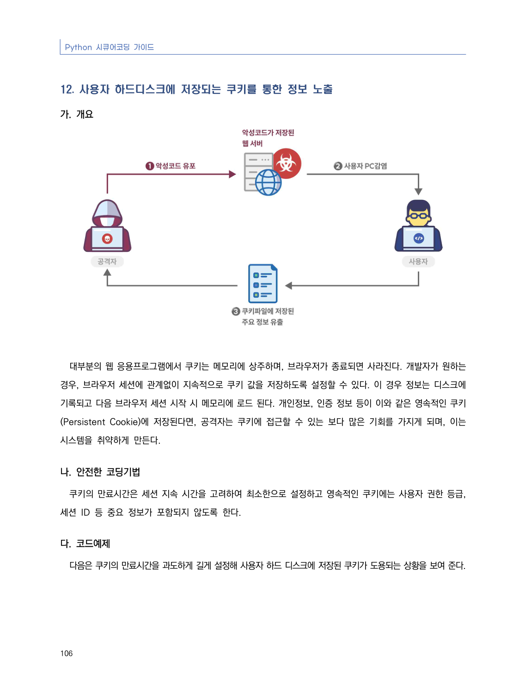
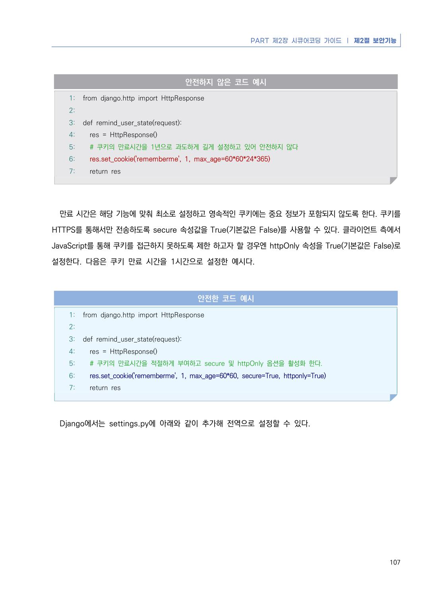
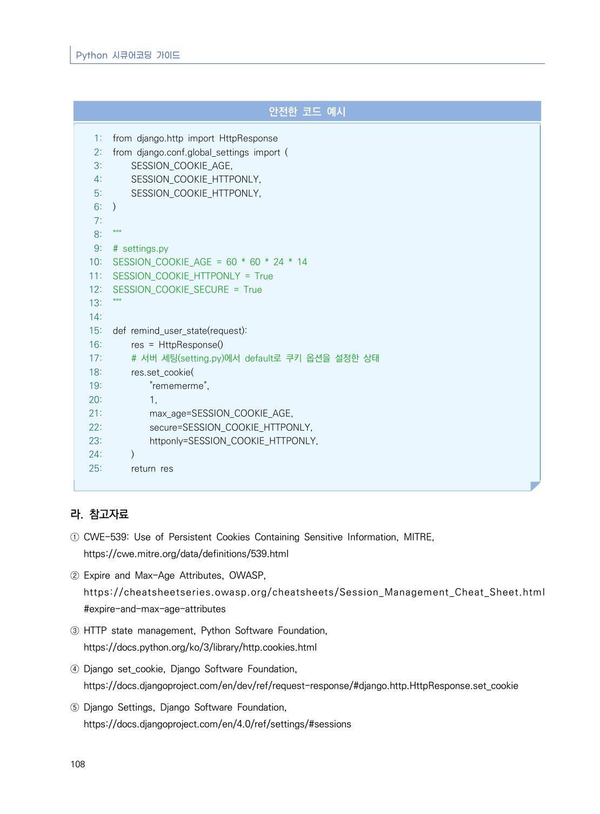

# 12. 사용자 하드디스크에 저장되는 쿠키를 통한 정보 노출

> 변환 안내(원문 외): 아래 본문은 PDF 텍스트를 추출한 전사입니다. 코드 줄번호·특수 공백·원문 오류를 유지했습니다. 실행용 코드가 아닙니다. 표·그림·들여쓰기는 연결된 페이지 이미지와 대조하세요. 페이지 경계의 줄바꿈을 보존하며, 동일 페이지가 여러 항목에 나뉘면 각 항목의 본문은 해당 구간만 포함합니다.

### PDF 112페이지 / 인쇄 106페이지

<!-- source-page:Python-2023:112; source-lines:0,1,2,3,4,5,6,7,8,9,10,11,12,13 -->

Python 시큐어코딩 가이드

106

#### 12. 사용자 하드디스크에 저장되는 쿠키를 통한 정보 노출

#### 가. 개요

대부분의 웹 응용프로그램에서 쿠키는 메모리에 상주하며, 브라우저가 종료되면 사라진다. 개발자가 원하는 
경우, 브라우저 세션에 관계없이 지속적으로 쿠키 값을 저장하도록 설정할 수 있다. 이 경우 정보는 디스크에 
기록되고 다음 브라우저 세션 시작 시 메모리에 로드 된다. 개인정보, 인증 정보 등이 이와 같은 영속적인 쿠키
(Persistent Cookie)에 저장된다면, 공격자는 쿠키에 접근할 수 있는 보다 많은 기회를 가지게 되며, 이는 
시스템을 취약하게 만든다.

#### 나. 안전한 코딩기법

쿠키의 만료시간은 세션 지속 시간을 고려하여 최소한으로 설정하고 영속적인 쿠키에는 사용자 권한 등급, 
세션 ID 등 중요 정보가 포함되지 않도록 한다.

#### 다. 코드예제

다음은 쿠키의 만료시간을 과도하게 길게 설정해 사용자 하드 디스크에 저장된 쿠키가 도용되는 상황을 보여 준다.

<details><summary>원본 페이지 이미지 (변환 외 보존 자료)</summary>



</details>

### PDF 113페이지 / 인쇄 107페이지

<!-- source-page:Python-2023:113; source-lines:0,1,2,3,4,5,6,7,8,9,10,11,12,13,14,15,16,17,18,19,20,21,22,23,24,25,26,27,28,29,30,31,32,33,34 -->

PART 제2장 시큐어코딩 가이드 ❘ 제2절 보안기능

107

#### 안전하지 않은 코드 예시

```python
1: from django.http import HttpResponse
2:
3: def remind_user_state(request):
4:   res = HttpResponse()
5:   # 쿠키의 만료시간을 1년으로 과도하게 길게 설정하고 있어 안전하지 않다
6:   res.set_cookie('rememberme', 1, max_age=60*60*24*365)
7:   return res
```

만료 시간은 해당 기능에 맞춰 최소로 설정하고 영속적인 쿠키에는 중요 정보가 포함되지 않도록 한다. 쿠키를 
HTTPS를 통해서만 전송하도록 secure 속성값을 True(기본값은 False)를 사용할 수 있다. 클라이언트 측에서 
JavaScript를 통해 쿠키를 접근하지 못하도록 제한 하고자 할 경우엔 httpOnly 속성을 True(기본값은 False)로 
설정한다. 다음은 쿠키 만료 시간을 1시간으로 설정한 예시다.

#### 안전한 코드 예시

```python
1: from django.http import HttpResponse
2:
3: def remind_user_state(request):
4:   res = HttpResponse()
5:   # 쿠키의 만료시간을 적절하게 부여하고 secure 및 httpOnly 옵션을 활성화 한다.
6:   res.set_cookie('rememberme', 1, max_age=60*60, secure=True, httponly=True)
7:   return res
```

Django에서는 settings.py에 아래와 같이 추가해 전역으로 설정할 수 있다.

<details><summary>원본 페이지 이미지 (변환 외 보존 자료)</summary>



</details>

### PDF 114페이지 / 인쇄 108페이지

<!-- source-page:Python-2023:114; source-lines:0,1,2,3,4,5,6,7,8,9,10,11,12,13,14,15,16,17,18,19,20,21,22,23,24,25,26,27,28,29,30,31,32,33,34,35,36,37,38,39,40,41,42,43,44,45,46,47,48,49,50,51,52,53,54,55,56,57,58,59,60,61,62 -->

Python 시큐어코딩 가이드

108

#### 안전한 코드 예시

```python
1: from django.http import HttpResponse
2: from django.conf.global_settings import (
3:     SESSION_COOKIE_AGE,
4:     SESSION_COOKIE_HTTPONLY,
5:     SESSION_COOKIE_HTTPONLY,
6: )
7:
8: """
9: # settings.py
10: SESSION_COOKIE_AGE = 60 * 60 * 24 * 14
11: SESSION_COOKIE_HTTPONLY = True
12: SESSION_COOKIE_SECURE = True
13: """
14:
15: def remind_user_state(request):
16:     res = HttpResponse()
17:     # 서버 세팅(setting.py)에서 default로 쿠키 옵션을 설정한 상태
18:     res.set_cookie(
19:         "rememerme",
20:         1,
21:         max_age=SESSION_COOKIE_AGE,
22:         secure=SESSION_COOKIE_HTTPONLY,
23:         httponly=SESSION_COOKIE_HTTPONLY,
24:     )
25:     return res
```

#### 라. 참고자료

① CWE-539: Use of Persistent Cookies Containing Sensitive Information, MITRE,

https://cwe.mitre.org/data/definitions/539.html
② Expire and Max-Age Attributes, OWASP,

https://cheatsheetseries.owasp.org/cheatsheets/Session_Management_Cheat_Sheet.html 
#expire-and-max-age-attributes
③ HTTP state management, Python Software Foundation,

https://docs.python.org/ko/3/library/http.cookies.html
④ Django set_cookie, Django Software Foundation,

https://docs.djangoproject.com/en/dev/ref/request-response/#django.http.HttpResponse.set_cookie
⑤ Django Settings, Django Software Foundation,

https://docs.djangoproject.com/en/4.0/ref/settings/#sessions

<details><summary>원본 페이지 이미지 (변환 외 보존 자료)</summary>



</details>

---

## 탐색 링크 (원문 외)

[통합 인덱스](../../../INDEX.md)

