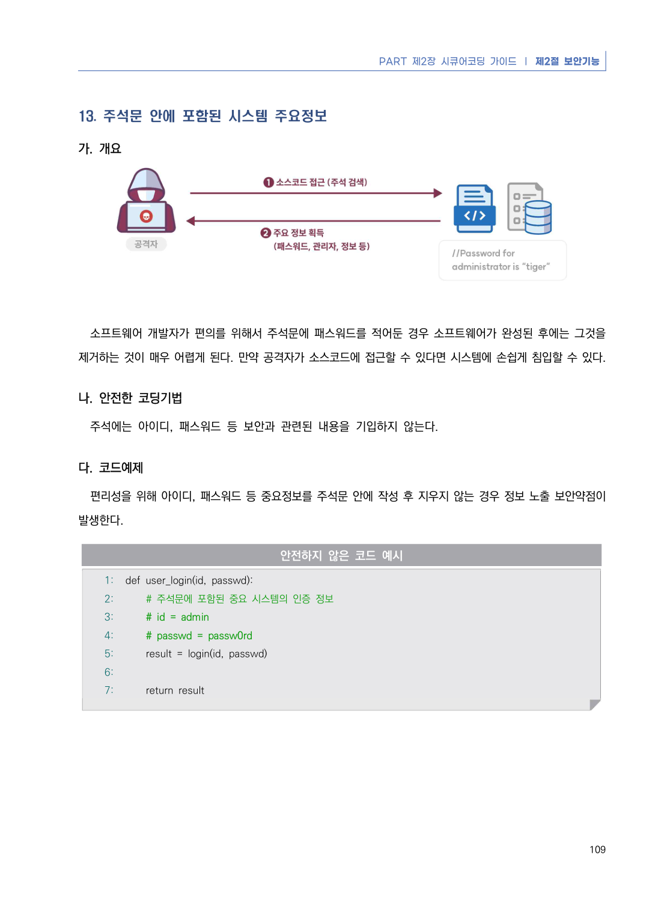
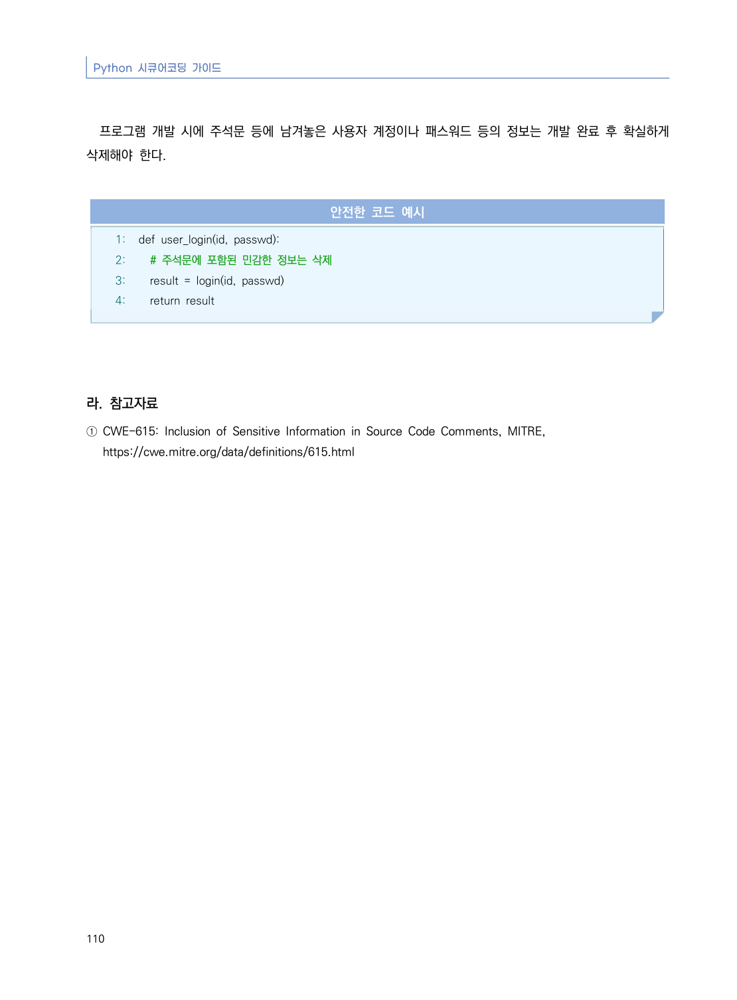

# 13. 주석문 안에 포함된 시스템 주요정보

> 변환 안내(원문 외): 아래 본문은 PDF 텍스트를 추출한 전사입니다. 코드 줄번호·특수 공백·원문 오류를 유지했습니다. 실행용 코드가 아닙니다. 표·그림·들여쓰기는 연결된 페이지 이미지와 대조하세요. 페이지 경계의 줄바꿈을 보존하며, 동일 페이지가 여러 항목에 나뉘면 각 항목의 본문은 해당 구간만 포함합니다.

### PDF 115페이지 / 인쇄 109페이지

<!-- source-page:Python-2023:115; source-lines:0,1,2,3,4,5,6,7,8,9,10,11,12,13,14,15,16,17,18,19,20,21,22,23,24 -->

PART 제2장 시큐어코딩 가이드 ❘ 제2절 보안기능

109

#### 13. 주석문 안에 포함된 시스템 주요정보

#### 가. 개요

소프트웨어 개발자가 편의를 위해서 주석문에 패스워드를 적어둔 경우 소프트웨어가 완성된 후에는 그것을 
제거하는 것이 매우 어렵게 된다. 만약 공격자가 소스코드에 접근할 수 있다면 시스템에 손쉽게 침입할 수 있다.

#### 나. 안전한 코딩기법

주석에는 아이디, 패스워드 등 보안과 관련된 내용을 기입하지 않는다.

#### 다. 코드예제

편리성을 위해 아이디, 패스워드 등 중요정보를 주석문 안에 작성 후 지우지 않는 경우 정보 노출 보안약점이 
발생한다.

#### 안전하지 않은 코드 예시

```python
1: def user_login(id, passwd):
2:     # 주석문에 포함된 중요 시스템의 인증 정보
3:     # id = admin
4:     # passwd = passw0rd
5:     result = login(id, passwd)
6:
7:     return result
```

<details><summary>원본 페이지 이미지 (변환 외 보존 자료)</summary>



</details>

### PDF 116페이지 / 인쇄 110페이지

<!-- source-page:Python-2023:116; source-lines:0,1,2,3,4,5,6,7,8,9,10,11,12,13,14,15 -->

Python 시큐어코딩 가이드

110

프로그램 개발 시에 주석문 등에 남겨놓은 사용자 계정이나 패스워드 등의 정보는 개발 완료 후 확실하게 
삭제해야 한다.

#### 안전한 코드 예시

```python
1: def user_login(id, passwd):
2:   # 주석문에 포함된 민감한 정보는 삭제
3:   result = login(id, passwd)
4:   return result
```

#### 라. 참고자료

① CWE-615: Inclusion of Sensitive Information in Source Code Comments, MITRE,

https://cwe.mitre.org/data/definitions/615.html

<details><summary>원본 페이지 이미지 (변환 외 보존 자료)</summary>



</details>

---

## 탐색 링크 (원문 외)

[통합 인덱스](../../../INDEX.md)

