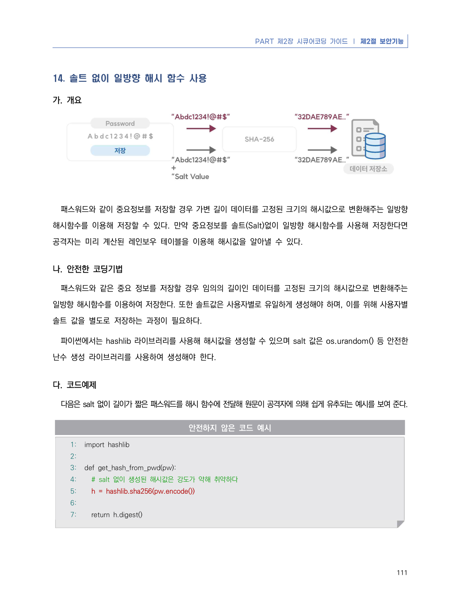
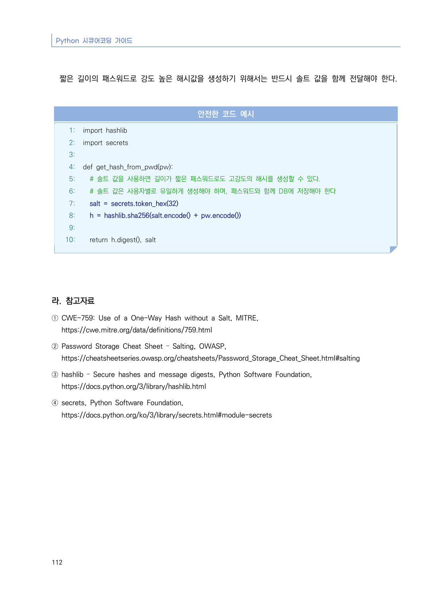

# 14. 솔트 없이 일방향 해시 함수 사용

> 변환 안내(원문 외): 아래 본문은 PDF 텍스트를 추출한 전사입니다. 코드 줄번호·특수 공백·원문 오류를 유지했습니다. 실행용 코드가 아닙니다. 표·그림·들여쓰기는 연결된 페이지 이미지와 대조하세요. 페이지 경계의 줄바꿈을 보존하며, 동일 페이지가 여러 항목에 나뉘면 각 항목의 본문은 해당 구간만 포함합니다.

### PDF 117페이지 / 인쇄 111페이지

<!-- source-page:Python-2023:117; source-lines:0,1,2,3,4,5,6,7,8,9,10,11,12,13,14,15,16,17,18,19,20,21,22,23,24,25,26,27 -->

PART 제2장 시큐어코딩 가이드 ❘ 제2절 보안기능

111

#### 14. 솔트 없이 일방향 해시 함수 사용

#### 가. 개요

패스워드와 같이 중요정보를 저장할 경우 가변 길이 데이터를 고정된 크기의 해시값으로 변환해주는 일방향 
해시함수를 이용해 저장할 수 있다. 만약 중요정보를 솔트(Salt)없이 일방향 해시함수를 사용해 저장한다면 
공격자는 미리 계산된 레인보우 테이블을 이용해 해시값을 알아낼 수 있다.

#### 나. 안전한 코딩기법

패스워드와 같은 중요 정보를 저장할 경우 임의의 길이인 데이터를 고정된 크기의 해시값으로 변환해주는 
일방향 해시함수를 이용하여 저장한다. 또한 솔트값은 사용자별로 유일하게 생성해야 하며, 이를 위해 사용자별 
솔트 값을 별도로 저장하는 과정이 필요하다.

파이썬에서는 hashlib 라이브러리를 사용해 해시값을 생성할 수 있으며 salt 값은 os.urandom() 등 안전한 
난수 생성 라이브러리를 사용하여 생성해야 한다.

#### 다. 코드예제

다음은 salt 없이 길이가 짧은 패스워드를 해시 함수에 전달해 원문이 공격자에 의해 쉽게 유추되는 예시를 보여 준다.

#### 안전하지 않은 코드 예시

```python
1: import hashlib
2:
3: def get_hash_from_pwd(pw):
4:   # salt 없이 생성된 해시값은 강도가 약해 취약하다
5:   h = hashlib.sha256(pw.encode())
6:
7:   return h.digest()
```

<details><summary>원본 페이지 이미지 (변환 외 보존 자료)</summary>



</details>

### PDF 118페이지 / 인쇄 112페이지

<!-- source-page:Python-2023:118; source-lines:0,1,2,3,4,5,6,7,8,9,10,11,12,13,14,15,16,17,18,19,20,21,22,23,24,25,26,27,28,29,30 -->

Python 시큐어코딩 가이드

112

짧은 길이의 패스워드로 강도 높은 해시값을 생성하기 위해서는 반드시 솔트 값을 함께 전달해야 한다.

#### 안전한 코드 예시

```python
1: import hashlib
2: import secrets
3:
4: def get_hash_from_pwd(pw):
5:   # 솔트 값을 사용하면 길이가 짧은 패스워드로도 고강도의 해시를 생성할 수 있다.
6:   # 솔트 값은 사용자별로 유일하게 생성해야 하며, 패스워드와 함께 DB에 저장해야 한다
7:   salt = secrets.token_hex(32)
8:   h = hashlib.sha256(salt.encode() + pw.encode())
9:
10:   return h.digest(), salt
```

#### 라. 참고자료

① CWE-759: Use of a One-Way Hash without a Salt, MITRE,

https://cwe.mitre.org/data/definitions/759.html
② Password Storage Cheat Sheet – Salting, OWASP, 

https://cheatsheetseries.owasp.org/cheatsheets/Password_Storage_Cheat_Sheet.html#salting
③ hashlib – Secure hashes and message digests, Python Software Foundation,

https://docs.python.org/3/library/hashlib.html
④ secrets, Python Software Foundation, 

https://docs.python.org/ko/3/library/secrets.html#module-secrets

<details><summary>원본 페이지 이미지 (변환 외 보존 자료)</summary>



</details>

---

## 탐색 링크 (원문 외)

[통합 인덱스](../../../INDEX.md)

