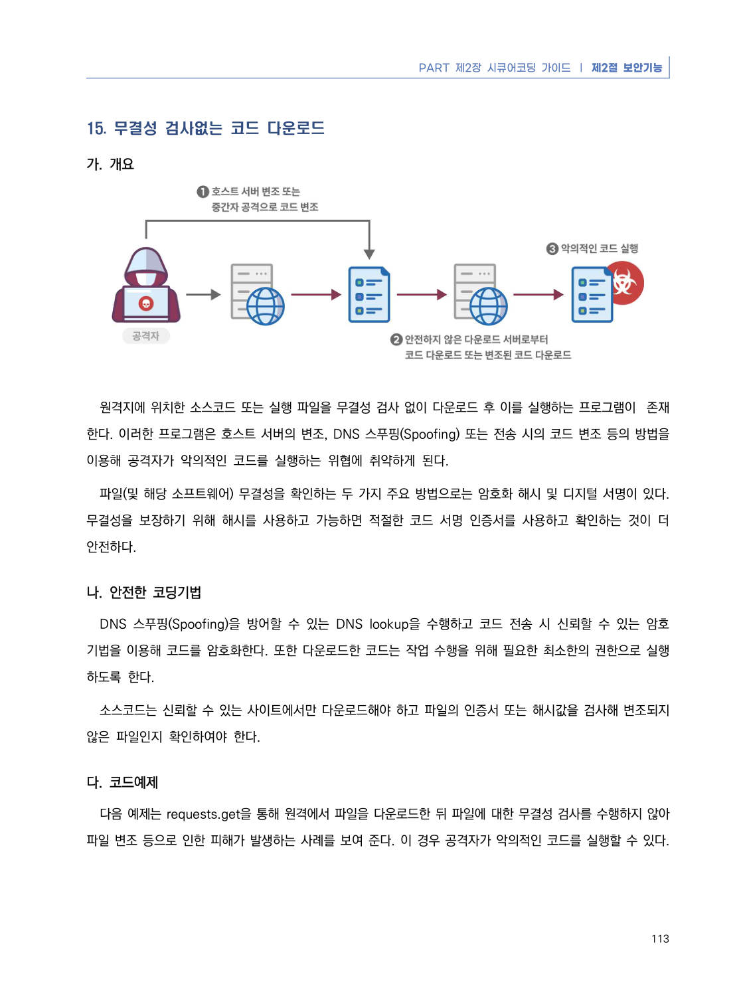
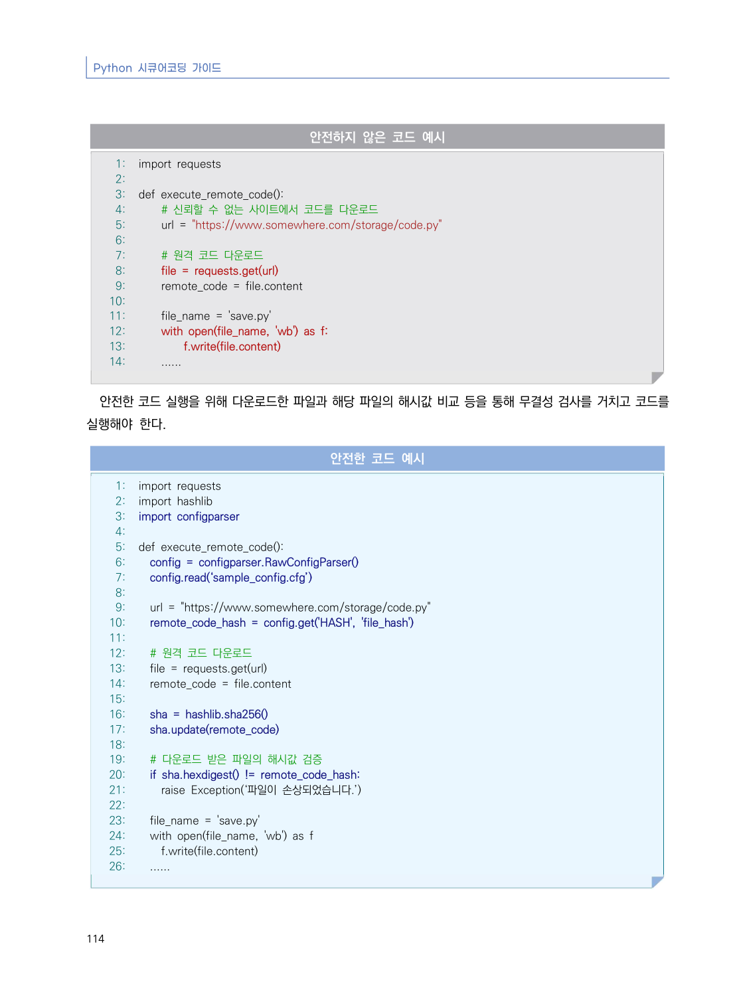
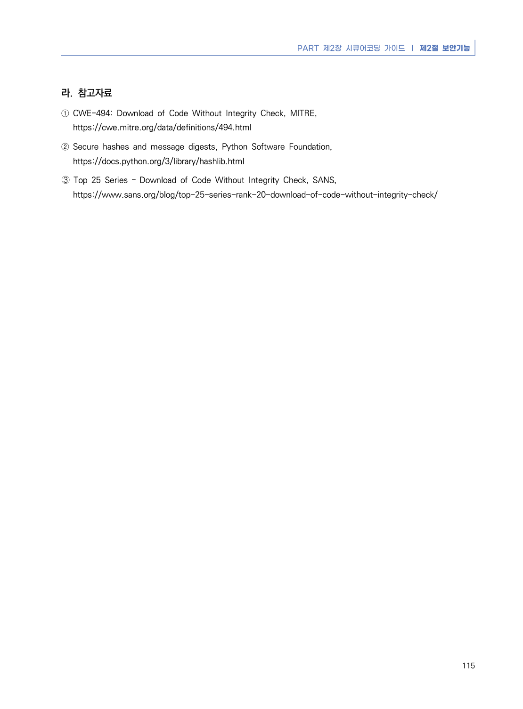

# 15. 무결성 검사없는 코드 다운로드

> 변환 안내(원문 외): 아래 본문은 PDF 텍스트를 추출한 전사입니다. 코드 줄번호·특수 공백·원문 오류를 유지했습니다. 실행용 코드가 아닙니다. 표·그림·들여쓰기는 연결된 페이지 이미지와 대조하세요. 페이지 경계의 줄바꿈을 보존하며, 동일 페이지가 여러 항목에 나뉘면 각 항목의 본문은 해당 구간만 포함합니다.

### PDF 119페이지 / 인쇄 113페이지

<!-- source-page:Python-2023:119; source-lines:0,1,2,3,4,5,6,7,8,9,10,11,12,13,14,15,16,17,18 -->

PART 제2장 시큐어코딩 가이드 ❘ 제2절 보안기능

113

#### 15. 무결성 검사없는 코드 다운로드

#### 가. 개요

원격지에 위치한 소스코드 또는 실행 파일을 무결성 검사 없이 다운로드 후 이를 실행하는 프로그램이  존재
한다. 이러한 프로그램은 호스트 서버의 변조, DNS 스푸핑(Spoofing) 또는 전송 시의 코드 변조 등의 방법을 
이용해 공격자가 악의적인 코드를 실행하는 위협에 취약하게 된다.

파일(및 해당 소프트웨어) 무결성을 확인하는 두 가지 주요 방법으로는 암호화 해시 및 디지털 서명이 있다. 
무결성을 보장하기 위해 해시를 사용하고 가능하면 적절한 코드 서명 인증서를 사용하고 확인하는 것이 더 
안전하다.

#### 나. 안전한 코딩기법

DNS 스푸핑(Spoofing)을 방어할 수 있는 DNS lookup을 수행하고 코드 전송 시 신뢰할 수 있는 암호 
기법을 이용해 코드를 암호화한다. 또한 다운로드한 코드는 작업 수행을 위해 필요한 최소한의 권한으로 실행
하도록 한다.

소스코드는 신뢰할 수 있는 사이트에서만 다운로드해야 하고 파일의 인증서 또는 해시값을 검사해 변조되지 
않은 파일인지 확인하여야 한다. 

#### 다. 코드예제

다음 예제는 requests.get을 통해 원격에서 파일을 다운로드한 뒤 파일에 대한 무결성 검사를 수행하지 않아 
파일 변조 등으로 인한 피해가 발생하는 사례를 보여 준다. 이 경우 공격자가 악의적인 코드를 실행할 수 있다.

<details><summary>원본 페이지 이미지 (변환 외 보존 자료)</summary>



</details>

### PDF 120페이지 / 인쇄 114페이지

<!-- source-page:Python-2023:120; source-lines:0,1,2,3,4,5,6,7,8,9,10,11,12,13,14,15,16,17,18,19,20,21,22,23,24,25,26,27,28,29,30,31,32,33,34,35,36,37,38,39,40,41,42,43,44,45,46,47,48,49,50,51,52,53,54,55,56,57,58,59,60,61,62,63,64,65,66,67,68,69,70,71,72,73,74,75,76 -->

Python 시큐어코딩 가이드

114

#### 안전하지 않은 코드 예시

```python
1: import requests
2:
3: def execute_remote_code():
4:     # 신뢰할 수 없는 사이트에서 코드를 다운로드
5:     url = "https://www.somewhere.com/storage/code.py"
6:
7:     # 원격 코드 다운로드
8:     file = requests.get(url)
9:     remote_code = file.content
10:
11:     file_name = 'save.py'    
12:     with open(file_name, 'wb') as f:
13:         f.write(file.content)
14:     ......
```

#### 안전한 코드 실행을 위해 다운로드한 파일과 해당 파일의 해시값 비교 등을 통해 무결성 검사를 거치고 코드를 

실행해야 한다.

#### 안전한 코드 예시

```python
1: import requests
2: import hashlib
3: import configparser
4:
5: def execute_remote_code():
6:   config = configparser.RawConfigParser()
7:   config.read(‘sample_config.cfg’)
8:
9:   url = "https://www.somewhere.com/storage/code.py"
10:   remote_code_hash = config.get('HASH', 'file_hash')
11:
12:   # 원격 코드 다운로드
13:   file = requests.get(url)
14:   remote_code = file.content
15:
16:   sha = hashlib.sha256()
17:   sha.update(remote_code)
18:
19:   # 다운로드 받은 파일의 해시값 검증
20:   if sha.hexdigest() != remote_code_hash:
21:     raise Exception(‘파일이 손상되었습니다.’)
22:
23:   file_name = 'save.py'
24:   with open(file_name, 'wb') as f
25:     f.write(file.content)
26:   ......
```

<details><summary>원본 페이지 이미지 (변환 외 보존 자료)</summary>



</details>

### PDF 121페이지 / 인쇄 115페이지

<!-- source-page:Python-2023:121; source-lines:0,1,2,3,4,5,6,7,8 -->

PART 제2장 시큐어코딩 가이드 ❘ 제2절 보안기능

115

#### 라. 참고자료

① CWE-494: Download of Code Without Integrity Check, MITRE,

https://cwe.mitre.org/data/definitions/494.html
② Secure hashes and message digests, Python Software Foundation,

https://docs.python.org/3/library/hashlib.html
➂ Top 25 Series – Download of Code Without Integrity Check, SANS,

https://www.sans.org/blog/top-25-series-rank-20-download-of-code-without-integrity-check/

<details><summary>원본 페이지 이미지 (변환 외 보존 자료)</summary>



</details>

---

## 탐색 링크 (원문 외)

[통합 인덱스](../../../INDEX.md)

