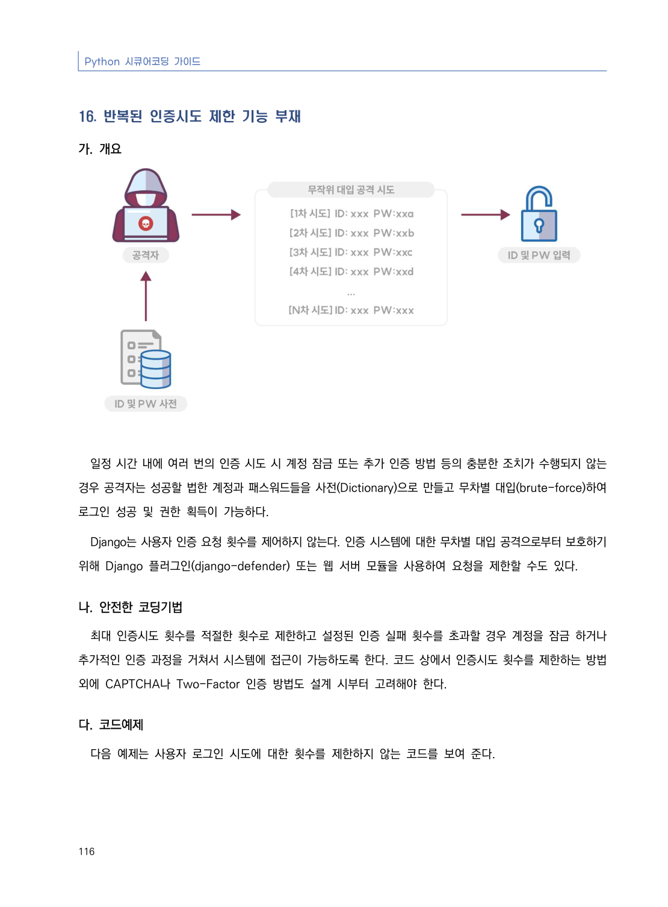
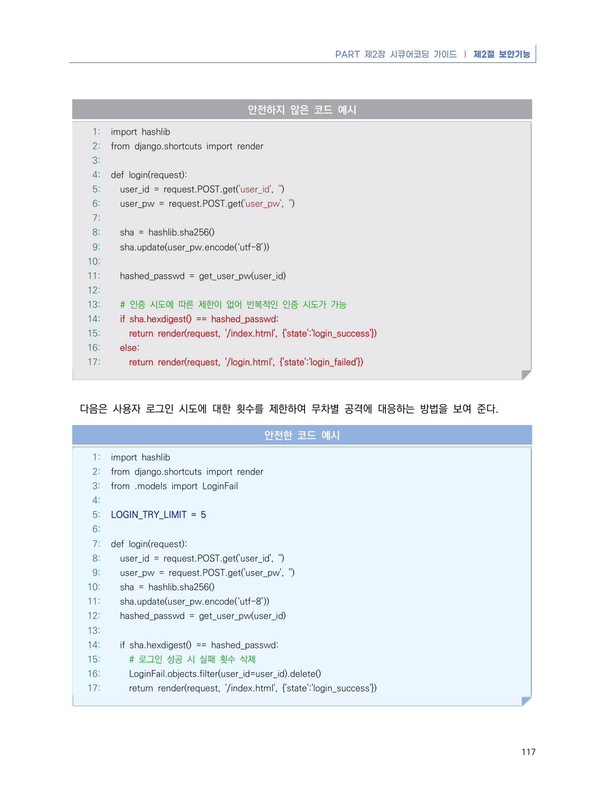
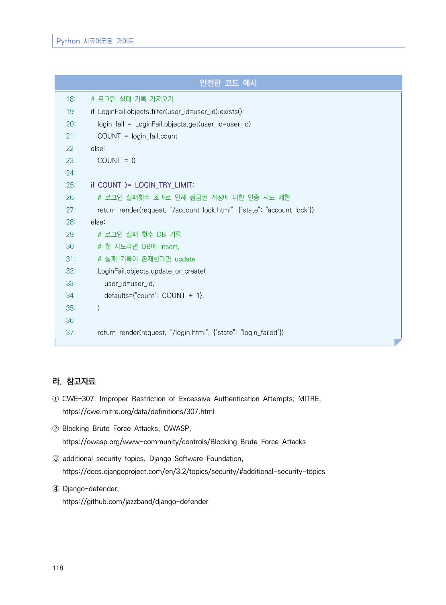

# 16. 반복된 인증시도 제한 기능 부재

> 변환 안내(원문 외): 아래 본문은 PDF 텍스트를 추출한 전사입니다. 코드 줄번호·특수 공백·원문 오류를 유지했습니다. 실행용 코드가 아닙니다. 표·그림·들여쓰기는 연결된 페이지 이미지와 대조하세요. 페이지 경계의 줄바꿈을 보존하며, 동일 페이지가 여러 항목에 나뉘면 각 항목의 본문은 해당 구간만 포함합니다.

### PDF 122페이지 / 인쇄 116페이지

<!-- source-page:Python-2023:122; source-lines:0,1,2,3,4,5,6,7,8,9,10,11,12,13,14 -->

Python 시큐어코딩 가이드

116

#### 16. 반복된 인증시도 제한 기능 부재

#### 가. 개요

일정 시간 내에 여러 번의 인증 시도 시 계정 잠금 또는 추가 인증 방법 등의 충분한 조치가 수행되지 않는 
경우 공격자는 성공할 법한 계정과 패스워드들을 사전(Dictionary)으로 만들고 무차별 대입(brute-force)하여 
로그인 성공 및 권한 획득이 가능하다.

Django는 사용자 인증 요청 횟수를 제어하지 않는다. 인증 시스템에 대한 무차별 대입 공격으로부터 보호하기 
위해 Django 플러그인(django-defender) 또는 웹 서버 모듈을 사용하여 요청을 제한할 수도 있다.

#### 나. 안전한 코딩기법

최대 인증시도 횟수를 적절한 횟수로 제한하고 설정된 인증 실패 횟수를 초과할 경우 계정을 잠금 하거나 
추가적인 인증 과정을 거쳐서 시스템에 접근이 가능하도록 한다. 코드 상에서 인증시도 횟수를 제한하는 방법 
외에 CAPTCHA나 Two-Factor 인증 방법도 설계 시부터 고려해야 한다. 

#### 다. 코드예제

다음 예제는 사용자 로그인 시도에 대한 횟수를 제한하지 않는 코드를 보여 준다.

<details><summary>원본 페이지 이미지 (변환 외 보존 자료)</summary>



</details>

### PDF 123페이지 / 인쇄 117페이지

<!-- source-page:Python-2023:123; source-lines:0,1,2,3,4,5,6,7,8,9,10,11,12,13,14,15,16,17,18,19,20,21,22,23,24,25,26,27,28,29,30,31,32,33,34,35,36,37,38,39,40,41,42,43,44,45,46,47,48,49,50,51,52,53,54,55,56,57,58,59,60,61,62,63,64,65 -->

PART 제2장 시큐어코딩 가이드 ❘ 제2절 보안기능

117

#### 안전하지 않은 코드 예시

```python
1: import hashlib
2: from django.shortcuts import render
3:
4: def login(request):
5:   user_id = request.POST.get('user_id', '')
6:   user_pw = request.POST.get('user_pw', '')
7:
8:   sha = hashlib.sha256()
9:   sha.update(user_pw.encode(‘utf-8’))
10:
11:   hashed_passwd = get_user_pw(user_id)
12:
13:   # 인증 시도에 따른 제한이 없어 반복적인 인증 시도가 가능
14:   if sha.hexdigest() == hashed_passwd:
15:     return render(request, '/index.html', {'state':'login_success'})
16:   else:
17:     return render(request, '/login.html', {'state':'login_failed'})
```

다음은 사용자 로그인 시도에 대한 횟수를 제한하여 무차별 공격에 대응하는 방법을 보여 준다.

#### 안전한 코드 예시

```python
1: import hashlib
2: from django.shortcuts import render
3: from .models import LoginFail
4:
5: LOGIN_TRY_LIMIT = 5
6:
7: def login(request):
8:   user_id = request.POST.get('user_id', '')
9:   user_pw = request.POST.get('user_pw', '')
10:   sha = hashlib.sha256()
11:   sha.update(user_pw.encode(‘utf-8’))
12:   hashed_passwd = get_user_pw(user_id)
13:
14:   if sha.hexdigest() == hashed_passwd:
15:     # 로그인 성공 시 실패 횟수 삭제
16:     LoginFail.objects.filter(user_id=user_id).delete()
17:     return render(request, '/index.html', {'state':'login_success'})
```

<details><summary>원본 페이지 이미지 (변환 외 보존 자료)</summary>



</details>

### PDF 124페이지 / 인쇄 118페이지

<!-- source-page:Python-2023:124; source-lines:0,1,2,3,4,5,6,7,8,9,10,11,12,13,14,15,16,17,18,19,20,21,22,23,24,25,26,27,28,29,30,31,32,33,34,35,36,37,38,39,40,41,42,43,44,45,46,47,48,49 -->

Python 시큐어코딩 가이드

118

#### 안전한 코드 예시

```python
18:   # 로그인 실패 기록 가져오기
19:   if LoginFail.objects.filter(user_id=user_id).exists():
20:     login_fail = LoginFail.objects.get(user_id=user_id)
21:     COUNT = login_fail.count
22:   else:
23:     COUNT = 0
24:
25:   if COUNT >= LOGIN_TRY_LIMIT:
26:     # 로그인 실패횟수 초과로 인해 잠금된 계정에 대한 인증 시도 제한
27:     return render(request, "/account_lock.html", {"state": "account_lock"})
28:   else:
29:     # 로그인 실패 횟수 DB 기록
30:     # 첫 시도라면 DB에 insert,
31:     # 실패 기록이 존재한다면 update
32:     LoginFail.objects.update_or_create(
33:       user_id=user_id,
34:       defaults={"count": COUNT + 1},
35:     )
36:
37:     return render(request, "/login.html", {"state": "login_failed"})
```

#### 라. 참고자료

① CWE-307: Improper Restriction of Excessive Authentication Attempts, MITRE,

https://cwe.mitre.org/data/definitions/307.html
② Blocking Brute Force Attacks, OWASP,

https://owasp.org/www-community/controls/Blocking_Brute_Force_Attacks
➂ additional security topics, Django Software Foundation,

https://docs.djangoproject.com/en/3.2/topics/security/#additional-security-topics
➃ Django-defender,

https://github.com/jazzband/django-defender

<details><summary>원본 페이지 이미지 (변환 외 보존 자료)</summary>



</details>

---

## 탐색 링크 (원문 외)

[통합 인덱스](../../../INDEX.md)

