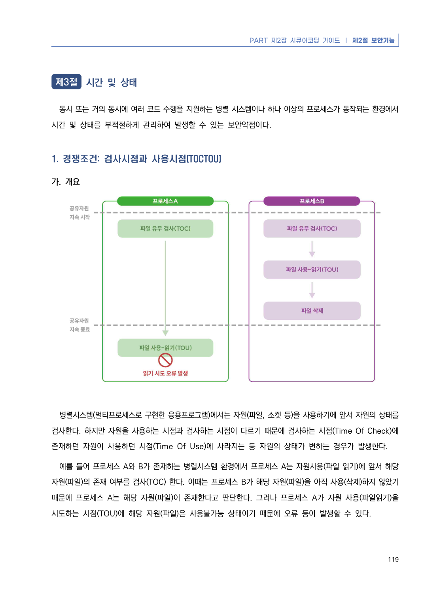
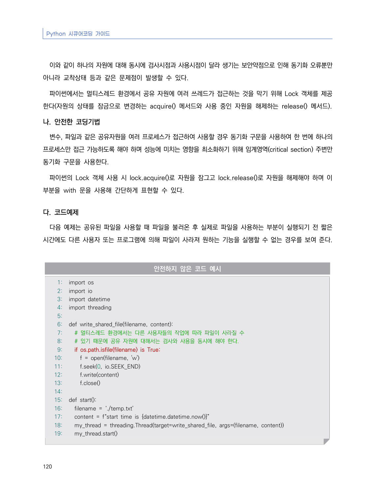
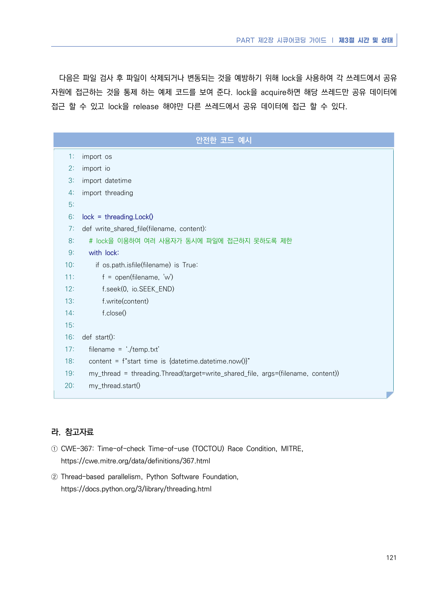

# 1. 경쟁조건: 검사시점과 사용시점(TOCTOU)

> 변환 안내(원문 외): 아래 본문은 PDF 텍스트를 추출한 전사입니다. 코드 줄번호·특수 공백·원문 오류를 유지했습니다. 실행용 코드가 아닙니다. 표·그림·들여쓰기는 연결된 페이지 이미지와 대조하세요. 페이지 경계의 줄바꿈을 보존하며, 동일 페이지가 여러 항목에 나뉘면 각 항목의 본문은 해당 구간만 포함합니다.

### PDF 125페이지 / 인쇄 119페이지

<!-- source-page:Python-2023:125; source-lines:1,5,6,7,8,9,10,11,12,13 -->

119

#### 1. 경쟁조건: 검사시점과 사용시점(TOCTOU)

#### 가. 개요

병렬시스템(멀티프로세스로 구현한 응용프로그램)에서는 자원(파일, 소켓 등)을 사용하기에 앞서 자원의 상태를 
검사한다. 하지만 자원을 사용하는 시점과 검사하는 시점이 다르기 때문에 검사하는 시점(Time Of Check)에 
존재하던 자원이 사용하던 시점(Time Of Use)에 사라지는 등 자원의 상태가 변하는 경우가 발생한다.

예를 들어 프로세스 A와 B가 존재하는 병렬시스템 환경에서 프로세스 A는 자원사용(파일 읽기)에 앞서 해당 
자원(파일)의 존재 여부를 검사(TOC) 한다. 이때는 프로세스 B가 해당 자원(파일)을 아직 사용(삭제)하지 않았기 
때문에 프로세스 A는 해당 자원(파일)이 존재한다고 판단한다. 그러나 프로세스 A가 자원 사용(파일읽기)을 
시도하는 시점(TOU)에 해당 자원(파일)은 사용불가능 상태이기 때문에 오류 등이 발생할 수 있다.

<details><summary>원본 페이지 이미지 (변환 외 보존 자료)</summary>



</details>

### PDF 126페이지 / 인쇄 120페이지

<!-- source-page:Python-2023:126; source-lines:0,1,2,3,4,5,6,7,8,9,10,11,12,13,14,15,16,17,18,19,20,21,22,23,24,25,26,27,28,29,30,31,32,33,34,35,36,37,38,39,40,41,42,43,44,45,46,47,48,49,50,51 -->

Python 시큐어코딩 가이드

120

이와 같이 하나의 자원에 대해 동시에 검사시점과 사용시점이 달라 생기는 보안약점으로 인해 동기화 오류뿐만 
아니라 교착상태 등과 같은 문제점이 발생할 수 있다.

파이썬에서는 멀티스레드 환경에서 공유 자원에 여러 쓰레드가 접근하는 것을 막기 위해 Lock 객체를 제공
한다(자원의 상태를 잠금으로 변경하는 acquire() 메서드와 사용 중인 자원을 해제하는 release() 메서드).

#### 나. 안전한 코딩기법

변수, 파일과 같은 공유자원을 여러 프로세스가 접근하여 사용할 경우 동기화 구문을 사용하여 한 번에 하나의 
프로세스만 접근 가능하도록 해야 하며 성능에 미치는 영향을 최소화하기 위해 임계영역(critical section) 주변만 
동기화 구문을 사용한다. 

파이썬의 Lock 객체 사용 시 lock.acquire()로 자원을 잠그고 lock.release()로 자원을 해제해야 하며 이 
부분을 with 문을 사용해 간단하게 표현할 수 있다.

#### 다. 코드예제

다음 예제는 공유된 파일을 사용할 때 파일을 불러온 후 실제로 파일을 사용하는 부분이 실행되기 전 짧은 
시간에도 다른 사용자 또는 프로그램에 의해 파일이 사라져 원하는 기능을 실행할 수 없는 경우를 보여 준다.

#### 안전하지 않은 코드 예시

```python
1: import os
2: import io
3: import datetime
4: import threading
5:
6: def write_shared_file(filename, content):
7:   # 멀티스레드 환경에서는 다른 사용자들의 작업에 따라 파일이 사라질 수
8:   # 있기 때문에 공유 자원에 대해서는 검사와 사용을 동시에 해야 한다.
9:   if os.path.isfile(filename) is True:
10:     f = open(filename, 'w')
11:     f.seek(0, io.SEEK_END)
12:     f.write(content)
13:     f.close()
14:
15: def start():
16:   filename = ‘./temp.txt’
17:   content = f“start time is {datetime.datetime.now()}”
18:   my_thread = threading.Thread(target=write_shared_file, args=(filename, content))
19:   my_thread.start()
```

<details><summary>원본 페이지 이미지 (변환 외 보존 자료)</summary>



</details>

### PDF 127페이지 / 인쇄 121페이지

<!-- source-page:Python-2023:127; source-lines:0,1,2,3,4,5,6,7,8,9,10,11,12,13,14,15,16,17,18,19,20,21,22,23,24,25,26,27,28,29,30,31,32,33,34,35,36,37,38,39,40,41,42,43,44,45,46,47,48 -->

PART 제2장 시큐어코딩 가이드 ❘ 제3절 시간 및 상태

121

다음은 파일 검사 후 파일이 삭제되거나 변동되는 것을 예방하기 위해 lock을 사용하여 각 쓰레드에서 공유
자원에 접근하는 것을 통제 하는 예제 코드를 보여 준다. lock을 acquire하면 해당 쓰레드만 공유 데이터에 
접근 할 수 있고 lock을 release 해야만 다른 쓰레드에서 공유 데이터에 접근 할 수 있다.

#### 안전한 코드 예시

```python
1: import os
2: import io
3: import datetime
4: import threading
5:
6: lock = threading.Lock()
7: def write_shared_file(filename, content):
8:   # lock을 이용하여 여러 사용자가 동시에 파일에 접근하지 못하도록 제한
9:   with lock:
10:     if os.path.isfile(filename) is True:
11:       f = open(filename, 'w')
12:       f.seek(0, io.SEEK_END)
13:       f.write(content)
14:       f.close()
15:
16: def start():
17:   filename = ‘./temp.txt’
18:   content = f“start time is {datetime.datetime.now()}”
19:   my_thread = threading.Thread(target=write_shared_file, args=(filename, content))
20:   my_thread.start()
```

#### 라. 참고자료

① CWE-367: Time-of-check Time-of-use (TOCTOU) Race Condition, MITRE,

https://cwe.mitre.org/data/definitions/367.html
② Thread-based parallelism, Python Software Foundation,

https://docs.python.org/3/library/threading.html

<details><summary>원본 페이지 이미지 (변환 외 보존 자료)</summary>



</details>

---

## 탐색 링크 (원문 외)

[통합 인덱스](../../../INDEX.md)

