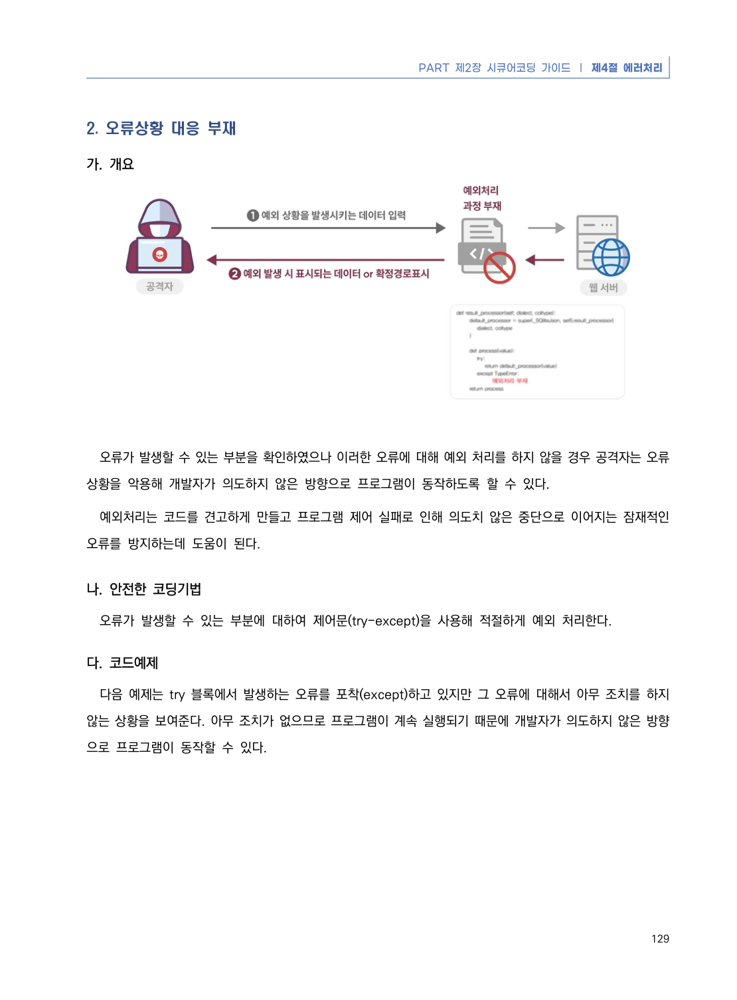
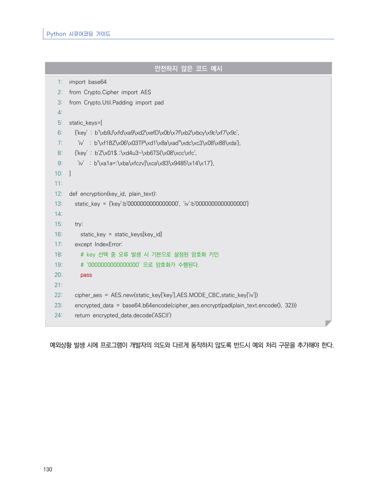
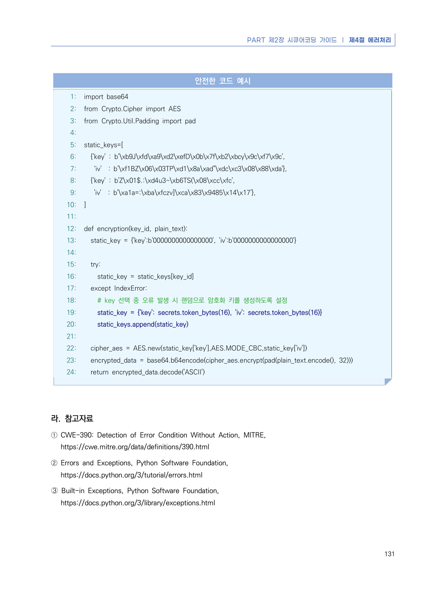

# 2. 오류상황 대응 부재

> 변환 안내(원문 외): 아래 본문은 PDF 텍스트를 추출한 전사입니다. 코드 줄번호·특수 공백·원문 오류를 유지했습니다. 실행용 코드가 아닙니다. 표·그림·들여쓰기는 연결된 페이지 이미지와 대조하세요. 페이지 경계의 줄바꿈을 보존하며, 동일 페이지가 여러 항목에 나뉘면 각 항목의 본문은 해당 구간만 포함합니다.

### PDF 135페이지 / 인쇄 129페이지

<!-- source-page:Python-2023:135; source-lines:0,1,2,3,4,5,6,7,8,9,10,11,12,13 -->

PART 제2장 시큐어코딩 가이드 ❘ 제4절 에러처리

129

#### 2. 오류상황 대응 부재

#### 가. 개요

오류가 발생할 수 있는 부분을 확인하였으나 이러한 오류에 대해 예외 처리를 하지 않을 경우 공격자는 오류 
상황을 악용해 개발자가 의도하지 않은 방향으로 프로그램이 동작하도록 할 수 있다.

예외처리는 코드를 견고하게 만들고 프로그램 제어 실패로 인해 의도치 않은 중단으로 이어지는 잠재적인 
오류를 방지하는데 도움이 된다.

#### 나. 안전한 코딩기법

오류가 발생할 수 있는 부분에 대하여 제어문(try-except)을 사용해 적절하게 예외 처리한다. 

#### 다. 코드예제

다음 예제는 try 블록에서 발생하는 오류를 포착(except)하고 있지만 그 오류에 대해서 아무 조치를 하지 
않는 상황을 보여준다. 아무 조치가 없으므로 프로그램이 계속 실행되기 때문에 개발자가 의도하지 않은 방향
으로 프로그램이 동작할 수 있다.

<details><summary>원본 페이지 이미지 (변환 외 보존 자료)</summary>



</details>

### PDF 136페이지 / 인쇄 130페이지

<!-- source-page:Python-2023:136; source-lines:0,1,2,3,4,5,6,7,8,9,10,11,12,13,14,15,16,17,18,19,20,21,22,23,24,25,26,27,28,29,30,31,32,33,34,35,36,37,38,39,40,41,42,43,44,45,46,47 -->

Python 시큐어코딩 가이드

130

#### 안전하지 않은 코드 예시

```python
1: import base64
2: from Crypto.Cipher import AES
3: from Crypto.Util.Padding import pad
4:
5: static_keys=[
6:   {'key' : b'\xb9J\xfd\xa9\xd2\xefD\x0b\x7f\xb2\xbcy\x9c\xf7\x9c',
7:    ‘iv'  : b'\xf1BZ\x06\x03TP\xd1\x8a\xad"\xdc\xc3\x08\x88\xda'}, 
8:   {'key' : b'Z\x01$.:\xd4u3~\xb6TS(\x08\xcc\xfc', 
9:    'iv'  : b'\xa1a=:\xba\xfczv]\xca\x83\x9485\x14\x17'},
10: ]
11:
12: def encryption(key_id, plain_text):
13:   static_key = {'key':b'0000000000000000', 'iv':b'0000000000000000'}
14:
15:   try:
16:     static_key = static_keys[key_id]
17:   except IndexError:
18:     # key 선택 중 오류 발생 시 기본으로 설정된 암호화 키인
19:     # ‘0000000000000000’ 으로 암호화가 수행된다.
20:     pass
21:
22:   cipher_aes = AES.new(static_key['key'],AES.MODE_CBC,static_key['iv'])
23:   encrypted_data = base64.b64encode(cipher_aes.encrypt(pad(plain_text.encode(), 32)))    
24:   return encrypted_data.decode('ASCII')
```

예외상황 발생 시에 프로그램이 개발자의 의도와 다르게 동작하지 않도록 반드시 예외 처리 구문을 추가해야 한다.

<details><summary>원본 페이지 이미지 (변환 외 보존 자료)</summary>



</details>

### PDF 137페이지 / 인쇄 131페이지

<!-- source-page:Python-2023:137; source-lines:0,1,2,3,4,5,6,7,8,9,10,11,12,13,14,15,16,17,18,19,20,21,22,23,24,25,26,27,28,29,30,31,32,33,34,35,36,37,38,39,40,41,42,43,44,45,46,47,48,49,50,51,52,53 -->

PART 제2장 시큐어코딩 가이드 ❘ 제4절 에러처리

131

#### 안전한 코드 예시

```python
1: import base64
2: from Crypto.Cipher import AES
3: from Crypto.Util.Padding import pad
4:
5: static_keys=[
6:   {'key' : b'\xb9J\xfd\xa9\xd2\xefD\x0b\x7f\xb2\xbcy\x9c\xf7\x9c',
7:    ‘iv'  : b'\xf1BZ\x06\x03TP\xd1\x8a\xad"\xdc\xc3\x08\x88\xda'}, 
8:   {'key' : b'Z\x01$.:\xd4u3~\xb6TS(\x08\xcc\xfc', 
9:    'iv'  : b'\xa1a=:\xba\xfczv]\xca\x83\x9485\x14\x17'},
10: ]
11:
12: def encryption(key_id, plain_text):
13:   static_key = {'key':b'0000000000000000', 'iv':b'0000000000000000'}
14:
15:   try:
16:     static_key = static_keys[key_id]
17:   except IndexError:
18:     # key 선택 중 오류 발생 시 랜덤으로 암호화 키를 생성하도록 설정
19:     static_key = {'key': secrets.token_bytes(16), 'iv': secrets.token_bytes(16)}
20:     static_keys.append(static_key)
21:
22:   cipher_aes = AES.new(static_key['key'],AES.MODE_CBC,static_key['iv'])
23:   encrypted_data = base64.b64encode(cipher_aes.encrypt(pad(plain_text.encode(), 32)))    
24:   return encrypted_data.decode('ASCII')
```

#### 라. 참고자료

① CWE-390: Detection of Error Condition Without Action, MITRE,

https://cwe.mitre.org/data/definitions/390.html
② Errors and Exceptions, Python Software Foundation,

https://docs.python.org/3/tutorial/errors.html
➂ Built-in Exceptions, Python Software Foundation,

https://docs.python.org/3/library/exceptions.html

<details><summary>원본 페이지 이미지 (변환 외 보존 자료)</summary>



</details>

---

## 탐색 링크 (원문 외)

[통합 인덱스](../../../INDEX.md)

