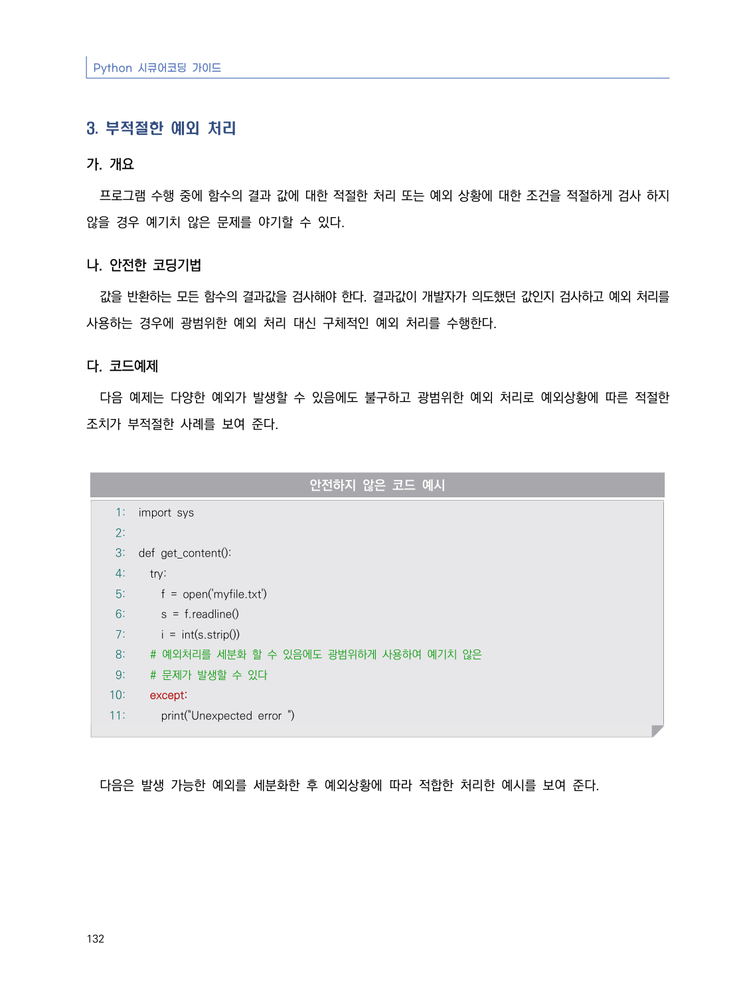
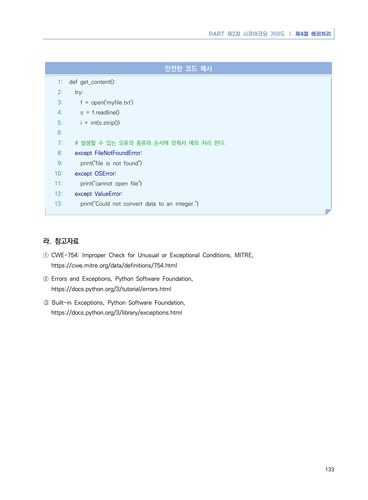

# 3. 부적절한 예외 처리

> 변환 안내(원문 외): 아래 본문은 PDF 텍스트를 추출한 전사입니다. 코드 줄번호·특수 공백·원문 오류를 유지했습니다. 실행용 코드가 아닙니다. 표·그림·들여쓰기는 연결된 페이지 이미지와 대조하세요. 페이지 경계의 줄바꿈을 보존하며, 동일 페이지가 여러 항목에 나뉘면 각 항목의 본문은 해당 구간만 포함합니다.

### PDF 138페이지 / 인쇄 132페이지

<!-- source-page:Python-2023:138; source-lines:0,1,2,3,4,5,6,7,8,9,10,11,12,13,14,15,16,17,18,19,20,21,22,23,24,25,26,27,28,29,30,31,32,33,34 -->

Python 시큐어코딩 가이드

132

#### 3. 부적절한 예외 처리

#### 가. 개요

프로그램 수행 중에 함수의 결과 값에 대한 적절한 처리 또는 예외 상황에 대한 조건을 적절하게 검사 하지 
않을 경우 예기치 않은 문제를 야기할 수 있다.

#### 나. 안전한 코딩기법

값을 반환하는 모든 함수의 결과값을 검사해야 한다. 결과값이 개발자가 의도했던 값인지 검사하고 예외 처리를 
사용하는 경우에 광범위한 예외 처리 대신 구체적인 예외 처리를 수행한다.

#### 다. 코드예제

다음 예제는 다양한 예외가 발생할 수 있음에도 불구하고 광범위한 예외 처리로 예외상황에 따른 적절한 
조치가 부적절한 사례를 보여 준다. 

#### 안전하지 않은 코드 예시

```python
1: import sys
2:
3: def get_content():
4:   try:
5:     f = open('myfile.txt')
6:     s = f.readline()
7:     i = int(s.strip())
8:   # 예외처리를 세분화 할 수 있음에도 광범위하게 사용하여 예기치 않은 
9:   # 문제가 발생할 수 있다
10:   except:
11:     print("Unexpected error ")
```

다음은 발생 가능한 예외를 세분화한 후 예외상황에 따라 적합한 처리한 예시를 보여 준다. 

<details><summary>원본 페이지 이미지 (변환 외 보존 자료)</summary>



</details>

### PDF 139페이지 / 인쇄 133페이지

<!-- source-page:Python-2023:139; source-lines:0,1,2,3,4,5,6,7,8,9,10,11,12,13,14,15,16,17,18,19,20,21,22,23,24,25,26,27,28,29,30,31,32,33,34 -->

PART 제2장 시큐어코딩 가이드 ❘ 제4절 에러처리

133

#### 안전한 코드 예시

```python
1: def get_content():
2:   try:
3:     f = open('myfile.txt')
4:     s = f.readline()
5:     i = int(s.strip())
6:
7:   # 발생할 수 있는 오류의 종류와 순서에 맞춰서 예외 처리 한다.
8:   except FileNotFoundError:
9:     print("file is not found")
10:   except OSError:
11:     print("cannot open file")
12:   except ValueError:
13:     print("Could not convert data to an integer.")
```

#### 라. 참고자료

① CWE-754: Improper Check for Unusual or Exceptional Conditions, MITRE,

https://cwe.mitre.org/data/definitions/754.html
② Errors and Exceptions, Python Software Foundation,

https://docs.python.org/3/tutorial/errors.html
➂ Built-in Exceptions, Python Software Foundation,

https://docs.python.org/3/library/exceptions.html

<details><summary>원본 페이지 이미지 (변환 외 보존 자료)</summary>



</details>

---

## 탐색 링크 (원문 외)

[통합 인덱스](../../../INDEX.md)

