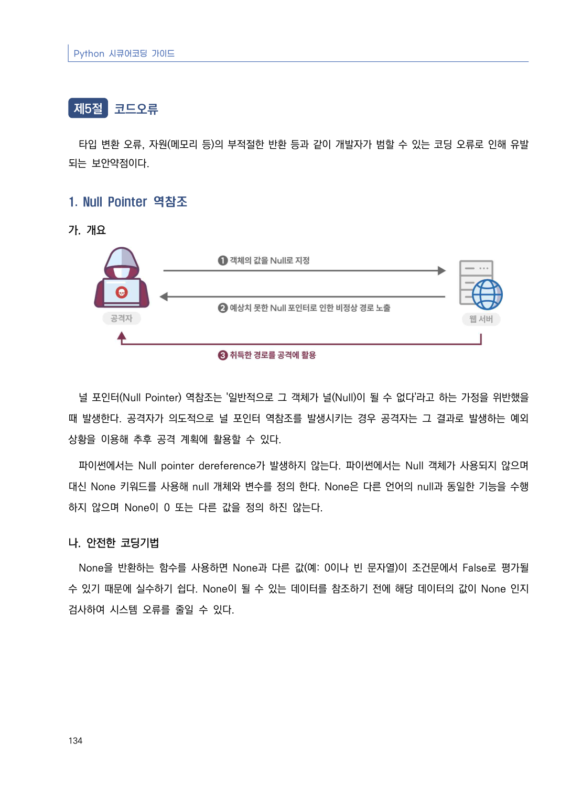
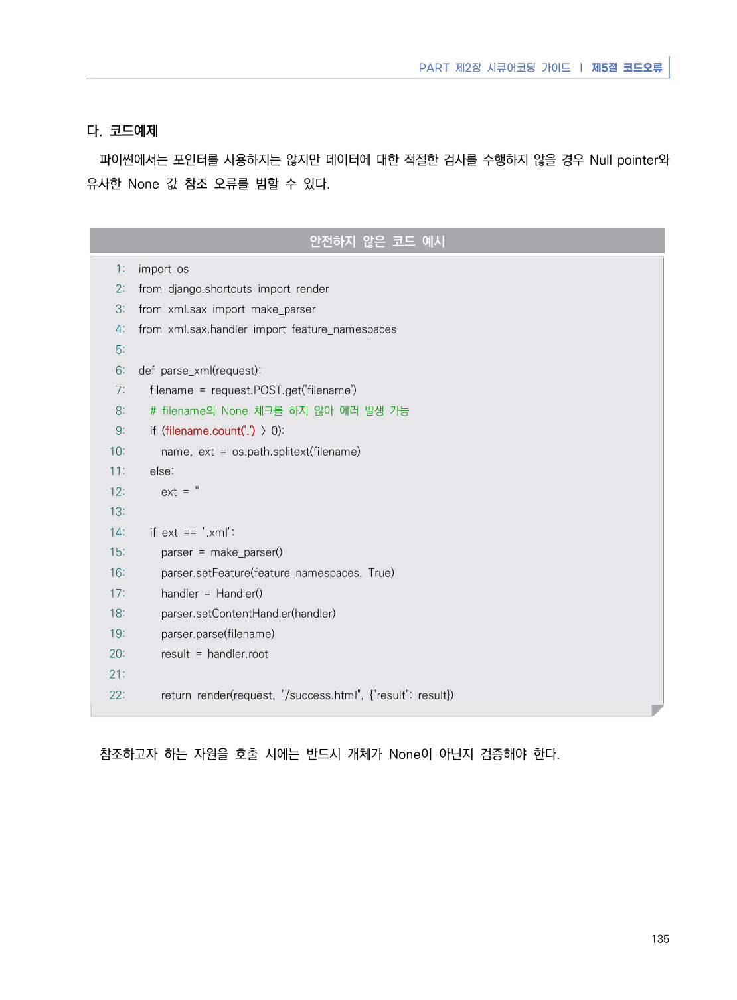
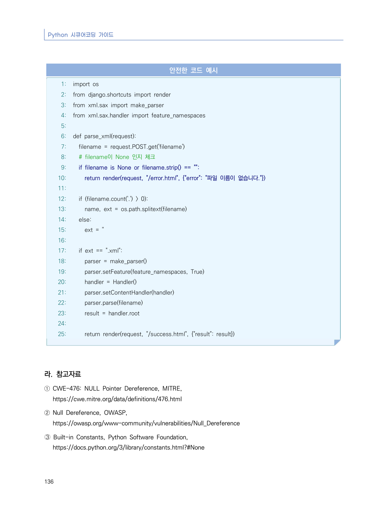

# 1. Null Pointer 역참조

> 변환 안내(원문 외): 아래 본문은 PDF 텍스트를 추출한 전사입니다. 코드 줄번호·특수 공백·원문 오류를 유지했습니다. 실행용 코드가 아닙니다. 표·그림·들여쓰기는 연결된 페이지 이미지와 대조하세요. 페이지 경계의 줄바꿈을 보존하며, 동일 페이지가 여러 항목에 나뉘면 각 항목의 본문은 해당 구간만 포함합니다.

### PDF 140페이지 / 인쇄 134페이지

<!-- source-page:Python-2023:140; source-lines:1,5,6,7,8,9,10,11,12,13,14,15,16 -->

134

#### 1. Null Pointer 역참조

#### 가. 개요

널 포인터(Null Pointer) 역참조는 '일반적으로 그 객체가 널(Null)이 될 수 없다'라고 하는 가정을 위반했을 
때 발생한다. 공격자가 의도적으로 널 포인터 역참조를 발생시키는 경우 공격자는 그 결과로 발생하는 예외 
상황을 이용해 추후 공격 계획에 활용할 수 있다.

파이썬에서는 Null pointer dereference가 발생하지 않는다. 파이썬에서는 Null 객체가 사용되지 않으며 
대신 None 키워드를 사용해 null 개체와 변수를 정의 한다. None은 다른 언어의 null과 동일한 기능을 수행
하지 않으며 None이 0 또는 다른 값을 정의 하진 않는다.

#### 나. 안전한 코딩기법

None을 반환하는 함수를 사용하면 None과 다른 값(예: 0이나 빈 문자열)이 조건문에서 False로 평가될 
수 있기 때문에 실수하기 쉽다. None이 될 수 있는 데이터를 참조하기 전에 해당 데이터의 값이 None 인지 
검사하여 시스템 오류를 줄일 수 있다.

<details><summary>원본 페이지 이미지 (변환 외 보존 자료)</summary>



</details>

### PDF 141페이지 / 인쇄 135페이지

<!-- source-page:Python-2023:141; source-lines:0,1,2,3,4,5,6,7,8,9,10,11,12,13,14,15,16,17,18,19,20,21,22,23,24,25,26,27,28,29,30,31,32,33,34,35,36,37,38,39,40,41,42,43,44,45,46,47 -->

PART 제2장 시큐어코딩 가이드 ❘ 제5절 코드오류

135

#### 다. 코드예제

파이썬에서는 포인터를 사용하지는 않지만 데이터에 대한 적절한 검사를 수행하지 않을 경우 Null pointer와 
유사한 None 값 참조 오류를 범할 수 있다.

#### 안전하지 않은 코드 예시

```python
1: import os
2: from django.shortcuts import render
3: from xml.sax import make_parser
4: from xml.sax.handler import feature_namespaces
5:
6: def parse_xml(request):
7:   filename = request.POST.get('filename')
8:   # filename의 None 체크를 하지 않아 에러 발생 가능
9:   if (filename.count('.') > 0):
10:     name, ext = os.path.splitext(filename)
11:   else:
12:     ext = ''
13:
14:   if ext == ".xml":
15:     parser = make_parser()
16:     parser.setFeature(feature_namespaces, True)
17:     handler = Handler()
18:     parser.setContentHandler(handler)
19:     parser.parse(filename)
20:     result = handler.root
21:
22:     return render(request, "/success.html", {"result": result})
```

참조하고자 하는 자원을 호출 시에는 반드시 개체가 None이 아닌지 검증해야 한다.

<details><summary>원본 페이지 이미지 (변환 외 보존 자료)</summary>



</details>

### PDF 142페이지 / 인쇄 136페이지

<!-- source-page:Python-2023:142; source-lines:0,1,2,3,4,5,6,7,8,9,10,11,12,13,14,15,16,17,18,19,20,21,22,23,24,25,26,27,28,29,30,31,32,33,34,35,36,37,38,39,40,41,42,43,44,45,46,47,48,49,50,51,52,53,54,55 -->

Python 시큐어코딩 가이드

136

#### 안전한 코드 예시

```python
1: import os
2: from django.shortcuts import render
3: from xml.sax import make_parser
4: from xml.sax.handler import feature_namespaces
5:
6: def parse_xml(request):
7:   filename = request.POST.get('filename')
8:   # filename이 None 인지 체크
9:   if filename is None or filename.strip() == "":
10:     return render(request, "/error.html", {"error": "파일 이름이 없습니다."})
11:
12:   if (filename.count('.') > 0):
13:     name, ext = os.path.splitext(filename)
14:   else:
15:     ext = ''
16:
17:   if ext == ".xml":
18:     parser = make_parser()
19:     parser.setFeature(feature_namespaces, True)
20:     handler = Handler()
21:     parser.setContentHandler(handler)
22:     parser.parse(filename)
23:     result = handler.root
24:
25:     return render(request, "/success.html", {"result": result})
```

#### 라. 참고자료

① CWE-476: NULL Pointer Dereference, MITRE,

https://cwe.mitre.org/data/definitions/476.html
② Null Dereference, OWASP,

https://owasp.org/www-community/vulnerabilities/Null_Dereference
➂ Built-in Constants, Python Software Foundation,

https://docs.python.org/3/library/constants.html?#None

<details><summary>원본 페이지 이미지 (변환 외 보존 자료)</summary>



</details>

---

## 탐색 링크 (원문 외)

[통합 인덱스](../../../INDEX.md)

