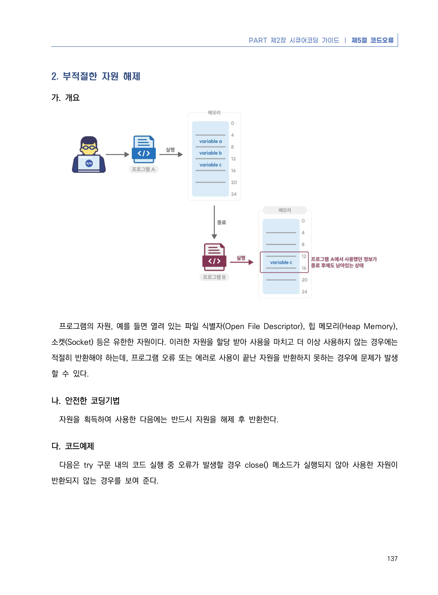
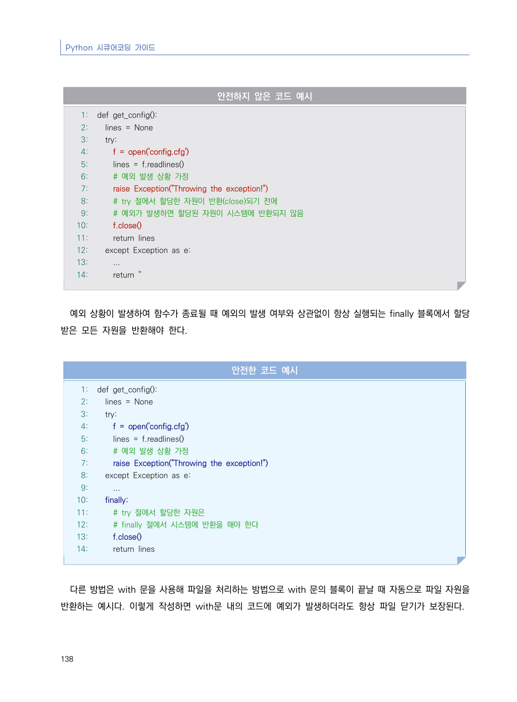
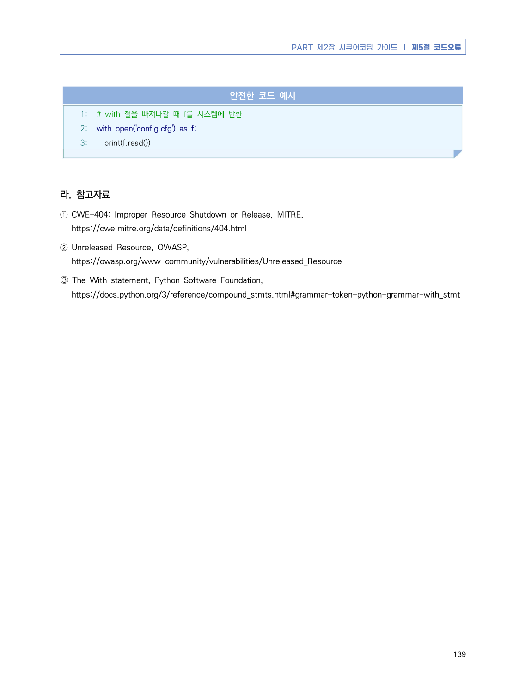

# 2. 부적절한 자원 해제

> 변환 안내(원문 외): 아래 본문은 PDF 텍스트를 추출한 전사입니다. 코드 줄번호·특수 공백·원문 오류를 유지했습니다. 실행용 코드가 아닙니다. 표·그림·들여쓰기는 연결된 페이지 이미지와 대조하세요. 페이지 경계의 줄바꿈을 보존하며, 동일 페이지가 여러 항목에 나뉘면 각 항목의 본문은 해당 구간만 포함합니다.

### PDF 143페이지 / 인쇄 137페이지

<!-- source-page:Python-2023:143; source-lines:0,1,2,3,4,5,6,7,8,9,10,11,12 -->

PART 제2장 시큐어코딩 가이드 ❘ 제5절 코드오류

137

#### 2. 부적절한 자원 해제

#### 가. 개요

프로그램의 자원, 예를 들면 열려 있는 파일 식별자(Open File Descriptor), 힙 메모리(Heap Memory), 
소켓(Socket) 등은 유한한 자원이다. 이러한 자원을 할당 받아 사용을 마치고 더 이상 사용하지 않는 경우에는 
적절히 반환해야 하는데, 프로그램 오류 또는 에러로 사용이 끝난 자원을 반환하지 못하는 경우에 문제가 발생
할 수 있다.

#### 나. 안전한 코딩기법

자원을 획득하여 사용한 다음에는 반드시 자원을 해제 후 반환한다.

#### 다. 코드예제

다음은 try 구문 내의 코드 실행 중 오류가 발생할 경우 close() 메소드가 실행되지 않아 사용한 자원이 
반환되지 않는 경우를 보여 준다.

<details><summary>원본 페이지 이미지 (변환 외 보존 자료)</summary>



</details>

### PDF 144페이지 / 인쇄 138페이지

<!-- source-page:Python-2023:144; source-lines:0,1,2,3,4,5,6,7,8,9,10,11,12,13,14,15,16,17,18,19,20,21,22,23,24,25,26,27,28,29,30,31,32,33,34,35,36,37,38,39,40,41,42,43,44,45,46,47,48,49,50,51,52,53,54,55,56,57,58,59,60,61,62,63 -->

Python 시큐어코딩 가이드

138

#### 안전하지 않은 코드 예시

```python
1: def get_config():
2:   lines = None
3:   try:
4:     f = open('config.cfg')
5:     lines = f.readlines()
6:     # 예외 발생 상황 가정
7:     raise Exception("Throwing the exception!")
8:     # try 절에서 할당한 자원이 반환(close)되기 전에
9:     # 예외가 발생하면 할당된 자원이 시스템에 반환되지 않음
10:     f.close()
11:     return lines
12:   except Exception as e:
13:     ...
14:     return ''
```

예외 상황이 발생하여 함수가 종료될 때 예외의 발생 여부와 상관없이 항상 실행되는 finally 블록에서 할당 
받은 모든 자원을 반환해야 한다.

#### 안전한 코드 예시

```python
1: def get_config():
2:   lines = None
3:   try:
4:     f = open('config.cfg')
5:     lines = f.readlines()
6:     # 예외 발생 상황 가정
7:     raise Exception("Throwing the exception!")
8:   except Exception as e:
9:     ...
10:   finally:
11:     # try 절에서 할당한 자원은
12:     # finally 절에서 시스템에 반환을 해야 한다
13:     f.close()
14:     return lines
```

다른 방법은 with 문을 사용해 파일을 처리하는 방법으로 with 문의 블록이 끝날 때 자동으로 파일 자원을 
반환하는 예시다. 이렇게 작성하면 with문 내의 코드에 예외가 발생하더라도 항상 파일 닫기가 보장된다.

<details><summary>원본 페이지 이미지 (변환 외 보존 자료)</summary>



</details>

### PDF 145페이지 / 인쇄 139페이지

<!-- source-page:Python-2023:145; source-lines:0,1,2,3,4,5,6,7,8,9,10,11,12,13,14,15 -->

PART 제2장 시큐어코딩 가이드 ❘ 제5절 코드오류

139

#### 안전한 코드 예시

```python
1: # with 절을 빠져나갈 때 f를 시스템에 반환
2: with open('config.cfg') as f:
3:   print(f.read())
```

#### 라. 참고자료

① CWE-404: Improper Resource Shutdown or Release, MITRE,

https://cwe.mitre.org/data/definitions/404.html
② Unreleased Resource, OWASP,

https://owasp.org/www-community/vulnerabilities/Unreleased_Resource
➂ The With statement, Python Software Foundation,

https://docs.python.org/3/reference/compound_stmts.html#grammar-token-python-grammar-with_stmt

<details><summary>원본 페이지 이미지 (변환 외 보존 자료)</summary>



</details>

---

## 탐색 링크 (원문 외)

[통합 인덱스](../../../INDEX.md)

