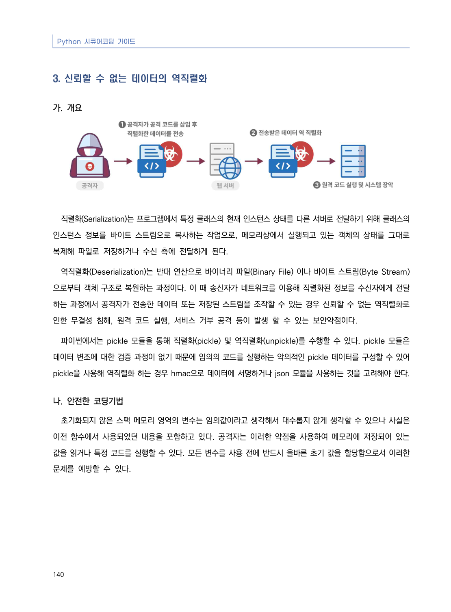
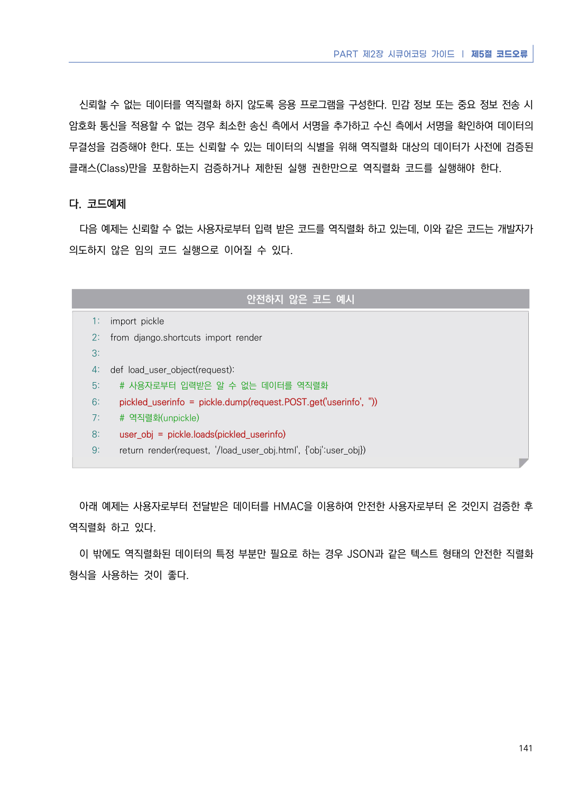
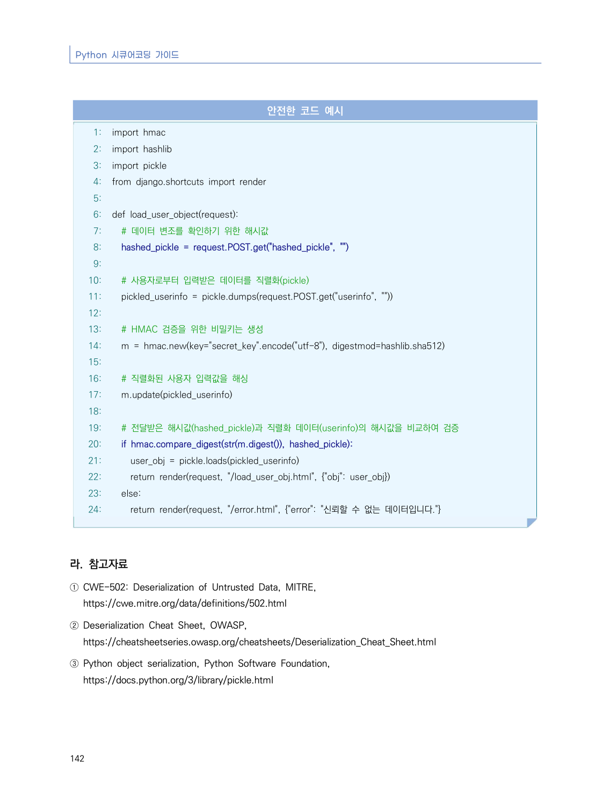

# 3. 신뢰할 수 없는 데이터의 역직렬화

> 변환 안내(원문 외): 아래 본문은 PDF 텍스트를 추출한 전사입니다. 코드 줄번호·특수 공백·원문 오류를 유지했습니다. 실행용 코드가 아닙니다. 표·그림·들여쓰기는 연결된 페이지 이미지와 대조하세요. 페이지 경계의 줄바꿈을 보존하며, 동일 페이지가 여러 항목에 나뉘면 각 항목의 본문은 해당 구간만 포함합니다.

### PDF 146페이지 / 인쇄 140페이지

<!-- source-page:Python-2023:146; source-lines:0,1,2,3,4,5,6,7,8,9,10,11,12,13,14,15,16,17,18 -->

Python 시큐어코딩 가이드

140

#### 3. 신뢰할 수 없는 데이터의 역직렬화

#### 가. 개요

직렬화(Serialization)는 프로그램에서 특정 클래스의 현재 인스턴스 상태를 다른 서버로 전달하기 위해 클래스의 
인스턴스 정보를 바이트 스트림으로 복사하는 작업으로, 메모리상에서 실행되고 있는 객체의 상태를 그대로 
복제해 파일로 저장하거나 수신 측에 전달하게 된다.

역직렬화(Deserialization)는 반대 연산으로 바이너리 파일(Binary File) 이나 바이트 스트림(Byte Stream)
으로부터 객체 구조로 복원하는 과정이다. 이 때 송신자가 네트워크를 이용해 직렬화된 정보를 수신자에게 전달
하는 과정에서 공격자가 전송한 데이터 또는 저장된 스트림을 조작할 수 있는 경우 신뢰할 수 없는 역직렬화로 
인한 무결성 침해, 원격 코드 실행, 서비스 거부 공격 등이 발생 할 수 있는 보안약점이다.

파이썬에서는 pickle 모듈을 통해 직렬화(pickle) 및 역직렬화(unpickle)를 수행할 수 있다. pickle 모듈은 
데이터 변조에 대한 검증 과정이 없기 때문에 임의의 코드를 실행하는 악의적인 pickle 데이터를 구성할 수 있어 
pickle을 사용해 역직렬화 하는 경우 hmac으로 데이터에 서명하거나 json 모듈을 사용하는 것을 고려해야 한다.

#### 나. 안전한 코딩기법

초기화되지 않은 스택 메모리 영역의 변수는 임의값이라고 생각해서 대수롭지 않게 생각할 수 있으나 사실은 
이전 함수에서 사용되었던 내용을 포함하고 있다. 공격자는 이러한 약점을 사용하여 메모리에 저장되어 있는 
값을 읽거나 특정 코드를 실행할 수 있다. 모든 변수를 사용 전에 반드시 올바른 초기 값을 할당함으로서 이러한 
문제를 예방할 수 있다. 

<details><summary>원본 페이지 이미지 (변환 외 보존 자료)</summary>



</details>

### PDF 147페이지 / 인쇄 141페이지

<!-- source-page:Python-2023:147; source-lines:0,1,2,3,4,5,6,7,8,9,10,11,12,13,14,15,16,17,18,19,20,21,22,23,24,25,26,27,28,29,30 -->

PART 제2장 시큐어코딩 가이드 ❘ 제5절 코드오류

141

신뢰할 수 없는 데이터를 역직렬화 하지 않도록 응용 프로그램을 구성한다. 민감 정보 또는 중요 정보 전송 시 
암호화 통신을 적용할 수 없는 경우 최소한 송신 측에서 서명을 추가하고 수신 측에서 서명을 확인하여 데이터의 
무결성을 검증해야 한다. 또는 신뢰할 수 있는 데이터의 식별을 위해 역직렬화 대상의 데이터가 사전에 검증된 
클래스(Class)만을 포함하는지 검증하거나 제한된 실행 권한만으로 역직렬화 코드를 실행해야 한다. 

#### 다. 코드예제

다음 예제는 신뢰할 수 없는 사용자로부터 입력 받은 코드를 역직렬화 하고 있는데, 이와 같은 코드는 개발자가 
의도하지 않은 임의 코드 실행으로 이어질 수 있다.

#### 안전하지 않은 코드 예시

```python
1: import pickle
2: from django.shortcuts import render
3:
4: def load_user_object(request):
5:   # 사용자로부터 입력받은 알 수 없는 데이터를 역직렬화
6:   pickled_userinfo = pickle.dump(request.POST.get('userinfo', ''))
7:   # 역직렬화(unpickle)
8:   user_obj = pickle.loads(pickled_userinfo)
9:   return render(request, '/load_user_obj.html', {'obj':user_obj})
```

아래 예제는 사용자로부터 전달받은 데이터를 HMAC을 이용하여 안전한 사용자로부터 온 것인지 검증한 후 
역직렬화 하고 있다.

이 밖에도 역직렬화된 데이터의 특정 부분만 필요로 하는 경우 JSON과 같은 텍스트 형태의 안전한 직렬화 
형식을 사용하는 것이 좋다.

<details><summary>원본 페이지 이미지 (변환 외 보존 자료)</summary>



</details>

### PDF 148페이지 / 인쇄 142페이지

<!-- source-page:Python-2023:148; source-lines:0,1,2,3,4,5,6,7,8,9,10,11,12,13,14,15,16,17,18,19,20,21,22,23,24,25,26,27,28,29,30,31,32,33,34,35,36,37,38,39,40,41,42,43,44,45,46,47,48,49,50,51,52 -->

Python 시큐어코딩 가이드

142

#### 안전한 코드 예시

```python
1: import hmac
2: import hashlib
3: import pickle
4: from django.shortcuts import render
5:
6: def load_user_object(request):
7:   # 데이터 변조를 확인하기 위한 해시값
8:   hashed_pickle = request.POST.get("hashed_pickle", "")
9:
10:   # 사용자로부터 입력받은 데이터를 직렬화(pickle)
11:   pickled_userinfo = pickle.dumps(request.POST.get("userinfo", ""))
12:
13:   # HMAC 검증을 위한 비밀키는 생성
14:   m = hmac.new(key="secret_key".encode("utf-8"), digestmod=hashlib.sha512)
15:
16:   # 직렬화된 사용자 입력값을 해싱
17:   m.update(pickled_userinfo)
18:
19:   # 전달받은 해시값(hashed_pickle)과 직렬화 데이터(userinfo)의 해시값을 비교하여 검증
20:   if hmac.compare_digest(str(m.digest()), hashed_pickle):
21:     user_obj = pickle.loads(pickled_userinfo)
22:     return render(request, "/load_user_obj.html", {"obj": user_obj})
23:   else:
24:     return render(request, "/error.html", {"error": "신뢰할 수 없는 데이터입니다."}
```

#### 라. 참고자료

① CWE-502: Deserialization of Untrusted Data, MITRE,

https://cwe.mitre.org/data/definitions/502.html
② Deserialization Cheat Sheet, OWASP, 

https://cheatsheetseries.owasp.org/cheatsheets/Deserialization_Cheat_Sheet.html
③ Python object serialization, Python Software Foundation,

https://docs.python.org/3/library/pickle.html

<details><summary>원본 페이지 이미지 (변환 외 보존 자료)</summary>



</details>

---

## 탐색 링크 (원문 외)

[통합 인덱스](../../../INDEX.md)

