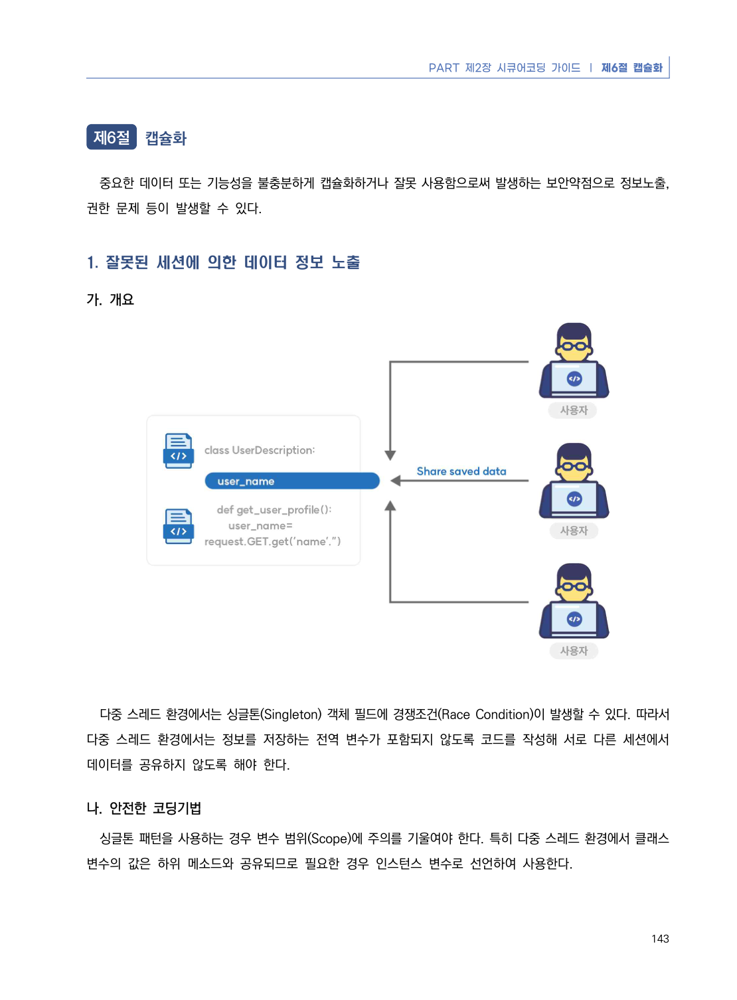
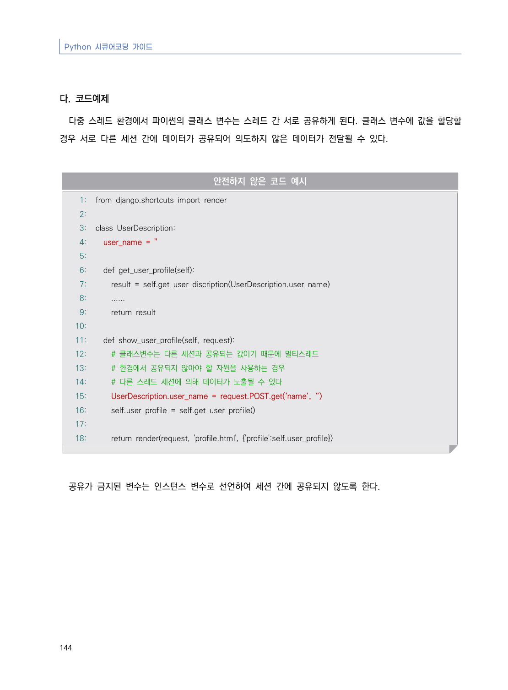
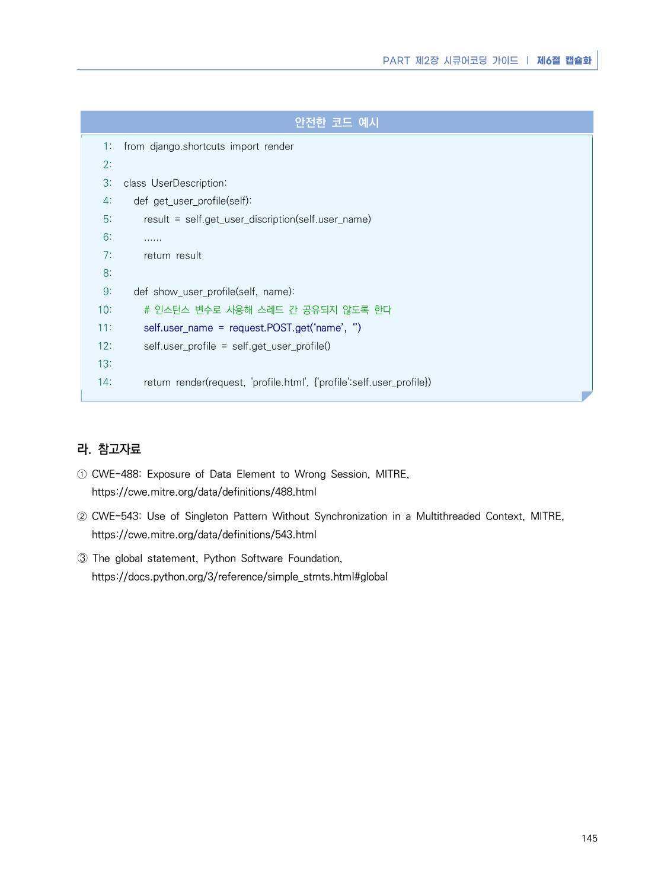

# 1. 잘못된 세션에 의한 데이터 정보 노출

> 변환 안내(원문 외): 아래 본문은 PDF 텍스트를 추출한 전사입니다. 코드 줄번호·특수 공백·원문 오류를 유지했습니다. 실행용 코드가 아닙니다. 표·그림·들여쓰기는 연결된 페이지 이미지와 대조하세요. 페이지 경계의 줄바꿈을 보존하며, 동일 페이지가 여러 항목에 나뉘면 각 항목의 본문은 해당 구간만 포함합니다.

### PDF 149페이지 / 인쇄 143페이지

<!-- source-page:Python-2023:149; source-lines:1,5,6,7,8,9,10,11,12 -->

143

#### 1. 잘못된 세션에 의한 데이터 정보 노출

#### 가. 개요

다중 스레드 환경에서는 싱글톤(Singleton) 객체 필드에 경쟁조건(Race Condition)이 발생할 수 있다. 따라서 
다중 스레드 환경에서는 정보를 저장하는 전역 변수가 포함되지 않도록 코드를 작성해 서로 다른 세션에서 
데이터를 공유하지 않도록 해야 한다.

#### 나. 안전한 코딩기법

싱글톤 패턴을 사용하는 경우 변수 범위(Scope)에 주의를 기울여야 한다. 특히 다중 스레드 환경에서 클래스 
변수의 값은 하위 메소드와 공유되므로 필요한 경우 인스턴스 변수로 선언하여 사용한다. 

<details><summary>원본 페이지 이미지 (변환 외 보존 자료)</summary>



</details>

### PDF 150페이지 / 인쇄 144페이지

<!-- source-page:Python-2023:150; source-lines:0,1,2,3,4,5,6,7,8,9,10,11,12,13,14,15,16,17,18,19,20,21,22,23,24,25,26,27,28,29,30,31,32,33,34,35,36,37,38,39,40 -->

Python 시큐어코딩 가이드

144

#### 다. 코드예제

다중 스레드 환경에서 파이썬의 클래스 변수는 스레드 간 서로 공유하게 된다. 클래스 변수에 값을 할당할 
경우 서로 다른 세션 간에 데이터가 공유되어 의도하지 않은 데이터가 전달될 수 있다.

#### 안전하지 않은 코드 예시

```python
1: from django.shortcuts import render
2:
3: class UserDescription:
4:   user_name = ''
5:   
6:   def get_user_profile(self):
7:     result = self.get_user_discription(UserDescription.user_name)
8:     ......
9:     return result
10:
11:   def show_user_profile(self, request):
12:     # 클래스변수는 다른 세션과 공유되는 값이기 때문에 멀티스레드 
13:     # 환경에서 공유되지 않아야 할 자원을 사용하는 경우 
14:     # 다른 스레드 세션에 의해 데이터가 노출될 수 있다
15:     UserDescription.user_name = request.POST.get(‘name’, ‘’)
16:     self.user_profile = self.get_user_profile()
17:     
18:     return render(request, 'profile.html', {'profile':self.user_profile})
```

공유가 금지된 변수는 인스턴스 변수로 선언하여 세션 간에 공유되지 않도록 한다.

<details><summary>원본 페이지 이미지 (변환 외 보존 자료)</summary>



</details>

### PDF 151페이지 / 인쇄 145페이지

<!-- source-page:Python-2023:151; source-lines:0,1,2,3,4,5,6,7,8,9,10,11,12,13,14,15,16,17,18,19,20,21,22,23,24,25,26,27,28,29,30,31,32,33,34,35 -->

PART 제2장 시큐어코딩 가이드 ❘ 제6절 캡슐화

145

#### 안전한 코드 예시

```python
1: from django.shortcuts import render
2:
3: class UserDescription:   
4:   def get_user_profile(self):
5:     result = self.get_user_discription(self.user_name)
6:     ......
7:     return result
8:
9:   def show_user_profile(self, name):
10:     # 인스턴스 변수로 사용해 스레드 간 공유되지 않도록 한다
11:     self.user_name = request.POST.get(‘name’, ‘’)
12:     self.user_profile = self.get_user_profile()
13:     
14:     return render(request, 'profile.html', {'profile':self.user_profile})
```

#### 라. 참고자료

① CWE-488: Exposure of Data Element to Wrong Session, MITRE,

https://cwe.mitre.org/data/definitions/488.html
② CWE-543: Use of Singleton Pattern Without Synchronization in a Multithreaded Context, MITRE,

https://cwe.mitre.org/data/definitions/543.html
➂ The global statement, Python Software Foundation,

https://docs.python.org/3/reference/simple_stmts.html#global

<details><summary>원본 페이지 이미지 (변환 외 보존 자료)</summary>



</details>

---

## 탐색 링크 (원문 외)

[통합 인덱스](../../../INDEX.md)

