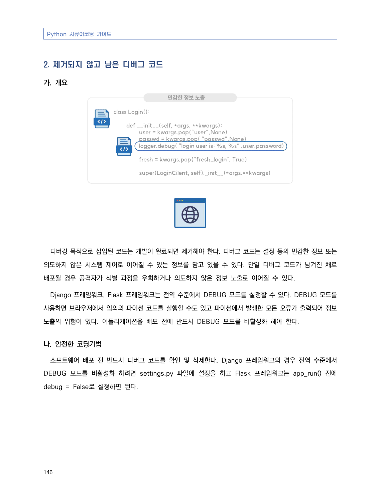
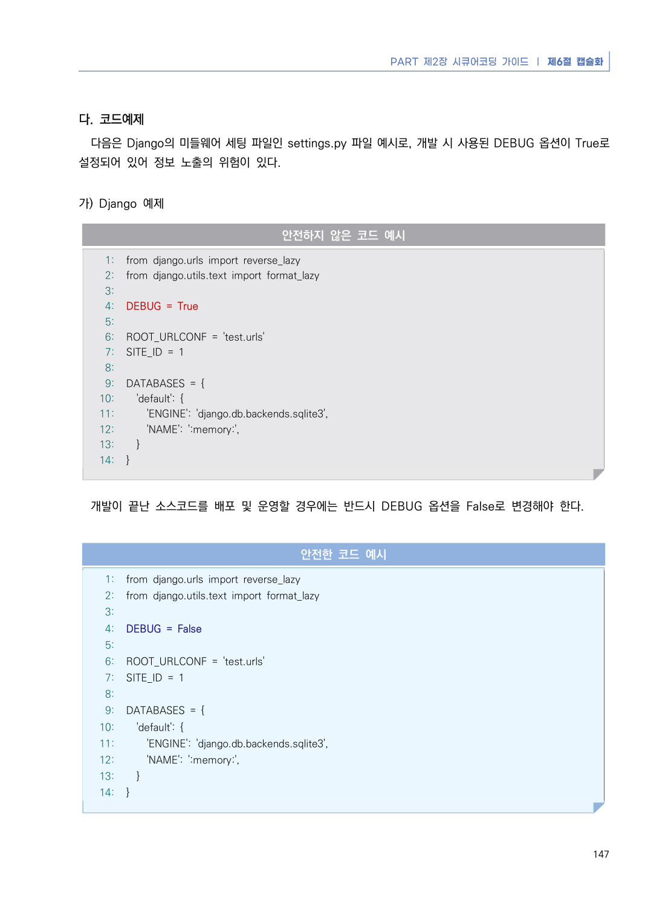
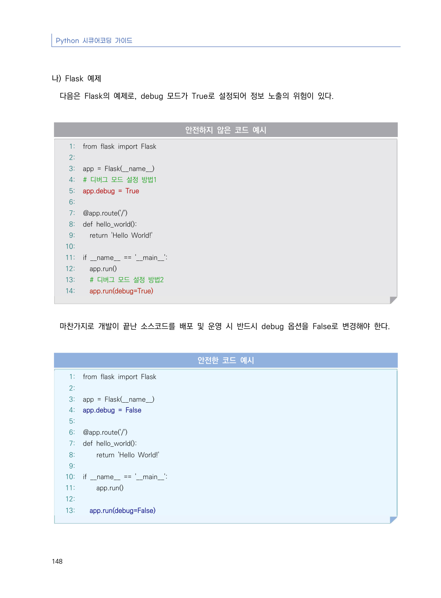
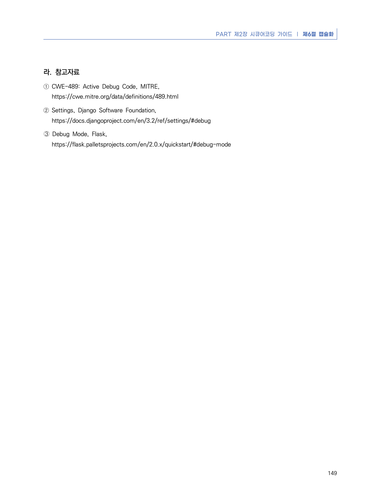

# 2. 제거되지 않고 남은 디버그 코드

> 변환 안내(원문 외): 아래 본문은 PDF 텍스트를 추출한 전사입니다. 코드 줄번호·특수 공백·원문 오류를 유지했습니다. 실행용 코드가 아닙니다. 표·그림·들여쓰기는 연결된 페이지 이미지와 대조하세요. 페이지 경계의 줄바꿈을 보존하며, 동일 페이지가 여러 항목에 나뉘면 각 항목의 본문은 해당 구간만 포함합니다.

### PDF 152페이지 / 인쇄 146페이지

<!-- source-page:Python-2023:152; source-lines:0,1,2,3,4,5,6,7,8,9,10,11,12,13 -->

Python 시큐어코딩 가이드

146

#### 2. 제거되지 않고 남은 디버그 코드

#### 가. 개요

디버깅 목적으로 삽입된 코드는 개발이 완료되면 제거해야 한다. 디버그 코드는 설정 등의 민감한 정보 또는 
의도하지 않은 시스템 제어로 이어질 수 있는 정보를 담고 있을 수 있다. 만일 디버그 코드가 남겨진 채로 
배포될 경우 공격자가 식별 과정을 우회하거나 의도하지 않은 정보 노출로 이어질 수 있다.

Django 프레임워크, Flask 프레임워크는 전역 수준에서 DEBUG 모드를 설정할 수 있다. DEBUG 모드를 
사용하면 브라우저에서 임의의 파이썬 코드를 실행할 수도 있고 파이썬에서 발생한 모든 오류가 출력되어 정보 
노출의 위험이 있다. 어플리케이션을 배포 전에 반드시 DEBUG 모드를 비활성화 해야 한다.

#### 나. 안전한 코딩기법

소프트웨어 배포 전 반드시 디버그 코드를 확인 및 삭제한다. Django 프레임워크의 경우 전역 수준에서 
DEBUG 모드를 비활성화 하려면 settings.py 파일에 설정을 하고 Flask 프레임워크는 app_run() 전에 
debug = False로 설정하면 된다.

<details><summary>원본 페이지 이미지 (변환 외 보존 자료)</summary>



</details>

### PDF 153페이지 / 인쇄 147페이지

<!-- source-page:Python-2023:153; source-lines:0,1,2,3,4,5,6,7,8,9,10,11,12,13,14,15,16,17,18,19,20,21,22,23,24,25,26,27,28,29,30,31,32,33,34,35,36,37,38,39,40,41,42,43,44,45,46,47,48,49,50,51,52,53,54,55,56,57,58 -->

PART 제2장 시큐어코딩 가이드 ❘ 제6절 캡슐화

147

#### 다. 코드예제

다음은 Django의 미들웨어 세팅 파일인 settings.py 파일 예시로, 개발 시 사용된 DEBUG 옵션이 True로 
설정되어 있어 정보 노출의 위험이 있다.

#### 가) Django 예제

#### 안전하지 않은 코드 예시

```python
1: from django.urls import reverse_lazy
2: from django.utils.text import format_lazy
3:
4: DEBUG = True
5:
6: ROOT_URLCONF = 'test.urls'
7: SITE_ID = 1
8:
9: DATABASES = {
10:   'default': {
11:     'ENGINE': 'django.db.backends.sqlite3',
12:     'NAME': ':memory:',
13:   }
14: }
```

개발이 끝난 소스코드를 배포 및 운영할 경우에는 반드시 DEBUG 옵션을 False로 변경해야 한다.

#### 안전한 코드 예시

```python
1: from django.urls import reverse_lazy
2: from django.utils.text import format_lazy
3:
4: DEBUG = False
5:
6: ROOT_URLCONF = 'test.urls'
7: SITE_ID = 1
8:
9: DATABASES = {
10:   'default': {
11:     'ENGINE': 'django.db.backends.sqlite3',
12:     'NAME': ':memory:',
13:   }
14: }
```

<details><summary>원본 페이지 이미지 (변환 외 보존 자료)</summary>



</details>

### PDF 154페이지 / 인쇄 148페이지

<!-- source-page:Python-2023:154; source-lines:0,1,2,3,4,5,6,7,8,9,10,11,12,13,14,15,16,17,18,19,20,21,22,23,24,25,26,27,28,29,30,31,32,33,34,35,36,37,38,39,40,41,42,43,44,45,46,47,48,49,50,51,52,53 -->

Python 시큐어코딩 가이드

148

#### 나) Flask 예제

다음은 Flask의 예제로, debug 모드가 True로 설정되어 정보 노출의 위험이 있다.

#### 안전하지 않은 코드 예시

```python
1: from flask import Flask
2:
3: app = Flask(__name__)
4: # 디버그 모드 설정 방법1
5: app.debug = True
6:
7: @app.route('/')
8: def hello_world():
9:   return 'Hello World!'
10:
11: if __name__ == '__main__':
12:   app.run()
13:   # 디버그 모드 설정 방법2
14:   app.run(debug=True)
```

마찬가지로 개발이 끝난 소스코드를 배포 및 운영 시 반드시 debug 옵션을 False로 변경해야 한다.

#### 안전한 코드 예시

```python
1: from flask import Flask
2:
3: app = Flask(__name__)
4: app.debug = False
5:
6: @app.route('/')
7: def hello_world():
8:     return 'Hello World!'
9:
10: if __name__ == '__main__':
11:     app.run()
12:
13:   app.run(debug=False)
```

<details><summary>원본 페이지 이미지 (변환 외 보존 자료)</summary>



</details>

### PDF 155페이지 / 인쇄 149페이지

<!-- source-page:Python-2023:155; source-lines:0,1,2,3,4,5,6,7,8 -->

PART 제2장 시큐어코딩 가이드 ❘ 제6절 캡슐화

149

#### 라. 참고자료

① CWE-489: Active Debug Code, MITRE,

https://cwe.mitre.org/data/definitions/489.html
② Settings, Django Software Foundation,

https://docs.djangoproject.com/en/3.2/ref/settings/#debug
➂ Debug Mode, Flask,

https://flask.palletsprojects.com/en/2.0.x/quickstart/#debug-mode

<details><summary>원본 페이지 이미지 (변환 외 보존 자료)</summary>



</details>

---

## 탐색 링크 (원문 외)

[통합 인덱스](../../../INDEX.md)

