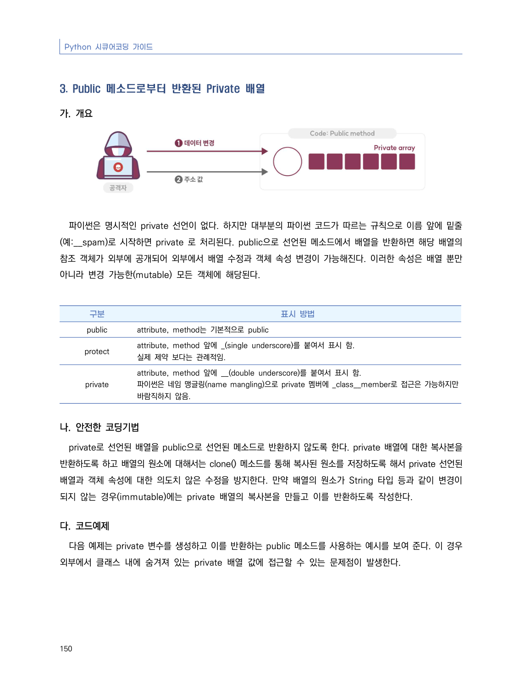
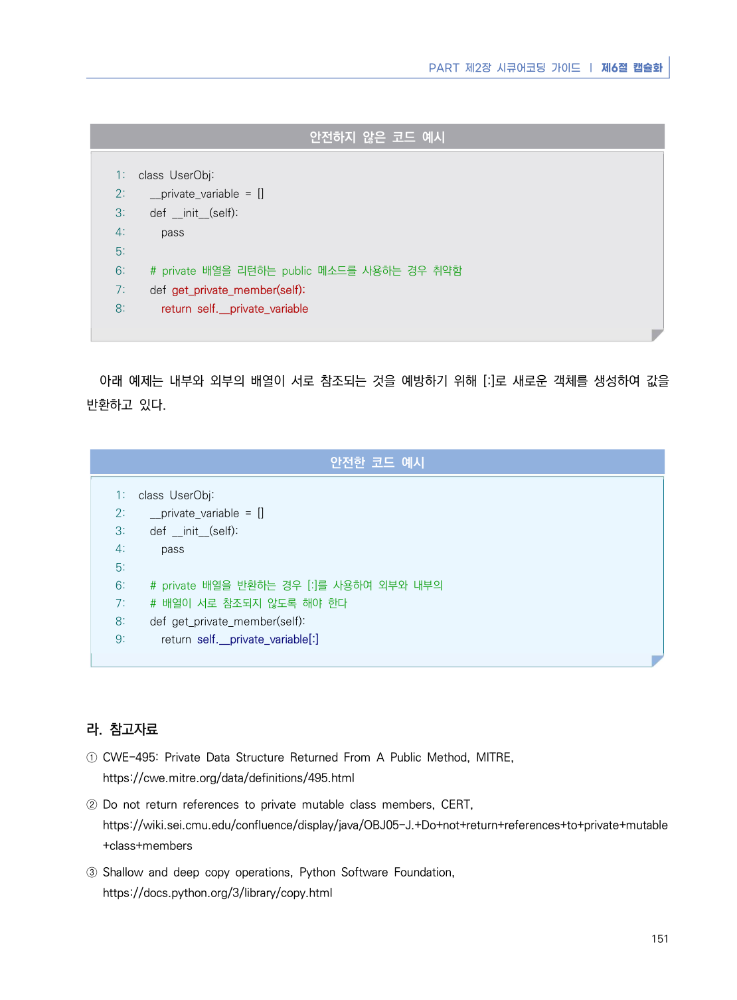

# 3. Public 메소드로부터 반환된 Private 배열

> 변환 안내(원문 외): 아래 본문은 PDF 텍스트를 추출한 전사입니다. 코드 줄번호·특수 공백·원문 오류를 유지했습니다. 실행용 코드가 아닙니다. 표·그림·들여쓰기는 연결된 페이지 이미지와 대조하세요. 페이지 경계의 줄바꿈을 보존하며, 동일 페이지가 여러 항목에 나뉘면 각 항목의 본문은 해당 구간만 포함합니다.

### PDF 156페이지 / 인쇄 150페이지

<!-- source-page:Python-2023:156; source-lines:0,1,2,3,4,5,6,7,8,9,10,11,12,13,14,15,16,17,18,19,20,21,22,23,24,25,26 -->

Python 시큐어코딩 가이드

150

#### 3. Public 메소드로부터 반환된 Private 배열

#### 가. 개요

파이썬은 명시적인 private 선언이 없다. 하지만 대부분의 파이썬 코드가 따르는 규칙으로 이름 앞에 밑줄
(예:__spam)로 시작하면 private 로 처리된다. public으로 선언된 메소드에서 배열을 반환하면 해당 배열의 
참조 객체가 외부에 공개되어 외부에서 배열 수정과 객체 속성 변경이 가능해진다. 이러한 속성은 배열 뿐만 
아니라 변경 가능한(mutable) 모든 객체에 해당된다.

구분

표시 방법

public

attribute, method는 기본적으로 public

protect

attribute, method 앞에 _(single underscore)를 붙여서 표시 함.
실제 제약 보다는 관례적임.

private

attribute, method 앞에 __(double underscore)를 붙여서 표시 함.
파이썬은 네임 맹글링(name mangling)으로 private 멤버에 _class__member로 접근은 가능하지만 
바람직하지 않음.

#### 나. 안전한 코딩기법

private로 선언된 배열을 public으로 선언된 메소드로 반환하지 않도록 한다. private 배열에 대한 복사본을 
반환하도록 하고 배열의 원소에 대해서는 clone() 메소드를 통해 복사된 원소를 저장하도록 해서 private 선언된 
배열과 객체 속성에 대한 의도치 않은 수정을 방지한다. 만약 배열의 원소가 String 타입 등과 같이 변경이 
되지 않는 경우(immutable)에는 private 배열의 복사본을 만들고 이를 반환하도록 작성한다.

#### 다. 코드예제

다음 예제는 private 변수를 생성하고 이를 반환하는 public 메소드를 사용하는 예시를 보여 준다. 이 경우 
외부에서 클래스 내에 숨겨져 있는 private 배열 값에 접근할 수 있는 문제점이 발생한다.

<details><summary>원본 페이지 이미지 (변환 외 보존 자료)</summary>



</details>

### PDF 157페이지 / 인쇄 151페이지

<!-- source-page:Python-2023:157; source-lines:0,1,2,3,4,5,6,7,8,9,10,11,12,13,14,15,16,17,18,19,20,21,22,23,24,25,26,27,28,29,30,31,32,33,34,35,36,37,38,39,40,41,42,43,44,45,46,47 -->

PART 제2장 시큐어코딩 가이드 ❘ 제6절 캡슐화

151

#### 안전하지 않은 코드 예시

```python
1: class UserObj:
2:   __private_variable = []
3:   def __init__(self):
4:     pass
5:     
6:   # private 배열을 리턴하는 public 메소드를 사용하는 경우 취약함
7:   def get_private_member(self):
8:     return self.__private_variable
```

아래 예제는 내부와 외부의 배열이 서로 참조되는 것을 예방하기 위해 [:]로 새로운 객체를 생성하여 값을 
반환하고 있다.

#### 안전한 코드 예시

```python
1: class UserObj:
2:   __private_variable = []
3:   def __init__(self):
4:     pass
5:     
6:   # private 배열을 반환하는 경우 [:]를 사용하여 외부와 내부의 
7:   # 배열이 서로 참조되지 않도록 해야 한다
8:   def get_private_member(self):
9:     return self.__private_variable[:]
```

#### 라. 참고자료

① CWE-495: Private Data Structure Returned From A Public Method, MITRE,

https://cwe.mitre.org/data/definitions/495.html
② Do not return references to private mutable class members, CERT,

https://wiki.sei.cmu.edu/confluence/display/java/OBJ05-J.+Do+not+return+references+to+private+mutable
+class+members
③ Shallow and deep copy operations, Python Software Foundation,

https://docs.python.org/3/library/copy.html

<details><summary>원본 페이지 이미지 (변환 외 보존 자료)</summary>



</details>

---

## 탐색 링크 (원문 외)

[통합 인덱스](../../../INDEX.md)

