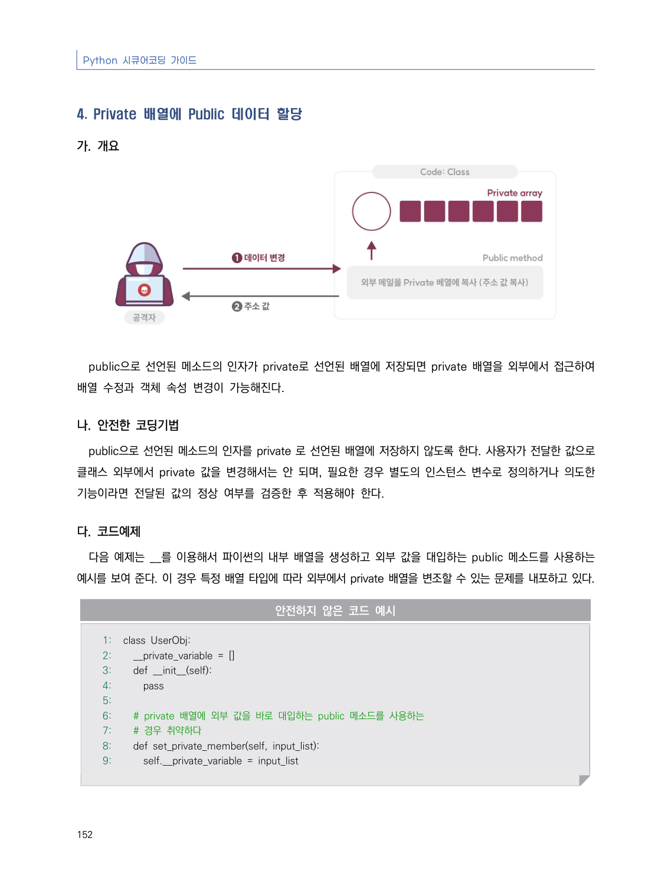
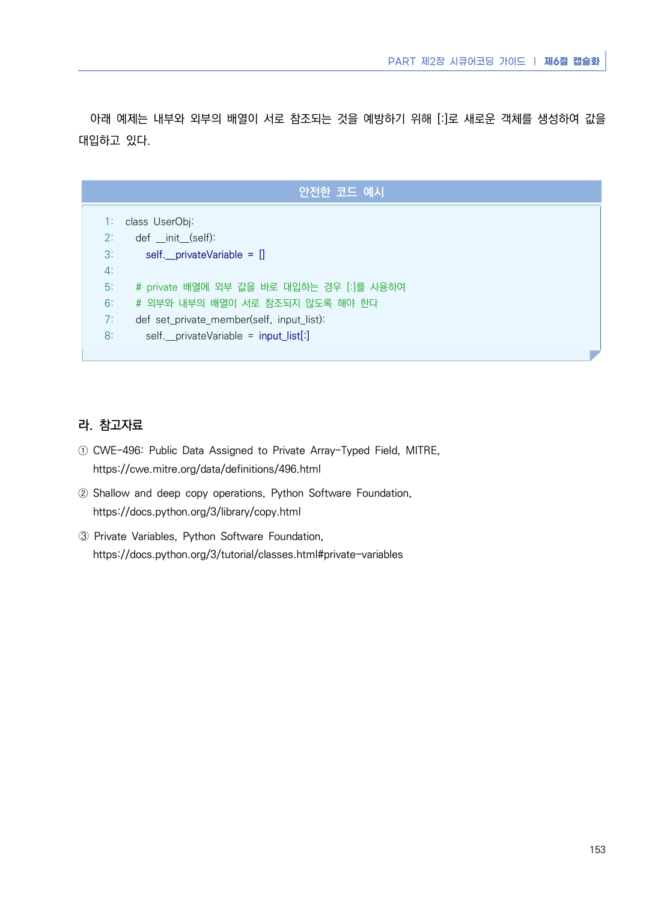

# 4. Private 배열에 Public 데이터 할당

> 변환 안내(원문 외): 아래 본문은 PDF 텍스트를 추출한 전사입니다. 코드 줄번호·특수 공백·원문 오류를 유지했습니다. 실행용 코드가 아닙니다. 표·그림·들여쓰기는 연결된 페이지 이미지와 대조하세요. 페이지 경계의 줄바꿈을 보존하며, 동일 페이지가 여러 항목에 나뉘면 각 항목의 본문은 해당 구간만 포함합니다.

### PDF 158페이지 / 인쇄 152페이지

<!-- source-page:Python-2023:158; source-lines:0,1,2,3,4,5,6,7,8,9,10,11,12,13,14,15,16,17,18,19,20,21,22,23,24,25,26,27,28,29,30 -->

Python 시큐어코딩 가이드

152

#### 4. Private 배열에 Public 데이터 할당

#### 가. 개요

public으로 선언된 메소드의 인자가 private로 선언된 배열에 저장되면 private 배열을 외부에서 접근하여 
배열 수정과 객체 속성 변경이 가능해진다.

#### 나. 안전한 코딩기법

public으로 선언된 메소드의 인자를 private 로 선언된 배열에 저장하지 않도록 한다. 사용자가 전달한 값으로 
클래스 외부에서 private 값을 변경해서는 안 되며, 필요한 경우 별도의 인스턴스 변수로 정의하거나 의도한 
기능이라면 전달된 값의 정상 여부를 검증한 후 적용해야 한다.

#### 다. 코드예제

다음 예제는 __를 이용해서 파이썬의 내부 배열을 생성하고 외부 값을 대입하는 public 메소드를 사용하는 
예시를 보여 준다. 이 경우 특정 배열 타입에 따라 외부에서 private 배열을 변조할 수 있는 문제를 내포하고 있다.

#### 안전하지 않은 코드 예시

```python
1: class UserObj:
2:   __private_variable = []
3:   def __init__(self):
4:     pass
5:
6:   # private 배열에 외부 값을 바로 대입하는 public 메소드를 사용하는 
7:   # 경우 취약하다
8:   def set_private_member(self, input_list):
9:     self.__private_variable = input_list
```

<details><summary>원본 페이지 이미지 (변환 외 보존 자료)</summary>



</details>

### PDF 159페이지 / 인쇄 153페이지

<!-- source-page:Python-2023:159; source-lines:0,1,2,3,4,5,6,7,8,9,10,11,12,13,14,15,16,17,18,19,20,21,22,23,24,25,26,27 -->

PART 제2장 시큐어코딩 가이드 ❘ 제6절 캡슐화

153

아래 예제는 내부와 외부의 배열이 서로 참조되는 것을 예방하기 위해 [:]로 새로운 객체를 생성하여 값을 
대입하고 있다.

#### 안전한 코드 예시

```python
1: class UserObj:
2:   def __init__(self):
3:     self.__privateVariable = []
4:     
5:   # private 배열에 외부 값을 바로 대입하는 경우 [:]를 사용하여 
6:   # 외부와 내부의 배열이 서로 참조되지 않도록 해야 한다
7:   def set_private_member(self, input_list):
8:     self.__privateVariable = input_list[:]
```

#### 라. 참고자료

① CWE-496: Public Data Assigned to Private Array-Typed Field, MITRE,

https://cwe.mitre.org/data/definitions/496.html
② Shallow and deep copy operations, Python Software Foundation,

https://docs.python.org/3/library/copy.html
➂ Private Variables, Python Software Foundation, 

https://docs.python.org/3/tutorial/classes.html#private-variables

<details><summary>원본 페이지 이미지 (변환 외 보존 자료)</summary>



</details>

---

## 탐색 링크 (원문 외)

[통합 인덱스](../../../INDEX.md)

